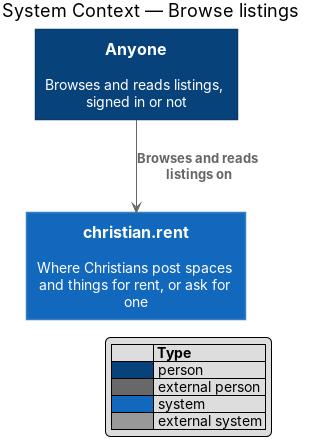
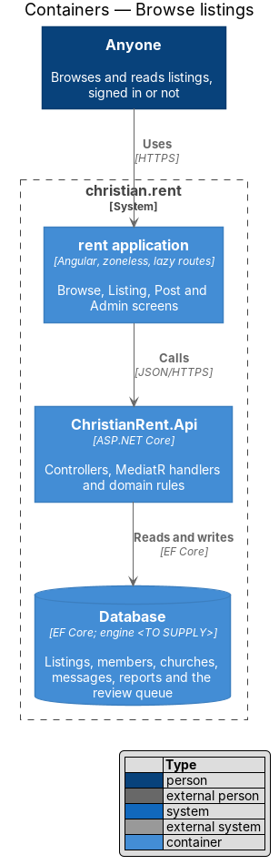
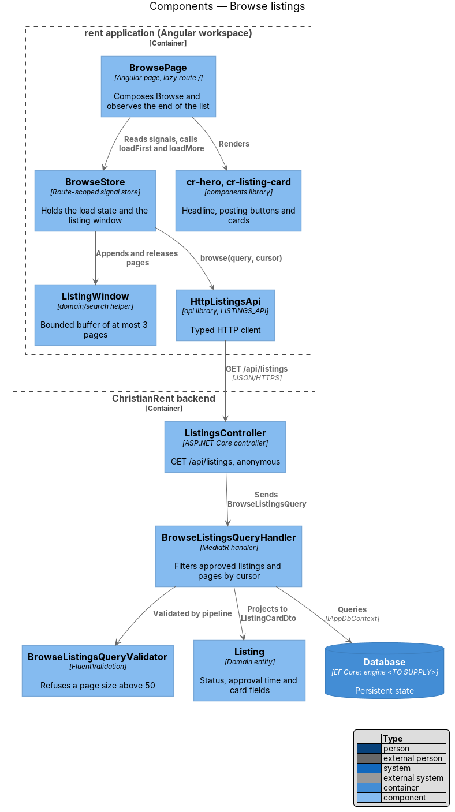
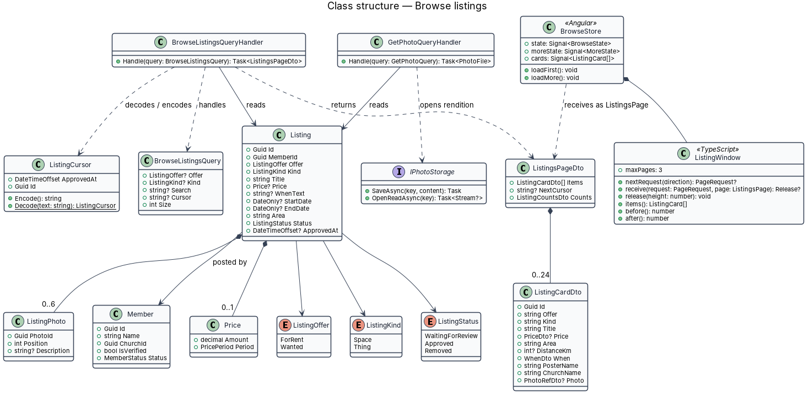
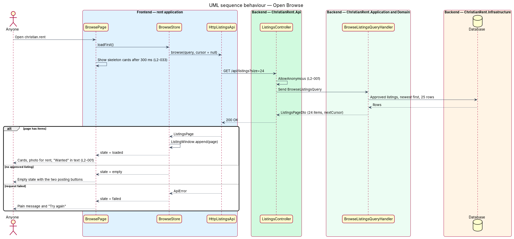
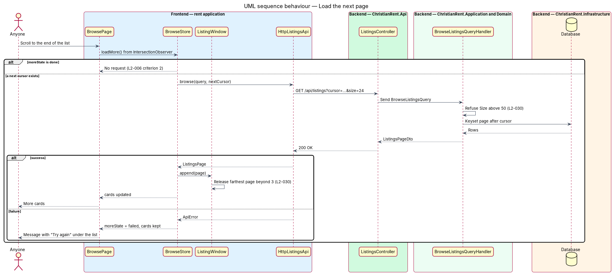

# Browse listings

## Overview

christian.rent is where Christians post spaces and things for rent, or ask for a space or a
thing to rent. Browse is its home screen, at the address `/`. It shows every approved
listing, newest first, to anyone, signed in or not. This feature covers loading that list,
drawing each listing as a card, growing the list page by page, and the two buttons that lead
to posting.

The terms used are the product's own:

- **listing** — post by a member that offers or asks for a space or a thing
- **for rent** — listing that offers something; its card shows a photo
- **wanted** — listing that asks for something; its card shows no photo
- **approved** — state of a listing an admin has let through the review queue; only an
  approved listing is public
- **page** — batch of at most 24 listings returned by one request
- **cursor** — opaque marker of the last listing of a page, sent to request the next page

Searching and filtering the same list is designed in
[search-and-filter-listings](../search-and-filter-listings/README.md). The shell around the
screen (header, wordmark, routing) is designed in
[present-app-shell](../../platform/present-app-shell/README.md).

## Description

The feature is a vertical slice from the Browse screen to the database. Nothing exists in
the codebase yet; every name below is introduced by this design.

**Frontend — `rent` application**

- **`BrowsePage`** (`rent/src/app/pages/browse/browse-page.ts`, selector `cr-browse-page`) —
  the page loaded by `loadComponent` for the route `/`. It composes the presentation
  components, provides `BrowseStore` in its own `providers`, and owns one
  `IntersectionObserver` on two sentinels: one after the last card, which asks for the next
  page, and one before the first, which asks again for a released page above it. Before a
  page is released it measures the page's height. The observer is disconnected, and the
  request in flight aborted, through `DestroyRef`.
- **`BrowseStore`** — route-scoped signal store. It holds `state` (`loading`, `loaded`,
  `empty`, `failed`), `moreState` (`idle`, `loading`, `failed`, `done`), the `ListingWindow`
  and the `counts`. `loadFirst()` and `loadMore()` call `LISTINGS_API`. A failed `loadMore()`
  leaves the window untouched and sets `moreState` to `failed` (L2-006, criterion 3).
  `moreState` `done` stops further requests (criterion 2).

**Frontend — `domain` library**

- **`ListingWindow`** (`domain/search/listing-window.ts`) — bounded buffer of pages
  ([ADR 0013](../../../adr/0013-browse-paging-and-window.md)). Each page it has seen is a slot
  holding the cursor that requested it; at most 3 consecutive slots (72 cards) hold their
  items. When a fourth page arrives at one end, the slot at the other end is released and
  keeps only its measured height, which a spacer reserves, so the scroll position holds and
  memory stays bounded over 500 listings (L2-030, criterion 4). Scrolling back to a spacer
  requests that released page again by its cursor. `before()` and `after()` give the spacer
  heights; `nextRequest('up' | 'down')` gives the cursor to ask for, or none.
- **`formatPrice`**, **`formatDistance`**, **`formatWhen`** (`domain/listings/`) — pure
  helpers that produce "$45 / hour", "Free", "Up to $120 / day", "3 km", "Sat, Aug 8, 2026"
  and "Jul 14 to 18, 2026" (L2-022). Each has a unit test per case.

**Frontend — `api` library**

- **`ListingsApi`** with the token **`LISTINGS_API`**, implemented by `HttpListingsApi`.
  `browse(query, cursor, signal)` returns `ListingsPage`.
- **`ListingsPage`** — `{ items: ListingCard[]; nextCursor: string | null; counts }`.
- **`ListingCard`** — `{ id, offer, kind, title, price, area, distanceKm, when, posterName,
  churchName, photo }`. `price` is `{ amount, period }` or `null`; `when` is
  `{ text, start, end }` with either the text or the two ISO dates; `photo` is
  `{ url, width, height, description }` or `null`, and `distanceKm` is null until a person's
  area is designed ([ADR 0012](../../../adr/0012-area-without-distance.md)).
- **`ListingCounts`** — `{ everything, forRent, wanted }`, the approved listings of each.

**Frontend — `components` library**

- **`cr-hero`** — the headline and the two buttons. "I have something to rent" links to
  `/post?offer=for-rent`; "I'm looking for something" links to `/post?offer=wanted` (L2-005).
- **`cr-listing-card`** — one card, a link to `/listings/{id}`. A for-rent card shows the
  first photo through `NgOptimizedImage` with `width`, `height` and a 4:3 box reserved before
  load; cards in the first row set `priority`, the rest load lazily (L2-029, criterion 3). The
  photo's description is its text alternative, and the `alt` is empty when it has none: the
  card's title already names the listing. A
  listing for rent with no photo shows the placeholder image, named "No photo yet". Under the
  photo the card shows a tag "space" or "thing", the title, the price, the area followed by
  the distance ("Langley · 3 km") and the church name (L2-001, criteria 7 and 9). A wanted
  card uses the `listing-card--wanted` modifier and shows no photo. It shows the tag
  "Wanted · space" or "Wanted · thing", the title, when it is needed, the poster's name, the
  price as "Up to $120 / day" when one was given, the area with its distance and the church
  name (criterion 8).
- **`cr-skeleton`**, **`cr-empty-state`**, **`cr-alert`** — the loading, empty and failed
  states. The skeleton cards appear 300 ms after the request starts and reserve the card
  shape (L2-033, criterion 5). While a further page is in flight, a spinner and "Loading more
  listings…" follow the last card (L2-006, criterion 4). In the failed state the header, the
  search bar and the switch stay (L2-033, criterion 6).
- **Count status** — `BrowsePage` holds a visually hidden `role="status"` line that reads
  "7 listings", "4 listings for rent", "3 wanted listings" or "Loading listings", so a
  screen reader hears each change of the list (L2-001, criterion 10).

**Backend**

- **`ListingsController.Browse`** — `GET /api/listings`, marked `[AllowAnonymous]`. It sends
  one `BrowseListingsQuery` and returns its result.
- **`BrowseListingsQuery`** — `{ Offer?, Kind?, Search?, Cursor?, Size = 24 }`. This journey
  reads `Cursor` and `Size`; search-and-filter adds the rest.
- **`BrowseListingsQueryValidator`** — refuses `Size` above 50 or below 1 with the code
  `page_size_out_of_range` (L2-030, criterion 3), and a cursor that does not decode with
  `cursor_invalid`. Both are 400 ProblemDetails.
- **`BrowseListingsQueryHandler`** — selects listings whose `Status` is `Approved` and whose
  poster is not removed, orders by `ApprovedAt` descending then `Id` descending, applies the
  cursor as a keyset predicate, takes `Size + 1` rows to learn whether a next page exists,
  and projects to `ListingCardDto` without tracking. Ordering by approval time keeps the
  keyset stable: a listing approved later than older posts enters at the head of the list.
- **`ListingCursor`** — value type that encodes `(ApprovedAt, Id)` as an opaque base64url
  string.
- **`Listing`** — domain entity. This slice reads `Offer`, `Kind`, `Title`, `Price`
  (`Amount`, `Period`), `WhenText`, `StartDate`, `EndDate`, `Area`, `Status`, `ApprovedAt`,
  its poster and the first `ListingPhoto` (`PhotoId`, `Position`, `Description`).
- **`Member`** — the poster: `Name`, `ChurchId`, `IsVerified`, `Status` (`Active`,
  `Removed`). A removed member's listings are not public.
- **`PhotosController.Get`** — `GET /api/photos/{id}/{rendition}`, `[AllowAnonymous]`. It
  sends one `GetPhotoQuery`. **`GetPhotoQueryHandler`** finds the listing that holds the
  photo; when that listing is public it opens `{id}/{rendition}.jpg` through `IPhotoStorage`
  and streams it with a year-long public `Cache-Control`. Otherwise, and for an unknown
  rendition, it answers `not_found` ([ADR 0011](../../../adr/0011-photo-renditions-and-serving.md)).
- **`ChristianRent.Cli seed`** — enters the mocks' cast: the members who posted, the seven
  approved listings of Browse and two listings waiting in the review queue, and the `card`
  renditions of their photos.

**Undecided**

- How a person's area is set, and so how `distanceKm` is measured: open
  ([ADR 0012](../../../adr/0012-area-without-distance.md); mocks open question 5). The mocks
  show the distance on every card of Browse (L2-001, criterion 9). `distanceKm` is null and
  the card shows the area alone until it is decided.
- Whether "newest first" counts from when a listing was posted or approved: settled by
  [ADR 0013](../../../adr/0013-browse-paging-and-window.md), which orders by `ApprovedAt`.
- What Browse shows when For rent, Wanted, Spaces or Things holds nothing and no search term
  is entered: the mocks draw no such state. The design shows the empty state of
  [`empty.html`](../../../mocks/pages/browse/empty.html).
- The database engine: PostgreSQL in development ([ADR 0003](../../../adr/0003-database-engine.md),
  Open for production). The migration adds the index on `(Status, ApprovedAt, Id)` that the
  300 ms at the 95th percentile over 10,000 approved listings needs (L2-030, criterion 1);
  measuring it against a real engine is outside the automated suites (ADR 0007).
- The value of the initial-bundle budget in `angular.json`: [ADR 0006](../../../adr/0006-bundle-budgets.md).
  Browse's own code is a lazy chunk, so the initial budget does not change.
- Until search-and-filter (journey 3) is built, Browse shows the headline and the list without
  the search bar and the switch that its mocks draw above the list.

### Mocks

The mocks are the source of truth for the UI of this feature. The states this design covers are:

- [`docs/mocks/pages/browse/default.html`](../../../mocks/pages/browse/default.html): the list with both kinds of card
- [`docs/mocks/pages/browse/loading.html`](../../../mocks/pages/browse/loading.html): skeleton cards
- [`docs/mocks/pages/browse/empty.html`](../../../mocks/pages/browse/empty.html): no approved listing; the two buttons that lead to posting
- [`docs/mocks/pages/browse/error.html`](../../../mocks/pages/browse/error.html): the first page failed; "Try again"
- [`docs/mocks/pages/browse/more-loading.html`](../../../mocks/pages/browse/more-loading.html): a further page is loading
- [`docs/mocks/pages/browse/more-error.html`](../../../mocks/pages/browse/more-error.html): a further page failed; the list stays
- [`docs/mocks/pages/browse/edge.html`](../../../mocks/pages/browse/edge.html): long titles, no photo, no price

## Requirements

The feature realizes the following level-2 (L2) requirements from
[`docs/specs/L2.md`](../../../specs/L2.md). Each L2 requirement refines a level-1 (L1)
requirement, cited by identifier. The table restates each requirement in `shall` form; the
acceptance criteria in the specification remain authoritative.

| L2 ID | Refines (L1) | Requirement |
|-------|--------------|-------------|
| `L2-001` | `L1-001` | Browse shall show approved listings, newest first, to anyone, signed in or not. A card for rent shall show its first photo, kind, title, price, area with its distance, and church. A wanted card shall show no photo, "Wanted" in text, its kind, title, when, poster, church, area and the price when given. The number of listings shall be announced. |
| `L2-005` | `L1-001` | Browse shall have two buttons, "I have something to rent" and "I'm looking for something", which shall open Post set to "I have" and to "I need". |
| `L2-006` | `L1-001` | Browse shall show the first 24 matching listings and shall load more as the person reaches the end of the list. "Loading more listings" shall show while a page is in flight. No request shall follow the last page. A page that fails to load shall leave the listings already shown and offer "Try again". |
| `L2-022` | `L1-009` | Prices shall be shown in Canadian dollars with their period, with cents only when not zero and a thousands separator. Distances shall be in kilometres. Dates shall write the month as a word, ranges shall use "to", and times shall be in 12-hour form. Copy shall use Canadian spelling. An area shall be a place in Canada. |
| `L2-029` | `L1-012` | On a mid-range phone on 4G, Browse shall paint its largest content within 2.5 s with layout shift under 0.1. The code for Listing, Post and Admin shall not be in the initial download. A card's photo shall be sized to the card, reserve its space and load lazily below the fold. A control shall respond within 200 ms. |
| `L2-030` | `L1-012` | With 10,000 approved listings, a page of Browse or a search shall respond within 300 ms and a single listing within 200 ms, at the 95th percentile. A list endpoint shall return at most one page and shall refuse a page size above 50. Browser memory shall stay bounded while a person scrolls 500 listings. |
| `L2-031` | `L1-013` | No screen shall be cut off or scroll sideways from 320 px. Browse shall show one column of cards under 576 px, two from 576 px, three from 768 px and four from 1200 px, with wider gutters from 992 px. From 768 px the message box, the live preview and the Admin detail panel shall sit beside their main column; below it they shall sit under it, and Admin shall show only the queue and a note that deciding needs a wider screen. A dialog shall be a bottom sheet under 640 px. Every touch target shall be at least 44 × 44 px. |
| `L2-033` | `L1-015` | A waiting screen shall show a loading state in the shape of what will arrive, and none when the request answers within 300 ms. An unreachable backend shall produce a plain message and "Try again". An address that matches no screen shall show "not found" with a way back to Browse. An unhandled backend error shall be a ProblemDetails with no stack trace, recorded with a trace id. |

## Diagrams

### System context

The people involved are: anyone. Each reaches the feature through christian.rent, which takes no payment and holds no booking calendar.

### Containers

The rent application calls `ChristianRent.Api` over JSON/HTTPS. The API persists state through EF Core.

### Components

`BrowsePage` renders from `BrowseStore`, which fills a `ListingWindow` through
`HttpListingsApi`. On the backend the controller sends one query; the handler reads `Listing`
rows through `IAppDbContext` and returns one page.

### Class structure

`Listing` carries the three enumerations that decide what Browse shows. The handler turns a
`BrowseListingsQuery` into a `ListingsPageDto` of at most 24 `ListingCardDto`. On the
frontend, `BrowseStore` owns one `ListingWindow`.

### Behaviour — open Browse

Opening `/` loads the first page without sign-in (`L2-001`). The failure branch shows the
plain message and "Try again" (`L2-033`); the empty branch shows the two posting buttons.

### Behaviour — load the next page

Reaching the sentinel requests the next page by cursor (`L2-006`). `ListingWindow` releases
the farthest page so that memory stays bounded (`L2-030`).

