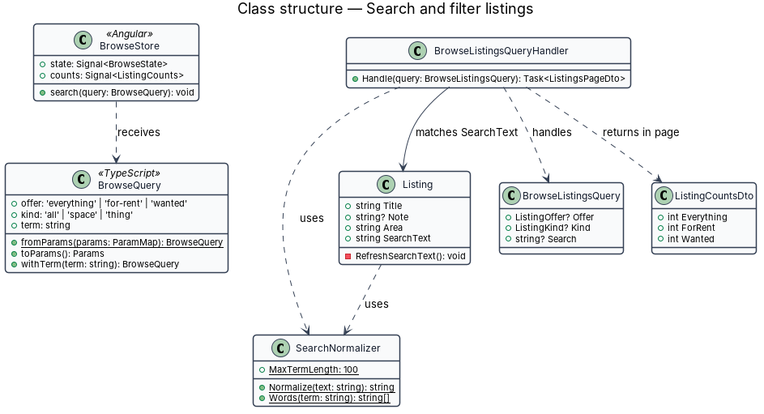
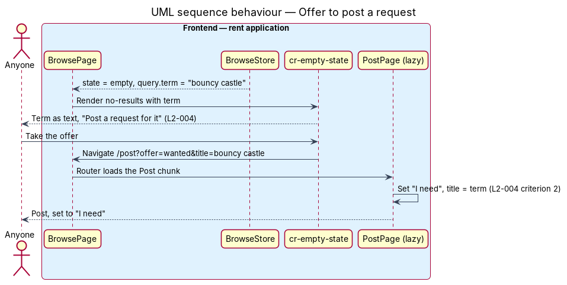

# Search and filter listings

## Overview

Browse lets anyone narrow the list of approved listings in two ways. The **switch** chooses
Everything, For rent or Wanted. The **search bar** finds listings by words in their title,
note and area. Both apply together, both live in the page address so that a reload or a
shared link restores them, and a search that finds nothing offers to post a wanted listing
for the same words.

- **switch** — control with the three options Everything, For rent and Wanted
- **search term** — text typed in the search bar, limited to its first 100 characters
- **normalized text** — lower-cased text with accents removed, used on both sides of a match
- **no-results state** — what Browse shows when a search matches no approved listing

The list itself, its paging and its memory bound are designed in
[browse-listings](../browse-listings/README.md). This feature adds the query to the same
endpoint and the same store.

## Description

**Frontend — `domain` library**

- **`BrowseQuery`** (`domain/search/browse-query.ts`) — immutable value
  `{ offer: 'everything' | 'for-rent' | 'wanted'; kind: 'all' | 'space' | 'thing'; term: string }`.
  `fromParams()` reads the query parameters `show`, `kind` and `q`; `toParams()` omits
  defaults, so the plain address `/` means Everything with no term. `withTerm()` trims the
  term and keeps its first 100 characters (L2-003, criterion 4).

**Frontend — `rent` application**

- **`BrowsePage`** — binds the three controls to the router. A change writes the query
  parameters with `router.navigate([], { queryParams, replaceUrl: true })`; the page derives
  `BrowseQuery` from `ActivatedRoute.queryParamMap`, so the address is the single source of
  the choice (L2-002, criteria 4 and 5).
- **`BrowseStore.search(query)`** — pipes query changes through `debounceTime(300)` and
  `switchMap`. `switchMap` unsubscribes the earlier request, which aborts it, so an earlier
  search never replaces a later result (L2-003, criterion 3). A change of the switch skips
  the debounce. The subscription ends with the route through `takeUntilDestroyed`. Unit tests
  advance a fake clock.

**Frontend — `components` library**

- **`cr-search-bar`** — a labelled search input and a Search button. It emits `termChange`
  on input and `submitted` on Enter or Search.
- **`cr-segmented`** — the switch. Each option is a button with `aria-pressed`, and shows
  the count returned in `counts` (L2-032, criterion 3).
- **`cr-kind-filter`** — All, Spaces, Things. It is in the mocks and the prototype; no
  requirement covers it (mocks open question 6). The design carries it as the `kind`
  parameter.
- **`cr-empty-state`** (no-results variant) — names the term through text interpolation,
  never as HTML (L2-003, criterion 5). Its action links to `/post?offer=wanted&title={term}`
  (L2-004).

**Backend**

- **`BrowseListingsQuery.Search`**, **`.Offer`**, **`.Kind`** — the same query as
  [browse-listings](../browse-listings/README.md).
- **`SearchNormalizer`** (`ChristianRent.Domain`) — `Normalize(text)` lower-cases with the
  invariant culture, decomposes to Unicode form D and drops combining marks. `Words(term)`
  truncates to 100 characters, normalizes and splits on white space.
- **`Listing.SearchText`** — normalized concatenation of title, note and area, set by the
  entity whenever one of the three changes.
- **`BrowseListingsQueryHandler`** — adds one `SearchText.Contains(word)` predicate per word,
  so every word shall match. The term reaches the database as a parameter (L2-026).
- **`ListingCountsDto`** — `{ Everything, ForRent, Wanted }` for the current term and kind,
  shown on the switch.

**Undecided**

- Whether the Spaces and Things filter stays, and its requirement: `<TO SUPPLY>`.
- The index that serves `Contains` within 300 ms over 10,000 listings (L2-030), which depends
  on the database engine: `<TO SUPPLY>`.
- The location text "Langley, BC · within 25 km" in the search bar is static in the mocks;
  how the area is chosen is `<TO SUPPLY>`.

### Mocks

The mocks are the source of truth for the UI of this feature. The states this design covers are:

- [`docs/mocks/pages/browse/for-rent.html`](../../../mocks/pages/browse/for-rent.html): the switch on For rent
- [`docs/mocks/pages/browse/wanted.html`](../../../mocks/pages/browse/wanted.html): the switch on Wanted
- [`docs/mocks/pages/browse/no-results.html`](../../../mocks/pages/browse/no-results.html): the term named, with the offer to post a request
- [`docs/mocks/pages/browse/default.html`](../../../mocks/pages/browse/default.html): Everything, with counts on the switch

## Requirements

The feature realizes the following level-2 (L2) requirements from
[`docs/specs/L2.md`](../../../specs/L2.md). Each L2 requirement refines a level-1 (L1)
requirement, cited by identifier. The table restates each requirement in `shall` form; the
acceptance criteria in the specification remain authoritative.

| L2 ID | Refines (L1) | Requirement |
|-------|--------------|-------------|
| `L2-002` | `L1-001` | A switch on Browse shall limit the list to listings for rent, to wanted listings, or show both. Everything shall be the default. The choice and the search term shall apply together and shall be restored from the address. |
| `L2-003` | `L1-001` | The search bar shall find approved listings by words in their title, note and area, without regard to letter case or accents. The list shall update 300 ms after typing pauses, an earlier search shall never replace a later result, and only the first 100 characters of a term shall be used. |
| `L2-004` | `L1-001` | A search that matches no approved listing shall show a no-results state that names the search term and offers to post a wanted listing for it. Taking the offer shall open Post set to "I need" with the term as the title. |
| `L2-026` | `L1-011` | A title, note, message, member name or church name shall be rendered as text wherever it is shown. Every input shall be validated for type, length and range before use, and database access shall be parameterised. Every response shall carry a Content-Security-Policy that allows no inline script and no third-party script. |
| `L2-030` | `L1-012` | With 10,000 approved listings, a page of Browse or a search shall respond within 300 ms and a single listing within 200 ms, at the 95th percentile. A list endpoint shall return at most one page and shall refuse a page size above 50. Browser memory shall stay bounded while a person scrolls 500 listings. |
| `L2-032` | `L1-014` | Every screen shall meet WCAG 2.2 level AA. Every action shall be completable by keyboard with visible focus. A state shall be carried by text or an announced attribute, never by colour alone. Confirmations and errors shall be announced. Every field shall have a visible label with its error tied to it. Reduced motion shall be honoured, and text at 200% shall lose nothing. |

## Diagrams

### System context

The people involved are: anyone. Each reaches the feature through christian.rent, which takes no payment and holds no booking calendar.

### Containers

The rent application calls `ChristianRent.Api` over JSON/HTTPS. The API persists state through EF Core.

### Components

The controls emit to `BrowsePage`, which writes the address and derives a `BrowseQuery` from
it. `BrowseStore` debounces and calls the same endpoint as plain browsing. The handler asks
`SearchNormalizer` for the words and matches them against `Listing.SearchText`.

### Class structure

`BrowseQuery` is the frontend value that mirrors `BrowseListingsQuery`. `SearchNormalizer` is
used twice: by `Listing` when its text changes and by the handler for the term.

### Behaviour — search while typing

Typing writes the address, and the store waits 300 ms before one request leaves. A newer
term cancels the request in flight (`L2-003`). The switch and the term apply together
(`L2-002`).

### Behaviour — offer to post a request

An empty result shows the no-results state with the term as text. Taking the offer opens
Post set to "I need" with the term as the title (`L2-004`).

