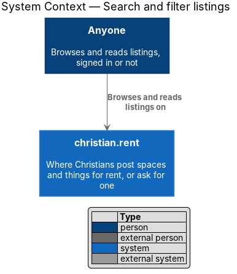
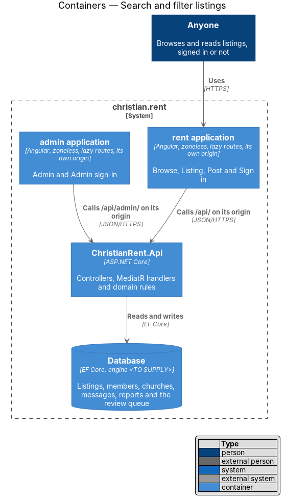
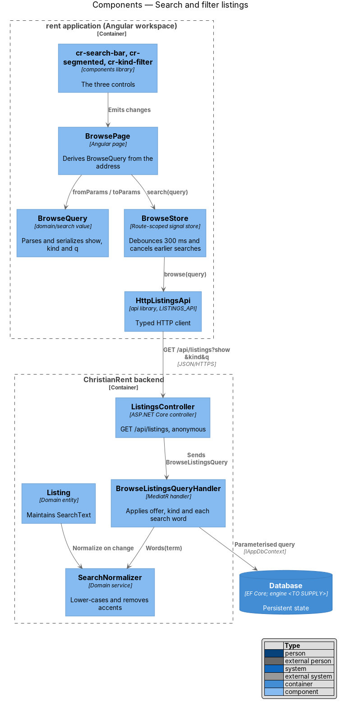
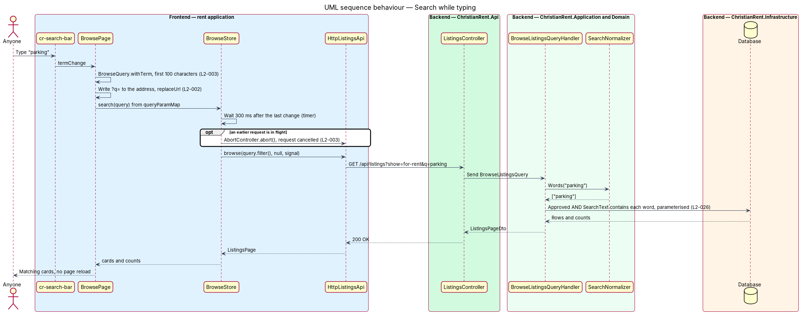

# Search and filter listings

## Overview

Browse lets anyone narrow the list of approved listings in three ways. The **switch** chooses
Everything, For rent or Wanted. The **kind filter** chooses All, Spaces or Things. The
**search bar** finds listings by words in their title, note and area. All three apply
together. The switch and the search term live in the page address so that a reload or a
shared link restores them, and a search that finds nothing offers to post a wanted listing
for the same words.

- **switch** — control with the three options Everything, For rent and Wanted
- **kind filter** — control with the three options All, Spaces and Things
- **search term** — text typed in the search bar, limited to its first 100 characters
- **normalized text** — lower-cased text with accents removed, used on both sides of a match
- **no-results state** — what Browse shows when a search matches no approved listing

The list itself, its paging and its memory bound are designed in
[browse-listings](../browse-listings/README.md). This feature adds the query to the same
endpoint and the same store.

## Description

**Frontend — `api` library**

- **`ListingsFilter`** — `{ offer: 'for-rent' | 'wanted' | null; kind: 'space' | 'thing' | null;
  term: string }`, what `ListingsApi.browse(filter, cursor, signal)` sends. `HttpListingsApi`
  writes it as the parameters `show`, `kind` and `q`, and omits each that is null or empty.

**Frontend — `domain` library**

- **`BrowseQuery`** (`domain/search/browse-query.ts`) — immutable value
  `{ offer: 'everything' | 'for-rent' | 'wanted'; kind: 'all' | 'space' | 'thing'; term: string }`.
  `fromParams()` reads the query parameters `show`, `kind` and `q`, and takes an unknown value
  as the default; `toParams()` omits defaults and a term of white space, so the plain address
  `/` means Everything, All and no term. `withTerm()` keeps the term's first 100 characters
  as typed (L2-003, criterion 4); `filter()` gives the `ListingsFilter` with the term trimmed.
  `withOffer()`, `withKind()` and `equals()` complete it. Unit tests cover each parameter.

**Frontend — `rent` application**

- **`BrowsePage`** — binds the three controls to the router. A choice on the kind filter and
  each change of the term writes the query parameters with
  `router.navigate([], { queryParams, replaceUrl: true })`; the switch's options are links, so
  each choice is an entry in the history. The page derives `BrowseQuery` from
  `ActivatedRoute.queryParamMap`, so the address is the single source of the choice, and a
  reload, the back button or a shared link restores it (L2-002, criteria 4 and 5; L2-035,
  criterion 5).
- **`BrowseStore.search(query, { now })`** — a query whose term alone changed waits 300 ms
  after the last change before its request leaves; a change of the switch or the kind filter,
  the first query and a submission (`now`) leave at once. Each request has its own
  `AbortController`, and a newer query aborts the one in flight, so an earlier search never
  replaces a later result (L2-003, criterion 3). A query equal to the one shown or awaited is
  ignored. Leaving Browse clears the timer and aborts the request. `counts` holds the counts of
  the last page, and null while the first page loads or has failed (L2-002, criterion 6).
  `state` is `no-results` when a search finds nothing and `empty` when nothing is found without
  a term; `term` is the term as the request sent it. Unit tests advance a fake clock.
- **`PageFocus`** and **`RentTitleStrategy`** (the shell) — a change of the query alone is the
  same screen: focus stays in the search field or on the control the person used, and the
  title is not announced again (L2-032, criterion 2;
  [present-app-shell](../../platform/present-app-shell/README.md)).

**Frontend — `components` library**

- **`cr-search-bar`** — a search input labelled "Search listings" with `maxlength` 100, and
  a Search button. It emits `termChange` on input and `submitted` on Enter or Search; a
  submission searches without waiting (L2-003, criterion 6). Escape empties the field. Between
  the input and the button it shows the area as text, and the distance after it when one is
  given: "Langley, BC", or "Langley, BC · within 25 km" once a person's area can be set
  ([ADR 0012](../../../adr/0012-area-without-distance.md)); the line is not a control
  (criterion 7).
- **`cr-segmented`** — the switch, a `nav` named "Show". Each option is a link to the same
  screen with its `show` parameter and the others kept. The selected option carries
  `aria-current="true"` (L2-032, criterion 3). Each option shows the count it is given, and no
  count while the list is loading or has failed (L2-002, criterion 6).
- **`cr-kind-filter`** — All, Spaces, Things in a group named "Kind" (L2-035). Each option is a
  button with `aria-pressed`, and All is pressed by default; it emits `kindChange`.
- **`cr-empty-state`** (no-results) — `BrowsePage` gives it the title "Nobody has “{term}”
  yet.", through text interpolation, never as HTML (L2-003, criterion 5). Its action "Ask for
  “{term}”" links to `/post?offer=wanted&title={term}` (L2-004, criterion 2). Its second
  action, "Clear search", is a link to the same address without `q` (criterion 3).
- **Count status** — the status line reads "7 listings", "4 listings for rent", "3 wanted
  listings" (and "1 listing for rent", "1 wanted listing"), or "No listings match “{term}”."
  when a search finds nothing.

**Backend**

- **`GET /api/listings`** — takes `show` (`for-rent` or `wanted`), `kind` (`space` or `thing`)
  and `q`, beside `cursor` and `size`, and sends them as one **`BrowseListingsQuery`**
  `{ Cursor, Size, Show, Kind, Search }`.
- **`BrowseListingsQueryValidator`** — refuses a `show` other than `for-rent` or `wanted` with
  `show_invalid`, and a `kind` other than `space` or `thing` with `kind_invalid` (L2-026,
  criterion 2). A term longer than 100 characters is cut, not refused.
- **`SearchNormalizer`** (`ChristianRent.Domain`) — `Normalize(text)` lower-cases with the
  invariant culture, decomposes to Unicode form D and drops combining marks. `Words(term)`
  truncates to 100 characters, normalizes and splits on white space.
- **`Listing.SearchText`** — normalized concatenation of title, note and area, set by the
  entity whenever one of the three is set. The migration `SearchListings` adds the column,
  fills it for the listings already there with `lower(unaccent(...))`, enables `pg_trgm` and
  adds a GIN trigram index on it
  ([ADR 0015](../../../adr/0015-search-matching-and-browse-query.md)). The backend builds with
  ICU, which Unicode normalisation needs.
- **`BrowseListingsQueryHandler`** — adds one `SearchText.Contains(word)` predicate per word,
  so every word shall match, and the offer and the kind when given. The term reaches the
  database as a parameter (L2-026).
- **`ListingCountsDto`** — `{ Everything, ForRent, Wanted }` for the current term and kind,
  shown on the switch.
- **Telemetry** — the route is recorded as its template; the scrubber removes the query
  string, so no term reaches a log, a metric or a span (L2-028, criterion 3).

**Decided since the first draft**

- The choice of Spaces or Things is kept in the address as `kind`, with the switch and the
  term (L2-035, criterion 5; [ADR 0015](../../../adr/0015-search-matching-and-browse-query.md)).
- How a term matches: every word, inside the normalised title, note and area, served on
  PostgreSQL by a trigram index (ADR 0015).
- What Browse shows when a choice holds nothing and no term is entered: the empty state of
  [`empty.html`](../../../mocks/pages/browse/empty.html) (ADR 0015).
- The store debounces with a timer and cancels with an `AbortController`, as `BrowseStore`
  already pages, rather than with `debounceTime` and `switchMap`: the behaviour is the same,
  and the store keeps one way of making requests.

**Undecided**

- What Post shows when a term of 81 to 100 characters becomes the title, which takes 80: L1
  lists it as not yet decided. The design passes the term unchanged, and Post marks the
  title invalid on submission.
- How the area is chosen, and so the distance in the search bar: open
  ([ADR 0012](../../../adr/0012-area-without-distance.md)). The bar shows "Langley, BC" alone.
- Measuring the 300 ms at the 95th percentile against a real engine stays outside the
  automated suites ([ADR 0007](../../../adr/0007-test-approach.md)).

### Mocks

The mocks are the source of truth for the UI of this feature. The states this design covers are:

- [`docs/mocks/pages/browse/for-rent.html`](../../../mocks/pages/browse/for-rent.html): the switch on For rent
- [`docs/mocks/pages/browse/wanted.html`](../../../mocks/pages/browse/wanted.html): the switch on Wanted
- [`docs/mocks/pages/browse/no-results.html`](../../../mocks/pages/browse/no-results.html): the term named, with the offer to post a request
- [`docs/mocks/pages/browse/default.html`](../../../mocks/pages/browse/default.html): Everything, with counts on the switch, the kind filter on All and the area line in the search bar
- [`docs/mocks/pages/browse/loading.html`](../../../mocks/pages/browse/loading.html): the switch with no counts
- [`docs/mocks/pages/browse/spaces.html`](../../../mocks/pages/browse/spaces.html): the kind filter on Spaces, with the counts for spaces

## Requirements

The feature realizes the following level-2 (L2) requirements from
[`docs/specs/L2.md`](../../../specs/L2.md). Each L2 requirement refines a level-1 (L1)
requirement, cited by identifier. The table restates each requirement in `shall` form; the
acceptance criteria in the specification remain authoritative.

| L2 ID | Refines (L1) | Requirement |
|-------|--------------|-------------|
| `L2-002` | `L1-001` | A switch on Browse shall limit the list to listings for rent, to wanted listings, or show both. Everything shall be the default. The choice and the search term shall apply together and shall be restored from the address. Each option shall show its number of listings for the current term and kind, and no number while the list loads or has failed. |
| `L2-003` | `L1-001` | The search bar shall find approved listings by words in their title, note and area, without regard to letter case or accents. The list shall update 300 ms after typing pauses, an earlier search shall never replace a later result, and only the first 100 characters of a term shall be used. The bar shall have a field named "Search listings", a "Search" button, and the person's area with its distance as text (the area alone until it can be set). |
| `L2-004` | `L1-001` | A search that matches no approved listing shall show a no-results state that names the search term and offers to post a wanted listing for it. Taking the offer shall open Post set to "I need" with the term as the title. The state shall also offer "Clear search". |
| `L2-035` | `L1-001` | A second control on Browse shall limit the list to listings for a space, to listings for a thing, or show both. All shall be the default. Its choice shall apply together with the switch and the search term and shall be restored from the address. Each option shall be a button whose state says whether it is selected. |
| `L2-026` | `L1-011` | A title, note, message, member name or church name shall be rendered as text wherever it is shown. Every input shall be validated for type, length and range before use, and database access shall be parameterised. Every response shall carry a Content-Security-Policy that allows no inline script and no third-party script. |
| `L2-030` | `L1-012` | With 10,000 approved listings, a page of Browse or a search shall respond within 300 ms and a single listing within 200 ms, at the 95th percentile. A list endpoint shall return at most one page and shall refuse a page size above 50. Browser memory shall stay bounded while a person scrolls 500 listings. |
| `L2-032` | `L1-014` | Every screen shall meet WCAG 2.2 level AA. Every action shall be completable by keyboard with visible focus. A state shall be carried by text or an announced attribute, never by colour alone. Confirmations and errors shall be announced. Every field shall have a visible label with its error tied to it. Reduced motion shall be honoured, and text at 200% shall lose nothing. "Skip to content" shall be the first control, and a dialog shall hold focus and return it on close. |

## Diagrams

### System context

The people involved are: anyone. Each reaches the feature through christian.rent, which takes no payment and holds no booking calendar.

### Containers

The rent application calls `ChristianRent.Api` over JSON/HTTPS. The API persists state through EF Core.

### Components

The controls emit to `BrowsePage`, which writes the address and derives a `BrowseQuery` from
it. `BrowseStore` debounces and calls the same endpoint as plain browsing. The handler asks
`SearchNormalizer` for the words and matches them against `Listing.SearchText`.

### Class structure

`BrowseQuery` is the frontend value that mirrors `BrowseListingsQuery`. `SearchNormalizer` is
used twice: by `Listing` when its text changes and by the handler for the term.

### Behaviour — search while typing

Typing writes the address, and the store waits 300 ms before one request leaves. A newer
term cancels the request in flight (`L2-003`). The switch, the kind filter and the term
apply together (`L2-002`, `L2-035`).

### Behaviour — offer to post a request

An empty result shows the no-results state with the term as text. Taking the offer opens
Post set to "I need" with the term as the title (`L2-004`).

