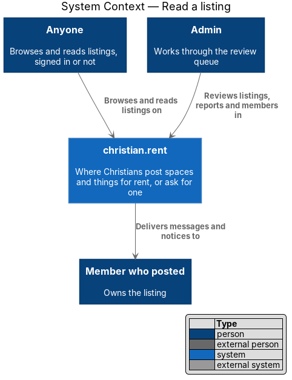
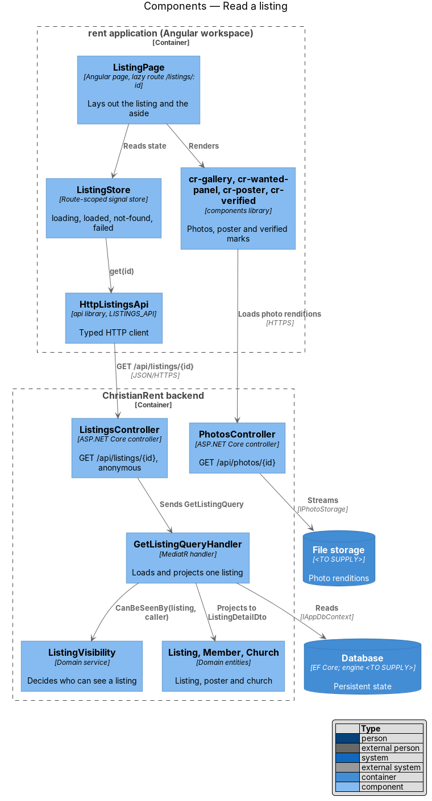
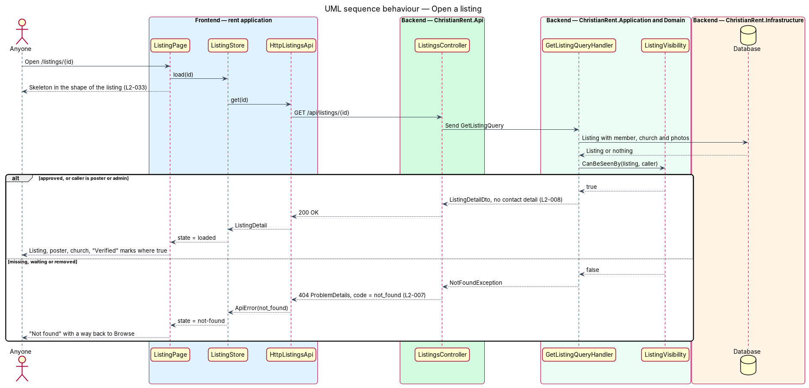

# Read a listing

## Overview

The Listing screen, at `/listings/{id}`, shows one approved listing to anyone: what it is,
what it costs, when it is available, roughly where it is, who posted it and which church
they belong to. A listing for rent shows its photos in a gallery; a wanted listing shows a
blue panel in place of a photo.

- **poster** — member who posted the listing
- **church** — congregation a member belongs to
- **verified** — confirmed by an admin; a member and a church are verified separately
- **area** — city or neighbourhood of a listing, never a street address
- **not found** — single answer given for a listing that does not exist, is waiting for
  review or has been removed, so that nothing about it is revealed

The message box beside the listing is designed in
[send-message](../../messages/send-message/README.md), and the Report button in
[report-listing](../../reports/report-listing/README.md).

## Description

**Frontend — `rent` application**

- **`ListingPage`** (`rent/src/app/pages/listing/listing-page.ts`, selector `cr-listing-page`)
  — lazy page for `/listings/:id`, loaded by `listing.routes.ts`, which binds `LISTINGS_API` to
  `HttpListingsApi` for the route. It provides `ListingStore`, reads the `id` route input, and
  composes `cr-listing-toolbar`, `cr-listing-layout`, `cr-listing` and `cr-message-box`: one
  column under 768 px, the aside to the right from 768 px (L2-031, criterion 3). Once the
  listing has loaded it sets the document title to the listing's title through
  `RentTitleStrategy.setPageTitle` ("Listing not found" for the not-found state) (ADR 0016).
- **`ListingStore`** (`rent/src/app/pages/listing/listing-store.ts`) — route-scoped store with
  `state`: `loading`, `loaded`, `not-found`, `failed`, and `skeleton`, true once the request
  has waited 300 ms (L2-033, criteria 1 and 5). `load(id)` calls `LISTINGS_API.get(id, signal)`
  and aborts the request, and clears the skeleton's timer, when the route is destroyed. An
  `ApiError` with the code `not_found` maps to `not-found`; any other failure maps to `failed`
  with "Try again". It turns the `ListingDetail` into a `ListingView` with `toListingView`.

**Frontend — `domain` library**

- **`toListingView(detail, now)`** (`domain/src/listings/listing-view.ts`) — writes every word
  the screen shows (L2-022): the tag ("For rent · space", "Wanted · thing"), the place
  (`formatPlace`), "when" (`formatWhen`), "Posted 2 days ago" (`formatAge`), the photos with
  their text alternatives, the poster's initials (`initialsOf`), tint (`avatarTint`) and "Member
  since 2023", and the message box's head ("Rent for", "$45", "CAD / hour").
- **`formatAge(from, now)`** — "just now", then minutes, hours, days, weeks, months and years,
  rounded down (ADR 0016).
- **`initialsOf(name)`**, **`firstNameOf(name)`**, **`avatarTint(name)`** — the first letters
  of the first two words skipping "Pastor", "Dr." and "The"; the first such word; one of `leaf`,
  `sky` and `sun` from the initials (ADR 0016).

**Frontend — `components` library**

- **`cr-listing-toolbar`** — the `listing-toolbar` block: `cr-back-link` "All listings", a link
  back to Browse (L2-007, criterion 8), and a slot for the Report button (journey 9).
- **`cr-back-link`** — the `back-link` block: an arrow and a label, linking to `href`.
- **`cr-listing-layout`** — the `listing-layout` block: the listing, and an `aside` slot that
  sits under it below 768 px and to its right, sticky, from 768 px.
- **`cr-listing`** — the `listing` block, from a `ListingView`: `cr-gallery` for a listing for
  rent or `cr-wanted-panel` for a wanted one, `cr-tag` with the kind, the title as the screen's
  `h1`, the facts (place, "when" for a listing for rent, "Posted 2 days ago"), the note, and
  `cr-poster`. Every member-written word is rendered as text (L2-026).
- **`cr-gallery`** — one large photo above a row of thumbnails. Thumbnails are buttons; Tab
  reaches each, Enter shows it, and the left and right arrow keys show the photo before or after
  and move focus to its thumbnail (L2-007, criterion 3). The large photo carries the photo's
  description as its text alternative. Each thumbnail is named "Photo {n} of {count}", has an
  empty `alt` and carries `aria-current` when shown. A polite live region reads "Photo 1 of
  3" (criterion 7). One photo shows alone, with no thumbnails and no count; none shows "No photo
  yet" (criterion 9; ADR 0016). The large photo is the `gallery` rendition, loaded with
  priority; thumbnails are the `thumb` rendition.
- **`cr-wanted-panel`** — the head of a wanted listing, with no photo: its tag, its title as the
  `h1`, and when it is needed.
- **`cr-poster`** — `cr-avatar` with the member's initials, the member name, church name and
  "Member since {year}" (L2-008, criterion 6).
- **`cr-avatar`** — the initials on one of three tints; decorative (`aria-hidden`).
- **`cr-verified`** — an icon and the word "Verified", followed by a visually hidden "member" or
  "church". `cr-poster` renders one beside the member and one beside the church, each only when
  its flag is true (L2-008).
- **`cr-tag`** — "For rent · space", "Wanted · thing".
- **`cr-message-box`** — the panel beside the listing. This journey builds its head: the
  visually hidden heading, "Rent for" or "They'll pay", and the price with its currency (L2-007,
  criterion 10; L2-022, criterion 9). Journey 8 adds the form and its states (ADR 0016).
- **`cr-skeleton`**, **`cr-plain-page`** — loading, failed and not-found states.

The screen has no payment control, no calendar, no review, no rating and no advert; "when"
is a line of text (L2-024).

**Frontend — `api` library**

- **`ListingsApi.get(id, signal)`** returns **`ListingDetail`**: `{ id, offer, kind, title,
  price, when, area, distanceKm, note, postedAt, photos, poster, isOwn, reportedAt }`. Each photo is
  `{ url, thumbUrl, width, height, description }`; `poster` is
  `{ name, isVerified, memberSince, church: { name, isVerified } }`. `reportedAt` is when the
  caller reported this listing, and null for everyone else (ADR 0023).
- **`ListingView`** — what `cr-listing` and `cr-message-box` draw, every word already written.

**Backend**

- **`ListingsController.Get`** — `GET /api/listings/{id}`, `[AllowAnonymous]`. An `id` that
  is not a GUID is sent as an unknown one, so it gets the same answer (ADR 0016).
- **`GetListingQuery`** — `{ Id }`.
- **`GetListingQueryHandler`** — loads the listing with its member, church and photos, then
  asks `ListingVisibility.CanBeSeenBy`. A listing that cannot be seen, or does not exist,
  raises `NotFoundException`, returned as a 404 ProblemDetails with the code `not_found` in
  both cases (L2-007, criterion 4; L2-025, criterion 2).
- **`ListingVisibility`** (`ChristianRent.Domain`) — a listing can be seen when it is
  `Approved` and its poster is active, or when the caller is its poster or an admin.
- **`ListingDetailDto`**, **`ListingPhotoDto`**, **`PosterDto`**, **`ChurchDto`** — the
  response. `PostedAt` is the listing's `CreatedAt`; `MemberSince` is the year the member
  joined; `DistanceKm` is null while ADR 0012 is Open; each photo carries its `gallery` and
  `thumb` renditions' addresses (ADR 0011). `PosterDto` has no email address, phone number or
  street address property, so none can be serialized (L2-008, criterion 5).
- **`PhotosController.Get`** — serves each photo rendition from file storage with the same
  visibility rule; see [add-photos](../../post/add-photos/README.md).

The response time target is 200 ms at the 95th percentile (L2-030, criterion 2); the query
is one read by primary key with three includes.

**Decided** (ADR 0016)

- `distanceKm` is null and the area is shown alone while ADR 0012 is Open.
- A photo with no description is described by the listing's title and its position. Journey 7
  left who writes descriptions open, and an uploaded photo has none (ADR 0021).
- What the poster sees on their own listing beyond "This is your listing" stays undecided:
  editing and taking down are `<TO SUPPLY>` ("My listings" is not designed). `isOwn` is in the
  response; the `own` state is built with the message box in journey 8.

### Mocks

The mocks are the source of truth for the UI of this feature. The states this design covers are:

- [`docs/mocks/pages/listing/default.html`](../../../mocks/pages/listing/default.html): a listing for rent, member and church verified
- [`docs/mocks/pages/listing/wanted.html`](../../../mocks/pages/listing/wanted.html): a wanted listing; only the member verified
- [`docs/mocks/pages/listing/unverified.html`](../../../mocks/pages/listing/unverified.html): neither verified; no mark shown
- [`docs/mocks/pages/listing/own.html`](../../../mocks/pages/listing/own.html): the poster's own listing
- [`docs/mocks/pages/listing/loading.html`](../../../mocks/pages/listing/loading.html): skeleton in the shape of the listing
- [`docs/mocks/pages/listing/error.html`](../../../mocks/pages/listing/error.html): failed; "Try again"
- [`docs/mocks/pages/listing/not-found.html`](../../../mocks/pages/listing/not-found.html): not found, with a way back to Browse
- [`docs/mocks/pages/listing/edge.html`](../../../mocks/pages/listing/edge.html): one photo, the longest title and names, a price with cents, no note

## Requirements

The feature realizes the following level-2 (L2) requirements from
[`docs/specs/L2.md`](../../../specs/L2.md). Each L2 requirement refines a level-1 (L1)
requirement, cited by identifier. The table restates each requirement in `shall` form; the
acceptance criteria in the specification remain authoritative.

| L2 ID | Refines (L1) | Requirement |
|-------|--------------|-------------|
| `L2-007` | `L1-002` | The Listing screen shall show an approved listing's photos (for rent only), title, kind, price with its currency, when, area with its distance once a person's area is known, note and how long ago it was posted. One photo shall show alone; none shall show "No photo yet". Each photo shall be reachable by touch and keyboard. The large photo shall have a text alternative that describes it, and each thumbnail a name by position. A listing that is not approved, is removed or does not exist shall show "not found" to anyone but its poster or an admin. The area shall never be a street address. "All listings" shall lead back to Browse. |
| `L2-008` | `L1-002` | A listing shall show the name of the member who posted it and the name of their church. The member and the church shall each be marked "Verified" with text and an icon only when verified. The member's initials and the year they became a member shall be shown. The member's email address, phone number and street address shall not be in the response. |
| `L2-014` | `L1-004` | A photo shall be accepted only when its content is a JPEG, PNG or WebP image of at most 10 MB, at least 400 × 300 px and at most 8,000 px on either side. A refusal shall name the file and the limits. Embedded metadata shall be removed before storage. Photos shall be served from file storage at a fitted size, never from the database, and a photo of a listing that is not approved shall be served only to its poster or an admin. |
| `L2-022` | `L1-009` | Prices shall be shown in Canadian dollars with their period, with cents only when not zero and a thousands separator. Distances shall be in kilometres. Dates shall write the month as a word, ranges shall use "to", and times shall be in 12-hour form. Copy shall use Canadian spelling. An area shall be a place in Canada. |
| `L2-024` | `L1-010` | No screen shall offer a way to pay, take a deposit or enter a card. A listing shall show no booking calendar, review, rating or advert. A message with dates shall not change the listing's availability or reserve anything. |
| `L2-025` | `L1-011` | Every endpoint other than browsing, searching, reading an approved listing and serving its photos shall respond 401 to anyone not signed in. Listing the churches, joining and asking who is signed in shall not be refused for want of membership. The backend shall refuse a request for, or a change to, anything that is not the member's own, and shall reveal nothing about it. A refusal a screen branches on shall be a ProblemDetails with a `code`. |
| `L2-031` | `L1-013` | No screen shall be cut off or scroll sideways from 320 px. Browse shall show one column of cards under 576 px, two from 576 px, three from 768 px and four from 1200 px, with wider gutters from 992 px. From 768 px the message box, the live preview and the Admin detail panel shall sit beside their main column; below it they shall sit under it, and Admin shall show only the queue and a note that deciding needs a wider screen. A dialog shall be a bottom sheet under 640 px. Every touch target shall be at least 44 × 44 px. |
| `L2-033` | `L1-015` | A waiting screen shall show a loading state in the shape of what will arrive, and none when the request answers within 300 ms. An unreachable backend shall produce a plain message and "Try again". An address that matches no screen shall show "not found" with a way back to Browse. An unhandled backend error shall be a ProblemDetails with no stack trace, recorded with a trace id. |

## Diagrams

### System context

The people involved are: anyone, member who posted, admin. Each reaches the feature through christian.rent, which takes no payment and holds no booking calendar.

### Containers

The rent application calls `ChristianRent.Api` over JSON/HTTPS. The API persists state through EF Core and keeps photo files in file storage, outside the database.

### Components

`ListingPage` renders from `ListingStore`. The handler applies `ListingVisibility` before it
projects anything, and the photos travel separately from `PhotosController`, which streams
them from file storage.

### Class structure

A `Listing` belongs to one `Member`, who belongs to one `Church`; each carries its own
`IsVerified` flag. `PosterDto` and `ChurchDto` expose the two flags and no contact detail.

### Behaviour — open a listing

The handler answers `not_found` for a listing that is missing, waiting or removed unless
the caller is its poster or an admin (`L2-007`). The response carries the two verified
flags and no contact detail (`L2-008`).

