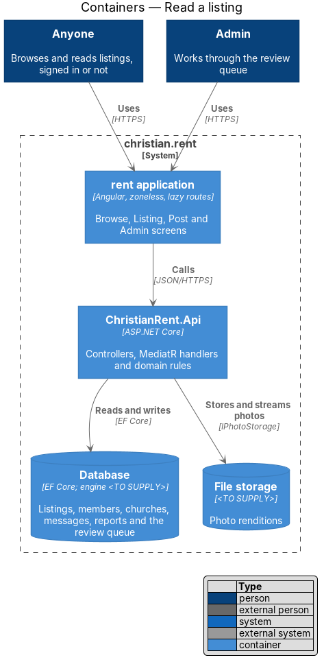
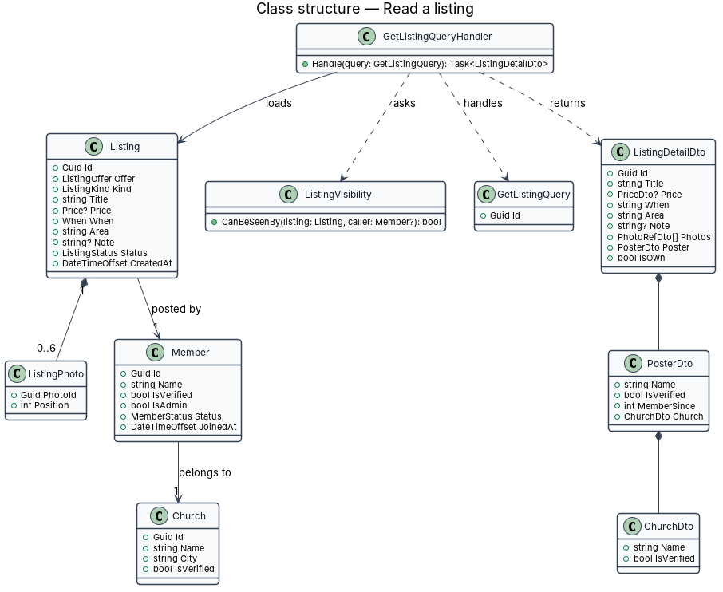

# Read a listing

## Overview

The Listing screen, at `/listings/{id}`, shows one approved listing to anyone: what it is,
what it costs, when it is available, roughly where it is, who posted it and which church
they belong to. A listing for rent shows its photos in a gallery; a wanted listing shows a
blue panel in place of a photo.

- **poster** — member who posted the listing
- **church** — congregation a member belongs to
- **verified** — confirmed by an admin; a member and a church are verified separately
- **area** — city or neighbourhood of a listing, never a street address
- **not found** — single answer given for a listing that does not exist, is waiting for
  review or has been removed, so that nothing about it is revealed

The message box beside the listing is designed in
[send-message](../../messages/send-message/README.md), and the Report button in
[report-listing](../../reports/report-listing/README.md).

## Description

**Frontend — `rent` application**

- **`ListingPage`** (`rent/src/app/listing/listing-page.ts`, selector `cr-listing-page`) —
  lazy page for `/listings/:id`. It provides `ListingStore`, reads the `id` route input, and
  lays the listing and the aside out with the `listing-layout` block: one column under
  768 px, the aside to the right from 768 px (L2-031, criterion 3).
- **`ListingStore`** — route-scoped store with `state`: `loading`, `loaded`, `not-found`,
  `failed`. It calls `LISTINGS_API.get(id, signal)` and aborts the request when the route is
  destroyed. An `ApiError` with the code `not_found` maps to `not-found`; any other failure
  maps to `failed` with "Try again".

**Frontend — `components` library**

- **`cr-gallery`** — one large photo and thumbnails. Thumbnails are buttons; the arrow keys
  move between them and each photo has a text alternative (L2-007, criterion 3). It shows
  "Photo 1 of 3". The text alternative is "{title}, photo {n} of {count}", because Post has
  no field for a member-written alternative.
- **`cr-wanted-panel`** — the head of a wanted listing, with no photo.
- **`cr-poster`** — avatar, member name, church name and "Member since {year}".
- **`cr-verified`** — an icon and the word "Verified". `cr-poster` renders one beside the
  member and one beside the church, each only when its flag is true (L2-008).
- **`cr-tag`** — "For rent · space", "Wanted · thing".
- **`cr-skeleton`**, **`cr-empty-state`** — loading, failed and not-found states.

The screen has no payment control, no calendar, no review, no rating and no advert; "when"
is a line of text (L2-024).

**Frontend — `api` library**

- **`ListingsApi.get(id)`** returns **`ListingDetail`**: `{ id, offer, kind, title, price,
  when, area, distanceKm, note, postedAt, photos, poster, isOwn }`. `poster` is
  `{ name, isVerified, memberSince, church: { name, isVerified } }`.

**Backend**

- **`ListingsController.Get`** — `GET /api/listings/{id}`, `[AllowAnonymous]`.
- **`GetListingQuery`** — `{ Id }`.
- **`GetListingQueryHandler`** — loads the listing with its member, church and photos, then
  asks `ListingVisibility.CanBeSeenBy(listing, caller)`. A listing that cannot be seen, or
  does not exist, raises `NotFoundException`, returned as a 404 ProblemDetails with the code
  `not_found` in both cases (L2-007, criterion 4; L2-025, criterion 2).
- **`ListingVisibility`** (`ChristianRent.Domain`) — a listing can be seen when it is
  `Approved` and its poster is active, or when the caller is its poster or an admin.
- **`ListingDetailDto`**, **`PosterDto`**, **`ChurchDto`** — the response. `PosterDto` has
  no email address, phone number or street address property, so none can be serialized
  (L2-008, criterion 5).
- **`PhotosController.Get`** — serves each photo rendition from file storage with the same
  visibility rule; see [add-photos](../../post/add-photos/README.md).

The response time target is 200 ms at the 95th percentile (L2-030, criterion 2); the query
is one read by primary key with three includes.

**Undecided**

- How `distanceKm` is measured: `<TO SUPPLY>`.
- What the poster sees on their own listing beyond "This is your listing": editing and
  taking down are `<TO SUPPLY>` ("My listings" is not designed).

### Mocks

The mocks are the source of truth for the UI of this feature. The states this design covers are:

- [`docs/mocks/pages/listing/default.html`](../../../mocks/pages/listing/default.html): a listing for rent, member and church verified
- [`docs/mocks/pages/listing/wanted.html`](../../../mocks/pages/listing/wanted.html): a wanted listing; only the member verified
- [`docs/mocks/pages/listing/unverified.html`](../../../mocks/pages/listing/unverified.html): neither verified; no mark shown
- [`docs/mocks/pages/listing/own.html`](../../../mocks/pages/listing/own.html): the poster's own listing
- [`docs/mocks/pages/listing/loading.html`](../../../mocks/pages/listing/loading.html): skeleton in the shape of the listing
- [`docs/mocks/pages/listing/error.html`](../../../mocks/pages/listing/error.html): failed; "Try again"
- [`docs/mocks/pages/listing/not-found.html`](../../../mocks/pages/listing/not-found.html): not found, with a way back to Browse

## Requirements

The feature realizes the following level-2 (L2) requirements from
[`docs/specs/L2.md`](../../../specs/L2.md). Each L2 requirement refines a level-1 (L1)
requirement, cited by identifier. The table restates each requirement in `shall` form; the
acceptance criteria in the specification remain authoritative.

| L2 ID | Refines (L1) | Requirement |
|-------|--------------|-------------|
| `L2-007` | `L1-002` | The Listing screen shall show an approved listing's photos (for rent only), title, kind, price, when, area and note. Each photo shall be reachable by touch and keyboard and have a text alternative. A listing that is not approved, is removed or does not exist shall show "not found" to anyone but its poster or an admin. The area shall never be a street address. |
| `L2-008` | `L1-002` | A listing shall show the name of the member who posted it and the name of their church. The member and the church shall each be marked "Verified" with text and an icon only when verified. The member's email address, phone number and street address shall not be in the response. |
| `L2-014` | `L1-004` | A photo shall be accepted only when its content is a JPEG, PNG or WebP image of at most 10 MB, at least 400 × 300 px and at most 8,000 px on either side. Embedded metadata shall be removed before storage. Photos shall be served from file storage at a fitted size, never from the database, and a photo of a listing that is not approved shall be served only to its poster or an admin. |
| `L2-022` | `L1-009` | Prices shall be shown in Canadian dollars with their period, with cents only when not zero. Distances shall be in kilometres. Dates shall write the month as a word. Copy shall use Canadian spelling. An area shall be a place in Canada. |
| `L2-024` | `L1-010` | No screen shall offer a way to pay, take a deposit or enter a card. A listing shall show no booking calendar, review, rating or advert. A message with dates shall not change the listing's availability or reserve anything. |
| `L2-025` | `L1-011` | Every endpoint other than browsing, searching and reading an approved listing shall respond 401 without a signed-in member. The backend shall refuse a request for, or a change to, anything that is not the member's own, and shall reveal nothing about it. A refusal a screen branches on shall be a ProblemDetails with a `code`. |
| `L2-031` | `L1-013` | No screen shall be cut off or scroll sideways from 320 px. Browse's columns shall grow at 576, 768, 992 and 1200 px as the mocks draw. From 768 px the message box, the live preview and the Admin detail panel shall sit beside their main column; below it they shall sit under it, and Admin shall show only the queue. Every touch target shall be at least 44 × 44 px. |
| `L2-033` | `L1-015` | A waiting screen shall show a loading state in the shape of what will arrive. An unreachable backend shall produce a plain message and "Try again". An address that matches no screen shall show "not found" with a way back to Browse. An unhandled backend error shall be a ProblemDetails with no stack trace, recorded with a trace id. |

## Diagrams

### System context

The people involved are: anyone, member who posted, admin. Each reaches the feature through christian.rent, which takes no payment and holds no booking calendar.

### Containers

The rent application calls `ChristianRent.Api` over JSON/HTTPS. The API persists state through EF Core and keeps photo files in file storage, outside the database.

### Components

`ListingPage` renders from `ListingStore`. The handler applies `ListingVisibility` before it
projects anything, and the photos travel separately from `PhotosController`, which streams
them from file storage.

### Class structure

A `Listing` belongs to one `Member`, who belongs to one `Church`; each carries its own
`IsVerified` flag. `PosterDto` and `ChurchDto` expose the two flags and no contact detail.

### Behaviour — open a listing

The handler answers `not_found` for a listing that is missing, waiting or removed unless
the caller is its poster or an admin (`L2-007`). The response carries the two verified
flags and no contact detail (`L2-008`).

