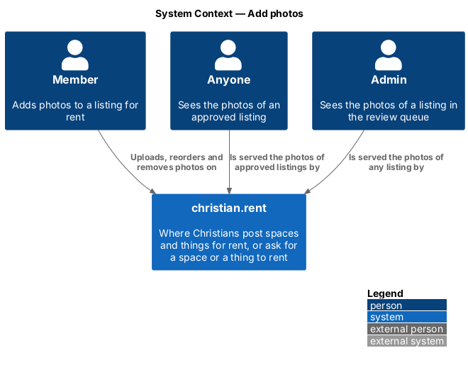
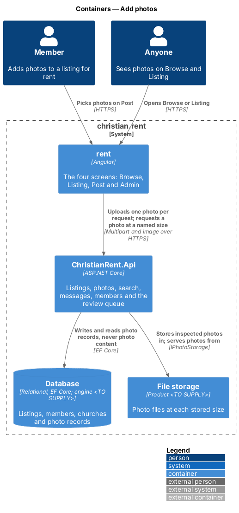
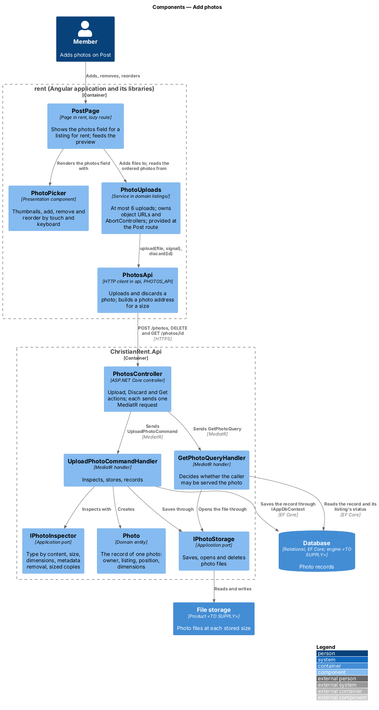
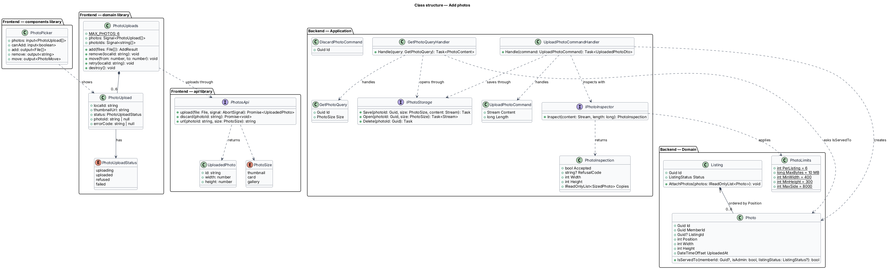
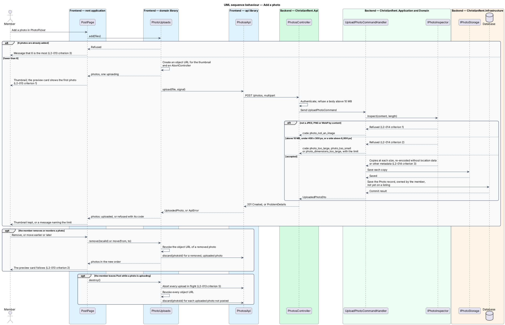
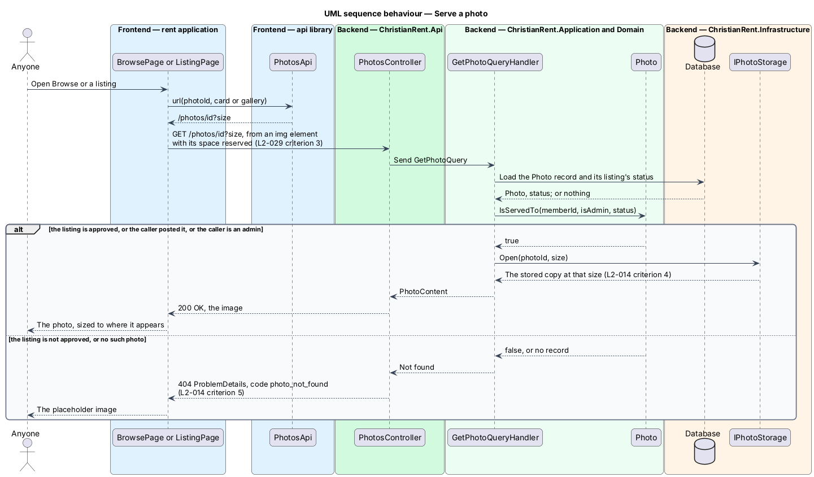

# Add photos

## Overview

christian.rent is where Christians post spaces and things for rent, or ask for a space or a
thing to rent. What a person posts is a *listing*. A listing *for rent* offers a space or a
thing; a *wanted* listing asks for one.

A member may add up to 6 photos to a listing for rent while filling in Post. The first photo is
the one shown on the listing's card on Browse; all of them appear on the Listing screen. A
wanted listing has no photo. A listing for rent posted with no photo is accepted, and its card
shows a placeholder image.

A photo is a file from a member's device, so it is treated as untrusted data. The backend
inspects each photo before it is stored: the file is an image by its content, within the size
and dimension limits, and its location data and other embedded metadata are removed. Photos are
kept in file storage and served from there, never from the database. A photo of a listing that
is not approved is served only to the member who posted it and to an admin.

The terms used below:

- **inspection** — check of an uploaded file's content, size and dimensions before it is stored
- **metadata** — data embedded in an image file beside the picture, such as the place it was
  taken
- **sized copy** — version of a photo stored at a size fitted to where it appears: a thumbnail
  on Post, a card on Browse, the gallery on Listing
- **unattached photo** — uploaded photo that belongs to a member and not yet to a listing

Post, where photos are added, is designed in `listings/post-listing`.

## Description

The slice is not built yet; this section describes the components the design introduces. It runs
from the `rent` application to file storage.

**Frontend**

- **`PhotoPicker`** — presentation component for the photos field. It shows a thumbnail per
  photo with its state, and emits `add`, `remove` and `move`. Removing and reordering work by
  touch and by keyboard; the reorder gesture follows the mocks. It injects nothing.
- **`PhotoUploads`** — service in `domain`'s `listings/`, provided at the Post route. It holds
  at most 6 `PhotoUpload` entries in order, each with a status: `uploading`, `uploaded`,
  `refused` or `failed`. The logic has unit tests with one case per transition.
  - `add(files)` accepts files while fewer than 6 photos are held and refuses the rest, and
    `PostPage` shows a message (`L2-013` criterion 3). For each accepted file it creates an
    object URL for the thumbnail and an `AbortController`, then uploads through `PhotosApi`
    (`L2-013` criterion 1).
  - `remove(localId)` aborts the upload if it is in flight, revokes the object URL and asks the
    backend to discard an uploaded photo. `move(from, to)` changes the order.
  - `photoIds` is the ordered list of uploaded photo ids, which `PostPage` puts in the draft.
    The first is the one the card shows, and the live preview follows each removal and reorder
    (`L2-013` criterion 2).
  - `destroy()` runs when the member leaves Post. It aborts every upload in flight, revokes
    every object URL, and asks the backend to discard each uploaded photo that was not posted
    (`L2-013` criterion 5).
- **`PhotosApi`** — contract and HTTP client in `api`, bound to `PHOTOS_API`.
  `upload(file, signal)` sends `POST /photos` as multipart content. `discard(photoId)` sends
  `DELETE /photos/{id}`. `url(photoId, size)` builds the address of a sized copy.
- **`PostPage`** — shows the photos field only for a listing for rent, and sends no photo id for
  a wanted listing (`L2-009` criterion 1). Whether photos already added return when a member
  switches "need" back to "have" is `<TO SUPPLY>`. A refused photo shows a message naming the
  limit, written from the refusal's `code` (`L2-014` criterion 2). When posting fails, the
  photos already added stay (`L2-012` criterion 5).
- **`ListingCard`** and **`PhotoGallery`** — request a photo at the size fitted to them, declare
  its width and height so its space is reserved, and load it lazily below the fold (`L2-029`
  criterion 3). `ListingCard` shows a placeholder image for a listing for rent with no photo
  (`L2-013` criterion 4).
- **Memory** — the photo upload allocates heavily. Leaving Post returns its memory, and the heap
  is checked for stability across repeated enter and leave when a person asks for that check.

**Backend — upload**

- **`PhotosController`** — its `Upload` action answers `POST /photos` for a signed-in member
  and refuses a request body above the size limit before reading it in full. It checks nothing
  else itself and sends one `UploadPhotoCommand`.
- **`UploadPhotoCommandHandler`** — passes the content to `IPhotoInspector`. For an accepted
  photo it saves each sized copy through `IPhotoStorage`, then saves a `Photo` record owned by
  the member, attached to no listing. It returns the photo's id and dimensions.
- **`IPhotoInspector`** — port in Application, implemented in Infrastructure. The image library
  behind it is `<TO SUPPLY>`. It applies `PhotoLimits` in this order.

  | Check | Refusal `code` | Criterion |
  |-------|----------------|-----------|
  | The content is a JPEG, PNG or WebP image, whatever the file name or declared type | `photo_not_an_image` | `L2-014` criterion 1 |
  | The file is no larger than 10 MB | `photo_too_large` | `L2-014` criterion 2 |
  | The image is at least 400 × 300 px | `photo_too_small` | `L2-014` criterion 2 |
  | Neither side is larger than 8,000 px | `photo_dimensions_too_large` | `L2-014` criterion 2 |

  Each refusal is a ProblemDetails with its `code` and the limit, and the rule has a direct unit
  test with one case per row. Whether a 300 × 400 px portrait image passes the smallest size is
  `<TO SUPPLY>`. An accepted photo is decoded and encoded again, which drops its location data
  and all other embedded metadata (`L2-014` criterion 3); only the encoded copies are stored,
  never the uploaded file. The pixel sizes and the format of the sized copies are `<TO SUPPLY>`
  until the mocks fix where a photo appears.
- **`IPhotoStorage`** — port in Application: `Save`, `Open` and `Delete` for a photo's sized
  copies. The file storage product behind it is `<TO SUPPLY>`.
- **`Photo`** — domain entity: id, owner, listing (none while unattached), position, width,
  height and upload time. The database holds this record and no photo content (`L2-014`
  criterion 4).
- **Attaching** — `PostListingCommandHandler` attaches the draft's photos to the new listing in
  order, as designed in `listings/post-listing`. The backend refuses a seventh photo and any
  photo on a wanted listing, whatever the frontend sent (`L2-025` criterion 3).
- **Unattached photos** — `DiscardPhotoCommand` deletes an unattached photo of the calling
  member from storage and from the database. A member who closes the browser sends no discard,
  so a command deletes unattached photos older than an age that is `<TO SUPPLY>`; what runs that
  command is `<TO SUPPLY>`.

**Backend — serving**

- **`PhotosController`** — its `Get` action answers `GET /photos/{id}?size=`, is marked
  `[AllowAnonymous]` and sends one `GetPhotoQuery`.
- **`GetPhotoQueryHandler`** — loads the `Photo` record and the status of its listing, asks
  `ICurrentMember` who is calling, and asks `Photo.IsServedTo`. When the answer is yes, it opens
  the sized copy through `IPhotoStorage` and returns it (`L2-014` criterion 4).
- **`Photo.IsServedTo(memberId, isAdmin, listingStatus)`** — true when the listing is approved,
  when the caller is the member who owns the photo, or when the caller is an admin. An
  unattached photo is served only to its owner. Otherwise the response is a 404 ProblemDetails
  with the `code` `photo_not_found`, the same as for a photo that does not exist (`L2-014`
  criterion 5, `L2-025` criterion 2).
- **Delivery** — every photo request passes this check. Whether the API streams the copy or
  hands the browser a short-lived address in file storage depends on the storage product and is
  `<TO SUPPLY>`. How long a browser may cache a photo of an approved listing, given that a
  removed listing's photos stop being served, is `<TO SUPPLY>`.

The photos field's layout and states, and the sizes at which a photo appears, follow
`docs/mocks/` once drawn, and this design is brought in line with them then.

## Requirements

The feature realizes the following level-2 (L2) requirements. Each L2 requirement refines a
level-1 (L1) requirement, cited by identifier.

| L2 ID | Refines (L1) | Requirement |
|-------|--------------|-------------|
| `L2-013` | `L1-004` | Add photos to a listing for rent. A member shall be able to add up to 6 photos to a listing for rent, each shown as a thumbnail, with the first shown on the card; the member may remove or reorder them, a seventh shall be refused with a message, and an upload in flight shall be cancelled when the member leaves Post. |
| `L2-014` | `L1-004` | Photos are checked before they are stored. A photo shall be accepted only when it is a JPEG, PNG or WebP image by its content, no larger than 10 MB, at least 400 × 300 px and at most 8,000 px on either side. An accepted photo shall have its location data and other embedded metadata removed, shall be served from file storage and never from the database, and shall not be served for a listing that is not approved to anyone but its poster or an admin. |

## Diagrams

### System context

A member uploads, reorders and removes photos on christian.rent. Anyone is served the photos of
approved listings, and an admin the photos of any listing. The slice touches no external system.

### Containers

The `rent` application uploads one photo per request to `ChristianRent.Api` and requests each
photo at a named size. The API writes photo records to the database and photo files to file
storage.

### Components

`PostPage` renders `PhotoPicker` and hands files to `PhotoUploads`, which uploads through
`PhotosApi`. In the backend, `PhotosController` sends `UploadPhotoCommand` to a handler that
inspects with `IPhotoInspector` and saves through `IPhotoStorage`, and sends `GetPhotoQuery` to
a handler that decides whether the caller is served.

### Class structure

`PhotoUploads` is composed of up to 6 `PhotoUpload` entries and depends on `PhotosApi`.
`IPhotoInspector` applies `PhotoLimits` and returns a `PhotoInspection`. A `Listing` owns up to
6 `Photo` records ordered by position.

### Behaviour — add a photo

`PhotoUploads` refuses a seventh photo, and otherwise shows a thumbnail and uploads. The
inspector refuses a file that is not an image by content or that breaks a limit; an accepted
photo is stored as sized copies without metadata. Removing, reordering and leaving Post each
release what the upload acquired.

### Behaviour — serve a photo

Each photo request reaches `GetPhotoQueryHandler`, which serves the stored copy from file
storage when the listing is approved or the caller is its poster or an admin, and otherwise
answers `photo_not_found`.

