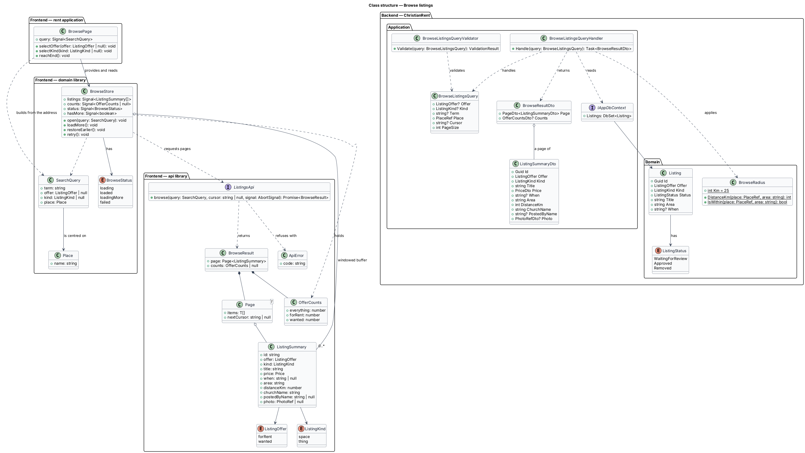
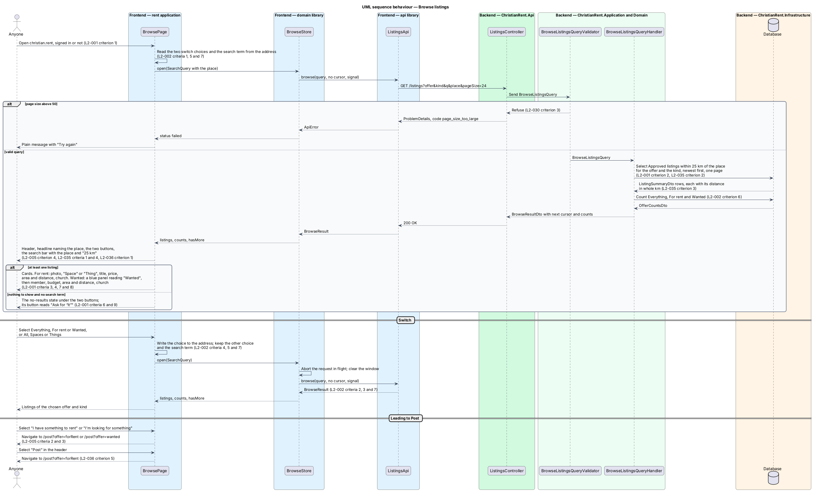

# Browse listings

## Overview

christian.rent is where Christians post spaces and things for rent, or ask for a space or a
thing to rent. What a person posts is a *listing*. A listing that offers something is *for
rent*; a listing that asks for something is *wanted*. A listing is for a *space* or a *thing*. A
listing is public only once an admin has approved it in the review queue.

Browse is the home screen. It is centred on a *place* and shows the approved listings within
25 km of it, newest first, to anyone, signed in or not. Each card shows how far the listing is
from the place. One switch limits the list to Everything, For rent or Wanted, and a second to
All, Spaces or Things. Two buttons, "I have something to rent" and "I'm looking for something",
lead straight to Post. The list arrives one page at a time as the person scrolls. Browse and
Listing share one header.

Most people open christian.rent on a phone, often on a slow connection, to look for one thing.
The slice therefore carries two limits besides its behaviour: Browse opens fast, and the memory
it holds stays bounded however far the list is scrolled.

The terms used below:

- **card** — presentation of one listing on Browse. A listing for rent shows its first photo
  under a label "Space" or "Thing", its title, price, area with the distance, and the church of
  the member who posted it. A wanted listing shows a blue panel in place of a photo
- **place** — where Browse is centred, for example "Langley, BC"; Browse shows the listings
  within 25 km of it
- **distance** — whole kilometres from the place to a listing's area
- **header** — bar that stays at the top of Browse and Listing: the wordmark, a Messages
  control, an account control and a "Post" button
- **page** — the listings one request returns: 24 on Browse, never more than 50
- **cursor** — opaque value that marks where the next page starts
- **window** — the pages `BrowseStore` holds in memory at one time

Search by words is designed in `listings/search-listings`. The Listing screen a card opens is
designed in `listings/read-listing`, and Post in `listings/post-listing`.

## Description

The slice is not built yet; this section describes the components the design introduces. It runs
from the `rent` application to the database.

**Frontend**

- **`BrowsePage`** — page in `rent`, loaded with `loadComponent` on the route `''`. It
  orchestrates Browse and holds no rule. It reads the choice on each switch and the search term
  from the query parameters `offer`, `kind` and `q` of the address and writes each change back,
  so a reload or a shared address restores all three (`L2-002` criteria 5 and 7). With no
  `offer` parameter, Everything is selected (`L2-002` criterion 1); with no `kind` parameter,
  All is selected (`L2-002` criterion 7). It provides `BrowseStore` at its own route, so the
  list leaves memory when the person leaves Browse.
- **The headline** — Browse opens with the headline "Rent it from your church family.", whose
  second line, "church family.", is orange. The line under it names the place: "Halls, rooms,
  vans and tools, shared between believers near {place}. Or ask for what you need." (`L2-035`
  criterion 4).
- **The two buttons** — "I have something to rent" and "I'm looking for something" (`L2-005`
  criterion 1), links to `/post?offer=forRent` and `/post?offer=wanted`. Post opens set to
  "I have" or "I need" (`L2-005` criteria 2 and 3). They sit beside the headline and stay there
  whatever the list shows (`L2-005` criterion 4): to the right of it from 1024 px, and below it
  under 1024 px. The first is filled orange and the second has an ink outline.
- **`BrowseStore`** — service in `domain`'s `search/`. It holds the current `SearchQuery`, the
  window of listings, the three counts of the first switch, a status (`loading`, `loaded`,
  `loadingMore`, `failed`) and whether a further page exists, each as a signal. `open(query)`
  aborts the request in flight, clears the window and requests the first page. `loadMore()`
  requests the next page from the cursor and makes no request once the last page has loaded
  (`L2-006` criterion 2). A failed page leaves the listings already shown in place and sets
  `failed`; `retry()` repeats the failed request (`L2-006` criterion 3).
- **The window** — `BrowseStore` holds at most a fixed number of pages. When a page arrives
  beyond that number, the store releases the page furthest from the viewport and keeps only its
  cursor; `restoreEarlier()` requests a released page again when the person scrolls back to it
  (`L2-030` criterion 4). `BrowsePage` reserves the height of released pages so the scroll
  position does not jump. The number of pages in the window is `<TO SUPPLY>`: the specs bound
  memory at 500 scrolled listings and give no window size.
- **`SearchQuery`** — value in `domain`'s `search/`: the search term, the choice on the first
  switch (`forRent`, `wanted`, or none for Everything), the choice on the second (`space`,
  `thing`, or none for All) and the place. A change of either switch keeps the term, and all
  apply together (`L2-002` criteria 4 and 7).
- **The place** — every request for a page carries the place, and Browse shows only listings
  whose area is within 25 km of it (`L2-035` criterion 2). The search bar names the place and
  the radius, for example "Langley, BC · 25 km" (`L2-035` criterion 1); the bar is designed in
  `listings/search-listings`. How the place is chosen, what it is for a person christian.rent
  knows nothing about, and whether the 25 km radius can be changed are `<TO SUPPLY>`: `L2-035`
  leaves them open, and the place control does nothing in the prototype.
- **`ListingsApi`** — contract and HTTP client in `api`, bound to the token `LISTINGS_API`.
  `browse(query, cursor, signal)` sends `GET /listings` and returns a `BrowseResult`, which is a
  `Page<ListingSummary>` with the three counts, or refuses with an `ApiError` whose `code` the
  page branches on.
- **`OfferSwitch`** — presentation component with the three choices Everything, For rent and
  Wanted. Each choice is followed by the number of listings it holds (`L2-002` criterion 6). The
  selected choice stands on a white pill and is carried by an attribute a screen reader
  announces, not by colour alone. Whether a count follows the search term and the second switch
  is `<TO SUPPLY>`: `L2-002` criterion 6 gives the count and not what it counts.
- **`KindSwitch`** — presentation component with the three choices All, Spaces and Things, at
  the right of the same row (`L2-002` criterion 7). The selected choice has an ink ground and
  white text, and is carried by an attribute in the same way. Beside it the prototype draws an
  icon control named "More filters" with nothing behind it; what it offers is `<TO SUPPLY>`. A
  hairline runs under the row of the two switches.
- **`ListingCard`** — presentation component for one `ListingSummary`. The whole card is one
  link to `/listings/{id}` (`L2-001` criterion 5).
  - *For rent*: the first photo at 4:3, with a white label over its top left corner that reads
    "Space" or "Thing"; below it the title and, to the right, the price as "$45/hour"; then the
    area with the distance, as "Walnut Grove, Langley · 5 km"; then the name of the church of
    the member who posted it (`L2-001` criteria 3 and 7, `L2-035` criterion 3). A card for rent
    shows neither "when" nor the member's name.
  - *Wanted*: a blue 4:3 panel in place of the photo. The panel holds a label that reads
    "Wanted · space" or "Wanted · thing", the title and when it is needed. Under the panel the
    card shows the name of the member who posted it, what they will pay as "Up to $120/day", the
    area with the distance, and their church (`L2-001` criteria 4 and 8). What the panel shows
    for a wanted listing with no "when" is `<TO SUPPLY>`; the prototype does not draw it.
  - The title, the area, the "when", the member's name and the church's name are rendered as
    text. `formatPrice` and `formatDistance` in `domain`'s `listings/`, designed in
    `platform/present-for-canada`, write the price and the distance.
- **The grid** — cards are in one column under 640 px, two from 640 px, three from 1024 px and
  four from 1280 px (`L2-031` criterion 2); 768 px changes nothing on Browse. The gap is 24 px
  across and 40 px down. The content is at most 1152 px wide and centred, with a margin of 16 px
  at each side under 640 px and 24 px from 640 px (`L2-031` criterion 7).
- **`EmptyState`** — one state serves every empty list; its copy is designed in
  `listings/search-listings`. With no approved listing, Browse shows it under the headline and
  the two buttons that lead to posting (`L2-001` criterion 6). When the choices on the switches
  match no approved listing and no search term is entered, the same state is shown and its
  button reads "Ask for “it”" (`L2-001` criterion 9).
- **`ErrorState`** — after a failed page, `BrowsePage` shows a message with "Try again" under
  the listings already shown (`L2-006` criterion 3). The prototype draws Browse's default and
  empty states only; the loading state, the failed state and the end of the list are
  `<TO SUPPLY>` until `docs/mocks/` draws them.
- **`Header`** — presentation component in `components`, rendered by `AppShell` above Browse and
  Listing (`platform/show-every-screen-to-everyone`). It stays at the top as the page scrolls, 64 px high with a hairline below
  (`L2-036` criterion 1). At the left the wordmark is a link to Browse, named "christian.rent
  home" (`L2-036` criterion 2); under 640 px the mark stands alone (`L2-023` criterion 3). At
  the right, in order, are the Messages control, which shows the number of messages a member has
  not read when it is above 0 (`L2-036` criterion 3); the account control, a circle with the
  member's initials (`L2-036` criterion 4); and "Post", a link to `/post?offer=forRent`
  (`L2-036` criterion 5). The component takes the initials and the unread count as inputs and
  injects nothing. What the Messages control and the account control open, where the unread
  count is read from, and how the header looks to a person who is not signed in are
  `<TO SUPPLY>`: `L2-036` leaves them open and the prototype draws none of them.

**Speed on a phone (`L2-029`)**

- The routes for Listing, Post and Admin use `loadComponent` or `loadChildren`; their code is not
  in the initial download (`L2-029` criterion 2). The `angular.json` budgets hold the initial
  bundle to a size that is `<TO SUPPLY>`.
- `ListingCard` requests its photo at the card size, declares the photo's width and height so
  its space is reserved before it loads, and loads it lazily when below the fold (`L2-029`
  criterion 3). The photos of the first cards in view load eagerly, because one of them is the
  largest content painted (`L2-029` criterion 1). The photo sizes are designed in
  `listings/add-photos`.
- The device and connection profile that stands for "a mid-range phone on a 4G connection" in a
  measurement is `<TO SUPPLY>`.

**Backend**

- **`ListingsController`** — its `Browse` action answers `GET /listings`, is marked
  `[AllowAnonymous]`, checks nothing itself and sends one `BrowseListingsQuery`.
- **`BrowseListingsQuery`** — carries `Offer`, `Kind`, `Term`, `Place`, `Cursor` and `PageSize`.
  `PageSize` defaults to 24. The form in which a request names the place is `<TO SUPPLY>` with
  the way the place is chosen.
- **`BrowseListingsQueryValidator`** — refuses a page size above 50 with a ProblemDetails whose
  `code` is `page_size_too_large` (`L2-030` criterion 3).
- **`BrowseListingsQueryHandler`** — reads `IAppDbContext.Listings`, keeps only listings whose
  `Status` is `Approved` (`L2-001` criterion 2) and whose area is within 25 km of the place
  (`L2-035` criterion 2), applies `Offer` and `Kind` when given, orders newest first and projects
  one page to `ListingSummaryDto` without tracking. The query starts after the cursor and never
  counts or skips rows to find a page, so its cost does not grow with the depth of the page. The
  response carries the next cursor, or none after the last page. The response to the first page
  also carries `OfferCountsDto`: the number of listings under Everything, For rent and Wanted
  (`L2-002` criterion 6).
- **`BrowseRadius`** — domain rule holding the radius, 25 km. The handler computes each
  listing's distance from the place to the listing's area and rounds it to whole kilometres
  (`L2-035` criterion 3). Between which two points a distance is measured is `<TO SUPPLY>`.
- **Ordering** — "newest first" (`L2-001`) reads either the time a listing was posted or the
  time it was approved; which of the two is `<TO SUPPLY>`. The cursor encodes that time and the
  listing's id.
- **`ListingSummaryDto`** — id, offer, kind, title, price amount and period, when, area, the
  distance in whole kilometres, the church's name, a reference to the first photo and, for a
  wanted listing, the name of the member who posted it. It holds nothing about the member beyond
  what a card shows: no email address, phone number or street address.
- **`Listing`** and **`ListingStatus`** — the entity and its status: `WaitingForReview`,
  `Approved`, `Removed`.
- **Response time** — a page responds within 300 ms at the 95th percentile with 10,000 approved
  listings (`L2-030` criterion 1). An index on the status, the offer, the kind and the ordering
  time serves the query; its definition, and how the radius is applied in the database, depend
  on the database engine, which is `<TO SUPPLY>`.

Browse's layout and its states follow `docs/mocks/` once drawn, and this design is brought in
line with them then. The facts stated here come from the Magic Patterns prototype; its sample
listings, places and prices are the cast, not rules.

## Requirements

The feature realizes the following level-2 (L2) requirements. Each L2 requirement refines a
level-1 (L1) requirement, cited by identifier.

| L2 ID | Refines (L1) | Requirement |
|-------|--------------|-------------|
| `L2-001` | `L1-001` | Browse shows approved listings. Browse shall be the home screen and shall show approved listings, newest first, to anyone, signed in or not. A listing for rent shall show as a card with its first photo, title, price and area; a wanted listing shall show as a card with no photo. |
| `L2-002` | `L1-001` | Switch between Everything, For rent and Wanted. A switch on Browse shall limit the list to listings for rent, to wanted listings, or show both, and shall show the number of listings each choice holds. A second switch shall offer All, Spaces and Things and shall apply together with the first switch and the search term. |
| `L2-005` | `L1-001` | Browse leads straight to posting. Browse shall have two buttons, "I have something to rent" and "I'm looking for something", which shall open Post set to "I have" and to "I need", and which shall sit beside the headline whatever the list shows. |
| `L2-006` | `L1-001` | Browse loads in pages. Browse shall show the first 24 matching listings and shall load more as the person reaches the end of the list. |
| `L2-029` | `L1-012` | Fast on a phone. On a mid-range phone on a 4G connection, Browse shall paint its largest content within 2.5 s with layout shift under 0.1, without the code for Listing, Post and Admin in the initial download. |
| `L2-030` | `L1-012` | Fast and bounded on the backend. A page of Browse or a search shall respond within 300 ms at the 95th percentile with 10,000 approved listings, a list endpoint shall return at most one page of at most 50, and memory in the browser shall stay bounded while a person scrolls. |
| `L2-035` | `L1-001`, `L1-009` | Listings near a place. Browse shall be centred on a place and shall show the listings within 25 km of it. The search bar shall name the place and the radius, and a card and the Listing screen shall show the distance from the place to the listing's area beside the area, in whole kilometres. |
| `L2-036` | `L1-001`, `L1-005` | The header. Browse and Listing shall share one header, which shall stay at the top as the page scrolls and shall hold the wordmark, a Messages control, an account control and a "Post" button. |

## Diagrams

### System context

Anyone, signed in or not, browses the approved listings near a place on christian.rent. The
slice touches no external system.

### Containers

The `rent` application requests one page of listings at a time from `ChristianRent.Api`, which
reads the approved listings within 25 km of the place from the database. Card photos come from
file storage, as designed in `listings/add-photos`.

### Components

`AppShell` renders `Header` above the page. `BrowsePage` renders `OfferSwitch`, `KindSwitch`, `ListingCard` and the empty and
failed states, and asks `BrowseStore` for pages. `BrowseStore` calls `ListingsApi`. In the
backend, `ListingsController` sends `BrowseListingsQuery` through its validator to
`BrowseListingsQueryHandler`, which applies `BrowseRadius`.

### Class structure

`BrowseStore` holds a windowed buffer of `ListingSummary` and the `OfferCounts`, and depends on
the `ListingsApi` contract. `SearchQuery` carries the term, the two choices and the place.
`BrowseListingsQueryHandler` handles `BrowseListingsQuery` and reads `Listing` through
`IAppDbContext`.

### Behaviour — browse listings

`BrowsePage` reads the two choices and the search term from the address and opens the query
with the place. The validator refuses a page size above 50. The handler selects approved
listings within 25 km of the place and returns each with its distance. A change of either switch
aborts the request in flight and opens a new query with the search term kept.

### Behaviour — load more listings in a bounded window

Reaching the end of the list requests the next page from the cursor, and no request follows the
last page. A failed page leaves the listings already shown and offers "Try again". Each appended
page releases the page furthest from the viewport, and a released page is requested again when
the person scrolls back to it.

