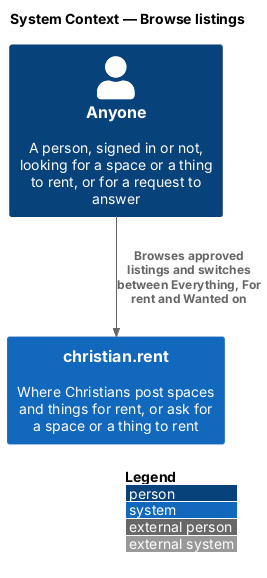
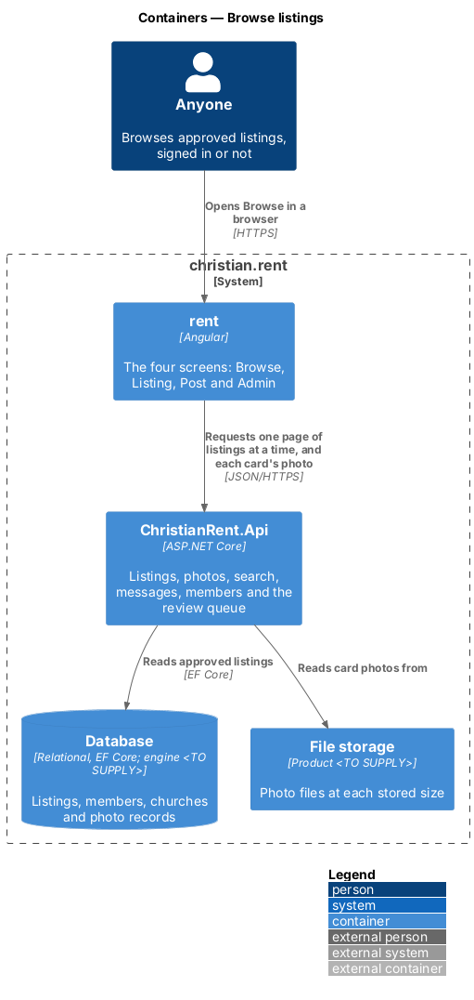
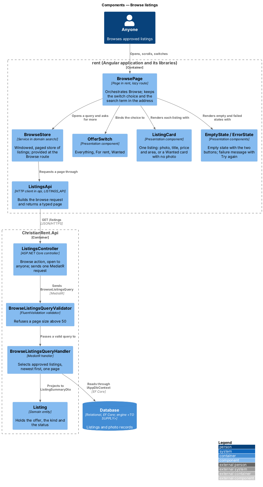
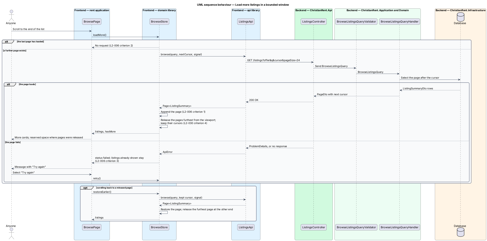

# Browse listings

## Overview

christian.rent is where Christians post spaces and things for rent, or ask for a space or a
thing to rent. What a person posts is a *listing*. A listing that offers something is *for
rent*; a listing that asks for something is *wanted*. A listing is public only once an admin has
approved it in the review queue.

Browse is the home screen. It shows the approved listings, newest first, to anyone, signed in or
not. A switch limits the list to Everything, For rent or Wanted. Two buttons, "I have something
to rent" and "I'm looking for something", lead straight to Post. The list arrives one page at a
time as the person scrolls.

Most people open christian.rent on a phone, often on a slow connection, to look for one thing.
The slice therefore carries two limits besides its behaviour: Browse opens fast, and the memory
it holds stays bounded however far the list is scrolled.

The terms used below:

- **card** — presentation of one listing on Browse: its first photo, title, price and area for a
  listing for rent; no photo and the label "Wanted" for a wanted listing
- **page** — the listings one request returns: 24 on Browse, never more than 50
- **cursor** — opaque value that marks where the next page starts
- **window** — the pages `BrowseStore` holds in memory at one time

Search by words is designed in `listings/search-listings`. The Listing screen a card opens is
designed in `listings/read-listing`, and Post in `listings/post-listing`.

## Description

The slice is not built yet; this section describes the components the design introduces. It runs
from the `rent` application to the database.

**Frontend**

- **`BrowsePage`** — page in `rent`, loaded with `loadComponent` on the route `''`. It
  orchestrates Browse and holds no rule. It reads the switch choice and the search term from the
  query parameters `offer` and `q` of the address and writes each change back, so a reload or a
  shared address restores both (`L2-002` criterion 5). With no `offer` parameter, Everything is
  selected (`L2-002` criterion 1). It provides `BrowseStore` at its own route, so the list leaves
  memory when the person leaves Browse.
- **`BrowseStore`** — service in `domain`'s `search/`. It holds the current `SearchQuery`, the
  window of listings, a status (`loading`, `loaded`, `loadingMore`, `failed`) and whether a
  further page exists, each as a signal. `open(query)` aborts the request in flight, clears the
  window and requests the first page. `loadMore()` requests the next page from the cursor and
  makes no request once the last page has loaded (`L2-006` criterion 2). A failed page leaves the
  listings already shown in place and sets `failed`; `retry()` repeats the failed request
  (`L2-006` criterion 3).
- **The window** — `BrowseStore` holds at most a fixed number of pages. When a page arrives
  beyond that number, the store releases the page furthest from the viewport and keeps only its
  cursor; `restoreEarlier()` requests a released page again when the person scrolls back to it
  (`L2-030` criterion 4). `BrowsePage` reserves the height of released pages so the scroll
  position does not jump. The number of pages in the window is `<TO SUPPLY>`: the specs bound
  memory at 500 scrolled listings and give no window size.
- **`SearchQuery`** — value in `domain`'s `search/`: the search term and the switch choice
  (`forRent`, `wanted`, or none for Everything). A change of the switch keeps the term, and both
  apply together (`L2-002` criterion 4).
- **`ListingsApi`** — contract and HTTP client in `api`, bound to the token `LISTINGS_API`.
  `browse(query, cursor, signal)` sends `GET /listings` and returns a `Page<ListingSummary>`
  or refuses with an `ApiError` whose `code` the page branches on.
- **`OfferSwitch`** — presentation component with the three choices. The selected choice is
  carried by an attribute a screen reader announces, not by colour alone.
- **`ListingCard`** — presentation component for one `ListingSummary`. A listing for rent shows
  its first photo, title, price and area (`L2-001` criterion 3). A wanted listing shows no photo
  and the text "Wanted" (`L2-001` criterion 4). The card is a link to `/listings/{id}`
  (`L2-001` criterion 5). The title and the area are rendered as text. `formatPrice` in
  `domain`'s `listings/` writes the price.
- **`EmptyState`** and **`ErrorState`** — presentation components. With no approved listing,
  `BrowsePage` shows `EmptyState` with the two buttons that lead to posting (`L2-001`
  criterion 6). After a failed page it shows `ErrorState` with "Try again". The state shown when
  For rent or Wanted is selected, no search term is entered and nothing matches is `<TO SUPPLY>`:
  `L2-001` criterion 6 covers only the case where no approved listing exists.
- **The two buttons** — links to `/post?offer=forRent` and `/post?offer=wanted`. Post opens set
  to "I have" or "I need" (`L2-005` criteria 2 and 3).

**Speed on a phone (`L2-029`)**

- The routes for Listing, Post and Admin use `loadComponent` or `loadChildren`; their code is not
  in the initial download (`L2-029` criterion 2). The `angular.json` budgets hold the initial
  bundle to a size that is `<TO SUPPLY>`.
- `ListingCard` requests its photo at the card size, declares the photo's width and height so
  its space is reserved before it loads, and loads it lazily when below the fold (`L2-029`
  criterion 3). The photos of the first cards in view load eagerly, because one of them is the
  largest content painted (`L2-029` criterion 1). The photo sizes are designed in
  `listings/add-photos`.
- The device and connection profile that stands for "a mid-range phone on a 4G connection" in a
  measurement is `<TO SUPPLY>`.

**Backend**

- **`ListingsController`** — its `Browse` action answers `GET /listings`, is marked
  `[AllowAnonymous]`, checks nothing itself and sends one `BrowseListingsQuery`.
- **`BrowseListingsQuery`** — carries `Offer`, `Term`, `Cursor` and `PageSize`. `PageSize`
  defaults to 24.
- **`BrowseListingsQueryValidator`** — refuses a page size above 50 with a ProblemDetails whose
  `code` is `page_size_too_large` (`L2-030` criterion 3).
- **`BrowseListingsQueryHandler`** — reads `IAppDbContext.Listings`, keeps only listings whose
  `Status` is `Approved` (`L2-001` criterion 2), applies `Offer` when given, orders newest first
  and projects one page to `ListingSummaryDto` without tracking. The query starts after the
  cursor and never counts or skips rows, so its cost does not grow with the depth of the page.
  The response carries the next cursor, or none after the last page.
- **Ordering** — "newest first" (`L2-001`) reads either the time a listing was posted or the
  time it was approved; which of the two is `<TO SUPPLY>`. The cursor encodes that time and the
  listing's id.
- **`ListingSummaryDto`** — id, offer, kind, title, price, area and a reference to the first
  photo. It holds nothing about the member beyond what a card shows.
- **`Listing`** and **`ListingStatus`** — the entity and its status: `WaitingForReview`,
  `Approved`, `Removed`.
- **Response time** — a page responds within 300 ms at the 95th percentile with 10,000 approved
  listings (`L2-030` criterion 1). An index on the status, the offer and the ordering time serves
  the query; its definition depends on the database engine, which is `<TO SUPPLY>`.

Browse's layout, its number of columns at each width and its states follow `docs/mocks/` once
drawn, and this design is brought in line with them then.

## Requirements

The feature realizes the following level-2 (L2) requirements. Each L2 requirement refines a
level-1 (L1) requirement, cited by identifier.

| L2 ID | Refines (L1) | Requirement |
|-------|--------------|-------------|
| `L2-001` | `L1-001` | Browse shows approved listings. Browse shall be the home screen and shall show approved listings, newest first, to anyone, signed in or not. A listing for rent shall show as a card with its first photo, title, price and area; a wanted listing shall show as a card with no photo. |
| `L2-002` | `L1-001` | Switch between Everything, For rent and Wanted. A switch on Browse shall limit the list to listings for rent, to wanted listings, or show both. |
| `L2-005` | `L1-001` | Browse leads straight to posting. Browse shall have two buttons, "I have something to rent" and "I'm looking for something", which shall open Post set to "I have" and to "I need". |
| `L2-006` | `L1-001` | Browse loads in pages. Browse shall show the first 24 matching listings and shall load more as the person reaches the end of the list. |
| `L2-029` | `L1-012` | Fast on a phone. On a mid-range phone on a 4G connection, Browse shall paint its largest content within 2.5 s with layout shift under 0.1, without the code for Listing, Post and Admin in the initial download. |
| `L2-030` | `L1-012` | Fast and bounded on the backend. A page of Browse or a search shall respond within 300 ms at the 95th percentile with 10,000 approved listings, a list endpoint shall return at most one page of at most 50, and memory in the browser shall stay bounded while a person scrolls. |

## Diagrams

### System context

Anyone, signed in or not, browses approved listings on christian.rent. The slice touches no
external system.

### Containers

The `rent` application requests one page of listings at a time from `ChristianRent.Api`, which
reads approved listings from the database. Card photos come from file storage, as designed in
`listings/add-photos`.

### Components

`BrowsePage` renders `OfferSwitch`, `ListingCard` and the empty and failed states, and asks
`BrowseStore` for pages. `BrowseStore` calls `ListingsApi`. In the backend, `ListingsController`
sends `BrowseListingsQuery` through its validator to `BrowseListingsQueryHandler`.

### Class structure

`BrowseStore` holds a windowed buffer of `ListingSummary` and depends on the `ListingsApi`
contract. `BrowseListingsQueryHandler` handles `BrowseListingsQuery` and reads `Listing` through
`IAppDbContext`.

### Behaviour — browse listings

`BrowsePage` reads the switch choice and the search term from the address and opens the query.
The validator refuses a page size above 50. The handler selects approved listings only. A change
of the switch aborts the request in flight and opens a new query with the search term kept.

### Behaviour — load more listings in a bounded window

Reaching the end of the list requests the next page from the cursor, and no request follows the
last page. A failed page leaves the listings already shown and offers "Try again". Each appended
page releases the page furthest from the viewport, and a released page is requested again when
the person scrolls back to it.

