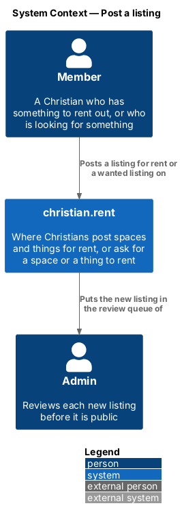
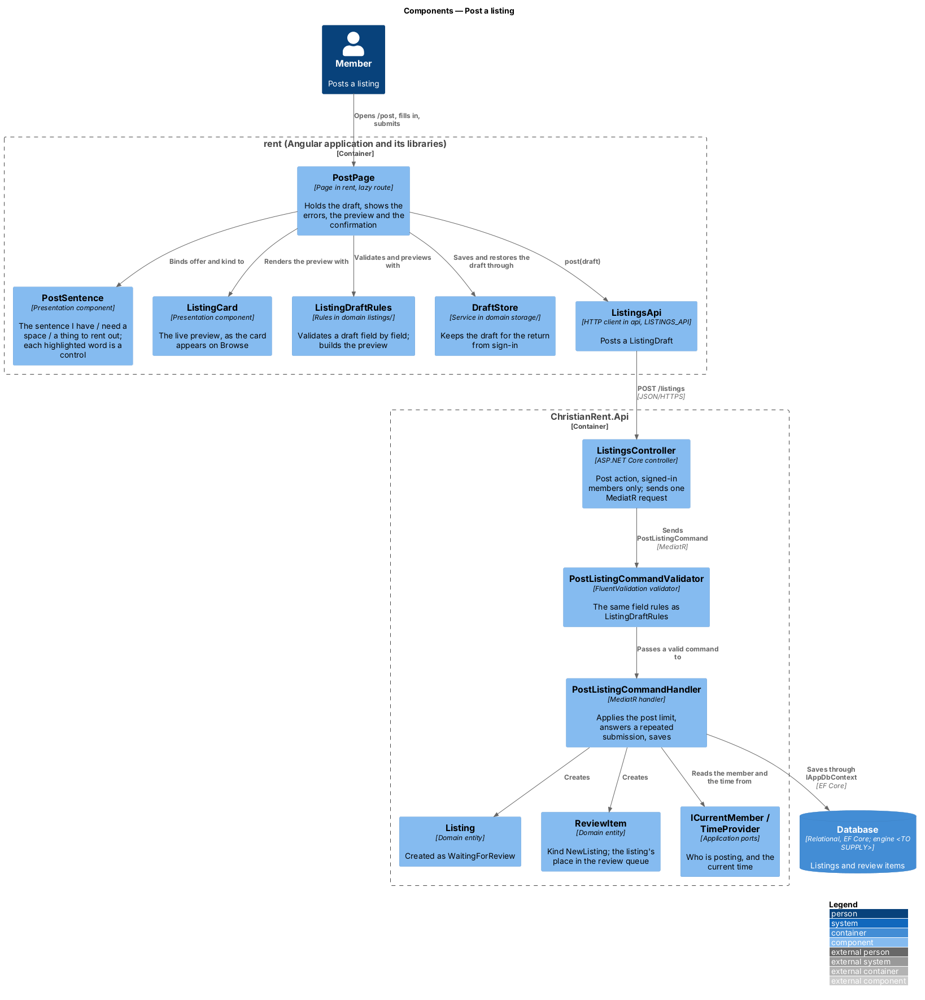
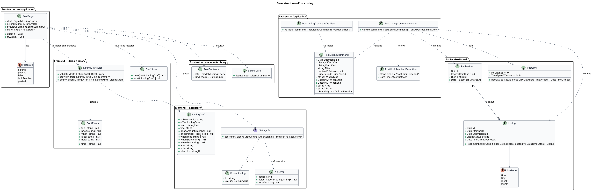
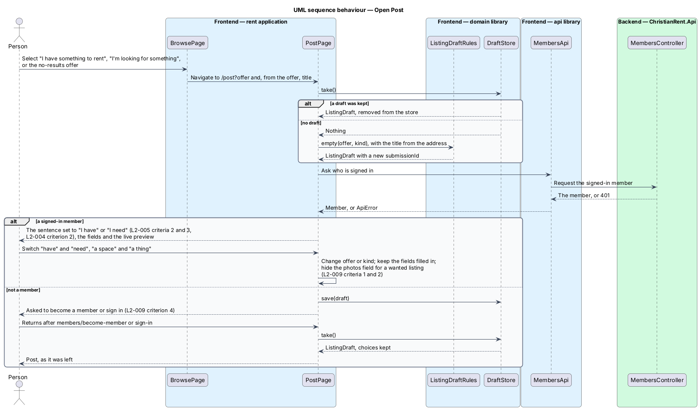

# Post a listing

## Overview

christian.rent is where Christians post spaces and things for rent, or ask for a space or a
thing to rent. What a person posts is a *listing*. A listing that offers something is *for
rent*; one that asks for something is *wanted*. A listing is for a *space* (a room, a hall, a
gymnasium, a locker, a parking space) or a *thing* (a tool, a trailer, a set of chairs).

Post is the screen where a member posts a listing in one short flow. It opens with one sentence,
"I have / need a space / a thing to rent out", whose highlighted words switch: "I have" makes a
listing for rent and "I need" makes a wanted listing. Below the sentence are a few fields: title,
price, when, area, photos (for rent only) and a note. A live preview shows the card as it will
appear on Browse. After the member submits, a confirmation says that the listing will appear
once it has been reviewed.

A new listing is not public. It is saved as waiting for review and enters the *review queue*,
where an admin approves or removes it. The review queue is designed in
`review-queue/work-review-queue`. Only a member may post; becoming a member is designed in
`members/become-member`.

The terms used below:

- **draft** — the listing as the member has filled it in so far, held in the browser until it is
  posted
- **live preview** — card built from the draft, updated on each change
- **submission id** — identifier the browser gives a draft once, so that the same draft sent
  twice creates one listing
- **post limit** — 10 listings posted by one member in 24 hours

Photos are designed in `listings/add-photos`.

## Description

The slice is not built yet; this section describes the components the design introduces. It runs
from the `rent` application to the database.

**Frontend**

- **`PostPage`** — page in `rent`, loaded with `loadComponent` on the route `/post`. It holds
  the draft as a signal, and its state: `editing`, `posting`, `failed`, `limitReached` or
  `posted`. It reads `offer` and `title` from the address when it opens: Browse's two buttons and
  the no-results offer set them (`L2-005` criteria 2 and 3, `L2-004` criterion 2). All state is
  provided at the route and goes when the member leaves Post.
- **`PostSentence`** — presentation component for the sentence. Its two pairs of highlighted
  words, "have" and "need", "a space" and "a thing", are controls with a name and a state that
  says which choice is selected (`L2-009` criterion 3). Switching "have" to "need" makes the
  draft a wanted listing, and `PostPage` removes the photos field (`L2-009` criterion 1).
  Switching between "a space" and "a thing" changes the kind and keeps the fields already filled
  in (`L2-009` criterion 2).
- **`ListingDraft`** — type in `api`: the submission id, offer, kind, title, price amount and
  period, when (free text, or a start and an end date), area, note and the ordered photo ids.
- **`ListingDraftRules`** — rules in `domain`'s `listings/`, pure functions with a unit test of
  one case per row of the table below. `validate(draft)` returns a `DraftErrors` with one error
  code per invalid field. `preview(draft)` returns the `ListingSummary` the preview card shows.
  `empty(offer, kind)` returns a new draft with a new submission id.
- **Field errors** — on submit, `PostPage` marks every invalid field at once through
  `aria-invalid`, ties each error to its field, moves focus to the first invalid field and keeps
  everything the member typed (`L2-010` criterion 8). Each field has a visible label (`L2-032`
  criterion 5).
- **Live preview** — `PostPage` renders `ListingCard` with `preview(draft)`, recomputed on each
  change (`L2-011` criterion 1). A wanted listing previews as a card with no photo (`L2-011`
  criterion 2). An empty field shows a placeholder, never "undefined" or an empty price
  (`L2-011` criterion 3). The placeholder copy is `<TO SUPPLY>` until the mocks draw it.
- **`ListingsApi`** — `post(draft, signal)` sends `POST /listings` and returns the new
  listing's id and status, or refuses with an `ApiError`.
- **Submitting** — `PostPage` disables the submit button while the request is in flight, as a
  convenience; the backend decides that one listing is created (`L2-012` criterion 4). On
  success the state becomes `posted` and a confirmation replaces the form. The confirmation says
  that the listing will appear once it has been reviewed and does not say it is public
  (`L2-012` criterion 2). A screen reader announces it (`L2-032` criterion 4).
- **Failure** — when the request fails, the form keeps everything the member entered, including
  the photos already added, and offers "Try again" (`L2-012` criterion 5). The retry sends the
  same submission id, so a first request that did reach the backend is not repeated as a second
  listing.
- **Post limit reached** — on the `code` `post_limit_reached`, `PostPage` shows a message saying
  when the member can post again, written from the `retryAt` time in the response (`L2-012`
  criterion 6).
- **A person who is not a member** — `PostPage` asks `MembersApi` who is signed in. A person who
  is not a member is asked to become a member or sign in (`L2-009` criterion 4). `PostPage`
  first saves the draft to `DraftStore` in `domain`'s `storage/`, and takes it back when the
  person returns, so their choices are kept. Becoming a member is `members/become-member`; the
  sign-in mechanism is `<TO SUPPLY>`. Where `DraftStore` keeps a draft, and for how long, is
  `<TO SUPPLY>`.

**The field rules**

`ListingDraftRules` in the browser and `PostListingCommandValidator` in the backend apply the
same rules (`L2-010` criterion 9).

| Field | Rule | Criterion |
|-------|------|-----------|
| Title | 3 to 80 characters | `L2-010` criterion 1 |
| Price, for rent | given; from 0 to 100,000; 0 is shown as "Free" | `L2-010` criterion 2 |
| Price period, for rent | hour, day, week or month | `L2-010` criterion 3 |
| Price, wanted | may be empty; the listing then shows no price | `L2-010` criterion 4 |
| When | free text of up to 80 characters, or a start and an end date; an end date before the start date is refused | `L2-010` criterion 5 |
| Area | given; a place in Canada | `L2-010` criterion 6, `L2-022` criterion 5 |
| Note | optional; up to 1,000 characters | `L2-010` criterion 7 |
| Photos | for rent only; up to 6 | `L2-013` |

The specs leave four points of these rules open. Whether "when" may be left empty is
`<TO SUPPLY>`. The range of a wanted listing's price when one is given, and whether it has a
period, are `<TO SUPPLY>`. The longest area is `<TO SUPPLY>`. How an area is shown to be a place
in Canada (a list of places to pick from, or a check of typed text) is `<TO SUPPLY>`.

**Backend**

- **`ListingsController`** — its `Post` action answers `POST /listings`. The fallback policy
  requires a signed-in member, so a call without one responds 401 (`L2-025` criterion 1). The
  action checks nothing itself and sends one `PostListingCommand`.
- **`PostListingCommandValidator`** — FluentValidation validator with the rules of the table. A
  refusal is a 400 ProblemDetails with the `code` `validation_failed` and one error code per
  field, which `PostPage` maps to the same field messages.
- **`PostListingCommandHandler`** — reads the member from `ICurrentMember` and the time from
  `TimeProvider`, then works in this order.
  1. It looks for a listing of this member with the command's `SubmissionId`. When one exists,
     it returns that listing and creates nothing (`L2-012` criterion 4).
  2. It reads the times of the listings the member posted in the last 24 hours. With 10 or more,
     it throws `PostLimitReachedException`, which becomes a 429 ProblemDetails with the `code`
     `post_limit_reached` and `retryAt`, the time 24 hours after the earliest of those 10
     (`L2-012` criterion 6).
  3. It checks that each photo id belongs to the member and to no other listing, that a wanted
     listing has none and that a listing for rent has at most 6.
  4. It creates the `Listing` with `Listing.Post`, attaches the photos in order, and creates a
     `ReviewItem` of kind `NewListing`. It saves both in one unit of work, so no listing waits
     outside the review queue (`L2-012` criterion 1).
- **`Listing`** — domain entity. `Listing.Post` sets `Status` to `WaitingForReview`, `PostedAt`
  to the given time and `SearchText` to the folded title, note and area (see
  `listings/search-listings`). A unique index on the member and `SubmissionId` makes two
  requests that arrive together create one listing; the handler answers the losing request with
  the listing the other created.
- **`PostLimit`** — domain rule holding the limit (10 listings, 24 hours) and the `RetryAt`
  calculation, with a direct unit test. Tests advance `FakeTimeProvider` and never sleep. Every
  listing the member posted in the window counts, whatever its status.
- **`ReviewItem`** — the listing's entry in the review queue. An admin's Approve sets the
  listing's `Status` to `Approved`, after which Browse shows it (`L2-012` criterion 3); that
  decision is designed in the `review-queue` subsystem.
- **A person who is signed in but is not a member** — the backend refuses the post (`L2-017`
  criterion 5). The refusal's `code` is defined in `members/become-member`.
- **What a member writes is data** — the title, the note and the area are stored as written and
  rendered as text wherever they appear (`L2-026` criterion 1).

Post's layout and states follow `docs/mocks/` once drawn, and this design is brought in line
with them then.

## Requirements

The feature realizes the following level-2 (L2) requirements. Each L2 requirement refines a
level-1 (L1) requirement, cited by identifier.

| L2 ID | Refines (L1) | Requirement |
|-------|--------------|-------------|
| `L2-009` | `L1-003` | Choose what is being posted. Post shall open with one sentence, "I have / need a space / a thing to rent out", whose highlighted words switch. "I have" shall make a listing for rent; "I need" shall make a wanted listing. |
| `L2-010` | `L1-003` | The fields of a listing. A listing shall have a title, a price, when, an area, photos (for rent only) and a note, each validated in Post and, with the same rules, by the backend. |
| `L2-011` | `L1-003` | Live preview. When a member changes any field on Post, the preview card shall update to show the listing as it will appear on Browse, with a placeholder in place of an empty field. |
| `L2-012` | `L1-003` | Posting and confirmation. A listing submitted with valid fields shall be saved as waiting for review, shall enter the review queue, and a confirmation shall be shown. Two submissions of the same listing shall create one listing, and a member who has posted 10 listings in 24 hours shall be refused with a message saying when they can post again. |

## Diagrams

### System context

A member posts a listing on christian.rent, and the new listing reaches an admin through the
review queue. The slice touches no external system; the sign-in mechanism is `<TO SUPPLY>` and
is not drawn.

### Containers

The `rent` application posts the listing once, with its submission id, to `ChristianRent.Api`,
which saves the listing and its review item in the database in one unit of work.

### Components

`PostPage` binds `PostSentence`, validates and previews with `ListingDraftRules`, keeps the
draft across sign-in with `DraftStore` and posts through `ListingsApi`. In the backend,
`ListingsController` sends `PostListingCommand` through its validator to
`PostListingCommandHandler`, which creates a `Listing` and a `ReviewItem`.

### Class structure

`ListingDraft` carries the submission id and the fields. `ListingDraftRules` returns
`DraftErrors` and the preview. `PostListingCommandHandler` asks `PostLimit`, creates `Listing`
and `ReviewItem`, and throws `PostLimitReachedException`.

### Behaviour — post a listing

The draft is validated in the browser, then again by the backend with the same rules. The
handler answers a repeated submission id with the listing already made, refuses at the post
limit, and otherwise saves the listing and its review item together. A failed request keeps the
form and retries with the same submission id.

### Behaviour — open Post

Post opens from Browse's two buttons or from the no-results offer, set to "I have" or "I need".
A person who is not a member is asked to become a member or sign in; the draft waits in
`DraftStore` and is restored on return. The backend's part in this behaviour belongs to
`members/become-member`, so the diagram shows `MembersController` only as the source of the
answer.

