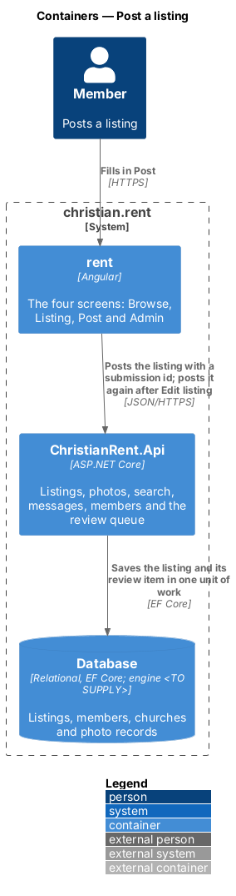
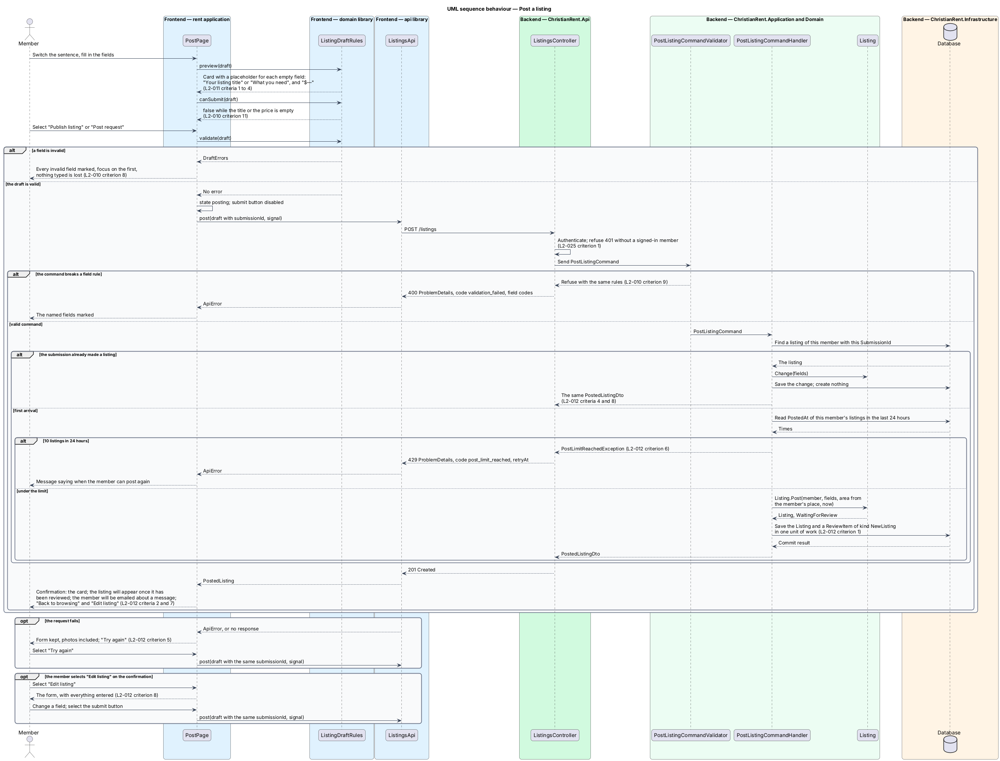

# Post a listing

## Overview

christian.rent is where Christians post spaces and things for rent, or ask for a space or a
thing to rent. What a person posts is a *listing*. A listing that offers something is *for
rent*; one that asks for something is *wanted*. A listing is for a *space* (a room, a hall, a
gymnasium, a locker, a parking space) or a *thing* (a tool, a trailer, a set of chairs).

Post is the screen where a member posts a listing in one short flow. It opens with one sentence,
"I have a thing to rent out.", whose highlighted words switch: "I have" makes a listing for
rent, and "I need" makes a wanted listing and ends the sentence "to rent.". Below the sentence
are a few fields: a title, a price with its period, when, photos (for rent only) and a note.
Post asks for no area: a listing takes its area from the place of the member who posts it. A
live preview shows the card as it will appear on Browse. After the member submits, a
confirmation shows the listing's card and says that the listing will appear once it has been
reviewed.

A new listing is not public. It is saved as waiting for review and enters the *review queue*,
where an admin approves or removes it. The review queue is designed in
`review-queue/work-review-queue`. Only a member may post; becoming a member is designed in
`members/become-member`.

The terms used below:

- **draft** — the listing as the member has filled it in so far, held in the browser until it is
  posted
- **live preview** — card built from the draft, updated on each change
- **budget** — the price of a wanted listing: the most the member will pay, shown as "Up to
  $120/day"
- **period** — what a price is per: hour, day, night, week or month
- **submission id** — identifier the browser gives a draft once, so that the same draft sent
  again changes one listing and never creates a second
- **post limit** — 10 listings posted by one member in 24 hours

Photos are designed in `listings/add-photos`.

## Description

The slice is not built yet; this section describes the components the design introduces. It runs
from the `rent` application to the database.

**Frontend**

- **`PostPage`** — page in `rent`, loaded with `loadComponent` on the route `/post`. It holds
  the draft as a signal, and its state: `editing`, `posting`, `failed`, `limitReached` or
  `posted`. It reads `offer` and `title` from the address when it opens: Browse's two buttons,
  the header's "Post" and the no-results offer set them (`L2-005` criteria 2 and 3, `L2-036`
  criterion 5, `L2-004` criterion 2). With no kind chosen the draft is for a thing, as the
  prototype opens. All state is provided at the route and goes when the member leaves Post.
- **The top bar** — Post does not render the header of Browse. Its own top bar, 64 px high,
  holds the mark alone, without the wordmark, and a control named "Close", a link to Browse
  (`L2-009` criterion 6, `L2-023` criterion 3).
- **`PostSentence`** — presentation component for the sentence, which is the page's heading. It
  reads "I have a thing to rent out." for a listing for rent and "I need a thing to rent." for a
  wanted listing (`L2-009` criterion 5). It has two highlighted words: "have" or "need", and "a
  space" or "a thing". Each is one control; selecting it switches to the other choice. Each has
  a name and a state that says which choice is selected (`L2-009` criterion 3). The ground of
  the first word is orange for "have" and blue for "need"; the ground of the second is ink.
  From 640 px the sentence breaks before "to rent out.". Switching "have" to "need" makes the
  draft a wanted listing, and `PostPage` removes the photos field (`L2-009` criterion 1).
  Switching between "a space" and "a thing" changes the kind and keeps the fields already filled
  in (`L2-009` criterion 2).
- **`ListingDraft`** — type in `api`: the submission id, offer, kind, title, price amount and
  period, when (free text), note and the ordered photo ids. It has no area.
- **`ListingDraftRules`** — rules in `domain`'s `listings/`, pure functions with a unit test of
  one case per row of the table below. `validate(draft)` returns a `DraftErrors` with one error
  code per invalid field. `canSubmit(draft)` is false while the title or the price is empty.
  `preview(draft, member)` returns the `ListingSummary` the preview card shows.
  `empty(offer, kind)` returns a new draft with a new submission id and the period "day".
- **The fields** — in order: the title, the price with its period, "when", the photos (for rent
  only) and the note (`L2-010`). From 640 px the price and "when" sit side by side. The price
  field is prefixed "$" for a listing for rent and "Up to $" for a wanted listing, accepts
  digits only, and is followed by a select that reads "per hour", "per day", "per night", "per
  week" and "per month". Each field has a visible label (`L2-032` criterion 5, `L2-010`
  criterion 10); the labels are in the table below.
- **The submit button** — reads "Publish listing", in orange, for a listing for rent and "Post
  request", in blue, for a wanted listing. It cannot be selected while the title or the price is
  empty (`L2-010` criterion 11). Beside it Post says where the listing will be shown: "Prices in
  CAD. Shown to members within 25 km of Langley, BC.", naming the member's place (`L2-010`
  criterion 6, `L2-022` criterion 7). `PostPage` reads the member's place from `MembersApi`.
- **Field errors** — on submit, `PostPage` marks every invalid field at once through
  `aria-invalid`, ties each error to its field, moves focus to the first invalid field and keeps
  everything the member typed (`L2-010` criterion 8). The prototype draws no field-error state;
  its layout and copy are `<TO SUPPLY>` until `docs/mocks/` draws it.
- **Live preview** — `PostPage` renders `ListingCard` with `preview(draft, member)`, recomputed
  on each change (`L2-011` criterion 1), under the heading "How it'll look". A wanted listing
  previews as a card with no photo (`L2-011` criterion 2). An empty field shows a placeholder,
  never "undefined" or an empty price (`L2-011` criterion 3): an empty title shows as "Your
  listing title" for a listing for rent and "What you need" for a wanted listing, and an empty
  price as "$—" (`L2-011` criterion 4). The card takes its area, its church and, for a wanted
  listing, its member's name from the signed-in member. What the preview shows as the distance
  is `<TO SUPPLY>`: a card's distance is measured from the place Browse is centred on
  (`L2-035`), and Post has no such place. Under 1024 px the preview is below the form; from
  1024 px it is beside it, 320 px wide, and stays in view as the form scrolls (`L2-031`
  criterion 4).
- **`ListingsApi`** — `post(draft, signal)` sends `POST /listings` and returns the new
  listing's id and status, or refuses with an `ApiError`.
- **Submitting** — `PostPage` disables the submit button while the request is in flight, as a
  convenience; the backend decides that one listing is created (`L2-012` criterion 4). On
  success the state becomes `posted` and a confirmation replaces the form.
- **The confirmation** — shows the listing's card, says that the member will be emailed when
  someone sends a message about the listing, and offers "Back to browsing", a link to Browse,
  and "Edit listing" (`L2-012` criterion 7). It says that the listing will appear once it has
  been reviewed and does not say it is public (`L2-012` criterion 2). A screen reader announces
  it (`L2-032` criterion 4). Its heading and its sentence are `<TO SUPPLY>`: the prototype's
  copy says the listing is already public, which `L2-012` criterion 2 forbids, and the prototype
  draws no "waiting for review" wording.
- **Edit listing** — returns the state to `editing` with the same draft, so the form holds
  everything the member entered. Posting again sends the same submission id, and the backend
  changes that listing and creates no second one (`L2-012` criterion 8).
- **Failure** — when the request fails, the form keeps everything the member entered, including
  the photos already added, and offers "Try again" (`L2-012` criterion 5). The retry sends the
  same submission id, so a first request that did reach the backend is not repeated as a second
  listing.
- **Post limit reached** — on the `code` `post_limit_reached`, `PostPage` shows a message saying
  when the member can post again, written from the `retryAt` time in the response (`L2-012`
  criterion 6).
- **A person who is not a member** — `PostPage` asks `MembersApi` who is signed in. A person who
  is not a member is asked to become a member or sign in (`L2-009` criterion 4). `PostPage`
  first saves the draft to `DraftStore` in `domain`'s `storage/`, and takes it back when the
  person returns, so their choices are kept. Becoming a member is `members/become-member`; the
  sign-in mechanism, and how Post looks to a person who is not signed in, are `<TO SUPPLY>`.
  Where `DraftStore` keeps a draft, and for how long, is `<TO SUPPLY>`.

**The field rules**

`ListingDraftRules` in the browser and `PostListingCommandValidator` in the backend apply the
same rules (`L2-010` criterion 9).

| Field | Label, for rent | Label, wanted | Rule | Criterion |
|-------|-----------------|---------------|------|-----------|
| Title | "What is it?" | "What do you need?" | 3 to 80 characters | `L2-010` criterion 1 |
| Price | "Price" | "Your budget" | given; whole dollars, a price with cents is refused; from 0 to 100,000; 0 is shown as "Free" | `L2-010` criteria 2 and 4 |
| Price period | none of its own | none of its own | hour, day, night, week or month | `L2-010` criteria 3 and 4 |
| When | "When" | "When" | may be empty; free text of up to 80 characters; no date fields | `L2-010` criterion 5 |
| Photos | "Photos" | not shown | for rent only; up to 6 | `L2-013` |
| Note | "Anything else?", marked "Optional" | "Anything else?", marked "Optional" | optional; up to 1,000 characters | `L2-010` criterion 7 |

A wanted listing's price is its budget. It has a period from the same list and keeps the limits
of a price for rent, and a wanted listing with no budget is not posted (`L2-010` criterion 4).
How a price of 0 reads as "Free" on a card and in the message box, with or without its period,
is `<TO SUPPLY>`.

Post has no field for the area (`L2-010` criterion 6). The backend sets the listing's area from
the place of the member who posts it. How a member's place is set, and how it is shown to be a
place in Canada (`L2-022` criterion 5), are `<TO SUPPLY>`: `L2-035` leaves them open.

**Backend**

- **`ListingsController`** — its `Post` action answers `POST /listings`. The fallback policy
  requires a signed-in member, so a call without one responds 401 (`L2-025` criterion 1). The
  action checks nothing itself and sends one `PostListingCommand`.
- **`PostListingCommandValidator`** — FluentValidation validator with the rules of the table. A
  refusal is a 400 ProblemDetails with the `code` `validation_failed` and one error code per
  field, which `PostPage` maps to the same field messages.
- **`PostListingCommandHandler`** — reads the member from `ICurrentMember` and the time from
  `TimeProvider`, then works in this order.
  1. It looks for a listing of this member with the command's `SubmissionId`. When one exists,
     it applies the command's fields to that listing with `Listing.Change`, returns it and
     creates nothing. Two requests from one selection of the submit button therefore create one
     listing (`L2-012` criterion 4), and a post after "Edit listing" changes that listing
     (`L2-012` criterion 8). What a change does to a listing an admin has already approved or
     removed is `<TO SUPPLY>`: editing a listing after the confirmation is not designed.
  2. It reads the times of the listings the member posted in the last 24 hours. With 10 or more,
     it throws `PostLimitReachedException`, which becomes a 429 ProblemDetails with the `code`
     `post_limit_reached` and `retryAt`, the time 24 hours after the earliest of those 10
     (`L2-012` criterion 6).
  3. It checks that each photo id belongs to the member and to no other listing, that a wanted
     listing has none and that a listing for rent has at most 6.
  4. It creates the `Listing` with `Listing.Post`, with the area taken from the member's place,
     attaches the photos in order, and creates a `ReviewItem` of kind `NewListing`. It saves
     both in one unit of work, so no listing waits outside the review queue (`L2-012`
     criterion 1).
- **`Listing`** — domain entity. `Listing.Post` sets `Status` to `WaitingForReview`, `PostedAt`
  to the given time, `Area` to the member's place and `SearchText` to the folded title, note and
  area (see `listings/search-listings`). `Listing.Change` replaces the fields and writes
  `SearchText` again. A unique index on the member and `SubmissionId` makes two requests that
  arrive together create one listing; the handler answers the losing request with the listing
  the other created.
- **`PricePeriod`** — `Hour`, `Day`, `Night`, `Week`, `Month`.
- **`PostLimit`** — domain rule holding the limit (10 listings, 24 hours) and the `RetryAt`
  calculation, with a direct unit test. Tests advance `FakeTimeProvider` and never sleep. Every
  listing the member posted in the window counts, whatever its status; a change to a listing
  already posted is not a further listing.
- **`ReviewItem`** — the listing's entry in the review queue. An admin's Approve sets the
  listing's `Status` to `Approved`, after which Browse shows it (`L2-012` criterion 3); that
  decision is designed in the `review-queue` subsystem.
- **A person who is signed in but is not a member** — the backend refuses the post (`L2-017`
  criterion 5). The refusal's `code` is defined in `members/become-member`.
- **What a member writes is data** — the title, the "when" and the note are stored as written
  and rendered as text wherever they appear (`L2-026` criterion 1).

Post's layout and states follow `docs/mocks/` once drawn, and this design is brought in line
with them then. The facts stated here come from the Magic Patterns prototype.

## Requirements

The feature realizes the following level-2 (L2) requirements. Each L2 requirement refines a
level-1 (L1) requirement, cited by identifier.

| L2 ID | Refines (L1) | Requirement |
|-------|--------------|-------------|
| `L2-009` | `L1-003` | Choose what is being posted. Post shall open with one sentence, "I have / need a space / a thing to rent out", whose highlighted words switch. "I have" shall make a listing for rent; "I need" shall make a wanted listing, and the sentence shall then end "to rent". |
| `L2-010` | `L1-003` | The fields of a listing. The fields of Post, in order, shall be a title, a price with its period, when, photos (for rent only) and a note, each validated in Post and, with the same rules, by the backend. A listing shall also have an area, which Post shall not ask for. |
| `L2-011` | `L1-003` | Live preview. When a member changes any field on Post, the preview card shall update to show the listing as it will appear on Browse, with a placeholder in place of an empty field. |
| `L2-012` | `L1-003` | Posting and confirmation. A listing submitted with valid fields shall be saved as waiting for review, shall enter the review queue, and a confirmation shall be shown with the listing's card, "Back to browsing" and "Edit listing". Two submissions of the same listing shall create one listing, and a member who has posted 10 listings in 24 hours shall be refused with a message saying when they can post again. |

## Diagrams

### System context

A member posts a listing on christian.rent, and the new listing reaches an admin through the
review queue. The slice touches no external system; the sign-in mechanism is `<TO SUPPLY>` and
is not drawn.

### Containers

The `rent` application posts the listing with its submission id to `ChristianRent.Api`, which
saves the listing and its review item in the database in one unit of work.

### Components

`PostPage` binds `PostSentence`, validates and previews with `ListingDraftRules`, keeps the
draft across sign-in with `DraftStore` and posts through `ListingsApi`. In the backend,
`ListingsController` sends `PostListingCommand` through its validator to
`PostListingCommandHandler`, which creates a `Listing` and a `ReviewItem`.

### Class structure

`ListingDraft` carries the submission id and the fields, and no area. `ListingDraftRules`
returns `DraftErrors` and the preview. `PostListingCommandHandler` asks `PostLimit`, creates or
changes `Listing`, creates `ReviewItem`, and throws `PostLimitReachedException`.

### Behaviour — post a listing

The submit button waits for a title and a price. The draft is validated in the browser, then
again by the backend with the same rules. The handler answers a repeated submission id by
changing the listing already made, refuses at the post limit, and otherwise saves the listing
and its review item together. A failed request keeps the form and retries with the same
submission id, and "Edit listing" on the confirmation returns the form.

### Behaviour — open Post

Post opens from Browse's two buttons, from the header's "Post" or from the no-results offer, set
to "I have" or "I need". A person who is not a member is asked to become a member or sign in;
the draft waits in `DraftStore` and is restored on return. The backend's part in this behaviour
belongs to `members/become-member`, so the diagram shows `MembersController` only as the source
of the answer.

