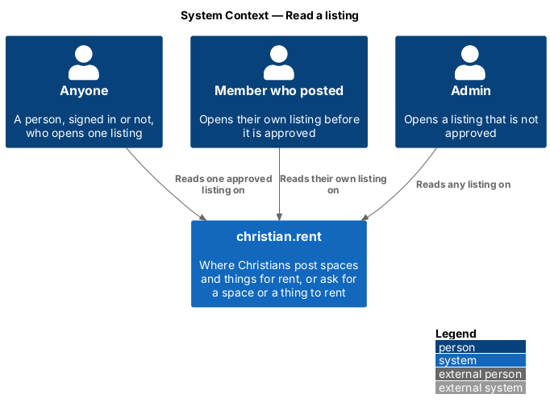
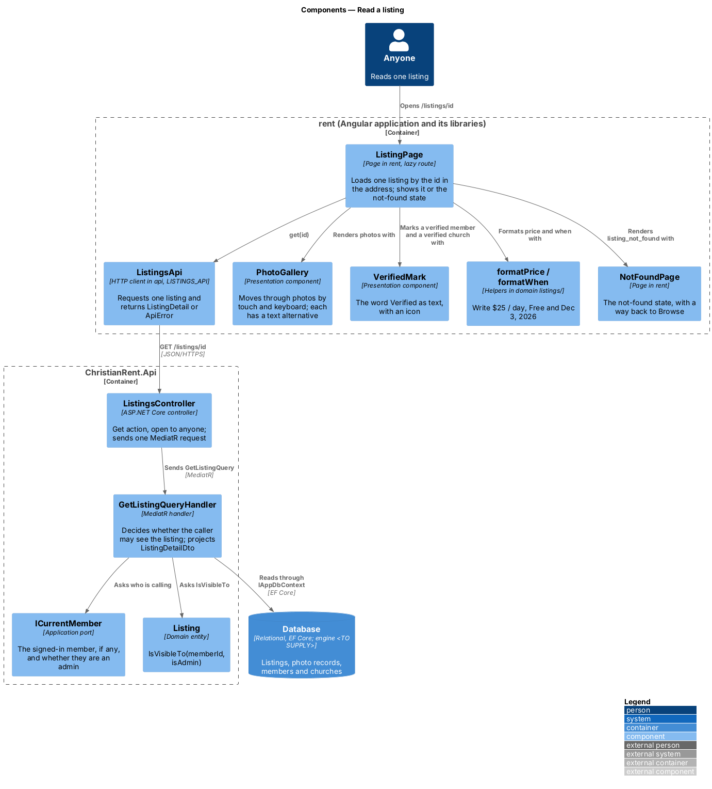
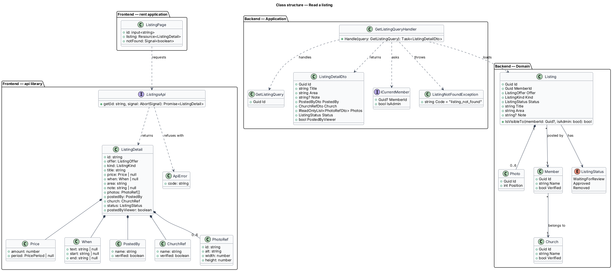

# Read a listing

## Overview

christian.rent is where Christians post spaces and things for rent, or ask for a space or a
thing to rent. What a person posts is a *listing*. A listing is *for rent* or *wanted*, and is
for a *space* or a *thing*. Someone who uses christian.rent is a *member*, and a member belongs
to a *church*. A member or a church an admin has confirmed is *verified*.

The Listing screen shows one listing: what it is, what it costs, when it is available, roughly
where it is, who posted it and which church they belong to. The member and the church are each
marked "Verified" when verified. Anyone, signed in or not, may open an approved listing. A
listing that is waiting for review, has been removed or does not exist shows the same "not
found" state to everyone but the member who posted it and an admin, and reveals nothing.

No payment happens on christian.rent, so the screen shows no way to pay, no booking calendar, no
review and no rating (`L2-024`). A person arranges a rental by sending a message from the
message box on this screen, which is designed in `messages/send-message`.

The terms used below:

- **area** — city or neighbourhood of a listing, never a street address
- **when** — description of when a space or a thing is available or needed: free text, or a
  start and an end date; a description, not a reservation
- **verified mark** — the word "Verified" with an icon, shown beside a verified member or church

## Description

The slice is not built yet; this section describes the components the design introduces. It runs
from the `rent` application to the database.

**Frontend**

- **`ListingPage`** — page in `rent`, loaded with `loadComponent` on the route `/listings/:id`,
  so its code is not in the initial download (`L2-029` criterion 2). It requests the listing
  named by the address through `ListingsApi` and aborts the request when the person leaves
  before it arrives. It shows a loading state in the shape of the listing while it waits
  (`L2-033` criterion 1). For a listing for rent it shows the photos, title, whether it is a
  space or a thing, price, when it is available, area and note (`L2-007` criterion 1). For a
  wanted listing it shows the title, whether it is a space or a thing, what the person will pay
  if given, when it is needed, area and note, and no photo (`L2-007` criterion 2). The title,
  the note, the area, the member's name and the church's name are rendered as text (`L2-026`
  criterion 1).
- **Not found** — when `ListingsApi` refuses with the `code` `listing_not_found`, `ListingPage`
  shows the "not found" state of `NotFoundPage`, with a way back to Browse (`L2-007`
  criterion 4). Any other failure shows `ErrorState` with "Try again" (`L2-033` criterion 2).
- **`ListingsApi`** — `get(id, signal)` sends `GET /listings/{id}` and returns a
  `ListingDetail`, or refuses with an `ApiError`.
- **`ListingDetail`** — type in `api`: the listing's fields, its photo references, `postedBy`
  and `church` (each a name and a `verified` flag), the listing's `status`, and
  `postedByViewer`, which is true when the signed-in member posted the listing. It has no field
  for an email address, a phone number or a street address.
- **`PhotoGallery`** — presentation component for the photos of a listing for rent. Each photo
  can be reached by touch and by keyboard, and each has a text alternative (`L2-007`
  criterion 3). The source of a photo's text alternative is `<TO SUPPLY>`: no requirement gives a
  photo a description field. Photos are requested at the gallery size, as designed in
  `listings/add-photos`.
- **`VerifiedMark`** — presentation component: the text "Verified" with an icon, never colour
  alone (`L2-008` criterion 2). `ListingPage` renders one beside the member only when
  `postedBy.verified` is true, and one beside the church only when `church.verified` is true;
  the two are independent (`L2-008` criteria 3 and 4).
- **`formatPrice`** and **`formatWhen`** — helpers in `domain`'s `listings/`. `formatPrice`
  writes Canadian dollars with the period, for example "$25 / day", with cents only when they
  are not zero, and "Free" for a price of 0 (`L2-022` criterion 1, `L2-010` criterion 2).
  `formatWhen` writes the free text, or the dates with the month as a word, for example
  "Dec 3, 2026" (`L2-022` criterion 3).
- **`MessageBox`** — sits on this screen and belongs to `messages/send-message`. `ListingPage`
  passes it the listing's id and offer, and does not offer it when `postedByViewer` is true.
- **A listing seen by its own poster or an admin before approval** — `status` tells the page
  that the listing is not public. How the screen says so is `<TO SUPPLY>` until the mocks draw
  that state.

**Backend**

- **`ListingsController`** — its `Get` action answers `GET /listings/{id}`, is marked
  `[AllowAnonymous]`, checks nothing itself and sends one `GetListingQuery`.
- **`GetListingQuery`** — carries the listing's `Id`.
- **`GetListingQueryHandler`** — loads the listing with its photo records, the member's name and
  verified flag, and the church's name and verified flag, in one query without tracking. It asks
  `ICurrentMember` who is calling and asks the listing whether that caller may see it. When the
  answer is no, or no listing has that id, it throws `ListingNotFoundException`.
- **`Listing.IsVisibleTo(memberId, isAdmin)`** — true when the listing's `Status` is `Approved`,
  when the caller is the member who posted it, or when the caller is an admin (`L2-007`
  criterion 4, `L2-025` criterion 2). The rule has a direct unit test with one case per row:
  each status against anyone, the poster, another member and an admin.
- **One refusal for three causes** — a listing that is not approved, one that has been removed
  and one that does not exist produce the same 404 ProblemDetails with the `code`
  `listing_not_found`, with the same body, so the response reveals nothing about the listing
  (`L2-007` criterion 4).
- **`ListingDetailDto`** — the projection selects the member's name and verified flag and the
  church's name and verified flag, and no other column of `Member`. The member's email address,
  phone number and street address are therefore not in the response (`L2-008` criterion 5).
- **Area** — `Listing.Area` holds a city or neighbourhood, and `Listing` has no field for a
  street address (`L2-007` criterion 5). How an area is entered and checked is designed in
  `listings/post-listing`.
- **A removed member's listings** — a listing whose member an admin has removed is no longer
  public (`L2-018` criterion 4). How a member's removal marks their listings is designed in the
  `review-queue` and `members` subsystems; this handler reads the result through `Status`.
- **Response time** — one listing responds within 200 ms at the 95th percentile (`L2-030`
  criterion 2). The handler reads by primary key.

The Listing screen's layout and states follow `docs/mocks/` once drawn, and this design is
brought in line with them then.

## Requirements

The feature realizes the following level-2 (L2) requirements. Each L2 requirement refines a
level-1 (L1) requirement, cited by identifier.

| L2 ID | Refines (L1) | Requirement |
|-------|--------------|-------------|
| `L2-007` | `L1-002` | The Listing screen. The Listing screen shall show an approved listing to anyone: its photos (for rent only), title, whether it is a space or a thing, price, when, area and note. A listing that is not approved, has been removed or does not exist shall show a "not found" state to anyone but its own poster or an admin, and nothing about the listing shall be revealed. The area shall be a city or neighbourhood and never a street address. |
| `L2-008` | `L1-002` | Who posted, and their church. A listing shall show the name of the member who posted it and the name of their church, each marked "Verified" with text and an icon when verified, separately from the other. The member's email address, phone number and street address shall not be shown and shall not be in the response. |

## Diagrams

### System context

Anyone reads an approved listing on christian.rent. The member who posted a listing and an admin
also read it before it is approved. The slice touches no external system.

### Containers

The `rent` application requests one listing from `ChristianRent.Api`, which reads the listing,
the member who posted it and their church from the database. The listing's photos come from file
storage, as designed in `listings/add-photos`.

### Components

`ListingPage` calls `ListingsApi` and renders `PhotoGallery`, `VerifiedMark` and the formatted
price and when. In the backend, `ListingsController` sends `GetListingQuery` to
`GetListingQueryHandler`, which asks `ICurrentMember` who is calling and asks `Listing` whether
that caller may see it.

### Class structure

`ListingDetail` is composed of a price, a when, `PostedBy`, `ChurchRef` and up to 6 photo
references; none of them holds a contact detail. `GetListingQueryHandler` depends on
`ICurrentMember`, loads `Listing` and throws `ListingNotFoundException`.

### Behaviour — read a listing

The handler loads the listing and asks `IsVisibleTo`. A visible listing is projected to names
and verified marks only. A listing that is not approved, removed or missing produces the same
`listing_not_found` response, and `ListingPage` shows the "not found" state.

