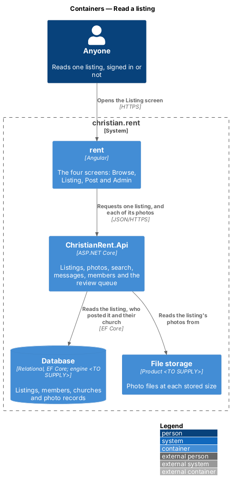
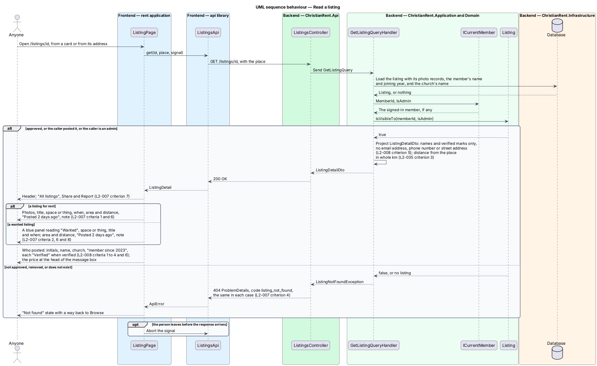

# Read a listing

## Overview

christian.rent is where Christians post spaces and things for rent, or ask for a space or a
thing to rent. What a person posts is a *listing*. A listing is *for rent* or *wanted*, and is
for a *space* or a *thing*. Someone who uses christian.rent is a *member*, and a member belongs
to a *church*. A member or a church an admin has confirmed is *verified*.

The Listing screen shows one listing: what it is, what it costs, when it is available, roughly
where it is and how far away, who posted it and which church they belong to. The member and the
church are each marked "Verified" when verified. Anyone, signed in or not, may open an approved
listing. A listing that is waiting for review, has been removed or does not exist shows the same
"not found" state to everyone but the member who posted it and an admin, and reveals nothing.

No payment happens on christian.rent, so the screen shows no way to pay, no booking calendar, no
review and no rating (`L2-024`). A person arranges a rental by sending a message from the
message box on this screen, which is designed in `messages/send-message`.

The terms used below:

- **area** — city or neighbourhood of a listing, never a street address
- **distance** — whole kilometres from the place Browse is centred on to the listing's area
- **when** — free text of up to 80 characters that says when a space or a thing is available or
  needed, for example "Most weekends"; a description, not a reservation, and it may be empty
- **verified mark** — the word "Verified" with an icon, shown beside a verified member or church

## Description

The slice is not built yet; this section describes the components the design introduces. It runs
from the `rent` application to the database.

**Frontend**

- **`ListingPage`** — page in `rent`, loaded with `loadComponent` on the route `/listings/:id`,
  so its code is not in the initial download (`L2-029` criterion 2). It requests the listing
  named by the address through `ListingsApi` and aborts the request when the person leaves
  before it arrives. It shows a loading state in the shape of the listing while it waits
  (`L2-033` criterion 1). The title, the note, the area, the "when", the member's name and the
  church's name are rendered as text (`L2-026` criterion 1).
- **The header and the top row** — `AppShell` renders above Listing the `Header` it shares with Browse
  (`L2-036`), designed in `listings/browse-listings`. Above the listing is a row with "All
  listings", a link to Browse, and at the right two icon controls named "Share" and "Report"
  (`L2-007` criterion 7). Each control has a touch target of at least 44 × 44 px (`L2-031`
  criterion 6). Share gives the listing's address to share; whether it opens the device's share
  sheet or copies the address is `<TO SUPPLY>`. Report is designed in
  `review-queue/report-listing`.
- **A listing for rent** — the screen shows the photo at 16:10, then the title as the page's
  heading, whether the listing is a space or a thing, a meta row, and the note (`L2-007`
  criterion 1). The meta row holds the area with the distance, as "Walnut Grove, Langley · 5 km"
  (`L2-035` criterion 3), the "when", and how long ago the listing was posted, as "Posted 2 days
  ago" (`L2-007` criterion 6, `L2-022` criterion 6). The prototype draws no "Space" or "Thing"
  label on a listing for rent; `L2-007` criterion 1 asks for one, and its place is `<TO SUPPLY>`
  until `docs/mocks/` draws it.
- **A wanted listing** — a blue 16:10 panel takes the place of a photo. It holds a label that
  reads "Wanted · space" or "Wanted · thing", the title as the page's heading, and when it is
  needed (`L2-007` criteria 2 and 8). The title is not repeated below the panel. The meta row
  holds the area with the distance and "Posted 2 days ago"; the note follows. A wanted listing
  has no photo.
- **The price** — on this screen the price stands at the head of the message box: "Rent for" on
  a listing for rent and "They'll pay" on a wanted listing, then the amount, then "CAD" and the
  period, as "$25" followed by "CAD / day" (`L2-022` criterion 1, `L2-015` criterion 9).
  `formatPrice` in `domain`'s `listings/`, designed in `platform/present-for-canada`, writes it
  in whole dollars. A wanted listing's price is the budget of the member who posted it and reads
  "Up to $120". A price of 0 is shown as "Free" (`L2-010` criterion 2); how "Free" stands in
  this form, with or without the period, is `<TO SUPPLY>`. Where the price stands when the
  message box is not offered, on a member's own listing, is `<TO SUPPLY>`: the prototype does
  not draw that state.
- **Who posted** — above a hairline, a circle holds the member's initials; beside it are the
  member's name and, on one line, the church's name and the year the member joined, as "member
  since 2023" (`L2-008` criteria 1 and 6). `ListingPage` takes the initials from the name.
- **`VerifiedMark`** — presentation component: the text "Verified" with an icon, never colour
  alone (`L2-008` criterion 2). `ListingPage` renders one beside the member only when
  `postedBy.verified` is true, and one beside the church only when `church.verified` is true;
  the two are independent (`L2-008` criteria 3 and 4). The prototype draws one icon, beside the
  church, with no word; `L2-008` criteria 2 to 4 stand, and `docs/mocks/` draws both marks with
  their text.
- **Not found** — when `ListingsApi` refuses with the `code` `listing_not_found`, `ListingPage`
  shows the "not found" state of `NotFoundPage`, with a way back to Browse (`L2-007`
  criterion 4). Any other failure shows `ErrorState` with "Try again" (`L2-033` criterion 2).
- **`ListingsApi`** — `get(id, place, signal)` sends `GET /listings/{id}` with the place Browse
  is centred on and returns a `ListingDetail`, or refuses with an `ApiError`. How the place is
  chosen, and what it is when a person opens a listing from its address and christian.rent
  knows nothing about them, are `<TO SUPPLY>` (`L2-035`).
- **`ListingDetail`** — type in `api`: the listing's fields, with its price amount and period,
  its "when" as text, its area, the distance in whole kilometres and the time it was posted; its
  photo references; `postedBy` (a name, the year the member joined and a `verified` flag);
  `church` (a name and a `verified` flag); the listing's `status`; and `postedByViewer`, which is
  true when the signed-in member posted the listing. It has no field for an email address, a
  phone number or a street address.
- **`PhotoGallery`** — presentation component for the photos of a listing for rent, each cropped
  to fill a 16:10 frame. Each photo can be reached by touch and by keyboard, and each has a text
  alternative (`L2-007` criterion 3). Post has no field for a text alternative, so a member
  never writes one; christian.rent writes it. Its words are `<TO SUPPLY>`. How a person moves
  through several photos is `<TO SUPPLY>`: the prototype draws one photo. Photos are requested
  at the gallery size, as designed in `listings/add-photos`.
- **`MessageBox`** — sits on this screen and belongs to `messages/send-message`. `ListingPage`
  passes it the listing's id, offer and price and the first name of the member who posted, and
  does not offer it when `postedByViewer` is true.
- **Two columns** — under 1024 px the message box is below the listing. From 1024 px it is to
  the right of the listing, 380 px wide, and stays in view as the listing scrolls (`L2-031`
  criterion 3). The content is at most 1152 px wide and centred (`L2-031` criterion 7).
- **A listing seen by its own poster or an admin before approval** — `status` tells the page
  that the listing is not public. How the screen says so is `<TO SUPPLY>` until the mocks draw
  that state.
- **States** — the prototype draws the default state and the sent state of the message box,
  each for a listing for rent and for a wanted listing. The layouts of the loading, "not
  found", not-public, own-listing and failed states are `<TO SUPPLY>` until `docs/mocks/` draws
  them.

**Backend**

- **`ListingsController`** — its `Get` action answers `GET /listings/{id}`, is marked
  `[AllowAnonymous]`, checks nothing itself and sends one `GetListingQuery`.
- **`GetListingQuery`** — carries the listing's `Id` and the `Place` the distance is measured
  from.
- **`GetListingQueryHandler`** — loads the listing with its photo records, the member's name,
  joining year and verified flag, and the church's name and verified flag, in one query without
  tracking. It asks `ICurrentMember` who is calling and asks the listing whether that caller may
  see it. When the answer is no, or no listing has that id, it throws
  `ListingNotFoundException`. For a visible listing it computes the distance from the place to
  the listing's area in whole kilometres with `BrowseRadius`, the rule designed in
  `listings/browse-listings` (`L2-035` criterion 3). Between which two points a distance is
  measured is `<TO SUPPLY>`.
- **`Listing.IsVisibleTo(memberId, isAdmin)`** — true when the listing's `Status` is `Approved`,
  when the caller is the member who posted it, or when the caller is an admin (`L2-007`
  criterion 4, `L2-025` criterion 2). The rule has a direct unit test with one case per row:
  each status against anyone, the poster, another member and an admin.
- **One refusal for three causes** — a listing that is not approved, one that has been removed
  and one that does not exist produce the same 404 ProblemDetails with the `code`
  `listing_not_found`, with the same body, so the response reveals nothing about the listing
  (`L2-007` criterion 4).
- **`ListingDetailDto`** — the projection selects the member's name, joining year and verified
  flag and the church's name and verified flag, and no other column of `Member`. The member's
  email address, phone number and street address are therefore not in the response (`L2-008`
  criterion 5).
- **Area** — `Listing.Area` holds a city or neighbourhood, and `Listing` has no field for a
  street address (`L2-007` criterion 5). A listing takes its area from the place of the member
  who posts it, as designed in `listings/post-listing`.
- **A removed member's listings** — a listing whose member an admin has removed is no longer
  public (`L2-018` criterion 4). How a member's removal marks their listings is designed in the
  `review-queue` and `members` subsystems; this handler reads the result through `Status`.
- **Response time** — one listing responds within 200 ms at the 95th percentile (`L2-030`
  criterion 2). The handler reads by primary key.

The Listing screen's layout and states follow `docs/mocks/` once drawn, and this design is
brought in line with them then. The facts stated here come from the Magic Patterns prototype.

## Requirements

The feature realizes the following level-2 (L2) requirements. Each L2 requirement refines a
level-1 (L1) requirement, cited by identifier.

| L2 ID | Refines (L1) | Requirement |
|-------|--------------|-------------|
| `L2-007` | `L1-002` | The Listing screen. The Listing screen shall show an approved listing to anyone: its photos (for rent only), title, whether it is a space or a thing, price, when, area with the distance, how long ago it was posted, and note. A wanted listing shall show a blue panel in place of a photo. A listing that is not approved, has been removed or does not exist shall show a "not found" state to anyone but its own poster or an admin, and nothing about the listing shall be revealed. The area shall be a city or neighbourhood and never a street address. |
| `L2-008` | `L1-002` | Who posted, and their church. A listing shall show the name of the member who posted it and the name of their church, each marked "Verified" with text and an icon when verified, separately from the other, with the member's initials and the year the member joined. The member's email address, phone number and street address shall not be shown and shall not be in the response. |
| `L2-035` | `L1-001`, `L1-009` | Listings near a place. The Listing screen shall show the distance from the place Browse is centred on to the listing's area beside the area, in whole kilometres. |

## Diagrams

### System context

Anyone reads an approved listing on christian.rent. The member who posted a listing and an admin
also read it before it is approved. The slice touches no external system.

### Containers

The `rent` application requests one listing from `ChristianRent.Api`, which reads the listing,
the member who posted it and their church from the database. The listing's photos come from file
storage, as designed in `listings/add-photos`.

### Components

`ListingPage` calls `ListingsApi` and, under the `Header` that `AppShell` renders, renders `PhotoGallery`, `VerifiedMark` and the
formatted price and distance. In the backend, `ListingsController` sends `GetListingQuery` to
`GetListingQueryHandler`, which asks `ICurrentMember` who is calling and asks `Listing` whether
that caller may see it.

### Class structure

`ListingDetail` is composed of a price, `PostedBy`, `ChurchRef` and up to 6 photo references,
and carries the "when" as text and the distance; none of them holds a contact detail.
`GetListingQueryHandler` depends on `ICurrentMember`, loads `Listing` and throws
`ListingNotFoundException`.

### Behaviour — read a listing

The handler loads the listing and asks `IsVisibleTo`. A visible listing is projected to names
and verified marks only, with its distance from the place. A listing that is not approved,
removed or missing produces the same `listing_not_found` response, and `ListingPage` shows the
"not found" state.

