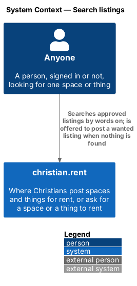
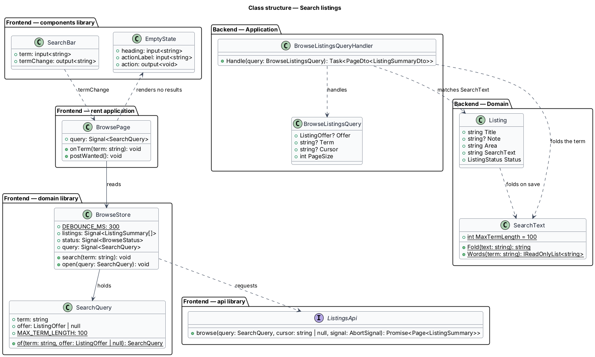

# Search listings

## Overview

christian.rent is where Christians post spaces and things for rent, or ask for a space or a
thing to rent. What a person posts is a *listing*; one that asks for something is a *wanted*
listing. Browse, the home screen, shows the approved listings.

The search bar on Browse finds approved listings by words in their title, note and area, without
regard to letter case or accents. The list updates as the person types, without a page reload.
A search that finds nothing names the search term and offers to post a wanted listing for it, so
a person who does not find a thing can ask for it in one step.

The terms used below:

- **search term** — text a person types in the search bar; only its first 100 characters are
  used
- **debounce** — wait of 300 ms after the last keystroke before a search is sent
- **folded text** — text with letter case and accents removed, so that "GYMNASIUM" and
  "gymnasium" compare equal
- **no-results state** — what Browse shows when a search matches no approved listing

Search shares Browse's request, store and paging, which are designed in
`listings/browse-listings`. This document covers what search adds to them.

## Description

The slice is not built yet; this section describes the components the design introduces.

**Frontend**

- **`SearchBar`** — presentation component: one labelled search field. It emits the term on each
  change and injects nothing.
- **`BrowsePage`** — passes each emitted term to `BrowseStore.search(term)`. When a search is
  sent, it writes the term to the query parameter `q` of the address without a page reload, so
  the term survives a reload or a shared address (`L2-002` criterion 5).
- **`BrowseStore`** — `search(term)` restarts a 300 ms timer. When the timer ends, the store
  builds a `SearchQuery` and opens it (`L2-003` criterion 3). Opening a query aborts the
  `AbortController` of the search in flight. A sequence number guards the result: a response
  that belongs to an earlier search is discarded, so it never replaces a later result. The store
  clears its timer and aborts its request when Browse is destroyed. The timer runs on an injected
  clock, so a unit test advances a fake clock and does not sleep.
- **`SearchQuery`** — `SearchQuery.of(term, offer)` trims the term and keeps its first 100
  characters (`L2-003` criterion 4). The switch choice is kept, so the term and the switch apply
  together (`L2-002` criterion 4).
- **`ListingsApi`** — `browse(query, cursor, signal)` sends the term as the parameter `q` of
  `GET /listings`.
- **`EmptyState`** — when a search with a term returns no listing, `BrowsePage` shows the
  no-results state: it names the search term and offers to post a wanted listing for it
  (`L2-004` criterion 1). The term is bound as text, never as HTML, so a term that contains HTML
  or script is shown as written and nothing runs (`L2-003` criterion 5).
- **The offer** — a link to `/post?offer=wanted&title={term}`. Post opens set to "I need", with
  the search term as the title (`L2-004` criterion 2); Post is designed in
  `listings/post-listing`. A search term may hold up to 100 characters and a title at most 80
  (`L2-010` criterion 1); what Post does with a longer term is `<TO SUPPLY>`.

**Backend**

- **`ListingsController`** — the same `Browse` action as `listings/browse-listings`, open to
  anyone.
- **`BrowseListingsQuery`** — its `Term` carries the search term.
- **`BrowseListingsQueryHandler`** — uses only the first 100 characters of `Term` (`L2-003`
  criterion 4); a longer term is cut, not refused. It splits the term into folded words with
  `SearchText.Words` and keeps the approved listings whose `SearchText` contains them. The term
  reaches the database as a parameter (`L2-026` criterion 2). Paging and ordering are those of
  `listings/browse-listings`.
- **`SearchText`** — domain value with two functions. `Fold(text)` lowercases text and removes
  accents. `Words(term)` cuts a term to 100 characters, folds it and splits it on white space.
  The same folding applies to a listing and to a term, so the two always agree.
- **`Listing.SearchText`** — the folded text of the listing's title, note and area, written
  whenever one of the three is saved. Matching on a stored, folded column does not depend on a
  database collation, so it behaves the same on EF Core InMemory in tests and on the deployed
  database (`L2-003` criteria 1 and 2).
- **Matching rule** — a one-word term matches a listing that contains that word. Whether a term
  of two or more words matches listings that contain every word or any word, and whether a word
  matches part of a longer word, are `<TO SUPPLY>`.
- **Response time** — a search responds within 300 ms at the 95th percentile with 10,000
  approved listings (`L2-030` criterion 1). The index that serves a contains-match on
  `SearchText` depends on the database engine, which is `<TO SUPPLY>`.
- **Telemetry** — the route is recorded as its template, and no log, metric or span carries the
  query string, so a search term is never recorded (`L2-028` criterion 3).

The search bar's place on Browse and the no-results state's layout and copy follow `docs/mocks/`
once drawn, and this design is brought in line with them then.

## Requirements

The feature realizes the following level-2 (L2) requirements. Each L2 requirement refines a
level-1 (L1) requirement, cited by identifier.

| L2 ID | Refines (L1) | Requirement |
|-------|--------------|-------------|
| `L2-003` | `L1-001` | Search. The search bar shall find approved listings by words in their title, note and area, without regard to letter case or accents. |
| `L2-004` | `L1-001` | A search that finds nothing offers to post a request. A search that matches no approved listing shall show a no-results state that names the search term and offers to post a wanted listing for it; taking the offer shall open Post set to "I need", with the search term as the title. |

## Diagrams

### System context

Anyone, signed in or not, searches approved listings on christian.rent. The slice touches no
external system.

### Containers

The `rent` application requests the first page of matches from `ChristianRent.Api` 300 ms after
typing pauses. The API matches the words against approved listings in the database. File storage
plays no part in matching and is not shown.

### Components

`SearchBar` emits the term to `BrowsePage`, which passes it to `BrowseStore`. The store builds a
`SearchQuery` and calls `ListingsApi`. In the backend, `BrowseListingsQueryHandler` folds the
term with `SearchText`, the same value that folds a listing's title, note and area.

### Class structure

`BrowseStore` holds a `SearchQuery`, whose factory cuts the term to 100 characters. `Listing`
keeps a `SearchText` column that `SearchText.Fold` produces, and `BrowseListingsQueryHandler`
matches the folded words of the term against it.

### Behaviour — search listings

Each keystroke restarts the 300 ms timer. When it ends, the store aborts the search in flight,
discards any late result and requests the new one. The handler cuts the term, folds it and
matches approved listings. With no match, `BrowsePage` names the term as text and offers to post
a wanted listing, which opens Post set to "I need" with the term as the title.

