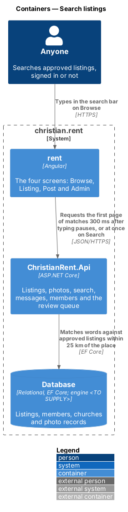
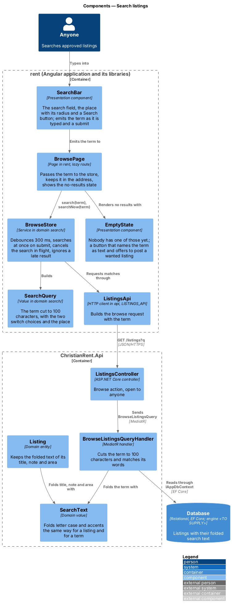
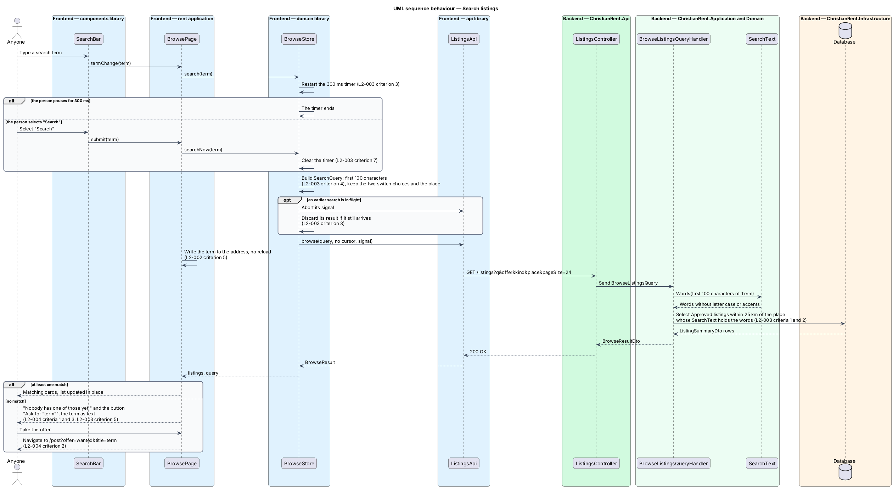

# Search listings

## Overview

christian.rent is where Christians post spaces and things for rent, or ask for a space or a
thing to rent. What a person posts is a *listing*; one that asks for something is a *wanted*
listing. Browse, the home screen, shows the approved listings within 25 km of a place.

The search bar on Browse finds approved listings by words in their title, note and area, without
regard to letter case or accents. The list updates as the person types, without a page reload,
and at once when the person selects "Search". A search that finds nothing says "Nobody has one
of those yet." and offers to post a wanted listing for the search term, so a person who does not
find a thing can ask for it in one step.

The terms used below:

- **search term** — text a person types in the search bar; only its first 100 characters are
  used
- **debounce** — wait of 300 ms after the last keystroke before a search is sent
- **folded text** — text with letter case and accents removed, so that "GYMNASIUM" and
  "gymnasium" compare equal
- **no-results state** — what Browse shows when a search matches no approved listing; the same
  state serves every empty list on Browse
- **place** — where Browse is centred; the search bar names it with its radius of 25 km

Search shares Browse's request, store and paging, which are designed in
`listings/browse-listings`. This document covers what search adds to them.

## Description

The slice is not built yet; this section describes the components the design introduces.

**Frontend**

- **`SearchBar`** — presentation component: one rounded panel that holds three parts (`L2-003`
  criterion 6). The first is the labelled search field, with a search icon and the placeholder
  "Fellowship hall, guest room, trailer…". The second is the place control, a button with a pin
  that reads the place and then its radius, for example "Langley, BC · 25 km" (`L2-035`
  criterion 1). The third is a "Search" button. Under 640 px the three are stacked; from 640 px
  they are in one row, with a hairline between the field and the place. The component takes the
  term, the place and the radius as inputs, emits the term on each change and a submit when
  "Search" is selected or Enter is pressed, and injects nothing. What the place control opens
  is `<TO SUPPLY>`: how the place is chosen is not designed (`L2-035`), and the control does
  nothing in the prototype.
- **`BrowsePage`** — passes each emitted term to `BrowseStore.search(term)` and each submit to
  `BrowseStore.searchNow(term)`. When a search is sent, it writes the term to the query
  parameter `q` of the address without a page reload, so the term survives a reload or a shared
  address (`L2-002` criterion 5).
- **`BrowseStore`** — `search(term)` restarts a 300 ms timer. When the timer ends, the store
  builds a `SearchQuery` and opens it (`L2-003` criterion 3). `searchNow(term)` clears the timer
  and opens the query at once (`L2-003` criterion 7). Opening a query aborts the
  `AbortController` of the search in flight. A sequence number guards the result: a response
  that belongs to an earlier search is discarded, so it never replaces a later result. The store
  clears its timer and aborts its request when Browse is destroyed. The timer runs on an injected
  clock, so a unit test advances a fake clock and does not sleep.
- **`SearchQuery`** — `SearchQuery.of(term, offer, kind, place)` trims the term and keeps its
  first 100 characters (`L2-003` criterion 4). The choices on the two switches and the place are
  kept, so the term, the switches and the 25 km radius apply together (`L2-002` criteria 4
  and 7, `L2-035` criterion 2).
- **`ListingsApi`** — `browse(query, cursor, signal)` sends the term as the parameter `q` of
  `GET /listings`.
- **`EmptyState`** — when a search with a term returns no listing, `BrowsePage` shows the
  no-results state (`L2-004` criterion 1). Its heading reads "Nobody has one of those yet.". Its
  text reads "Post a request and we'll let you know the moment someone nearby can help. Most
  requests get a reply within a day.". Its button is blue and names the search term, as "Ask for
  “parking space”" (`L2-004` criterion 3). The term is bound as text, never as HTML, so a term
  that contains HTML or script is shown as written and nothing runs (`L2-003` criterion 5). The
  headline of Browse and its two buttons stay above the state.
- **The same state with no term** — when the choices on Browse match no approved listing and no
  search term is entered, `BrowsePage` shows the same state and the button reads "Ask for “it”"
  (`L2-001` criterion 9), as designed in `listings/browse-listings`.
- **The offer** — the button is a link to `/post?offer=wanted&title={term}`. Post opens set to
  "I need", with the search term as the title (`L2-004` criterion 2); Post is designed in
  `listings/post-listing`. With no term the link is `/post?offer=wanted` and Post opens with an
  empty title. A search term may hold up to 100 characters and a title at most 80 (`L2-010`
  criterion 1); what Post does with a longer term is `<TO SUPPLY>`.

**Backend**

- **`ListingsController`** — the same `Browse` action as `listings/browse-listings`, open to
  anyone.
- **`BrowseListingsQuery`** — its `Term` carries the search term, beside `Offer`, `Kind` and
  `Place`.
- **`BrowseListingsQueryHandler`** — uses only the first 100 characters of `Term` (`L2-003`
  criterion 4); a longer term is cut, not refused. It splits the term into folded words with
  `SearchText.Words` and keeps the approved listings whose `SearchText` contains them. The term
  reaches the database as a parameter (`L2-026` criterion 2). Paging, ordering, the two switches
  and the 25 km radius are those of `listings/browse-listings`.
- **`SearchText`** — domain value with two functions. `Fold(text)` lowercases text and removes
  accents. `Words(term)` cuts a term to 100 characters, folds it and splits it on white space.
  The same folding applies to a listing and to a term, so the two always agree.
- **`Listing.SearchText`** — the folded text of the listing's title, note and area, written
  whenever one of the three is saved. Matching on a stored, folded column does not depend on a
  database collation, so it behaves the same on EF Core InMemory in tests and on the deployed
  database (`L2-003` criteria 1 and 2).
- **Matching rule** — a one-word term matches a listing that contains that word. Whether a term
  of two or more words matches listings that contain every word or any word, and whether a word
  matches part of a longer word, are `<TO SUPPLY>`; the prototype's own filter is demo code and
  settles neither.
- **Response time** — a search responds within 300 ms at the 95th percentile with 10,000
  approved listings (`L2-030` criterion 1). The index that serves a contains-match on
  `SearchText` depends on the database engine, which is `<TO SUPPLY>`.
- **Telemetry** — the route is recorded as its template, and no log, metric or span carries the
  query string, so a search term is never recorded (`L2-028` criterion 3).

The search bar's place on Browse and the no-results state's layout follow `docs/mocks/` once
drawn, and this design is brought in line with them then. The facts stated here come from the
Magic Patterns prototype.

## Requirements

The feature realizes the following level-2 (L2) requirements. Each L2 requirement refines a
level-1 (L1) requirement, cited by identifier.

| L2 ID | Refines (L1) | Requirement |
|-------|--------------|-------------|
| `L2-003` | `L1-001` | Search. The search bar shall find approved listings by words in their title, note and area, without regard to letter case or accents. It shall hold the search field, the place and its radius, and a "Search" button. |
| `L2-004` | `L1-001` | A search that finds nothing offers to post a request. A search that matches no approved listing shall show a no-results state that names the search term and offers to post a wanted listing for it; its heading shall read "Nobody has one of those yet." and its button shall name the search term. Taking the offer shall open Post set to "I need", with the search term as the title. |

## Diagrams

### System context

Anyone, signed in or not, searches approved listings on christian.rent. The slice touches no
external system.

### Containers

The `rent` application requests the first page of matches from `ChristianRent.Api` 300 ms after
typing pauses, or at once when "Search" is selected. The API matches the words against approved listings in the database. File storage
plays no part in matching and is not shown.

### Components

`SearchBar` emits the term to `BrowsePage`, which passes it to `BrowseStore`. The store builds a
`SearchQuery` and calls `ListingsApi`. In the backend, `BrowseListingsQueryHandler` folds the
term with `SearchText`, the same value that folds a listing's title, note and area.

### Class structure

`BrowseStore` holds a `SearchQuery`, whose factory cuts the term to 100 characters. `Listing`
keeps a `SearchText` column that `SearchText.Fold` produces, and `BrowseListingsQueryHandler`
matches the folded words of the term against it.

### Behaviour — search listings

Each keystroke restarts the 300 ms timer. When it ends, or when the person selects "Search",
the store aborts the search in flight, discards any late result and requests the new one. The
handler cuts the term, folds it and matches approved listings. With no match, `BrowsePage` shows
"Nobody has one of those yet." and a button that names the term as text, which opens Post set to
"I need" with the term as the title.

