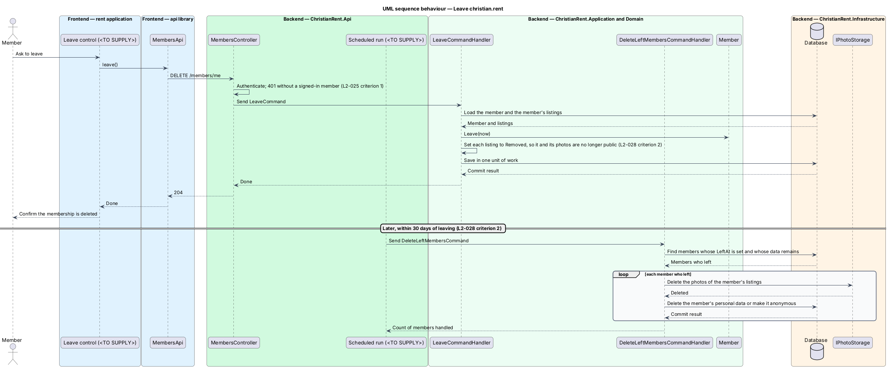

# Become a member

## Overview

christian.rent is for Christians. Anyone may browse, search and read a listing. A person becomes
a *member* before they post a listing, send a message or report a listing. A member belongs to a
*church*. A member or a church an admin has confirmed is *verified*.

This feature covers the moment a person joins. The person gives their name, names their church
and declares that they are a Christian. The church is one already known to christian.rent, or a
new one entered with its name and city. Without all three the person does not become a member.
The new member enters the *review queue*, the list an admin works through, and is not verified.
A member who is not yet verified may post and send a message; their name shows no verified mark.
christian.rent reaches a member at their email address, which is shown to nobody but the member.

The feature also covers the end of a membership. christian.rent collects only what the product
uses. When a member asks to leave, their listings and photos stop being public, and their
personal data is deleted or made anonymous within 30 days.

One local term is used below.

- **declaration** — statement, made by the person joining, that they are a Christian

Sign-in is `<TO SUPPLY>`: it is not designed, and it is not built before its design exists. This
design says "the signed-in member" and shows an identification step without naming a mechanism.

## Description

The slice is not built yet; the components below are the ones the design introduces. The slice
runs from the join form in the `rent` application to the database behind `ChristianRent.Api`.

**Frontend**

- **Join host** — `<TO SUPPLY>`. The four designed screens are Browse, Listing, Post and Admin,
  and none of them is a join screen; the Magic Patterns prototype draws no join or sign-in
  screen. Whether the join form opens as a CDK Dialog or as a screen of its own is decided when
  its mock is drawn. Whichever it is, it lives in `rent`, is loaded
  lazily, binds `JoinForm`, and calls `MembersApi` through the `MEMBERS_API` token.
- **`JoinForm`** — presentation component in `components` (selector `cr-join-form`). It holds
  three fields: the name, the church and the declaration. The church field offers the churches
  that match what the person types, and an entry for a new church with its name and city
  (`L2-017` criterion 2). Its outputs are `churchSearch` and `join`. It injects no service, token
  or router.
- **`MemberRules`** — pure helper in `domain`, in a `members/` folder this slice adds. It refuses
  an entry without a name, without a church or without the declaration (`L2-017` criterion 1), a
  name longer than 60 characters and a church name longer than 100 (`L2-017` criterion 6). The
  limit on a city's length is `<TO SUPPLY>`; the specs give none.
- **`MembersApi`** — contract and injection token (`MEMBERS_API`) in `api`, with its HTTP client:
  `findChurches(term)`, `join(request)` and `leave()`. A refusal is an `ApiError` whose `code`
  the join host branches on.
- **`JoinRequest`**, **`NewChurch`**, **`ChurchSummary`** — types in `api`. A `JoinRequest`
  carries either the identifier of an existing church or a `NewChurch`, never both.

A person reaches the join form from Post (`L2-009` criterion 4), from the message box
(`L2-015` criterion 5) or from Report (`L2-021` criterion 5). `DraftStore` keeps what the person
had entered there; those features own that step (`listings/post-listing`,
`messages/send-message`, `review-queue/report-listing`). After joining, the join host returns the
person to where they came from.

**Backend**

- **`ChurchesController`** — `GET /churches?search=` sends one `FindChurchesQuery`. Its handler
  returns at most one page of churches whose name matches the term, each with its name and city
  (`L2-030` criterion 3).
- **`MembersController`** — `POST /members` sends one `JoinCommand`; `DELETE /members/me` sends
  one `LeaveCommand`. The controller checks nothing itself.
- **`JoinCommand`** — request carrying `Name`, `ChurchId` or `NewChurchName` with
  `NewChurchCity`, and `DeclaresChristian`. It carries no verified flag: a person joining cannot
  set a mark (`L2-018` criterion 5).
- **`JoinCommandValidator`** — FluentValidation validator applying the same rules as
  `MemberRules`, so a request sent straight to the backend is refused with the reason
  (`L2-017` criteria 1 and 6, `L2-026` criterion 2).
- **`JoinCommandHandler`** — MediatR handler. It refuses with `church_not_found` when the picked
  church does not exist and with `already_member` when the person is already a member. Otherwise
  it creates a `Church` that is not verified when a new one was entered, a `Member` that is not
  verified, and a `ReviewItem` of kind `NewMember`, and saves the three in one unit of work
  (`L2-017` criterion 3). It creates no review item for the church: the review queue holds none
  (`L2-018` criterion 6). Whether a new church that matches the name and city of an existing one
  is joined to it or stored as a second church is `<TO SUPPLY>`.
- **`Member`** — domain entity: `Id`, `Name`, `Email`, `ChurchId`, `IsVerified`, `JoinedAt` and
  `LeftAt`. `Email` is the member's email address, the one field that reaches a member: every
  notice christian.rent writes to a member goes to it, and no response shows it to anyone but
  that member (`L2-028` criterion 4, `L2-008` criterion 5). Whether the join form asks for the
  email address or sign-in supplies it is `<TO SUPPLY>` with sign-in, as is what the member signs
  in with (`L2-028` criterion 1). No other personal data is collected. `JoinedAt` supplies the
  year shown beside the church on Listing, as "member since 2023" (`L2-008` criterion 6), and
  how long the member has been a member in the review queue (`L2-019` criterion 2).
- **`Church`** — domain entity: `Id`, `Name`, `City` and `IsVerified`. A church that is not
  verified is waiting to be confirmed; an item of its member in the review queue says the church
  is pending (`L2-018` criterion 6).
- **`ReviewItem`** — domain entity the review queue lists; here of kind `NewMember`, pointing at
  the member and labelled "New member" in the queue (`L2-019` criterion 1). The review queue
  shows the item through the listing that member posted (`L2-019` criterion 2). What the queue
  shows for a new member who has posted nothing, which is the case at the moment of joining, is
  `<TO SUPPLY>`. An admin decides the item in `review-queue/decide-review-item`, and
  `members/verify-member-and-church` describes what that decision does to the member.

A member who is not verified may post and send a message (`L2-017` criterion 4): no handler in
`listings/post-listing` or `messages/send-message` reads `IsVerified`. A person who is not a
member is refused by the backend when they post, send a message or report (`L2-017`
criterion 5): those endpoints require a signed-in member, and only browsing, searching, reading
an approved listing and reading a photo of an approved listing are marked `[AllowAnonymous]`
(`L2-025` criterion 1). `GET /churches` and `POST /members` are called by a person who is not
yet a member, and `L2-025` criterion 1 names neither among the endpoints open without a
signed-in member. Whether the two are open to a person who is not yet a member, and whether that
person is already signed in at that point or joining creates what they sign in with, is
`<TO SUPPLY>` with sign-in.

**Leaving**

- **`LeaveCommandHandler`** — MediatR handler. It reads the member from `ICurrentMember`, sets
  `LeftAt` from `TimeProvider`, and sets each of the member's listings to
  `ListingStatus.Removed`. From that moment the listings are not shown on Browse or Listing, and
  their photos are not served (`L2-028` criterion 2, `L2-014` criterion 5).
- **`DeleteLeftMembersCommandHandler`** — MediatR handler for `DeleteLeftMembersCommand`. For
  each member whose `LeftAt` is set, it deletes the photos of the member's listings through
  `IPhotoStorage` and deletes the member's personal data or makes it anonymous. It shall complete
  this within 30 days of `LeftAt` (`L2-028` criterion 2). The email address is among the
  personal data it handles. What runs the command on a schedule is `<TO SUPPLY>`. Which data is
  deleted and which is made anonymous is `<TO SUPPLY>`, as is what becomes of messages the
  member sent that another member received.

Where a member asks to leave is `<TO SUPPLY>`: no designed screen holds that control, and what
the account control of the header opens is not designed (`L2-036`).

Names from the backend, a member's and a church's, are data and are rendered as text, never as
HTML (`L2-026` criterion 1). No log, metric or span of this slice carries a name, an email
address or another contact detail (`L2-028` criterion 3).

The layout and the states of the join form follow `docs/mocks/` once the mocks are drawn, and
this design is brought in line with them then. The facts stated here come from the Magic
Patterns prototype, which draws no join screen: it fixes that a member is reached by email and
how a new member appears in the review queue, and nothing of the form.

## Requirements

The feature realizes the following level-2 (L2) requirements. Each L2 requirement refines a
level-1 (L1) requirement, cited by identifier.

| L2 ID | Refines (L1) | Requirement |
|-------|--------------|-------------|
| `L2-017` | `L1-006` | Becoming a member: a person who joins shall give their name and their church and declare that they are a Christian; without all three they shall not become a member. |
| `L2-028` | `L1-011` | Personal data is kept to a minimum: only what the product uses shall be collected, namely a member's name, their church and what is needed to sign in and reach them; the personal data of a member who leaves shall be deleted or made anonymous within 30 days; and christian.rent shall write to a member at their email address, which shall be shown to nobody but the member. |

## Diagrams

### System context

A person who is not a member joins through christian.rent, and the new member appears in the
review queue an admin works through. A member may later ask to leave. The mechanism that
identifies the person is `<TO SUPPLY>`.

### Containers

The `rent` application finds churches, joins and leaves through `ChristianRent.Api`, which
writes members, churches and review items to the database. File storage takes part only when the
photos of a member who left are deleted.

### Components

The join host binds `JoinForm`, checks the entry with `MemberRules` and calls `MembersApi`. In
`ChristianRent.Api`, `ChurchesController` and `MembersController` each send one request;
`JoinCommandHandler` writes the member, the church and the review item, `LeaveCommandHandler`
takes the member's listings out of public view, and `DeleteLeftMembersCommandHandler` deletes
what remains.

### Class structure

`JoinCommandHandler` creates a `Member`, a `Church` when a new one was entered, and a
`ReviewItem` of kind `NewMember`. Each `Member` belongs to one `Church` and holds one email
address. On the frontend,
`MembersApi` takes a `JoinRequest`, which holds a `NewChurch` only when no existing church was
picked.

### Behaviour — become a member

The person searches for a church, picks one or enters a new one, declares being a Christian and
joins. The join host and then the backend refuse an entry that lacks any of the three or exceeds
a length limit. Otherwise the handler saves the member, not verified, and the review item
together, with no review item for the church, and the person returns to where they came from.

### Behaviour — leave christian.rent

`LeaveCommandHandler` marks the member as having left and sets their listings to `Removed` in
one unit of work, so the listings and photos stop being public at once. A later scheduled run
deletes the photos and deletes the personal data or makes it anonymous, within 30 days.

