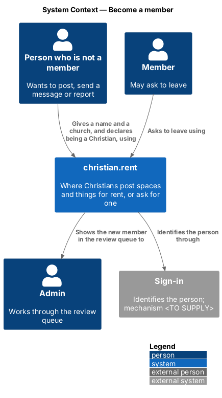
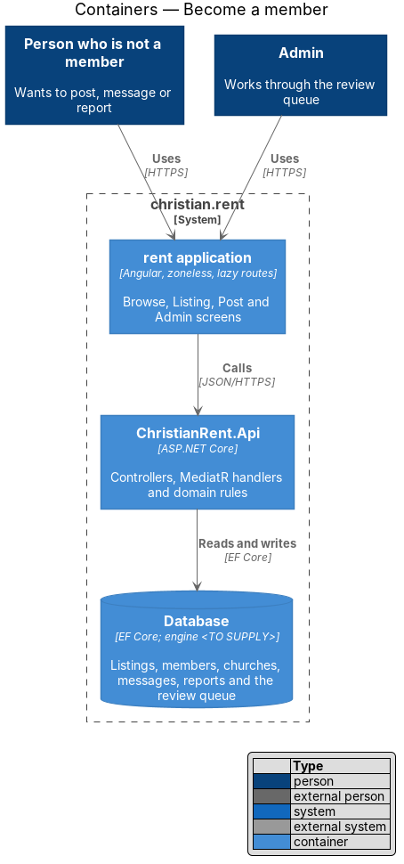
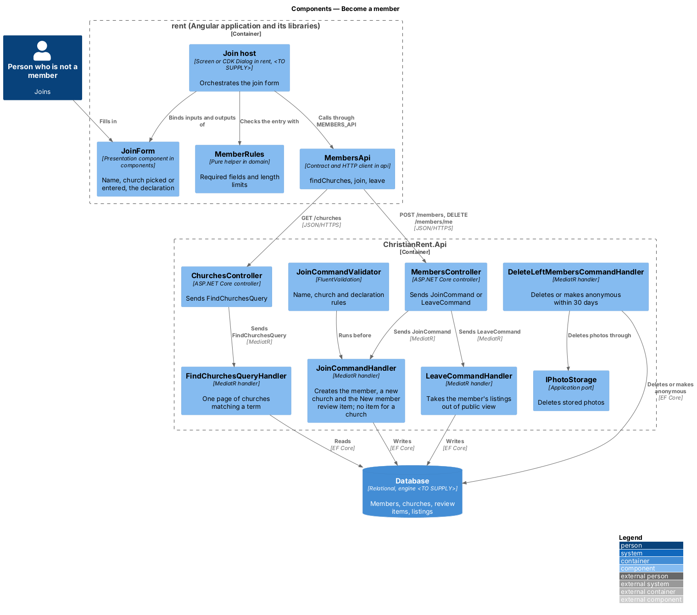
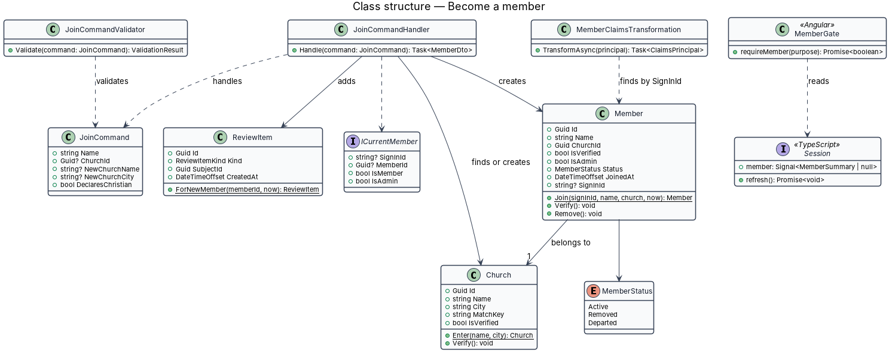
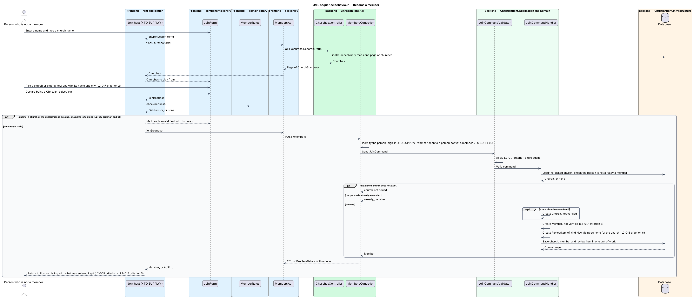

# Become a member

## Overview

christian.rent is for Christians. Anyone may browse, search and read a listing. To post, to
send a message or to report a listing, a person first becomes a member: they give their
name, name their church, and declare that they are a Christian. A new member is not
verified and enters the review queue, and may post and message at once.

- **member** — person who uses christian.rent after joining
- **church** — congregation a member belongs to, with a name and a city
- **declaration** — statement "I am a Christian", required to join
- **Join dialog** — dialog titled "Become a member" that collects the three items
- **member gate** — check made before posting, messaging or reporting, which opens the Join
  dialog for a person who is not a member

How a member signs in is not designed yet. This feature designs membership itself and
isolates sign-in behind one interface on each side, so that the sign-in design can be added
without changing the slices that depend on membership.

## Description

**Frontend — `rent` application**

- **`MemberGate`** — `requireMember(purpose): Promise<boolean>`, where `purpose` is
  `'post'`, `'message'` or `'report'`. It reads `SESSION.member()`. For a member it resolves
  `true`. Otherwise it asks `SESSION.refresh()` again and, while that answers, imports
  `JoinDialog` dynamically; for a person who is still not a member it opens the dialog with the
  CDK `Dialog` and resolves with the result ([ADR 0017](../../../adr/0017-identifying-a-person-until-sign-in.md)). The dialog code stays out of the initial
  bundle. Post, the message box and the Report button each call it (L2-009 criterion 4,
  L2-015 criterion 5, L2-021 criterion 5).
- **`JoinDialog`** (`rent/src/app/join/`, selector `cr-join-dialog`) — orchestrating dialog
  with states `default`, `new-church`, `busy`, `invalid`, `failed` and `churches-failed`. Its
  title names the purpose: "Become a member to post", "… to send a message" or "… to report"
  (criterion 12, [ADR 0018](../../../adr/0018-joining-open-decisions.md)). Its text says that
  browsing is open to anyone, that posting, messaging and reporting need a member, and that
  what the person has filled in is kept (L2-017, criterion 7). It has three fields: "Your
  name" (`maxlength` 60), "Your church" and the checkbox "I am a Christian" (criterion 9). It
  loads churches from `CHURCHES_API.list()` and shows each as "{name}, {city}". Choosing "My
  church isn't listed" shows the church name (`maxlength` 100) and city fields and the line
  "An admin confirms a new church before it is shown as verified." (criterion 8). When the
  churches cannot be loaded, the church field says so and offers "Try again", and "My church
  isn't listed" stays available (criterion 13). In
  `invalid` each missing item is marked and says why (criterion 10). In `busy` the button
  carries `aria-busy` and the fields are read-only; in `failed` an alert says the person was
  not added, the entries stay and the button reads "Try again" (criterion 11). Focus starts
  inside the dialog and returns to the opening control on close; under 640 px the dialog is
  a bottom sheet. "Not now" closes it and changes nothing. The same dialog serves posting,
  messaging and reporting (criterion 12).
- **`JoinStore`** (`rent/src/app/join/`) — the dialog's state, provided by the dialog: what
  was entered, the churches and whether they loaded, and joining (`idle`, `busy`, `failed`).
  Errors show once a person has tried to join, and each clears as its field is put right; the
  first invalid field takes focus. Leaving the dialog aborts the churches' request.
- **`validateJoinForm`** (`domain/members/join-form.ts`, the `JoinFormValidator` rules) and
  `toJoinRequest` — name 1 to 60 characters; a chosen church, or
  a new church name of 1 to 100 characters with a city of 1 to 80; the declaration checked
  (L2-017, criteria 1, 2 and 6). It answers the message of each invalid field, in the words of
  the `invalid` mock.

**Frontend — `api` library**

- **`Session`** with the token **`SESSION`** — `member: Signal<MemberSummary | null>` and
  `refresh(): Promise<void>`. `MemberSummary` is `{ id, name, initials, isAdmin, isVerified }`.
  The site header shows the initials (L2-036, criterion 2). `SESSION` is bound in
  `app.config.ts` to `AppSession` (`rent/src/app/members/`), because the whole application
  shares it; `AppSession` asks `MEMBERS_API.me()` when the app starts, without holding up the
  first screen, and writes the initials with `initialsOf` (ADR 0016).
- **`MembersApi`** (`MEMBERS_API`) — `join(request): Promise<Member>`, `me(): Promise<Member |
  null>` (null for 204). `HttpMembersApi` is bound in `app.config.ts` with `SESSION`.
- **`ChurchesApi`** (`CHURCHES_API`) — `list(signal): Promise<ChurchOption[]>`.
  `HttpChurchesApi` (its own file) is provided by `JoinDialog` itself, so its code loads with
  the dialog and stays out of the initial bundle.

**Frontend — `components` library**

- **`cr-dialog`**, **`cr-text-field`**, **`cr-select`**, **`cr-checkbox`**, **`cr-alert`**,
  **`cr-field-row`**.
  Each field has a visible label and its error tied to it (L2-032, criterion 5). `cr-dialog`
  is the panel only (header with its title as an `h2`, description and close, body and
  footer); the CDK `Dialog` holds focus, closes on Escape and returns focus, and its pane
  covers the viewport so the panel is a bottom sheet under 640 px.

**Backend**

- **`MembersController`** — `POST /api/members` sends `JoinCommand`; `GET /api/members/me`
  sends `GetCurrentMemberQuery` and returns 204 when the caller is not a member.
- **`ChurchesController`** — `GET /api/churches` sends `ListChurchesQuery` and returns
  `ChurchOptionDto { Id, Name, City }`, ordered by name.
- **`JoinCommand`** — `{ Name, ChurchId?, NewChurchName?, NewChurchCity?, DeclaresChristian }`.
- **`JoinCommandValidator`** — the rules of `JoinFormValidator`. `DeclaresChristian` false
  is refused with `validation_failed`.
- **`JoinCommandHandler`** — returns the existing member when the caller already is one
  (200), and refuses a removed member with `not_a_member`. Otherwise it resolves the church:
  the existing one by `ChurchId` (an unknown one is `validation_failed` on `churchId`), or a
  new `Church` that is not verified; a new church whose `ChurchMatch` key equals an existing
  church's reuses it (ADR 0018). It creates `Member.Join(name, church, now)` with `IsVerified = false`, adds
  `ReviewItem.ForNewMember(member.Id, now)`, and saves in one unit of work (L2-017,
  criterion 3). It answers `MemberDto { Id, Name, IsVerified, IsAdmin }` with 201.
- **`Member`** — stores `Name`, `ChurchId`, `IsVerified`, `IsAdmin`, `Status`, `JoinedAt`,
  `DepartedAt` and the sign-in identifier `SignInId`. It stores nothing else about the person
  (L2-028, criterion 1).
- **`ReviewItem`** — `{ Id, Kind, SubjectId, CreatedAt }`; journeys 10 and 11 add the
  decision. `ForNewMember(memberId, now)` makes a `NewMember` item.
- **`ICurrentMember`** (`ChristianRent.Application`) — `SignInId`, `MemberId`, `IsMember`,
  `IsAdmin`. Every handler that needs a member calls `RequireMember()`, which raises
  `ForbiddenException` with the code `not_a_member` for anyone who is not an active member
  (L2-017, criterion 5). `MemberClaimsTransformation` turns the sign-in identifier into the
  member (ADR 0017).

An unverified member posts and messages like any other member; their name shows no verified
mark (L2-017, criterion 4).

**Decided**

- How a person is identified before and after joining: the sign-in identifier is the `sub`
  claim, stored as `Member.SignInId`; no sign-in screen is built
  ([ADR 0017](../../../adr/0017-identifying-a-person-until-sign-in.md)).
- `POST /api/members`, `GET /api/churches` and `GET /api/members/me` need a signed-in person
  and not a member; they are not exceptions to L2-025 criterion 1 (ADR 0017).
- A new church is matched by its trimmed, single-spaced, lower-cased name and city without
  accents; its city takes up to 80 characters (ADR 0018).
- The behaviour specs drive `MemberGate` from a host page that only the `e2e` build contains
  (ADR 0018).

**Undecided**

- Sign-in, sign-out, and the contact detail needed "to reach them": `<TO SUPPLY>`. The mocks
  draw no credentials on purpose.
- How a member asks to leave (L2-028, criterion 2): the backend part is designed in
  [handle-member-data](../../platform/handle-member-data/README.md) and built; its screen is
  `<TO SUPPLY>`.

### Mocks

The mocks are the source of truth for the UI of this feature. The states this design covers are:

- [`docs/mocks/dialogs/join/default.html`](../../../mocks/dialogs/join/default.html): name, church and declaration
- [`docs/mocks/dialogs/join/new-church.html`](../../../mocks/dialogs/join/new-church.html): a new church with its name and city
- [`docs/mocks/dialogs/join/busy.html`](../../../mocks/dialogs/join/busy.html): the request is in flight
- [`docs/mocks/dialogs/join/invalid.html`](../../../mocks/dialogs/join/invalid.html): missing name, church or declaration
- [`docs/mocks/dialogs/join/failed.html`](../../../mocks/dialogs/join/failed.html): the request failed; "Try again"
- [`docs/mocks/dialogs/join/churches-failed.html`](../../../mocks/dialogs/join/churches-failed.html): the churches could not be loaded

## Requirements

The feature realizes the following level-2 (L2) requirements from
[`docs/specs/L2.md`](../../../specs/L2.md). Each L2 requirement refines a level-1 (L1)
requirement, cited by identifier. The table restates each requirement in `shall` form; the
acceptance criteria in the specification remain authoritative.

| L2 ID | Refines (L1) | Requirement |
|-------|--------------|-------------|
| `L2-009` | `L1-003` | Post shall open with the sentence "I have / need a space / a thing to rent out", with both words of each pair shown and the chosen one highlighted. Switching "have" to "need" shall make a wanted listing, remove the photos field and change the sentence, the field labels and the button. Each word shall be a named control with a selected state. "A thing" shall be chosen when no kind is given. A person who is not a member shall be asked to become a member or sign in and shall return to Post with their choices kept. |
| `L2-015` | `L1-005` | The Listing screen shall have a message box that sends a message of 1 to 1,000 characters to the person who posted, with start and end dates when the listing is for rent. The box shall name the person who posted, show the price with "CAD" and state that no payment happens here. Invalid fields shall be listed in a summary that takes focus. A confirmation shall replace the message box once sent; it shall quote the message back and shall not say where the reply arrives. A non-member's message and dates shall be kept while they become a member. The message box shall not be offered on a member's own listing. A failed send shall keep the text and dates. |
| `L2-017` | `L1-006` | A person shall become a member by giving their name and their church and declaring that they are a Christian. The church shall be an existing church or a new one with its name and city. A new member shall enter the review queue and shall not be verified. A member who is not verified may post and message. A name longer than 60 characters, a church name longer than 100 or a city longer than 80 shall be refused. One join dialog shall serve posting, messaging and reporting, its title naming which; it shall mark each missing item, keep what was entered when joining fails, and still allow a new church when the churches cannot be loaded. A new church matching an existing one apart from capitals, accents and spacing shall reuse it, and joining twice shall create nothing. |
| `L2-021` | `L1-008` | A member shall be able to report a listing with a reason from a fixed list and an optional note of up to 500 characters. A report with no reason shall not be sent. The report shall enter the review queue and the member shall see a confirmation. A second report by the same member on the same listing shall not be created. The member who posted shall never be told who reported. Report shall not be offered on a member's own listing. |
| `L2-025` | `L1-011` | Every endpoint other than browsing, searching, reading an approved listing and serving its photos shall respond 401 to anyone not signed in. Listing the churches, joining and asking who is signed in shall not be refused for want of membership. The backend shall refuse a request for, or a change to, anything that is not the member's own, and shall reveal nothing about it. A refusal a screen branches on shall be a ProblemDetails with a `code`. |
| `L2-028` | `L1-011` | Only the member's name, church and what is needed to sign in and reach them shall be collected. When a membership is deleted, the member's listings and photos shall no longer be public and their personal data shall be deleted or made anonymous within 30 days. No log, metric or trace shall hold a contact detail, token, message text, query string or request body. |
| `L2-032` | `L1-014` | Every screen shall meet WCAG 2.2 level AA. Every action shall be completable by keyboard with visible focus. A state shall be carried by text or an announced attribute, never by colour alone. Confirmations and errors shall be announced. Every field shall have a visible label with its error tied to it. Reduced motion shall be honoured, and text at 200% shall lose nothing. "Skip to content" shall be the first control, and a dialog shall hold focus and return it on close. |

## Diagrams

### System context

The people involved are: person who is not a member, admin. Each reaches the feature through christian.rent, which takes no payment and holds no booking calendar.

### Containers

The rent application calls `ChristianRent.Api` over JSON/HTTPS. The API persists state through EF Core.

### Components

`MemberGate` is the single entry to the Join dialog. `JoinCommandHandler` creates the
`Member`, a `Church` when new, and the `ReviewItem` together. `ICurrentMember` hides how the
caller is identified.

### Class structure

`Member` belongs to one `Church`; both start unverified. `ICurrentMember` on the backend and
`Session` on the frontend are the two seams behind which sign-in will sit.

### Behaviour — become a member

The dialog collects the name, the church and the declaration (`L2-017`). The handler
creates the member unverified and adds the review item in the same unit of work.

