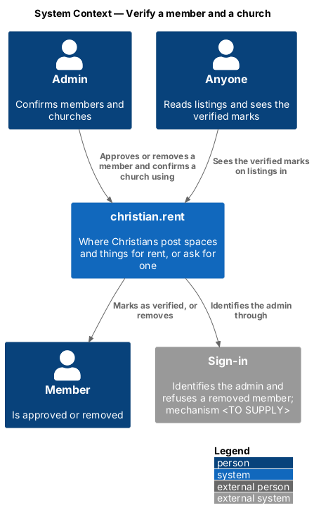
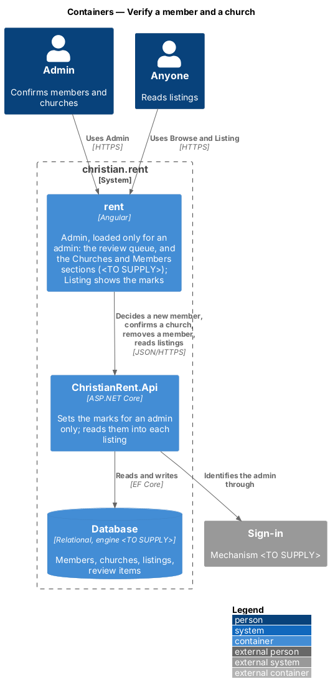
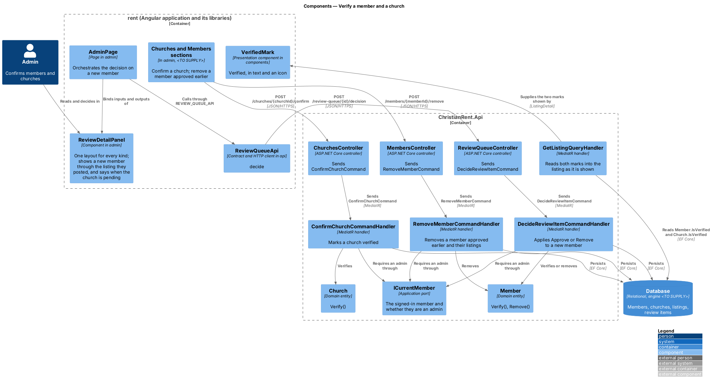
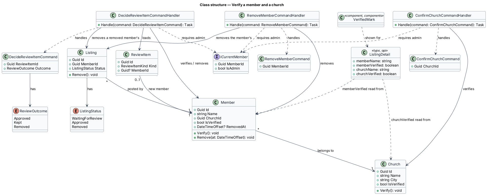
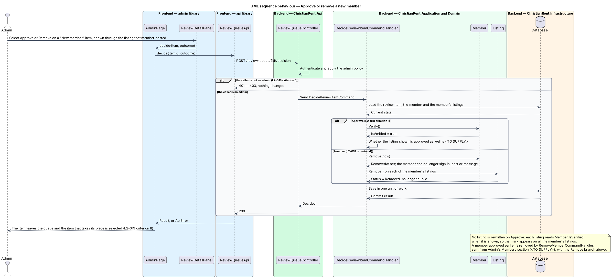
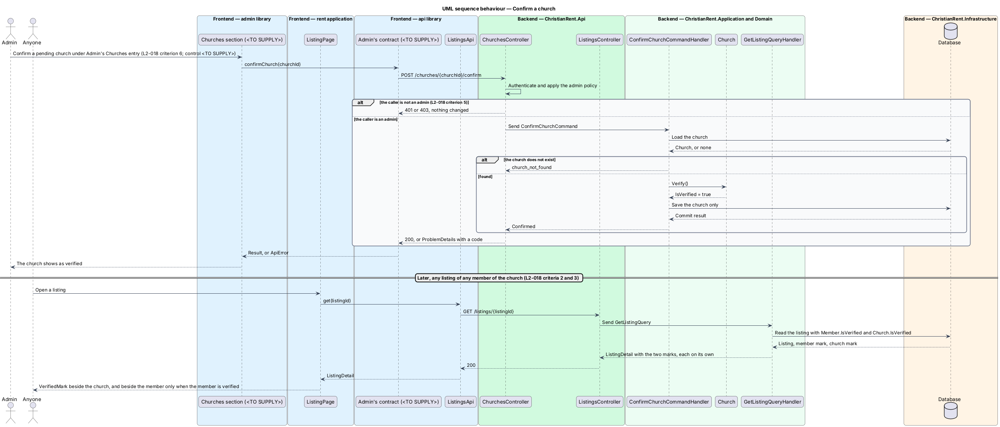

# Verify a member and a church

## Overview

christian.rent is for Christians, and a reader of a listing wants to know who is behind it. A
*member* is someone who uses christian.rent, and a member belongs to a *church*. A member or a
church an admin has confirmed is *verified*. A listing shows the name of the member who posted
it and the name of their church, each with its own verified mark when it is verified.

This feature covers how the two marks are set and what removing a member does. An admin who
approves a new member in the *review queue* makes that member verified, and the mark appears on
the member's listings. An admin who confirms a church makes that church verified, and the mark
appears on the listings of all its members. The two marks are independent: a verified member of
a church that is not verified shows the member's mark only. An admin who removes a member ends
that membership: the member can no longer sign in, post or send a message, and their listings
are no longer public. Only an admin sets a mark.

Two local terms are used below.

- **mark** — "Verified" label, in text and an icon, shown beside a verified member or church
- **pending church** — church a member entered that no admin has confirmed yet

The slice has no screen of its own. An admin approves or removes a new member in the detail
panel of Admin's review queue (`review-queue/work-review-queue`,
`review-queue/decide-review-item`). An admin confirms a church under the Churches entry of
Admin's navigation and removes a member approved earlier under its Members entry; neither
section is designed yet. The marks are shown on Listing (`listings/read-listing`).

## Description

The slice is not built yet; the components below are the ones the design introduces. The slice
runs from Admin in the `rent` application to the database behind `ChristianRent.Api`, and back
out through every listing that is read.

**Backend**

- **`Member`** — domain entity. `IsVerified` starts false when the member joins
  (`members/become-member`). `Verify()` sets it. `Remove(at)` sets `RemovedAt`. No other code
  path writes either field.
- **`Church`** — domain entity. `IsVerified` starts false when a member enters the church, and
  the church is a pending church until `Verify()` sets it.
- **`DecideReviewItemCommandHandler`** — MediatR handler designed in
  `review-queue/decide-review-item`. For a `ReviewItem` of kind `NewMember`, the outcome
  `Approved` calls `Member.Verify()` (`L2-018` criterion 1). The outcome `Removed` calls
  `Member.Remove(at)` and `Listing.Remove()` on each of the member's listings, in the same unit
  of work (`L2-018` criterion 4). The review queue shows a new member through the listing that
  member posted (`L2-019` criterion 2). Whether Approve on that item also approves the listing
  shown is `<TO SUPPLY>`; Remove takes it out of public view with the member's other listings.
- **`MembersController`** — `POST /members/{memberId}/remove` sends one `RemoveMemberCommand`.
- **`RemoveMemberCommandHandler`** — MediatR handler for a member approved earlier, who has no
  item left in the review queue. It refuses with `member_not_found` when the member does not
  exist; otherwise it calls `Member.Remove(at)` and `Listing.Remove()` on each of the member's
  listings in one unit of work, the same effect as the outcome `Removed` (`L2-018` criterion 4).
  Removing a member who is already removed changes nothing and succeeds.
- **`ChurchesController`** — `POST /churches/{churchId}/confirm` sends one
  `ConfirmChurchCommand`.
- **`ConfirmChurchCommandHandler`** — MediatR handler. It refuses with `church_not_found` when
  the church does not exist; otherwise it calls `Church.Verify()` and saves the church
  (`L2-018` criterion 2). Confirming a church that is already verified changes nothing and
  succeeds.
- **`ICurrentMember`** — port in `ChristianRent.Application` giving the signed-in member and
  whether they are an admin. The three endpoints carry the admin policy: a caller who is not
  signed in receives 401, and a signed-in member who is not an admin receives 403 with the code
  `not_admin`; in both cases nothing changes (`L2-018` criterion 5, `L2-025` criterion 3). No
  other request accepts a verified flag: `JoinCommand` and `PostListingCommand` carry none. How a
  person is known to be an admin is `<TO SUPPLY>` with sign-in.

The marks are not copied onto listings. `GetListingQueryHandler` (`listings/read-listing`) reads
`Member.IsVerified` and `Church.IsVerified` when a listing is read and returns them as two
separate fields. A member approved a moment ago is therefore marked on all their listings, and a
church confirmed a moment ago is marked on the listings of all its members, with no listing
rewritten (`L2-018` criteria 1 and 2). The two fields are independent, so a verified member of a
church that is not verified shows one mark (`L2-018` criterion 3).

A removed member is refused in three places. `ICurrentMember` does not resolve a member whose
`RemovedAt` is set, so every endpoint that requires a signed-in member responds 401, which covers
posting and sending a message. The member's listings hold `ListingStatus.Removed`, so Browse and
Listing do not show them and their photos are not served (`L2-014` criterion 5). Refusing the
member at sign-in itself is `<TO SUPPLY>` with sign-in.

A church is not an item of the review queue. `ReviewItemKind` holds `NewListing`, `Report` and
`NewMember`, and the review queue holds no item for a church (`L2-018` criterion 6). The detail
panel shows the church of the member who posted under "Church", with its mark when the church is
verified, and says under "Account" that the church is pending when it is a pending church
(`L2-019` criterion 2, `L2-018` criterion 6). The detail panel holds no control that confirms a
church.

Admin's navigation names four entries: Review, Reports, Members and Churches (`L2-019`
criterion 9). A church is confirmed under Churches, and a member approved earlier is removed
under Members (`L2-018` criterion 6). The Magic Patterns prototype names the entries and draws
nothing in them. The specs and the prototype leave four points open, each `<TO SUPPLY>`:

- The Churches section and its control that confirms a church.
- The Members section and its control that removes a member approved earlier.
- Whether a mark, once set, can be withdrawn from a member or a church.
- Whether a removed member is told, and how. `L2-020` criterion 7 covers a removed listing only.

**Frontend**

- **`ReviewDetailPanel`** and **`AdminPage`** — in the `admin` library, loaded only for an
  admin. The panel has one layout for every kind of item. For a new member it shows the listing
  that member posted, the member under "Posted by", the church under "Church" and the pending
  church under "Account", and emits the decision; `AdminPage` sends it.
- **`ReviewQueueApi`** — contract and injection token (`REVIEW_QUEUE_API`) in `api`, bound by
  Admin's lazy route. In this slice it supplies `decide(itemId, outcome)`.
- **Churches section** and **Members section** — `<TO SUPPLY>`. Whatever each becomes, it lives
  in the `admin` library, so its code loads only for an admin. The contract that carries
  `POST /churches/{churchId}/confirm` and `POST /members/{memberId}/remove` is bound by Admin's
  lazy route, which keeps its client out of the initial bundle; whether the two calls join
  `ReviewQueueApi` or a contract of their own is decided with the sections.
- **`VerifiedMark`** — presentation component in `components` (selector `cr-verified-mark`).
  `ListingPage` shows one beside the member when `ListingDetail.memberVerified` is true and one
  beside the church when `ListingDetail.churchVerified` is true, and none otherwise (`L2-008`
  criteria 2 to 4). `ReviewDetailPanel` shows one beside the church under the same rule. The
  frontend shows a mark and never decides one.

On Listing the prototype draws one check-badge icon, beside the church, with no word "Verified"
and no separate mark for the member. `L2-008` criteria 2 to 4 are unchanged: each mark is text
and an icon, and the member's mark is separate from the church's. The criteria stand, and the
mocks draw both marks.

The layout and the states of the detail panel and of the marks follow `docs/mocks/` once the
mocks are drawn, and this design is brought in line with them then. The facts stated here come
from the Magic Patterns prototype.

## Requirements

The feature realizes the following level-2 (L2) requirement. It refines a level-1 (L1)
requirement, cited by identifier.

| L2 ID | Refines (L1) | Requirement |
|-------|--------------|-------------|
| `L2-018` | `L1-006` | Verified members and churches: a member an admin approves shall be verified, a church an admin confirms shall be verified, each mark shall appear on the listings it concerns, a removed member shall no longer sign in, post or message, and the backend shall refuse anyone other than an admin who tries to set a verified mark. The review queue shall hold no item for a church and shall say when a member's church is pending; a church shall be confirmed, and a member approved earlier removed, from the Churches and Members entries of Admin's navigation. |

## Diagrams

### System context

An admin approves or removes a member and confirms a church through christian.rent. Anyone who
reads a listing sees the resulting marks. The mechanism that identifies the admin is
`<TO SUPPLY>`.

### Containers

Admin, in the `rent` application, sends the decision, the church confirmation and the removal of
a member to `ChristianRent.Api`, which writes the member or the church to the database. The same
API reads the marks into each listing it returns. File storage takes no part in this slice.

### Components

`AdminPage` calls `ReviewQueueApi`, which reaches `ReviewQueueController` for a decision on a
new member. The Churches and Members sections, both `<TO SUPPLY>`, reach `ChurchesController` to
confirm a church and `MembersController` to remove a member approved earlier. Each handler
requires an admin through `ICurrentMember` and changes one entity through its own method.
`GetListingQueryHandler` reads both marks when a listing is shown, and `VerifiedMark` displays
them.

### Class structure

`Member` and `Church` each own their `IsVerified` field and the method that sets it.
`DecideReviewItemCommandHandler` verifies or removes a `Member` and removes a removed member's
`Listing` records; `RemoveMemberCommandHandler` does the same removal for a member approved
earlier; `ConfirmChurchCommandHandler` verifies a `Church`. `ListingDetail` carries the two marks
as separate fields.

### Behaviour — approve or remove a new member

The admin policy refuses a caller who is not an admin before any state changes. On Approve the
handler verifies the member; on Remove it removes the member and each of their listings in the
same unit of work. No listing is rewritten on Approve, because each listing reads the mark when
it is shown. `RemoveMemberCommandHandler` applies the Remove branch to a member approved
earlier, from the Members section.

### Behaviour — confirm a church

An admin confirms a church from the Churches section, and the handler saves the church alone.
When anyone later opens a listing of any member of that church, `GetListingQueryHandler` reads
the church's mark and the member's mark separately, and `ListingPage` shows each only where it
is true.

