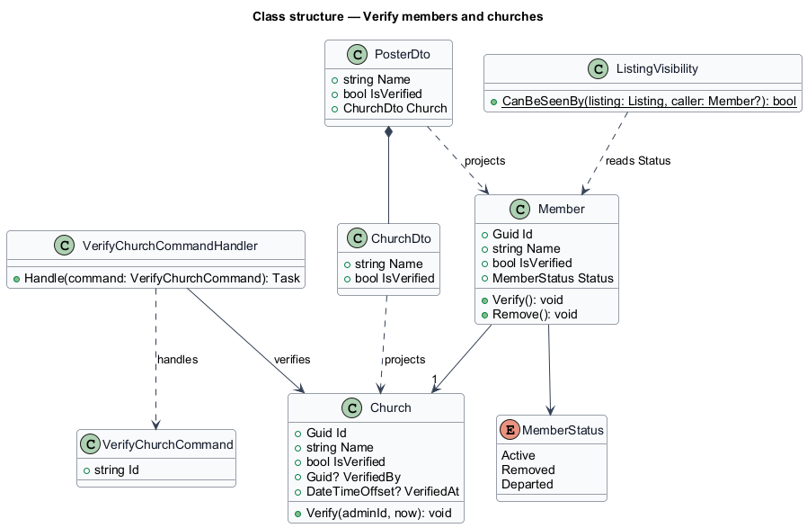
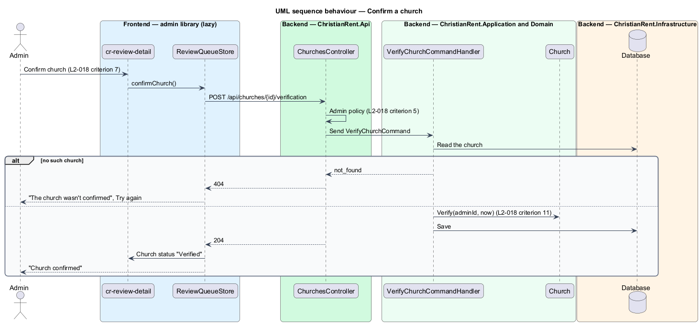
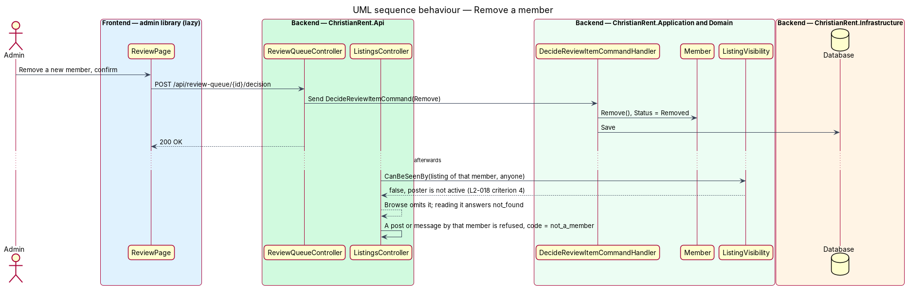

# Verify members and churches

## Overview

A member or a church that an admin has confirmed is **verified**. The mark "Verified", an
icon with the word, appears beside the member and beside the church on the Listing screen and
in Admin's detail; a Browse card draws no mark
([ADR 0028](../../../adr/0028-confirming-a-church.md)). The two marks are independent: a
verified member of an unverified church shows one mark, on the member.

- **verified member** — member an admin approved from the review queue
- **verified church** — church an admin confirmed
- **removed member** — member an admin removed; they can no longer sign in, post or
  message, and their listings are no longer public

This feature designs where the two flags live, how they reach every screen, what removal
does, and who may change them. The admin's Approve and Remove buttons are designed in
[decide-review-item](../../review/decide-review-item/README.md).

## Description

**Backend**

- **`Member.IsVerified`**, **`Church.IsVerified`** — the two flags. Each is set only by a
  method on its entity: `Member.Verify()` and `Church.Verify()`. No request DTO from a
  member has a property that maps to either flag, so a member cannot set one through
  `JoinCommand` or `PostListingCommand` (L2-018, criterion 5).
- **`Member.Remove()`** — sets `Status = Removed`.
- **`DecideReviewItemCommandHandler`** — calls `Member.Verify()` on Approve and
  `Member.Remove()` on Remove for a new-member item. Approve leaves the flag of the member's
  church unchanged (L2-018, criterion 6); see
  [decide-review-item](../../review/decide-review-item/README.md).
- **`VerifyChurchCommand`** — `{ Id }`, sent by
  `POST /api/churches/{id}/verification` on `ChurchesController`, restricted to the `Admin`
  policy, and answered 204. Its handler calls `Church.Verify(adminId, now)`, which records
  the admin and the time on the church (`VerifiedBy`, `VerifiedAt`) unless it is verified
  already, so a second confirmation changes nothing (L2-018, criterion 11). An identifier no
  church has, or a malformed one, is `not_found`; the policy refuses anyone else first.
- **`ListingVisibility.CanBeSeenBy`** — treats a listing as public only when its poster's
  `Status` is `Active`. A removal therefore hides every listing of the member at once,
  without rewriting the listings (L2-018, criterion 4). `BrowseListingsQueryHandler`,
  `GetListingQueryHandler` and `GetPhotoQueryHandler` share the rule.
- **`ICurrentMember`** — reports `IsMember = false` for a removed member, so every handler
  that requires a member refuses with `not_a_member`. Refusing sign-in itself belongs to the
  sign-in design.
- **`PosterDto.IsVerified`**, **`ChurchDto.IsVerified`** — projected from the entities at
  read time by `GetListingQueryHandler` and `GetReviewItemQueryHandler`. A new member's
  `NewMemberChurchDto` also carries the church's `Id`, which the confirmation is sent to. Because the flags
  are read on every request, a church confirmed today marks the listings of all its members
  on their next load (L2-018, criterion 2).

**Frontend**

- **`cr-verified`** (`components`) — an icon with `aria-hidden` and the visible word
  "Verified"; the state is text, never colour alone (L2-008, criteria 2 and 3).
- **`cr-poster`** — renders `cr-verified` beside the member name when
  `poster.isVerified`, and beside the church name when `poster.church.isVerified`. When a
  flag is false nothing is rendered in its place (L2-008, criterion 4).
- **`cr-review-detail`** — shows the same marks to the admin. For a new member it shows the
  row "Church status", and beside it, while the church is not verified, "Confirm church"
  (`cr-button`, outline, small; L2-018, criterion 7). It takes `confirming` (the button is
  busy) and `off`, and emits `confirmChurch`. The status is focusable, to take focus when the
  button has gone.
- **`toReviewDetailView`** (`domain`) — marks the church status fact of a new member with
  whether the church can be confirmed. `toChurchConfirmedToast` and `toChurchFailedToast`
  write the two notifications.
- **`ReviewQueueApi.confirmChurch(churchId, signal)`** (`api`) —
  `POST /api/churches/{id}/verification`, in `HttpReviewQueueApi`, which Admin's route binds.
- **`ReviewQueueStore.confirmChurch()`** (`admin`) — confirms the church of the new member
  shown, one at a time and never beside a decision. On success it marks the church verified in
  the detail shown, when that detail is of the same church, and says so. On any failure it
  says so with "Try again", which sends the same church (L2-018, criterion 10). Leaving Admin
  aborts the request in flight.

**Undecided**

- How an admin confirms a church none of whose new members still waits: `<TO SUPPLY>`. Admin
  has no screen other than the queue
  ([ADR 0028](../../../adr/0028-confirming-a-church.md)).
- How an admin removes a member who has left the review queue: `<TO SUPPLY>`. Admin has no
  screen other than the queue, so `Member.Remove()` is reached only from a new-member item.
- Whether a removed member is told, and how: `<TO SUPPLY>`.

Removing a member also closes what waited about them or their listings
([ADR 0027](../../../adr/0027-deciding-a-review-item-open-decisions.md)).

### Mocks

The mocks are the source of truth for the UI of this feature. The states this design covers are:

- [`docs/mocks/pages/listing/default.html`](../../../mocks/pages/listing/default.html): member and church both verified
- [`docs/mocks/pages/listing/wanted.html`](../../../mocks/pages/listing/wanted.html): member verified, church not
- [`docs/mocks/pages/listing/unverified.html`](../../../mocks/pages/listing/unverified.html): neither verified
- [`docs/mocks/pages/admin/new-member.html`](../../../mocks/pages/admin/new-member.html): a new member with the church's status and "Confirm church"
- [`docs/mocks/pages/admin/church-confirming.html`](../../../mocks/pages/admin/church-confirming.html): the confirmation in flight
- [`docs/mocks/pages/admin/church-confirmed.html`](../../../mocks/pages/admin/church-confirmed.html): the church verified, with its notification
- [`docs/mocks/pages/admin/church-failed.html`](../../../mocks/pages/admin/church-failed.html): the confirmation that could not be saved

## Requirements

The feature realizes the following level-2 (L2) requirements from
[`docs/specs/L2.md`](../../../specs/L2.md). Each L2 requirement refines a level-1 (L1)
requirement, cited by identifier. The table restates each requirement in `shall` form; the
acceptance criteria in the specification remain authoritative.

| L2 ID | Refines (L1) | Requirement |
|-------|--------------|-------------|
| `L2-008` | `L1-002` | A listing shall show the name of the member who posted it and the name of their church. The member and the church shall each be marked "Verified" with text and an icon only when verified. The member's initials and the year they became a member shall be shown. The member's email address, phone number and street address shall not be in the response. |
| `L2-018` | `L1-006` | An admin's approval shall make a member verified. An admin's confirmation shall make a church verified for the listings of all its members. The two marks shall be independent, and approving a new member shall not verify their church. A removed member shall no longer sign in, post or message, and their listings shall no longer be public. The backend shall refuse anyone but an admin who sets a verified mark. Admin shall confirm a new member's unverified church from their detail, without deciding the item, shall say what came of it, and shall record who confirmed it and when. |
| `L2-025` | `L1-011` | Every endpoint other than browsing, searching, reading an approved listing and serving its photos shall respond 401 to anyone not signed in. Listing the churches, joining and asking who is signed in shall not be refused for want of membership. The backend shall refuse a request for, or a change to, anything that is not the member's own, and shall reveal nothing about it. A refusal a screen branches on shall be a ProblemDetails with a `code`. |

## Diagrams

### System context

The people involved are: admin, anyone, member. Each reaches the feature through christian.rent, which takes no payment and holds no booking calendar.

### Containers

The rent application calls `ChristianRent.Api` over JSON/HTTPS. The API persists state through EF Core.

### Components

Two handlers change the flags, both restricted to an admin. `GetListingQueryHandler` reads
the flags at request time, and `ListingVisibility` reads the member's status, so both
changes take effect without touching any listing.

### Class structure

`Member` and `Church` each own their flag and the method that sets it. The DTOs project the
flags; `ListingVisibility` depends on `MemberStatus`.

### Behaviour — show the verified marks

Approving a new member sets the flag once; the next read of any of the member's listings
carries it, and `cr-poster` renders each mark only when its flag is true (`L2-018`,
`L2-008`).

### Behaviour — confirm a church

"Confirm church" sends one request. The admin policy refuses anyone else, `Church.Verify`
records who and when once, and the next read of any listing of the church's members carries the
mark (`L2-018`, criteria 2, 5 and 7 to 11).

### Behaviour — remove a member

Removal changes the member's status. `ListingVisibility` then hides every listing of the
member, and `ICurrentMember` stops treating them as a member (`L2-018`, criterion 4).

