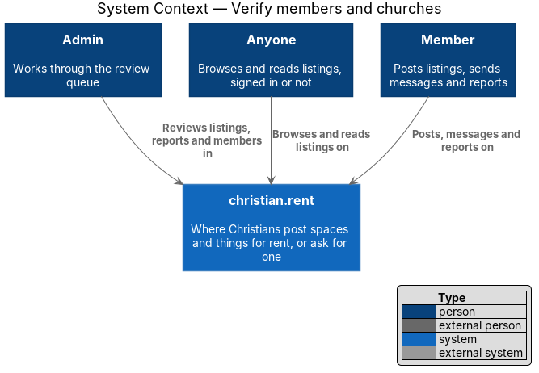

# Verify members and churches

## Overview

A member or a church that an admin has confirmed is **verified**. The mark "Verified", an
icon with the word, appears beside the member and beside the church wherever a listing shows
who posted it. The two marks are independent: a verified member of an unverified church
shows one mark, on the member.

- **verified member** — member an admin approved from the review queue
- **verified church** — church an admin confirmed
- **removed member** — member an admin removed; they can no longer sign in, post or
  message, and their listings are no longer public

This feature designs where the two flags live, how they reach every screen, what removal
does, who may change them, and how an admin confirms a church (ADR 0031). The admin's Approve
and Remove buttons are designed in
[decide-review-item](../../review/decide-review-item/README.md).

## Description

**Backend**

- **`Member.IsVerified`**, **`Church.IsVerified`** — the two flags. Each is set only by a
  method on its entity: `Member.Verify()` and `Church.Verify()`. No request DTO from a
  member has a property that maps to either flag, so a member cannot set one through
  `JoinCommand` or `PostListingCommand` (L2-018, criterion 5).
- **`Member.Remove()`** — sets `Status = Removed`.
- **`DecideReviewItemCommandHandler`** — calls `Member.Verify()` on Approve and
  `Member.Remove()` on Remove for a new-member item. Approve leaves the flag of the member's
  church unchanged (L2-018, criterion 6); see
  [decide-review-item](../../review/decide-review-item/README.md).
- **`VerifyChurchCommand`** — `{ Id }`, the address's text, sent by
  `POST /api/admin/churches/{id}/verification` on `AdminChurchesController` (under
  `/api/admin/`, so only the Admin session reaches it; ADR 0029), restricted to the `Admin`
  policy. Its handler calls `Church.Verify(adminId, now)`, which sets the flag and records the
  admin and the time on the church (`VerifiedBy`, `VerifiedAt`) once: a church already verified
  is unchanged, and the answer is 204 either way (L2-018, criterion 10). A church that does not
  exist is `not_found` (criterion 11). The request has no body.
- **`NewMemberChurchDto.Id`** — the church's identifier in the detail of a new member, which
  the control sends.
- **`ListingVisibility.CanBeSeenBy`** — treats a listing as public only when its poster's
  `Status` is `Active`. A removal therefore hides every listing of the member at once,
  without rewriting the listings (L2-018, criterion 4). `BrowseListingsQueryHandler`,
  `GetListingQueryHandler` and `GetPhotoQueryHandler` share the rule.
- **`ICurrentMember`** — reports `IsMember = false` for a removed member, so every handler
  that requires a member refuses with `not_a_member`. From their next request their
  session stops working and signing in is refused
  ([sign-in-and-sessions](../../platform/sign-in-and-sessions/README.md)).
- **`PosterDto.IsVerified`**, **`ChurchDto.IsVerified`** — projected from the entities at
  read time by `GetListingQueryHandler` and `GetReviewItemQueryHandler`. Because the flags
  are read on every request, a church confirmed today marks the listings of all its members
  on their next load (L2-018, criterion 2).

**Frontend**

- **`cr-verified`** (`components`) — an icon with `aria-hidden` and the visible word
  "Verified"; the state is text, never colour alone (L2-008, criteria 2 and 3).
- **`cr-poster`** — renders `cr-verified` beside the member name when
  `poster.isVerified`, and beside the church name when `poster.church.isVerified`. When a
  flag is false nothing is rendered in its place (L2-008, criterion 4).
- **`cr-review-detail`** — shows the same marks to the admin. For a new member it shows the
  row "Church status" and, while the church is not verified, the button "Confirm church"
  beside it (L2-018, criterion 7). It takes `confirming` (the button is busy) and emits
  `confirmChurch`; `off` turns the button off while a decision is in flight.
- **`ChurchVerificationApi`** / **`CHURCH_VERIFICATION_API`** (`api`) — `verify(churchId,
  signal)`, over HTTP as `HttpChurchVerificationApi`, which Admin's review page provides, so
  its code is in the review page's lazy chunk and Admin's first download does not grow.
- **`ReviewQueueStore.confirmChurch()`** (`admin`) — confirms the church of the new member
  whose detail is shown. One change is in flight at a time: it is ignored while a decision or
  another confirmation is, and a decision is ignored while it is. On success the detail shown
  reads "Verified" and a notification says so; on failure a notification offers "Try again",
  which sends the same confirmation (L2-018, criteria 8 and 9). Destroying the store aborts it.
- **`toChurchConfirmedToast`**, **`toChurchFailedToast`** (`domain`) — the notifications' words.
- **`ReviewPage`** — moves focus to the selected row once a church is confirmed, as after a
  decision.

**Undecided**

- How an admin confirms a church none of whose members waits as a new member, and how a
  church's mark is taken away: `<TO SUPPLY>` (ADR 0031, consequences). Neither has a
  requirement.
- How an admin removes a member who has left the review queue: `<TO SUPPLY>`. Admin has no
  screen other than the queue, so `Member.Remove()` is reached only from a new-member item.
- Whether removing a member also closes the open review items about their listings:
  `<TO SUPPLY>`.
- Whether a removed member is told, and how: `<TO SUPPLY>`.

### Mocks

The mocks are the source of truth for the UI of this feature. The states this design covers are:

- [`docs/mocks/pages/listing/default.html`](../../../mocks/pages/listing/default.html): member and church both verified
- [`docs/mocks/pages/listing/wanted.html`](../../../mocks/pages/listing/wanted.html): member verified, church not
- [`docs/mocks/pages/listing/unverified.html`](../../../mocks/pages/listing/unverified.html): neither verified
- [`docs/mocks/pages/admin/new-member.html`](../../../mocks/pages/admin/new-member.html): a new member with the church's status and "Confirm church"
- [`docs/mocks/pages/admin/church-confirming.html`](../../../mocks/pages/admin/church-confirming.html): the confirmation in flight
- [`docs/mocks/pages/admin/church-confirmed.html`](../../../mocks/pages/admin/church-confirmed.html): the church verified, with its notification
- [`docs/mocks/pages/admin/church-failed.html`](../../../mocks/pages/admin/church-failed.html): the confirmation not saved, with "Try again"

## Requirements

The feature realizes the following level-2 (L2) requirements from
[`docs/specs/L2.md`](../../../specs/L2.md). Each L2 requirement refines a level-1 (L1)
requirement, cited by identifier. The table restates each requirement in `shall` form; the
acceptance criteria in the specification remain authoritative.

| L2 ID | Refines (L1) | Requirement |
|-------|--------------|-------------|
| `L2-008` | `L1-002` | A listing shall show the name of the member who posted it and the name of their church. The member and the church shall each be marked "Verified" with text and an icon only when verified. The member's initials and the year they became a member shall be shown. The member's email address, phone number and street address shall not be in the response. |
| `L2-018` | `L1-006` | An admin's approval shall make a member verified. An admin's confirmation, made from the detail of a new member of the church, shall make a church verified for the listings of all its members, shall be idempotent, and shall record the admin and the time. The two marks shall be independent, and approving a new member shall not verify their church. A removed member shall no longer sign in, post or message, and their listings shall no longer be public. The backend shall refuse anyone but an admin who sets a verified mark. |
| `L2-025` | `L1-011` | Every endpoint other than browsing, searching, reading an approved listing and serving its photos shall respond 401 to anyone not signed in. Listing the churches, joining and asking who is signed in shall not be refused for want of membership. The backend shall refuse a request for, or a change to, anything that is not the member's own, and shall reveal nothing about it. A refusal a screen branches on shall be a ProblemDetails with a `code`. |

## Diagrams

### System context

The people involved are: admin, anyone, member. Each reaches the feature through christian.rent, which takes no payment and holds no booking calendar.

### Containers

The rent and admin applications call `ChristianRent.Api` over JSON/HTTPS. The API persists state through EF Core.

### Components

Two handlers change the flags, both restricted to an admin; Admin's review page reaches
`VerifyChurchCommandHandler` through `ChurchVerificationApi`. `GetListingQueryHandler` reads
the flags at request time, and `ListingVisibility` reads the member's status, so both
changes take effect without touching any listing.

### Class structure

`Member` and `Church` each own their flag and the method that sets it. The DTOs project the
flags; `ListingVisibility` depends on `MemberStatus`.

### Behaviour — show the verified marks

Approving a new member sets the flag once; the next read of any of the member's listings
carries it, and `cr-poster` renders each mark only when its flag is true (`L2-018`,
`L2-008`).

### Behaviour — confirm a church

"Confirm church" sends one request. The church records the admin and the time once, the detail
shown reads "Verified", and every listing of every member of the church carries the mark on its
next read (`L2-018`, criteria 2 and 7 to 10).

### Behaviour — remove a member

Removal changes the member's status. `ListingVisibility` then hides every listing of the
member, and `ICurrentMember` stops treating them as a member (`L2-018`, criterion 4).

