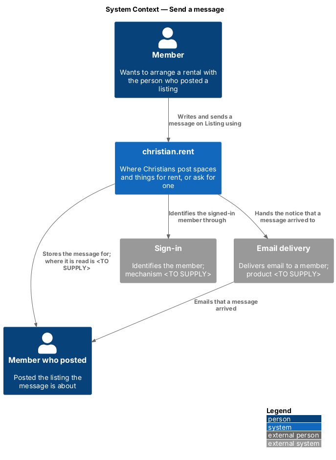
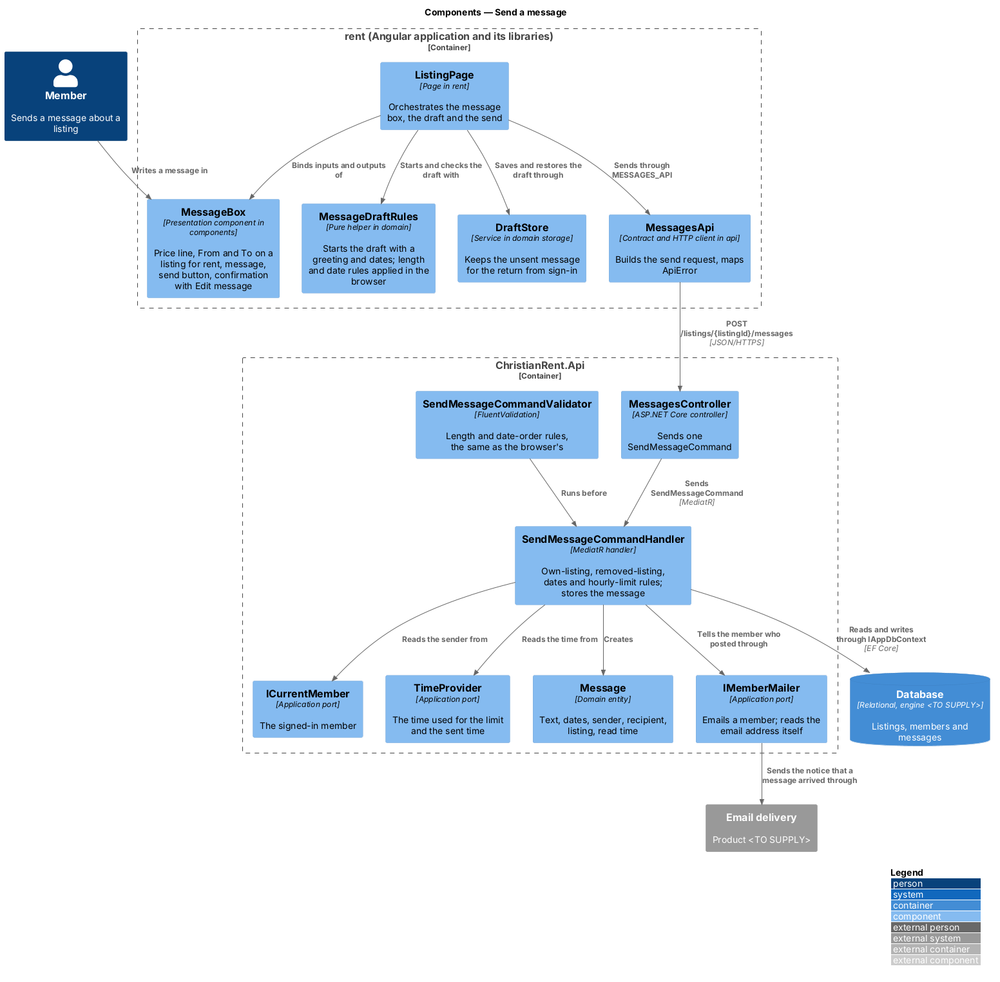
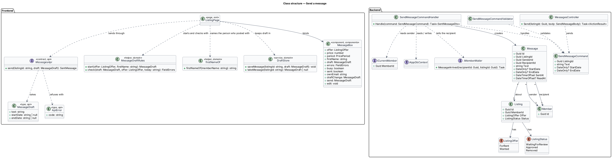
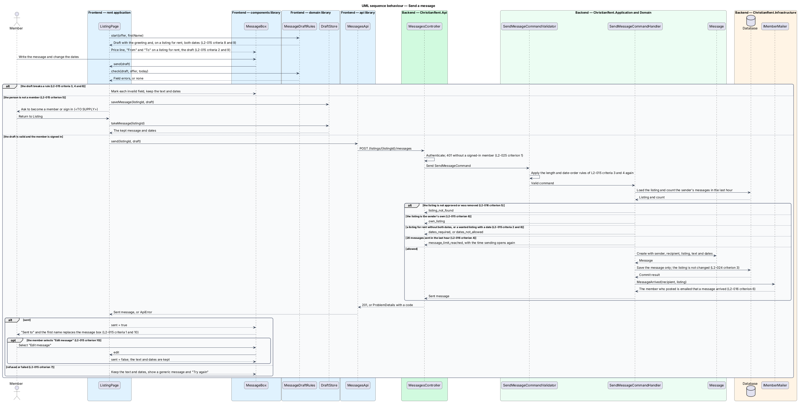

# Send a message

## Overview

christian.rent is where Christians post spaces and things for rent, or ask for a space or a
thing to rent. A *listing* is what a person posts; it is *for rent* or *wanted*. A *member* is
someone who uses christian.rent. No payment happens on christian.rent: the two people agree the
details together, and the message is how that starts.

This feature covers the message box on the Listing screen. A member writes a message of 1 to
1,000 characters to the person who posted the listing and sends it. On a listing for rent the
message box also holds a start date and an end date, labelled "From" and "To"; both always hold
a date. On a wanted listing it holds none. Once the message is sent, a confirmation reading
"Sent to" and the first name of the person who posted replaces the message box. The member who
posted is emailed that a message has arrived.

Two local terms are used below.

- **message draft** — message text and dates a person has entered and not yet sent
- **hourly limit** — ceiling of 20 messages one member may send in one hour

The feature also covers what a message does not do. A message is private to the member who sent
it and the member who posted the listing. A message with dates reserves nothing and changes
nothing on the listing. No screen in this feature offers a way to pay.

Where the person who posted reads the message is `<TO SUPPLY>`: a Messages inbox is not designed,
and none is built before its design exists. The email that tells them a message has arrived is
part of this feature. This feature ends when the message is stored for that person and the email
is handed over for delivery.

## Description

The slice is not built yet; the components below are the ones the design introduces. The slice
runs from the Listing screen in the `rent` application to the database behind
`ChristianRent.Api`, and out to the email address of the member who posted.

**Frontend**

- **`ListingPage`** — page in `rent` (designed in `listings/read-listing`). In this slice it
  binds `MessageBox`, checks the message draft, keeps it across sign-in, and sends it through
  the `MESSAGES_API` token. `ListingPage` omits `MessageBox` when the listing is the signed-in
  member's own (`L2-015` criterion 6); how `ListingPage` learns this follows
  `listings/read-listing`. `ListingPage` aborts a send still in flight when the member leaves the
  screen. Under 1024 px the message box is below the listing; from 1024 px it is to the right of
  it, 380 px wide, and stays in view as the listing scrolls (`L2-031` criterion 3).
- **`MessageBox`** — presentation component in `components` (selector `cr-message-box`). Its
  inputs are the listing's `ListingOffer`, its price and period, the first name of the person
  who posted, the message draft, the field errors, a busy flag, a sent flag and the email address
  shown in the confirmation. Its outputs are `draftChange`, `send` and `edit`. It injects no
  service, token or router. From top to bottom it shows:
  - the price line: "Rent for" on a listing for rent or "They'll pay" on a wanted listing, the
    price, then "CAD /" and the period, as "Rent for $45 CAD / hour" and "They'll pay Up to $120
    CAD / day" (`L2-015` criterion 9, `L2-022` criterion 1);
  - on a listing for rent only, two fields side by side labelled "From" and "To", each holding a
    date shown with its weekday and without its year, as "Sat, Jun 14" (`L2-015` criterion 2,
    `L2-022` criterion 6); neither field can be emptied (`L2-015` criterion 8);
  - the message field, a text area of 4 rows named "Message";
  - the send button, reading "Message" and the first name on a listing for rent and "Offer to
    help" and the first name on a wanted listing (`L2-015` criterion 9); the first is orange and
    the second blue, and the wording carries the difference;
  - the line "No payment yet. You'll agree on details together." (`L2-015` criterion 9,
    `L2-024` criterion 1).

  It ties each error to its field. Once the sent flag is set it shows the confirmation in place
  of the fields (`L2-015` criterion 1).
- **Confirmation** — state of `MessageBox`. It shows a check, the heading "Sent to" and the first
  name, a sentence saying the member is emailed when a reply comes, and the control "Edit
  message" (`L2-015` criterion 10). The prototype's sentence reads "They usually reply within a
  few hours. We'll email you at" followed by the member's own email address and "when they do."
  A screen reader announces the confirmation (`L2-032` criterion 4). "Edit message" emits `edit`;
  `ListingPage` clears the sent flag, and the message box returns with the text and dates kept.
  Whether sending again after "Edit message" replaces the message already sent or sends another
  is `<TO SUPPLY>`.
- **`MessageDraft`** — type in `api`: `text`, `startDate` and `endDate`. Both dates are present
  on a listing for rent and both are absent on a wanted listing.
- **`MessageDraftRules`** — pure helper in `domain`, in a `messages/` folder this slice adds.
  `start(offer, firstName)` makes the draft the message box opens with. Its text is the greeting
  "Hi" and the first name, followed by "is this free on the dates below?" on a listing for rent
  and by "I think I can help with this." on a wanted listing (`L2-015` criterion 9). On a listing
  for rent the draft holds both dates. The date "From" and "To" open on is `<TO SUPPLY>`.
  `check(draft, offer, today)` applies the rules the browser can apply itself: the text holds 1
  to 1,000 characters (`L2-015` criterion 4), a listing for rent has both dates (`L2-015`
  criterion 8), the end date is not before the start date, and the start date is not in the past
  (`L2-015` criterion 3). The two dates may be the same day. The time zone that decides which day
  is "the past" is `<TO SUPPLY>`.
- **`firstNameOf`** — pure helper in the same folder. It returns the first word of a member's
  name after dropping a leading "Pastor", "Dr." or "The", as the prototype does. The greeting,
  the send button and the confirmation use it.
- **`DraftStore`** — service in `domain`'s `storage/`. When a person who is not a member selects
  send, `ListingPage` saves the message draft against the listing, and restores it when the
  person returns to Listing (`L2-015` criterion 5). The restored draft is shown in `MessageBox`;
  it is not sent until the member selects send. Where the person is asked to become a member is
  designed in `members/become-member`, and sign-in is `<TO SUPPLY>`.
- **`MessagesApi`** — contract and injection token (`MESSAGES_API`) in `api`, with its HTTP
  client. `send(listingId, draft)` posts the message draft and returns the sent message, or
  refuses with an `ApiError` whose `code` `ListingPage` branches on.

On a refusal or a failed request, `ListingPage` keeps the text and dates in `MessageBox`, shows a
generic message and offers "Try again" (`L2-015` criterion 7, `L2-025` criterion 4). For
`message_limit_reached` the message says when the member can send again (`L2-016` criterion 4).

The email address in the confirmation is the signed-in member's own. Where the browser reads it
from is `<TO SUPPLY>` with sign-in. It is shown to that member and to nobody else (`L2-028`
criterion 4).

The prototype hides the label "Message" from sight and keeps it for a screen reader. `L2-032`
criterion 5 asks for a visible label on every form field; the criterion stands, and the mock
draws the label.

The header of Browse and Listing holds a Messages control that shows how many messages the member
has not read (`L2-036` criterion 3). This slice stores each message with an empty `ReadAt`, which
is what that number counts. The endpoint that returns the number, what the control opens and what
sets `ReadAt` are `<TO SUPPLY>` with the Messages inbox.

**Backend**

- **`MessagesController`** — ASP.NET Core controller. `POST /listings/{listingId}/messages`
  requires a signed-in member under the fallback policy and responds 401 without one (`L2-025`
  criterion 1). It checks nothing itself and sends one `SendMessageCommand`.
- **`SendMessageCommand`** — request carrying `ListingId`, `Text`, `StartDate` and `EndDate`.
  The sender is not part of the request; the handler reads it from `ICurrentMember`.
- **`SendMessageCommandValidator`** — FluentValidation validator. It applies the same length and
  date-order rules as `MessageDraftRules`, so a request sent straight to the backend is refused
  by the same rules (`L2-026` criterion 2). A failure is a ProblemDetails with the code
  `validation_failed` and the invalid fields.
- **`SendMessageCommandHandler`** — MediatR handler holding the rules that need stored state. It
  loads the listing and refuses with `listing_not_found` when the listing does not exist, is not
  approved or has been removed (`L2-016` criterion 5), revealing nothing about it. It refuses
  with `own_listing` when the sender posted the listing (`L2-015` criterion 6). It refuses with
  `dates_not_allowed` when dates arrive for a wanted listing (`L2-015` criterion 2) and with
  `dates_required` when either date is missing for a listing for rent (`L2-015` criterion 8). It
  counts the sender's messages whose `SentAt` falls within the hour before the current time read
  from `TimeProvider`; at 20 it refuses with `message_limit_reached` and the time at which the
  oldest of the 20 leaves the hour (`L2-016` criterion 4). Otherwise it creates a `Message`,
  saves it in one unit of work, and then asks `IMemberMailer` to tell the member who posted.
- **`Message`** — domain entity: `Id`, `ListingId`, `SenderId`, `RecipientId`, `Text`,
  `StartDate`, `EndDate`, `SentAt` and `ReadAt`. `RecipientId` is the member who posted the
  listing, taken from the listing when the message is created. The sender and the recipient are
  the only two members who may read the message (`L2-016` criterion 1).
- **`IMemberMailer`** — port in `ChristianRent.Application`, implemented in
  `ChristianRent.Infrastructure`. `MessageArrived(recipientId, listingId)` emails the member who
  posted that a message about their listing has arrived (`L2-016` criterion 6). The port takes
  the member's identifier and reads the email address itself, so no handler and no response
  carries the address (`L2-028` criterion 4). The email names the listing and does not reveal the
  sender's email address or phone number (`L2-016` criterion 3). Whether the email carries the
  message text is `<TO SUPPLY>`. The product that delivers email, and what happens when an email
  cannot be delivered, are `<TO SUPPLY>`.
- **`ICurrentMember`**, **`TimeProvider`**, **`IAppDbContext`** — ports in
  `ChristianRent.Application`: the signed-in member, the clock and the database.

The handler writes a `Message` and nothing else. It does not read or change the listing's
"when", and no reservation, booking or payment type exists in the slice (`L2-024` criteria 1
and 3).

The response to the sender carries the message's identifier and sent time. It carries no email
address or phone number of either member (`L2-016` criterion 3); the message text is whatever
the sender wrote, stored and later rendered as text, never as HTML (`L2-026` criterion 1). No
log, metric or span of this slice carries the message text or an email address (`L2-028`
criterion 3).

The slice stores what the person who posted is to be shown: the sender, from whom the name,
church and verified marks are read, the listing, and the dates if any (`L2-016` criterion 2).
The screen that shows them and the way to reply are `<TO SUPPLY>` with the Messages inbox; this
slice exposes no endpoint that reads a message. A reply emails the member who sent the message in
the same way (`L2-016` criterion 6); the reply itself belongs to that inbox, and
`IMemberMailer` gains its second notice then.

The prototype draws four states of the message box: default and sent, each for a listing for
rent and for a wanted listing. It draws no state for the member's own listing, for a person who
is not a member, for an invalid field or for a failed send; each is `<TO SUPPLY>` until
`docs/mocks/` draws it.

The layout and the states of the message box follow `docs/mocks/` once the mocks are drawn, and
this design is brought in line with them then. The facts stated here come from the Magic
Patterns prototype.

## Requirements

The feature realizes the following level-2 (L2) requirements. Each L2 requirement refines one or
two level-1 (L1) requirements, cited by identifier.

| L2 ID | Refines (L1) | Requirement |
|-------|--------------|-------------|
| `L2-015` | `L1-005` | Send a message about a listing: the Listing screen shall have a message box that sends a message to the person who posted, with a start and an end date labelled "From" and "To" on a listing for rent, and a confirmation shall replace the message box once the message is sent. |
| `L2-016` | `L1-005` | A message is private to the two people: only the member who sent a message and the member who posted the listing shall be able to read it, and the member who posted shall be emailed when it arrives. |
| `L2-024` | `L1-010` | Nothing beyond renting: no screen shall offer a way to pay, and a message with dates shall not change the listing's availability or reserve anything. |
| `L2-036` | `L1-001`, `L1-005` | The header: Browse and Listing shall share one header that holds the wordmark, a Messages control, an account control and a "Post" button; the Messages control shall show how many messages a member has not read. This feature stores what that number counts (criterion 3); the header itself is designed with Browse and Listing (`listings/browse-listings`, `listings/read-listing`). |

## Diagrams

### System context

A member sends a message through christian.rent, which stores it for the member who posted the
listing and emails that member that it has arrived. Where that member reads it, the product that
delivers email and the mechanism that identifies the sender are each `<TO SUPPLY>`.

### Containers

The message travels from the `rent` application to `ChristianRent.Api`, which reads the listing,
counts the sender's recent messages, writes the message to the database and hands the notice to
email delivery. File storage takes no part in this slice.

### Components

In the browser, `ListingPage` binds `MessageBox`, starts and checks the message draft with
`MessageDraftRules`, keeps it in `DraftStore` and sends it through `MessagesApi`. In
`ChristianRent.Api`, `MessagesController` sends one `SendMessageCommand`; the validator runs
before `SendMessageCommandHandler`, which reads the sender and the time from its ports, creates
the `Message` and tells the member who posted through `IMemberMailer`.

### Class structure

`SendMessageCommandHandler` handles `SendMessageCommand` and creates a `Message`, which refers
to one `Listing` and to two `Member` records, the sender and the recipient. The handler depends
on `IMemberMailer` for the email. On the frontend, `MessagesApi` takes a `MessageDraft` and
refuses with an `ApiError`, and `MessageBox` emits `draftChange`, `send` and `edit`.

### Behaviour — send a message

`ListingPage` opens the message box with a greeting and, on a listing for rent, two dates, and
checks the message draft before any request. A person who is not a member has the draft kept and
restored on return. The backend applies the same field rules, then refuses a listing that is
removed or not approved, the sender's own listing, a listing for rent without both dates, and a
twenty-first message in an hour. Otherwise it saves the message alone and emails the member who
posted; the confirmation replaces the message box, and "Edit message" brings the box back with
the text and dates kept.

