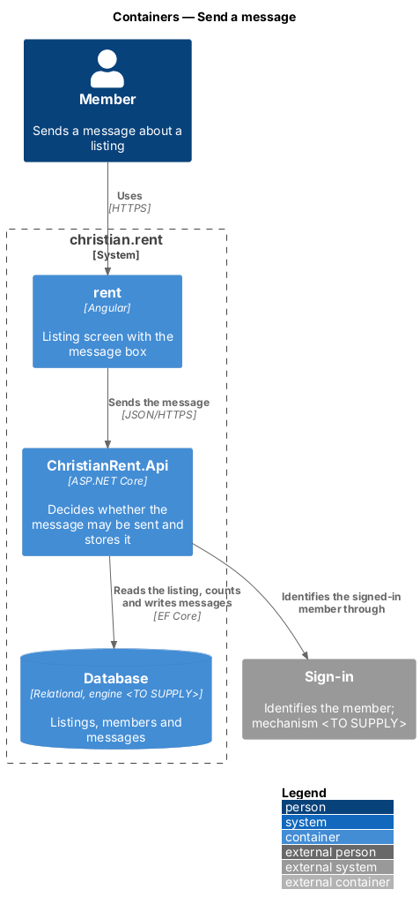

# Send a message

## Overview

christian.rent is where Christians post spaces and things for rent, or ask for a space or a
thing to rent. A *listing* is what a person posts; it is *for rent* or *wanted*. A *member* is
someone who uses christian.rent. No payment happens on christian.rent: the two people agree the
details together, and the message is how that starts.

This feature covers the message box on the Listing screen. A member writes a message of 1 to
1,000 characters to the person who posted the listing and sends it. On a listing for rent the
message box also takes a start date and an end date; on a wanted listing it takes none. Once the
message is sent, a confirmation replaces the message box.

Two local terms are used below.

- **message draft** — message text and dates a person has entered and not yet sent
- **hourly limit** — ceiling of 20 messages one member may send in one hour

The feature also covers what a message does not do. A message is private to the member who sent
it and the member who posted the listing. A message with dates reserves nothing and changes
nothing on the listing. No screen in this feature offers a way to pay.

Where the person who posted reads the message is `<TO SUPPLY>`: a Messages inbox is not designed,
and none is built before its design exists. This feature ends when the message is stored for
that person.

## Description

The slice is not built yet; the components below are the ones the design introduces. The slice
runs from the Listing screen in the `rent` application to the database behind
`ChristianRent.Api`.

**Frontend**

- **`ListingPage`** — page in `rent` (designed in `listings/read-listing`). In this slice it
  binds `MessageBox`, checks the message draft, keeps it across sign-in, and sends it through
  the `MESSAGES_API` token. `ListingPage` omits `MessageBox` when the listing is the signed-in
  member's own (`L2-015` criterion 6); how `ListingPage` learns this follows
  `listings/read-listing`. `ListingPage` aborts a send still in flight when the member leaves the
  screen.
- **`MessageBox`** — presentation component in `components` (selector `cr-message-box`). Its
  inputs are the listing's `ListingOffer`, the message draft, the field errors, a busy flag and a
  sent flag. Its outputs are `draftChange` and `send`. It shows the start and end date fields
  only when the offer is `forRent` (`L2-015` criterion 2), ties each error to its field, and
  shows the confirmation in place of the fields once the sent flag is set (`L2-015` criterion 1).
  It injects no service, token or router.
- **`MessageDraft`** — type in `api`: `text`, `startDate` and `endDate`, the dates being absent
  on a wanted listing.
- **`MessageDraftRules`** — pure helper in `domain`, in a `messages/` folder this slice adds. It
  applies the rules the browser can apply itself: the text holds 1 to 1,000 characters
  (`L2-015` criterion 4), the end date is not before the start date, and the start date is not
  in the past (`L2-015` criterion 3). Whether both dates are required on a listing for rent, or
  both are optional, is `<TO SUPPLY>`: `L2-015` criterion 3 speaks of dates that "are entered"
  and `L2-016` criterion 2 of "the dates if any". The time zone that decides which day is "the
  past" is `<TO SUPPLY>`.
- **`DraftStore`** — service in `domain`'s `storage/`. When a person who is not a member selects
  send, `ListingPage` saves the message draft against the listing, and restores it when the
  person returns to Listing (`L2-015` criterion 5). The restored draft is shown in `MessageBox`;
  it is not sent until the member selects send. Where the person is asked to become a member is
  designed in `members/become-member`, and sign-in is `<TO SUPPLY>`.
- **`MessagesApi`** — contract and injection token (`MESSAGES_API`) in `api`, with its HTTP
  client. `send(listingId, draft)` posts the message draft and returns the sent message, or
  refuses with an `ApiError` whose `code` `ListingPage` branches on.

On a refusal or a failed request, `ListingPage` keeps the text and dates in `MessageBox`, shows a
generic message and offers "Try again" (`L2-015` criterion 7, `L2-025` criterion 4). For
`message_limit_reached` the message says when the member can send again (`L2-016` criterion 4).

**Backend**

- **`MessagesController`** — ASP.NET Core controller. `POST /listings/{listingId}/messages`
  requires a signed-in member under the fallback policy and responds 401 without one (`L2-025`
  criterion 1). It checks nothing itself and sends one `SendMessageCommand`.
- **`SendMessageCommand`** — request carrying `ListingId`, `Text`, `StartDate` and `EndDate`.
  The sender is not part of the request; the handler reads it from `ICurrentMember`.
- **`SendMessageCommandValidator`** — FluentValidation validator. It applies the same length and
  date rules as `MessageDraftRules`, so a request sent straight to the backend is refused by the
  same rules (`L2-026` criterion 2). A failure is a ProblemDetails with the code
  `validation_failed` and the invalid fields.
- **`SendMessageCommandHandler`** — MediatR handler holding the rules that need stored state. It
  loads the listing and refuses with `listing_not_found` when the listing does not exist, is not
  approved or has been removed (`L2-016` criterion 5), revealing nothing about it. It refuses
  with `own_listing` when the sender posted the listing (`L2-015` criterion 6). It refuses with
  `dates_not_allowed` when dates arrive for a wanted listing (`L2-015` criterion 2). It counts
  the sender's messages whose `SentAt` falls within the hour before the current time read from
  `TimeProvider`; at 20 it refuses with `message_limit_reached` and the time at which the oldest
  of the 20 leaves the hour (`L2-016` criterion 4). Otherwise it creates a `Message` and saves it
  in one unit of work.
- **`Message`** — domain entity: `Id`, `ListingId`, `SenderId`, `RecipientId`, `Text`,
  `StartDate`, `EndDate` and `SentAt`. `RecipientId` is the member who posted the listing, taken
  from the listing when the message is created. The sender and the recipient are the only two
  members who may read the message (`L2-016` criterion 1).
- **`ICurrentMember`**, **`TimeProvider`**, **`IAppDbContext`** — ports in
  `ChristianRent.Application`: the signed-in member, the clock and the database.

The handler writes a `Message` and nothing else. It does not read or change the listing's
"when", and no reservation, booking or payment type exists in the slice (`L2-024` criteria 1
and 3).

The response to the sender carries the message's identifier and sent time. It carries no email
address or phone number of either member (`L2-016` criterion 3); the message text is whatever
the sender wrote, stored and later rendered as text, never as HTML (`L2-026` criterion 1). No
log, metric or span of this slice carries the message text (`L2-028` criterion 3).

The slice stores what the person who posted is to be shown: the sender, from whom the name,
church and verified marks are read, the listing, and the dates if any (`L2-016` criterion 2).
The screen that shows them and the way to reply are `<TO SUPPLY>` with the Messages inbox; this
slice exposes no endpoint that reads a message.

The layout and the states of the message box follow `docs/mocks/` once the mocks are drawn, and
this design is brought in line with them then.

## Requirements

The feature realizes the following level-2 (L2) requirements. Each L2 requirement refines a
level-1 (L1) requirement, cited by identifier.

| L2 ID | Refines (L1) | Requirement |
|-------|--------------|-------------|
| `L2-015` | `L1-005` | Send a message about a listing: the Listing screen shall have a message box that sends a message to the person who posted. |
| `L2-016` | `L1-005` | A message is private to the two people: only the member who sent a message and the member who posted the listing shall be able to read it. |
| `L2-024` | `L1-010` | Nothing beyond renting: no screen shall offer a way to pay, and a message with dates shall not change the listing's availability or reserve anything. |

## Diagrams

### System context

A member sends a message through christian.rent, which stores it for the member who posted the
listing. Where that member reads it, and the mechanism that identifies the sender, are both
`<TO SUPPLY>`.

### Containers

The message travels from the `rent` application to `ChristianRent.Api`, which reads the listing,
counts the sender's recent messages and writes the message to the database. File storage takes
no part in this slice.

### Components

In the browser, `ListingPage` binds `MessageBox`, checks the message draft with
`MessageDraftRules`, keeps it in `DraftStore` and sends it through `MessagesApi`. In
`ChristianRent.Api`, `MessagesController` sends one `SendMessageCommand`; the validator runs
before `SendMessageCommandHandler`, which reads the sender and the time from its ports and
creates the `Message`.

### Class structure

`SendMessageCommandHandler` handles `SendMessageCommand` and creates a `Message`, which refers
to one `Listing` and to two `Member` records, the sender and the recipient. On the frontend,
`MessagesApi` takes a `MessageDraft` and refuses with an `ApiError`.

### Behaviour — send a message

`ListingPage` checks the message draft before any request. A person who is not a member has the
draft kept and restored on return. The backend applies the same field rules, then refuses a
listing that is removed or not approved, the sender's own listing, and a twenty-first message in
an hour; otherwise it saves the message alone, and the confirmation replaces the message box.

