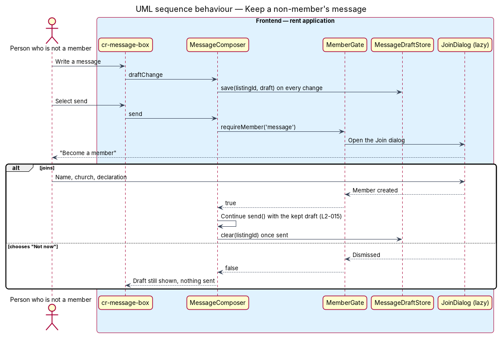

# Send a message about a listing

## Overview

A rental on christian.rent is arranged by two people who agree the details together. The
Listing screen has a message box that sends a message from a member to the member who posted
the listing. When the listing is for rent the message carries a start and an end date. Once
the message is sent, a confirmation replaces the message box.

- **message** — text a member sends about one listing, with dates when the listing is for
  rent
- **sender** — member who writes the message
- **recipient** — member who posted the listing
- **messaging limit** — at most 20 messages per member in any hour

A message is private to the sender and the recipient. Sending one reserves nothing and
changes nothing on the listing. Where the recipient reads the message is not designed yet;
this feature covers sending, storing and the rule for who may read.
[ADR 0022](../../../adr/0022-sending-a-message-open-decisions.md) records what this design
left open and how each point was decided.

## Description

**Frontend**

- **`cr-message-box`** (`components`) — the panel beside the listing. Inputs: `heading`,
  `price`, `loading`, `own`, `form`, `sent` and `draft`. Outputs: `draftChange` and `send`.
  It is presentation only: `form` is a `MessageFormView` and `sent` a `MessageSentView`, both
  types of `@rent/api` whose every word `@rent/domain` has already written. For a listing for
  rent it shows `cr-date-range` and the summary "Sat, Jun 13, 2026 · one day" (criterion 9);
  for a wanted listing it shows no dates (L2-015, criterion 2), and with no price it has no
  head (criterion 13). It shows the line "No payment happens here. You'll agree the details
  together." and no payment control (L2-024). The offer decides the copy (criterion 8):

  | | For rent | Wanted |
  |---|---|---|
  | heading | "Message {name} about this listing" | "Offer to help {name} about this listing" |
  | price | "Rent for", "$45 CAD / hour" | "They'll pay", "Up to $120 CAD / day" |
  | button | "Message {name}" | "Offer to help {name}" |

  The message field has `maxlength` 1,000 and a counter "94 / 1,000". By what `form` says:
  - invalid — every invalid field carries `aria-invalid`; a summary lists them in the form's
    order and takes focus (`focusSummary()`), and each of its links moves focus to its field
    (criterion 10);
  - busy — the button carries `aria-busy` and the fields are read-only (criterion 11);
  - failed — an alert says the message was not sent and the button reads "Try again";
  - limited — an alert names when sending reopens and the button is disabled (L2-016,
    criterion 6).

  With `sent` it draws its own confirmation in place of the form, as the `sent` mock does: a
  `status` region that reads "Sent to {name}", says that the person can read the message and
  reply and that nothing is booked or paid, quotes the dates and the message back as text,
  and links back to Browse. It does not say where the reply arrives (criterion 12).
  `focusSent()` moves focus to its title, which announces it. With `own` it draws the price,
  "This is your listing." and no form (criterion 6).
- **`MessageComposer`** (`rent/src/app/pages/listing/`) — service provided by the Listing
  page. It holds `draft: MessageDraft` and `state`: `idle`, `submitting`, `sent`, `failed`,
  `limited`; a draft is invalid while `errors` is not empty, which is not a state of its own.
  `open(listingId)` restores the kept draft. `send()` validates, asks
  `MemberGate.requireMember('message')`, then calls `MESSAGES_API.send(listingId, request)`.
  On `failed` and `limited` the draft is unchanged (L2-015, criterion 7); `limited` returns to
  `idle` by a timer at `retryAt`. A `not_found` refusal reloads the listing. Leaving aborts
  the request and clears the timer.
- **`validateMessageDraft`** (`domain/listings/`, the design's `MessageDraftValidator`) — text
  of 1 to 1,000 characters after trimming; dates are optional, but one needs the other, the
  start is today or later and the end is on or after the start (L2-015, criteria 3 and 4).
  "Today" is passed in. `toMessageRequest` writes what is sent, and `toMessageFormView` and
  `toMessageSentView` write what the box shows.
- **`MessageDraftStore`** (`domain/storage/`) — keeps the message draft in `sessionStorage`
  under `cr.message.draft.{listingId}` on every change, so it survives the join dialog and a
  reload; an empty draft and a sent one are removed (L2-015, criteria 5 and 14).
- **`ListingPage`** — passes `own` to `cr-message-box` when `ListingDetail.isOwn` is true, so
  no form is drawn (L2-015, criterion 6).
- **`MessagesApi`** with the token **`MESSAGES_API`** — `send(listingId, request, signal)`,
  bound to `HttpMessagesApi` by the Listing route.

**Backend**

- **`MessagesController.Send`** — `POST /api/listings/{listingId}/messages`, member
  required. It sends one `SendMessageCommand` and returns `201 Created` with
  `SentMessageDto { Id, SentAt }`.
- **`SendMessageCommand`** — `{ ListingId, Text, StartDate?, EndDate? }`. `ListingId` is the
  address's text, so one that is not an identifier is `not_found` like an unknown one.
- **`SendMessageCommandValidator`** — the same rules as `validateMessageDraft`, with the
  date taken from `TimeProvider`; a start date may be the day before the backend's own date,
  which is today somewhere in Canada (ADR 0022). A control character other than a line break
  or a tab is refused.
- **`SendMessageCommandHandler`** — in order:
  1. requires a member (`not_a_member`);
  2. loads the listing; a listing that is missing, waiting or removed, or whose poster is not
     active, raises `NotFoundException` (`not_found`), so a message about a removed listing
     is refused (L2-016, criterion 5);
  3. refuses the listing's own poster with the code `own_listing` (L2-015, criterion 6);
  4. refuses dates on a wanted listing with `validation_failed`;
  5. asks `MessagingLimit.RetryAt(sentAt, now)` with when the sender's messages of the last
     hour were sent; a twenty-first message in an hour raises `LimitReachedException`,
     returned as 429 with `message_limit_reached` and `retryAt` (L2-016, criterion 4);
  6. creates `Message.Send(listing, senderId, text, startDate, endDate, now)` and saves it.
  The handler writes nothing to the `Listing` (L2-024, criterion 3).
- **`Message`** — domain entity `{ Id, ListingId, SenderId, RecipientId, Text, StartDate?,
  EndDate?, SentAt }`. `CanBeReadBy(memberId)` is true for the sender and the recipient only
  (L2-016, criterion 1). Every query that returns message text applies it; none exists yet.
  `ClearText()` empties the text when its sender has left (L2-016, criterion 7).
- **`MessageDto`** — the shape a reader receives: sender name, sender church, the two
  verified flags, listing title, dates and text. It has no email address or phone number
  property (L2-016, criteria 2 and 3). It is built with the Messages inbox, not before.
- **`PurgeDepartedMembersCommand`** — also clears the text of the messages a departed member
  sent, and deletes the messages about their listings with those listings.

Message text is stored and rendered as text (L2-026) and never appears in a log, a metric
or a span.

**Undecided**

- Where the recipient reads a message and how they reply (the Messages inbox):
  `<TO SUPPLY>`. No read endpoint is built before its design exists; until then a message is
  stored and shown to nobody (ADR 0022).
- Whether the recipient is notified outside christian.rent, and by which channel:
  `<TO SUPPLY>`. Nothing is sent until it is decided.
- How long messages are kept: decided with the inbox.

### Mocks

The mocks are the source of truth for the UI of this feature. The states this design covers are:

- [`docs/mocks/pages/listing/default.html`](../../../mocks/pages/listing/default.html): the message box with dates
- [`docs/mocks/pages/listing/wanted.html`](../../../mocks/pages/listing/wanted.html): the message box without dates
- [`docs/mocks/pages/listing/no-price.html`](../../../mocks/pages/listing/no-price.html): the message box of a wanted listing that gave no price
- [`docs/mocks/pages/listing/invalid.html`](../../../mocks/pages/listing/invalid.html): an empty message or wrong dates
- [`docs/mocks/pages/listing/submitting.html`](../../../mocks/pages/listing/submitting.html): the request is in flight
- [`docs/mocks/pages/listing/sent.html`](../../../mocks/pages/listing/sent.html): the confirmation that replaces the message box
- [`docs/mocks/pages/listing/failed.html`](../../../mocks/pages/listing/failed.html): sending failed; text and dates kept
- [`docs/mocks/pages/listing/limited.html`](../../../mocks/pages/listing/limited.html): the messaging limit, with the time sending reopens
- [`docs/mocks/pages/listing/own.html`](../../../mocks/pages/listing/own.html): no message box on the poster's own listing
- [`docs/mocks/dialogs/join/default.html`](../../../mocks/dialogs/join/default.html): the membership prompt

## Requirements

The feature realizes the following level-2 (L2) requirements from
[`docs/specs/L2.md`](../../../specs/L2.md). Each L2 requirement refines a level-1 (L1)
requirement, cited by identifier. The table restates each requirement in `shall` form; the
acceptance criteria in the specification remain authoritative.

| L2 ID | Refines (L1) | Requirement |
|-------|--------------|-------------|
| `L2-015` | `L1-005` | The Listing screen shall have a message box that sends a message of 1 to 1,000 characters to the person who posted, with start and end dates when the listing is for rent. The box shall name the person who posted, show the price with "CAD" and state that no payment happens here. Invalid fields shall be listed in a summary that takes focus. A confirmation shall replace the message box once sent; it shall quote the message back and shall not say where the reply arrives. A non-member's message and dates shall be kept while they become a member. The message box shall not be offered on a member's own listing. A failed send shall keep the text and dates. |
| `L2-016` | `L1-005` | Only the member who sent a message and the member who posted the listing shall be able to read it. Neither person's email address or phone number shall be revealed to the other. A twenty-first message in an hour shall be refused with the time sending reopens, and the text and dates shall be kept. A message about a removed listing shall be refused. |
| `L2-024` | `L1-010` | No screen shall offer a way to pay, take a deposit or enter a card. A listing shall show no booking calendar, review, rating or advert. A message with dates shall not change the listing's availability or reserve anything. |
| `L2-025` | `L1-011` | Every endpoint other than browsing, searching, reading an approved listing and serving its photos shall respond 401 to anyone not signed in. Listing the churches, joining and asking who is signed in shall not be refused for want of membership. The backend shall refuse a request for, or a change to, anything that is not the member's own, and shall reveal nothing about it. A refusal a screen branches on shall be a ProblemDetails with a `code`. |
| `L2-026` | `L1-011` | A title, note, message, member name or church name shall be rendered as text wherever it is shown. Every input shall be validated for type, length and range before use, and database access shall be parameterised. Every response shall carry a Content-Security-Policy that allows no inline script and no third-party script. |

## Diagrams

### System context

The people involved are: member, member who posted. Each reaches the feature through christian.rent, which takes no payment and holds no booking calendar.

### Containers

The rent application calls `ChristianRent.Api` over JSON/HTTPS. The API persists state through EF Core.

### Components

`cr-message-box` is presentation only; `MessageComposer` owns the draft and the request.
The handler refuses a hidden, removed or own listing and a sender over the limit before it
creates the `Message`.

### Class structure

`Message` references one listing and two members and owns the rule for who may read it.
`MessageDto` is the only projection of a message and carries no contact detail.

### Behaviour — send a message

The handler refuses a removed listing, the listing's own poster and a sender over the
limit, then stores the message without touching the listing (`L2-015`, `L2-016`,
`L2-024`).

### Behaviour — keep a non-member's message

A person who is not a member is asked to join; the message and dates are kept in
`MessageDraftStore` and sent after joining (`L2-015`, criterion 5).

