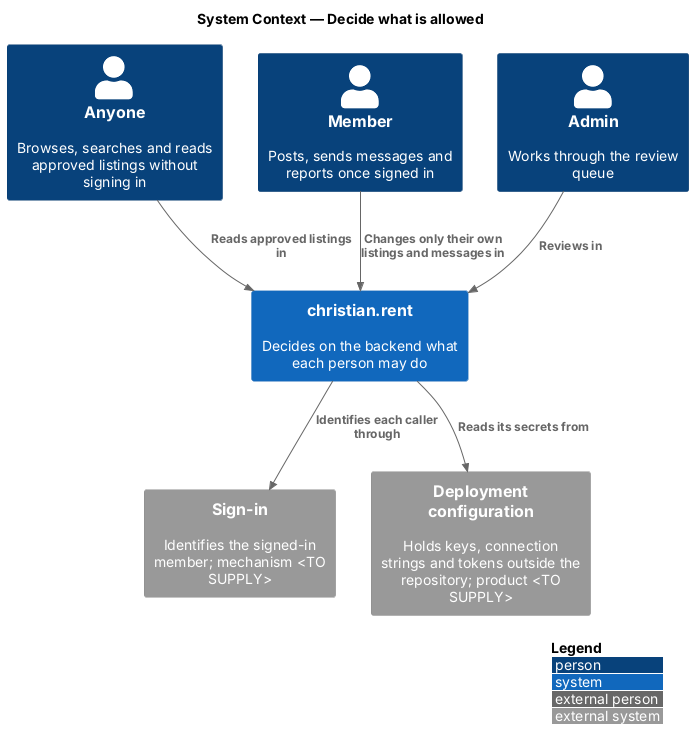
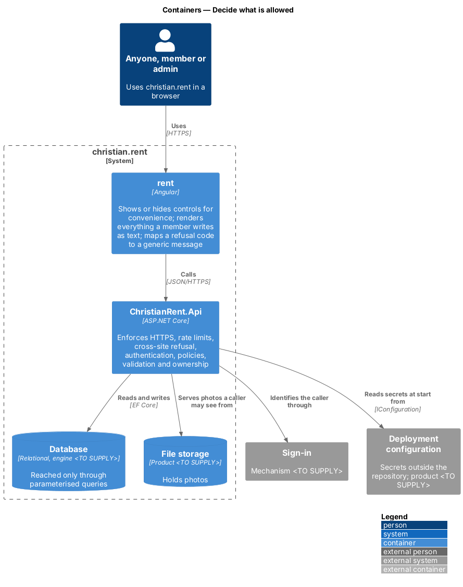
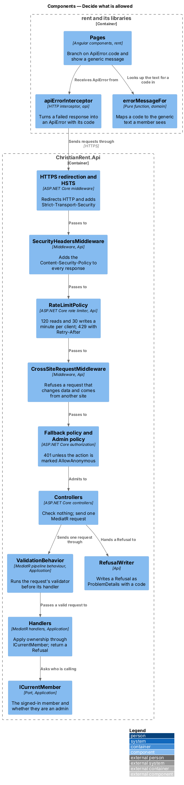
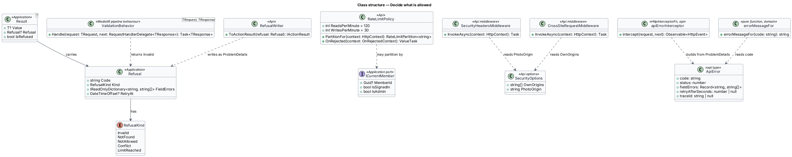
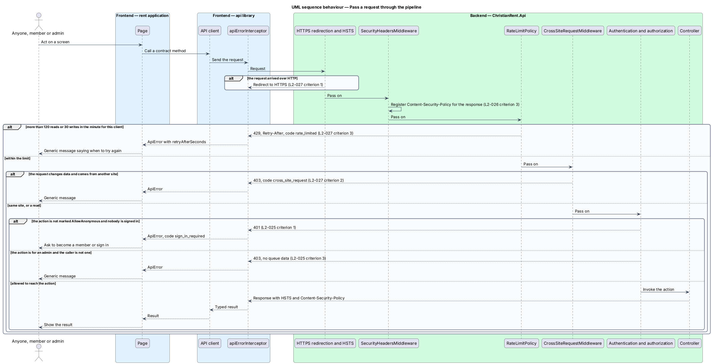
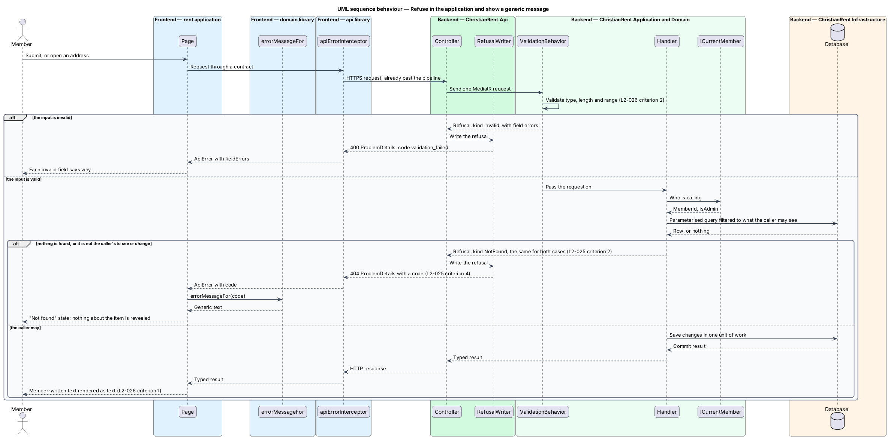

# Decide what is allowed

## Overview

christian.rent is where Christians post spaces and things for rent, or ask for a space or a
thing to rent. Anyone may browse, search and read an approved listing. A *member* may post a
listing, send a message and report a listing. An *admin* works through the review queue. This
feature is the set of shared parts that decide, for every request, whether the caller may do
what the request asks, and that keep what a member writes from ever running as code.

The feature is cross-cutting. It owns no screen and no entity. Every other feature passes
through it: a request crosses the same ordered steps in `ChristianRent.Api` before any
controller runs, every handler refuses in the same form, and every screen turns a refusal into
a generic message in the same way. The backend decides; `rent` shows or hides a control for
convenience and never relies on that for a rule.

Terms used below:

- **pipeline** — ordered chain of middleware a request crosses in `ChristianRent.Api` before a controller action runs
- **fallback policy** — authorization rule applied to every endpoint that declares no rule of its own
- **refusal** — decision by the backend not to do what a request asks, returned as a ProblemDetails
- **ProblemDetails** — standard JSON error body (RFC 9457) with a status, a title and extension members
- **`code`** — extension member of a ProblemDetails, in snake_case, that a screen branches on
- **read request** — request with the method GET or HEAD
- **write request** — request with any other method; a write request changes data
- **client** — single source of requests that the rate limit counts

The rules particular to one feature stay with that feature: the limit of 10 listings in 24 hours
is in `docs/detailed-designs/listings/`, the limit of 20 messages in an hour is in
`docs/detailed-designs/messages/send-message/`, and who may see the review queue is in
`docs/detailed-designs/review-queue/work-review-queue/`. This feature supplies the mechanism
they use.

## Description

The slice is not built yet; the parts below are the ones the design introduces.

### The pipeline in `ChristianRent.Api`

`Program.cs` registers the steps in this order. Each step either refuses or passes the request
on.

1. **HTTPS redirection and HSTS** — the platform's own middleware. A request over HTTP is
   redirected to HTTPS, and every response carries a `Strict-Transport-Security` header
   (`L2-027` criterion 1). The `max-age` of the header is `<TO SUPPLY>`: no requirement gives
   it. Where a proxy ends the TLS connection in front of the API, the API reads the forwarded
   scheme from that proxy; the hosting arrangement is `<TO SUPPLY>`.
2. **`SecurityHeadersMiddleware`** — adds a `Content-Security-Policy` header to every response,
   including a refusal from a later step (`L2-026` criterion 3). The policy is
   `default-src 'self'; script-src 'self'; object-src 'none'; base-uri 'self'; frame-ancestors 'none'`,
   with `img-src` extended by the origin photos are served from (`SecurityOptions.PhotoOrigin`).
   `script-src 'self'` allows no inline script and no third-party script. The `style-src`
   directive is `<TO SUPPLY>`: Angular adds component styles as `style` elements at run time,
   and whether they are admitted by a nonce depends on the host that serves `index.html`.
3. **`RateLimitPolicy`** — the platform's rate limiter, configured as one global limiter. See
   *Rate limit* below.
4. **`CrossSiteRequestMiddleware`** — refuses a write request that comes from another site. See
   *Cross-site refusal* below.
5. **Authentication** — establishes who is calling. Sign-in is not designed; the mechanism is
   `<TO SUPPLY>`. The step ends with an identity or with none.
6. **Authorization** — applies the fallback policy or the policy the action names. See
   *Policies* below.
7. **Controller action** — checks nothing itself and sends one MediatR request.

The handler for an unhandled error wraps all seven steps; it is designed in
`docs/detailed-designs/platform/fail-clearly-and-operate/`.

### Policies

- **Fallback policy** — `AuthorizationOptions.FallbackPolicy` requires a signed-in member. An
  action that declares nothing is therefore closed, and a new endpoint is closed until someone
  opens it on purpose. A call without a signed-in member receives 401 (`L2-025` criterion 1).
- **`[AllowAnonymous]`** — written explicitly on the actions anyone may call: browsing and
  searching (`ListingsController`, `BrowseListingsQuery`), reading one listing
  (`ListingsController`, `GetListingQuery`) and reading a photo of an approved listing
  (`PhotosController`). The attribute is never placed on a controller class, so each open action
  is visible where it is declared. Two further cases are not settled by `L2-025` criterion 1,
  which names only browsing, searching and reading an approved listing: whether the health
  endpoint and the endpoints a person calls while becoming a member (joining, and choosing a
  church) are open is `<TO SUPPLY>`.
- **`Admin` policy** — named policy on every action of `ReviewQueueController`. It requires that
  `ICurrentMember.IsAdmin` is true. How a member is made an admin is `<TO SUPPLY>` with
  sign-in.
- **`ICurrentMember`** — port in `ChristianRent.Application` giving the signed-in member's id
  and whether they are an admin. A handler never takes the member's id from the request body or
  the route; it reads it from this port.

Hiding a control in `rent` changes nothing here. The same action sent straight to the backend
by someone not allowed meets the same policy and the same handler (`L2-025` criterion 3).

### Ownership that reveals nothing

Authorization answers whether a caller may call an action. Whether the caller may see or change
one particular listing, message or photo is a business rule, and business rules live in
handlers.

- A handler builds its query with the ownership condition inside it: a member's own listings
  and messages, and listings that are approved. It does not load a row and then compare owners.
- When the query returns nothing, the handler returns one `Refusal` of kind `NotFound`. A row
  that does not exist and a row that belongs to someone else produce the same refusal, the same
  status 404 and the same `code` (for a listing, `listing_not_found`). The response therefore
  does not reveal whether the item exists (`L2-025` criterion 2).
- The same holds for a change: a command against an item that is not the caller's is refused as
  not found, and nothing is written.

### Refusals as ProblemDetails with a `code`

- **`Refusal`** — value in `ChristianRent.Application` with a `Code`, a `RefusalKind`, optional
  `FieldErrors` and an optional `RetryAt`.
- **`RefusalKind`** — enumeration `Invalid`, `NotFound`, `NotAllowed`, `Conflict`,
  `LimitReached`.
- **`Result<T>`** — what every handler returns: a value or a `Refusal`. A handler does not throw
  to refuse; an exception means an unhandled error.
- **`RefusalWriter`** — the one place in `ChristianRent.Api` that turns a `Refusal` into an HTTP
  response. It maps `Invalid` to 400, `NotFound` to 404, `NotAllowed` to 403, `Conflict` to 409
  and `LimitReached` to 429, and writes a ProblemDetails whose `code` extension is
  `Refusal.Code` (`L2-025` criterion 4). A `LimitReached` refusal with a `RetryAt` also carries
  a `Retry-After` header. The `detail` of the ProblemDetails holds no member data and no
  internal name.

### Input validation

- **`…Validator`** — one FluentValidation validator per request that takes input. It states the
  type, length and range of each field, with the limits the L2 requirement of that feature
  gives.
- **`ValidationBehavior<TRequest, TResponse>`** — MediatR pipeline behaviour registered once. It
  runs the request's validator before its handler and returns a `Refusal` of kind `Invalid`
  with the `code` `validation_failed` and the field errors. No handler runs on input that has
  not passed (`L2-026` criterion 2). Because the behaviour sits in the MediatR pipeline, a
  request sent straight to the backend meets the same rules as one sent from a form.
- **Model binding** — a body that does not fit the request's types is refused by the framework
  with 400 before any MediatR request is sent. A request body larger than the limit is refused;
  the limit for a request that is not a photo upload is `<TO SUPPLY>`.
- **Database access** — every query goes through `IAppDbContext` as a LINQ query, which EF Core
  sends with parameters. SQL built by joining strings shall not be used, including for search
  (`L2-026` criterion 2).

### Rendering as text

- Every title, note, message, member name, church name and search term reaches the screen
  through Angular's text interpolation or a text binding, which escape it. `[innerHTML]`,
  `DomSanitizer.bypassSecurityTrust…` and direct DOM writes shall not be used anywhere in
  `rent` or its libraries (`L2-026` criterion 1).
- A member-written value is never bound to an `href`, a `src` or a style.
- The `title` and `detail` of a ProblemDetails are data too. A screen does not show them; it
  shows its own text for the `code`.
- The Content-Security-Policy is the second line: were markup to reach the page, `script-src
  'self'` stops it from running. The production build of `rent` shall emit no inline script and
  no inline event handler in `index.html`, so the policy holds without an exception. The host
  that serves `index.html` shall send the same policy as `SecurityHeadersMiddleware`; that host
  is `<TO SUPPLY>`.

### Cross-site refusal

**`CrossSiteRequestMiddleware`** lets every read request pass. For a write request it reads the
`Origin` header, and the `Sec-Fetch-Site` header where the browser sends it. When the request
comes from an origin that is not in `SecurityOptions.OwnOrigins`, the middleware refuses with
403 and the `code` `cross_site_request` (`L2-027` criterion 2). The API registers no CORS policy
that admits another origin. Where sign-in keeps the session in a cookie, the cookie's `SameSite`
attribute and an anti-forgery token add to this check; whether it does is `<TO SUPPLY>` with
sign-in.

### Rate limit

**`RateLimitPolicy`** partitions requests by client and by whether the request is a read or a
write, and gives each partition a fixed window of one minute: 120 read requests and 30 write
requests. The request after the limit is refused with 429, a `Retry-After` header giving the
seconds until the window ends, and a ProblemDetails with the `code` `rate_limited` (`L2-027`
criterion 3). The limiter sits before authentication, so a refused request costs no database
work.

What identifies one client is `<TO SUPPLY>`: `L2-027` criterion 3 says "one client" and does
not say whether that is a network address, the signed-in member, or both. The limiter keeps its
counts in the memory of one instance of the API; the number of instances a deployed system
runs, and whether the counts are shared between them, is `<TO SUPPLY>`.

### Secrets from configuration

`ChristianRent.Api` reads every key, connection string and token through `IConfiguration`, from
sources outside the repository (`L2-027` criterion 4). The `appsettings.json` files in the
repository hold names and non-secret defaults only. Each group of settings is an options class
(`SecurityOptions` among them) validated when the API starts, so a missing secret stops the
start with the name of the setting and never its value. The product that holds the secrets in a
deployed system is `<TO SUPPLY>`. Each setting a deployed system needs is documented in the
same change that introduces it; the path of that document is `<TO SUPPLY>`.

### The frontend's part

- **`apiErrorInterceptor`** — functional HTTP interceptor in the `api` library, bound in
  `app.config.ts`. It turns every failed response into an `ApiError` carrying the `code`, the
  status, the field errors and the seconds from `Retry-After`. A 401, which has no body, becomes
  the `code` `sign_in_required`.
- **`ApiError`** — the only error a contract in `api` rejects with.
- **`errorMessageFor(code)`** — pure function in `domain` mapping a `code` to the generic text
  a member sees. An unknown `code` maps to one general message. A page branches on the `code`
  for behaviour, for example sending a person to become a member or sign in on
  `sign_in_required`, with their draft kept by `DraftStore`.
- **Controls** — a page hides a control the signed-in member may not use. This is convenience.
  The code for Admin is loaded only for an admin, as
  `docs/detailed-designs/review-queue/work-review-queue/` describes.

Where a refusal appears on a screen, its layout and states follow `docs/mocks/` once drawn, and
this design is brought in line with them then.

## Requirements

The feature realizes the following level-2 (L2) requirements. Each L2 requirement refines a
level-1 (L1) requirement, cited by identifier.

| L2 ID | Refines (L1) | Requirement |
|-------|--------------|-------------|
| `L2-025` | `L1-011` | The backend decides what is allowed. Any endpoint other than browsing, searching and reading an approved listing shall respond 401 when called without a signed-in member. The backend shall refuse a member who requests a listing, message or photo that is not theirs to see, or tries to change one that is not theirs, and shall reveal nothing about it. An action sent straight to the backend by someone not allowed shall be refused. A refusal a screen branches on shall be a ProblemDetails with a `code`, and the member shall see a generic message. |
| `L2-026` | `L1-011` | What a member writes is data. A title, note, message, member name or church name containing HTML or script shall be rendered as text wherever it is shown. Any input shall be validated for type, length and range before it is used, and database access shall be parameterised. Each response shall carry a Content-Security-Policy that allows no inline script and no third-party script. |
| `L2-027` | `L1-011` | Transport, sessions and abuse. A request over HTTP shall be redirected to HTTPS, and responses shall carry HSTS. A request that changes data and comes from another site shall be refused. A client that makes more than 120 read requests or 30 write requests in a minute shall be refused with 429 and a Retry-After header. A secret shall come from configuration outside the repository. |

## Diagrams

### System context

Anyone, a member and an admin each use christian.rent, which identifies its callers through a
sign-in mechanism that is `<TO SUPPLY>` and reads its secrets from configuration outside the
repository.

### Containers

`rent` shows or hides controls and renders text; `ChristianRent.Api` enforces every rule and is
the only container that reaches the database and file storage.

### Components

A request crosses HTTPS redirection, `SecurityHeadersMiddleware`, `RateLimitPolicy`,
`CrossSiteRequestMiddleware` and authorization before a controller sends one MediatR request.
`ValidationBehavior` runs before the handler, the handler asks `ICurrentMember` who is calling,
and `RefusalWriter` writes any refusal. In the frontend, `apiErrorInterceptor` produces the
`ApiError` a page branches on.

### Class structure

`Result<T>` carries a `Refusal`, which has a `RefusalKind`. `ValidationBehavior` returns a
refusal and `RefusalWriter` writes it. `RateLimitPolicy` holds the two limits, and the two
middleware read `SecurityOptions`. In the frontend, `apiErrorInterceptor` builds `ApiError` and
`errorMessageFor` reads its `code`.

### Behaviour — pass a request through the pipeline

Each step of the pipeline either refuses or passes on: a redirect to HTTPS, 429 with
`Retry-After` over the limit, 403 for a write request from another site, 401 without a
signed-in member, and 403 for a caller who is not an admin. Only then does the controller
action run.

### Behaviour — refuse in the application and show a generic message

`ValidationBehavior` refuses invalid input before the handler runs. The handler queries with
the ownership condition inside the query and returns the same `NotFound` refusal whether the
item is absent or belongs to someone else. `RefusalWriter` writes a ProblemDetails with a
`code`, and the page shows the text `errorMessageFor` gives for it.

