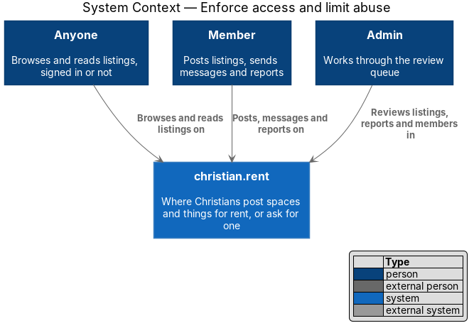
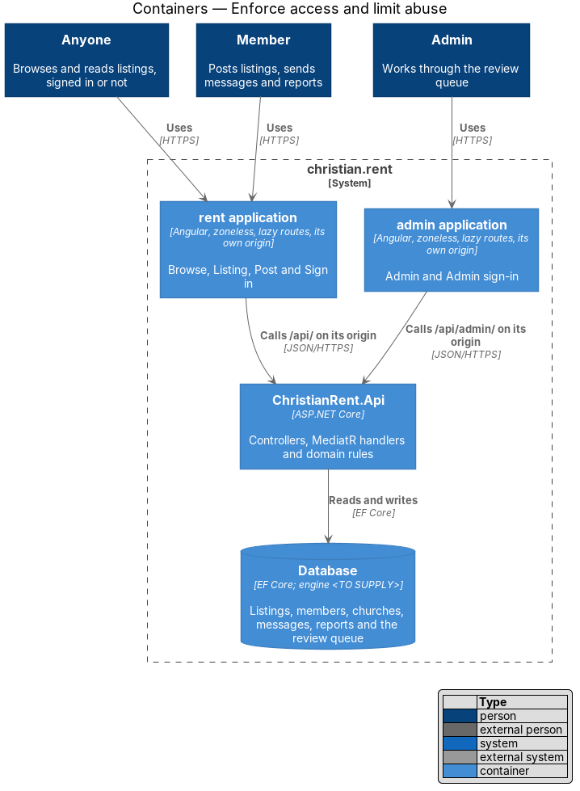
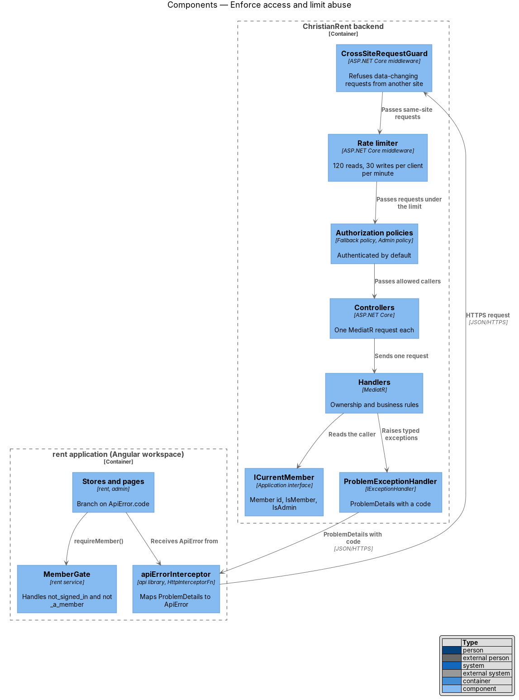
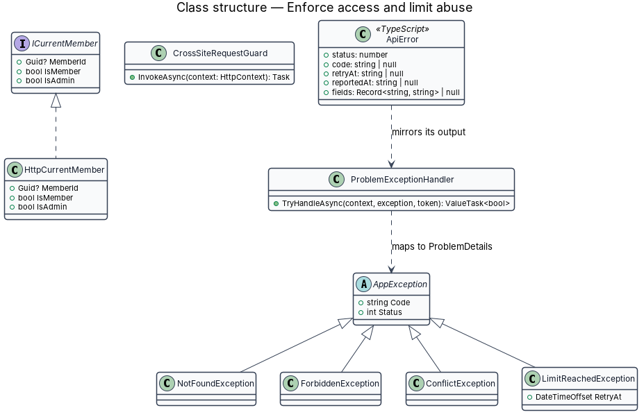
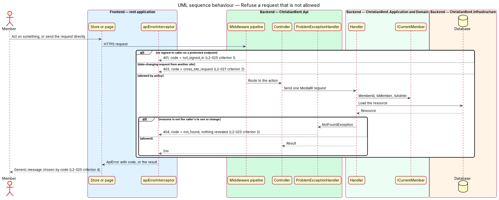
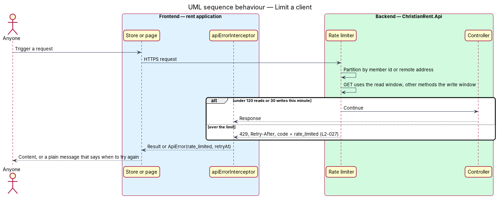

# Enforce access and limit abuse

## Overview

The backend decides what each person may do. The frontend shows or hides a control for
convenience and never stands in for a rule. This feature is the part of the backend that
every request passes through before a handler runs, and the part of the frontend that turns
a refusal into something a screen can branch on.

- **fallback policy** — authorization rule applied to every endpoint that declares none
- **anonymous endpoint** — endpoint explicitly opened to people who are not signed in
- **refusal code** — `code` field of a ProblemDetails response, which a screen branches on
- **client** — signed-in member, or the network address of a caller who is not signed in
- **rate limit** — cap on requests per client per minute

Sign-in and the two sessions are [sign-in-and-sessions](../sign-in-and-sessions/README.md)
([ADR 0029](../../../adr/0029-sign-in-and-two-sessions.md)). This design fixes what happens once
the caller is, or is not, known.

## Description

**Backend — request pipeline, in order**

1. **HTTPS redirection and HSTS** — `UseHttpsRedirection()` and `UseHsts()` outside
   development (L2-027, criterion 1). Behind a proxy, forwarded headers are honoured from
   configured proxies only.
2. **`CrossSiteRequestGuard`** (`ChristianRent.Api` middleware) — for `POST`, `PUT`, `PATCH`
   and `DELETE`, it compares the `Origin` header, or `Sec-Fetch-Site` when present, with the
   origin of the application the path belongs to (`Site:AdminOrigin` for `/api/admin/`,
   `Site:Origin` for any other), and answers 403 with the code `cross_site_request` on a
   mismatch (criterion 2). Signing in and out are covered. The session cookies are
   `SameSite=Strict`, `Secure` and `HttpOnly`.
3. **Authentication** — the default scheme `Session` forwards a path under `/api/admin/` to the
   `Admin` cookie scheme and any other to `Member`, so the principal is the application's own
   before the rate limiter runs ([ADR 0029](../../../adr/0029-sign-in-and-two-sessions.md)).
   The cookie carries the account's id in `sub`, and `MemberClaimsTransformation` adds
   `member_id` and the role `admin` for the active member with that identifier
   ([ADR 0017](../../../adr/0017-identifying-a-person-until-sign-in.md)).
4. **Rate limiter** — ASP.NET Core `AddRateLimiter` with one global partitioned limiter. The
   partition key is the member identifier, of either session, or the remote address for an
   anonymous caller. It is chained with the sign-in limiter: 10 sign-in attempts per address
   per 15 minutes.
   `GET` and `HEAD` take a token from the `read` window, 120 per minute; every other method
   takes one from the `write` window, 30 per minute. A rejected request is 429 with a
   `Retry-After` header and the code `rate_limited` (criterion 3). The limiter reads time
   from `TimeProvider`: each partition is a `TimeProviderFixedWindowLimiter`, and the health
   endpoints are outside it ([ADR 0009](../../../adr/0009-health-endpoints-and-rate-limiter.md)).
5. **Authorization** — the fallback policy requires an authenticated caller of the `Member`
   scheme. `[AllowAnonymous]` appears on exactly these actions: `ListingsController.Browse`,
   `ListingsController.Get`, `PhotosController.Get`, the sign-in and sign-out actions of
   `SessionController` and `AdminSessionController`, and the health endpoints, all named by
   L2-025, criterion 1. `MembersController.Join`, `MembersController.Me` and
   `ChurchesController.List` need a signed-in person and not a member (L2-025, criterion 5;
   ADR 0017). `AdminSession` requires a caller of the `Admin` scheme; `Admin` also requires the
   role `admin`.
6. **Controllers** — each action sends one MediatR request and checks nothing itself.

**Backend — application layer**

- **`ICurrentMember`** — `SignInId`, `MemberId`, `IsMember`, `IsAdmin`. `HttpCurrentMember`
  (`ChristianRent.Infrastructure`) reads them from the principal, which
  `MemberClaimsTransformation` has resolved once per request. A handler that needs a member
  calls `RequireMember()`, which raises `ForbiddenException("not_a_member")` for anyone who is
  not an active member.
- **Ownership checks** live in handlers: a handler loads the resource, then compares its
  owner with `ICurrentMember.MemberId`. A resource that is not the caller's to see is
  answered exactly like one that does not exist (L2-025, criterion 2).
- **Exceptions** — `NotFoundException`, `ForbiddenException(code)`,
  `LimitReachedException(code, retryAt)`, `ConflictException(code)` and FluentValidation's
  `ValidationException`.
- **`ProblemExceptionHandler`** (`IExceptionHandler`) — maps each exception to a
  ProblemDetails with a `code` extension (criterion 4).

| Status | `code` | Raised when |
|---|---|---|
| 400 | `validation_failed` | a field breaks a rule; `errors` names each field |
| 400 | `page_size_out_of_range` | a page size above 50 |
| 401 | `not_signed_in` | no signed-in caller of the endpoint's session on a protected endpoint |
| 401 | `sign_in_failed` | a sign-in refused, for whatever reason (L2-037, criterion 2) |
| 403 | `not_a_member` | the caller is not, or is no longer, a member |
| 403 | `not_an_admin` | the caller is not an admin |
| 403 | `own_listing` | a message or report on the caller's own listing |
| 403 | `cross_site_request` | a data-changing request from another site |
| 404 | `not_found` | missing, or not the caller's to see |
| 409 | `already_reported`, `already_decided` | the action was already taken |
| 409 | `decision_not_allowed` | the decision does not fit the item's kind |
| 422 | `photo_type_refused`, `photo_too_large`, `photo_too_small`, `photo_dimensions_too_large` | a photo breaks a rule |
| 429 | `post_limit_reached`, `message_limit_reached`, `rate_limited` | a limit is reached; `retryAt` or `Retry-After` says when |

**Frontend — `api` library**

- **`ApiError`** — `{ status, code, retryAt, reportedAt, fields }` (`reportedAt` is when the
  caller's earlier report was filed, on `already_reported`; ADR 0023). `code` is `null` when the response
  is not a ProblemDetails, for example when the backend cannot be reached.
- **`apiErrorInterceptor`** — functional `HttpInterceptorFn` that converts every failed
  response into an `ApiError`. Screens branch on `code` and show their own generic copy;
  the `title` and `detail` of the ProblemDetails are never rendered (criterion 4).
- A 401 on a member action leads to `MemberGate`, and a 401 on a request made while signed in
  to the sign-in page with `expired=1` (`sessionExpiryInterceptor`). In Admin, `adminGuard`
  chooses between Admin's sign-in page, its forbidden page and the review queue.

**Configuration**

Secrets (the database connection string, the file storage key, passwords) come
from environment variables or a secret store and never from the repository (L2-027,
criterion 4). `appsettings.json` holds names and non-secret defaults only. The change that
adds each setting documents it.

**Undecided**

- Where secrets are held in production: `<TO SUPPLY>`.
- Whether the 120 and 30 per-minute windows are fixed or sliding: the design uses fixed
  windows.

### Mocks

The mocks are the source of truth for the UI of this feature. The states this design covers are:

- [`docs/mocks/pages/admin/forbidden.html`](../../../mocks/pages/admin/forbidden.html): a member who is not an admin
- [`docs/mocks/pages/listing/not-found.html`](../../../mocks/pages/listing/not-found.html): a listing that is not the caller's to see
- [`docs/mocks/pages/listing/limited.html`](../../../mocks/pages/listing/limited.html): a limit with the time it lifts
- [`docs/mocks/dialogs/join/default.html`](../../../mocks/dialogs/join/default.html): what a non-member sees on a member action

## Requirements

The feature realizes the following level-2 (L2) requirements from
[`docs/specs/L2.md`](../../../specs/L2.md). Each L2 requirement refines a level-1 (L1)
requirement, cited by identifier. The table restates each requirement in `shall` form; the
acceptance criteria in the specification remain authoritative.

| L2 ID | Refines (L1) | Requirement |
|-------|--------------|-------------|
| `L2-025` | `L1-011` | Every endpoint other than browsing, searching, reading an approved listing and serving its photos shall respond 401 to anyone not signed in. Listing the churches, joining and asking who is signed in shall not be refused for want of membership. The backend shall refuse a request for, or a change to, anything that is not the member's own, and shall reveal nothing about it. A refusal a screen branches on shall be a ProblemDetails with a `code`. |
| `L2-027` | `L1-011` | HTTP requests shall be redirected to HTTPS and responses shall carry HSTS. A data-changing request from another site shall be refused. More than 120 read requests or 30 write requests from one client in a minute shall be refused with 429 and a Retry-After header. Secrets shall come from configuration outside the repository. |

## Diagrams

### System context

The people involved are: anyone, member, admin. Each reaches the feature through christian.rent, which takes no payment and holds no booking calendar.

### Containers

The rent application calls `ChristianRent.Api` over JSON/HTTPS. The API persists state through EF Core.

### Components

A request passes the cross-site guard, the rate limiter and the authorization policies
before a controller sends it to a handler. Handlers raise typed exceptions, which
`ProblemExceptionHandler` turns into ProblemDetails; `apiErrorInterceptor` turns those into
`ApiError` for the screens.

### Class structure

Every refusal a handler raises derives from `AppException`, which carries the `code` and the
status. `ApiError` is the frontend mirror of the ProblemDetails that
`ProblemExceptionHandler` writes.

### Behaviour — refuse a request that is not allowed

A hidden control changes nothing: the same action sent straight to the backend is refused
by a policy or by the handler's ownership check, with a `code` (`L2-025`).

### Behaviour — limit a client

The limiter counts reads and writes per client and answers 429 with `Retry-After` beyond
120 reads or 30 writes in a minute (`L2-027`, criterion 3).

