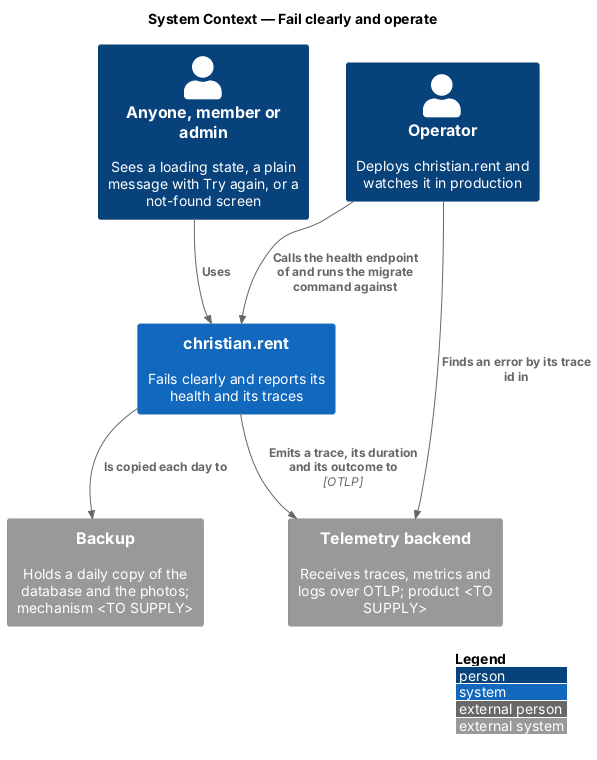
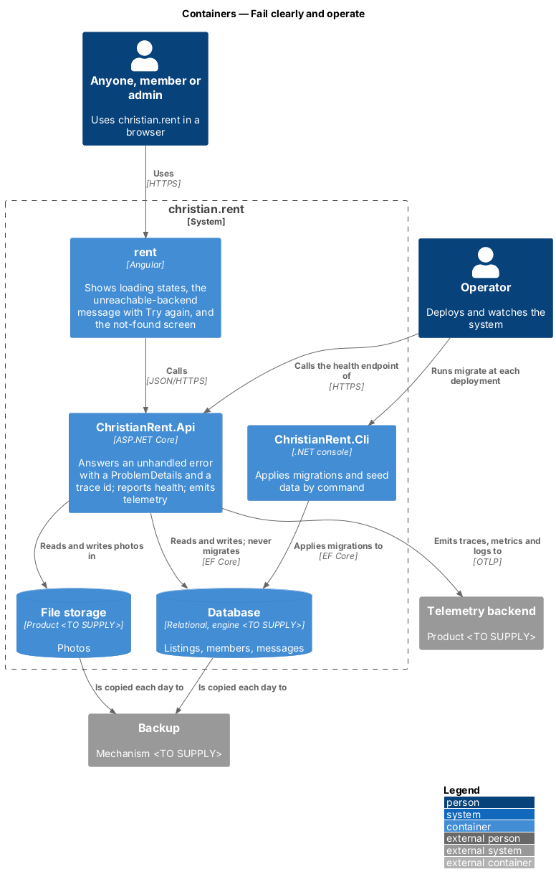
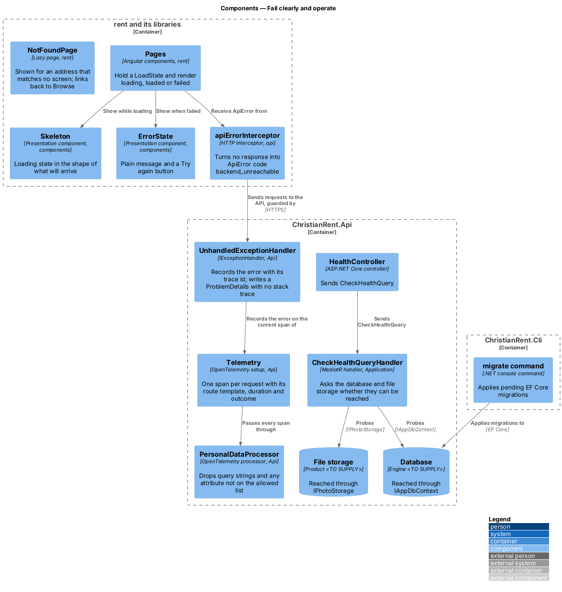
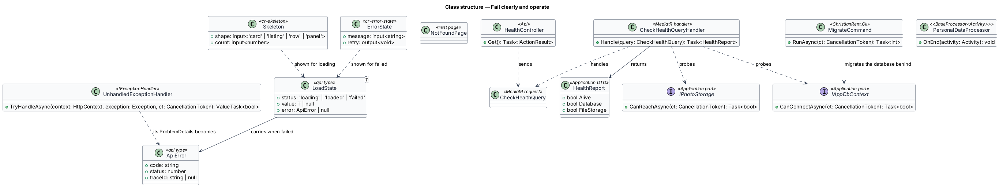
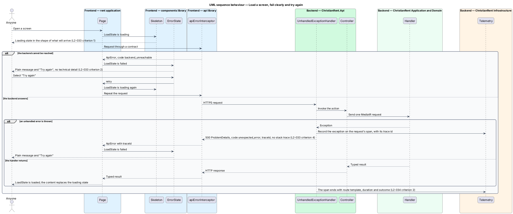
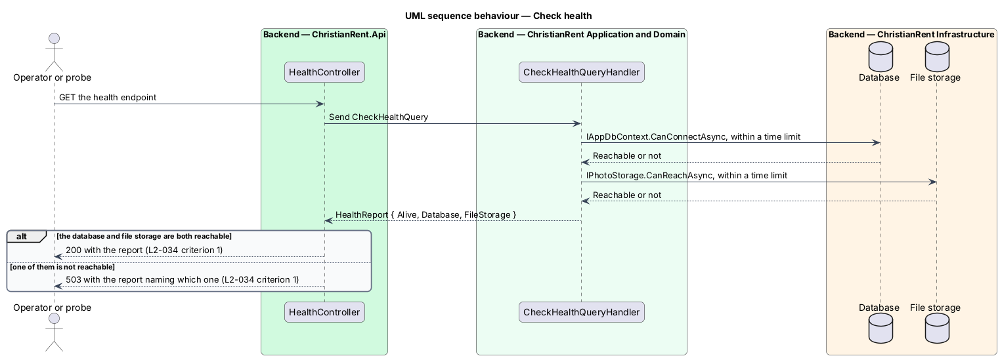
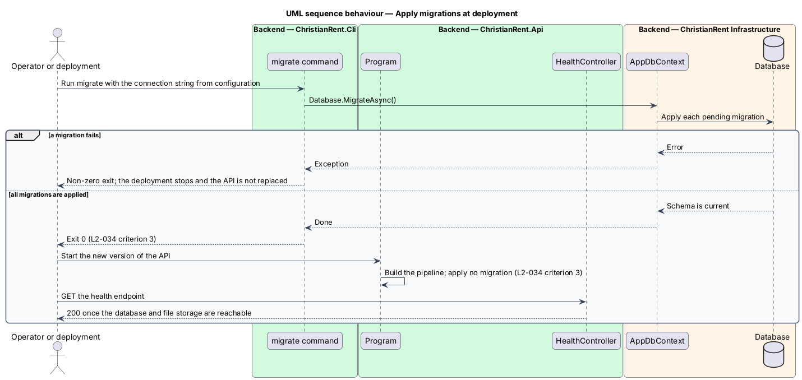

# Fail clearly and operate

## Overview

christian.rent is where Christians post spaces and things for rent, or ask for a space or a
thing to rent. Most people open it on a phone, often on a slow connection, and a deployed
system sometimes fails: a request is slow, the backend cannot be reached, an address leads
nowhere, or a handler meets an error nobody foresaw. This feature is the set of shared parts
that make each of those cases plain to the person on the screen and visible to the person who
runs the system.

The feature has two halves. *Failing clearly* covers what a person sees: a loading state while
a request is in flight, a plain message with "Try again" when the backend cannot be reached, a
"not found" screen for an address that matches no screen, and a response without technical
detail when the backend meets an unhandled error. *Operating* covers what the system offers in
production: a health endpoint, traces through OpenTelemetry that hold no personal data, schema
changes applied by a command, and a daily backup.

The feature is cross-cutting. It owns no screen but the "not found" screen. Every page uses its
loading and failed states, and every request to `ChristianRent.Api` is traced and guarded by
it.

Terms used below:

- **loading state** — placeholder in the shape of the content that will arrive
- **unhandled error** — exception no handler turned into a refusal
- **trace** — record of one request's path through the backend, made of spans
- **trace id** — identifier of one trace, by which a recorded error is found
- **route template** — route as declared, with parameter names in place of values, for example `/listings/{id}`
- **health endpoint** — endpoint that reports whether the backend is alive and can reach what it depends on
- **migration** — versioned change to the database schema
- **operator** — person or automated deployment that deploys christian.rent and watches it in production

A refusal the backend makes on purpose (invalid input, not found, a limit reached) is not a
failure in this sense; it is designed in
`docs/detailed-designs/platform/decide-what-is-allowed/`.

## Description

The slice is not built yet; the parts below are the ones the design introduces.

### Loading and failing on a screen

- **`LoadState<T>`** — type in `api` with three cases: `loading`, `loaded` with a value, and
  `failed` with an `ApiError`. Each page holds what it fetched as a signal of `LoadState<T>`
  and renders one branch per case, so no screen is blank while it waits and none shows stale
  content beside an error by accident.
- **`Skeleton`** (`cr-skeleton`) — presentation component in `components`. It draws a
  placeholder in the shape of what will arrive: a card on Browse, a listing on Listing, a row
  and a panel on Admin (`L2-033` criterion 1). It reserves the space the content will take, so
  the layout does not shift when the content replaces it. The region it stands in carries
  `aria-busy="true"` while loading.
- **`ErrorState`** (`cr-error-state`) — presentation component in `components`. It shows a
  plain message and a "Try again" button, emits `retry`, and carries `role="alert"`. It shows
  no status code, no `code`, no trace id and no text from the response (`L2-033` criterion 2).
- **`apiErrorInterceptor`** — the HTTP interceptor in `api` designed in
  `docs/detailed-designs/platform/decide-what-is-allowed/`. For this feature it maps a request
  that received no response, and a 502, 503 or 504 from anything in front of the API, to an
  `ApiError` with the `code` `backend_unreachable`. It maps a 500 to `unexpected_error` and
  keeps the `traceId` of the ProblemDetails on the `ApiError`.
- **Try again** — the page handles `retry` by returning its `LoadState` to `loading` and
  repeating the same request. A person starts each retry; no automatic retry is designed.
  A request a person has navigated away from is cancelled when its page is destroyed.
- **Where content already shows** — a failure that follows content keeps the content. A page of
  Browse that fails leaves the cards already shown and adds the message with "Try again" below
  them, as `L2-006` criterion 3 requires; a failed post or message keeps what the member
  entered. Those cases are designed in `docs/detailed-designs/listings/` and
  `docs/detailed-designs/messages/send-message/`, and they use `ErrorState` and the same
  `code`.

### The "not found" screen

- **`NotFoundPage`** — page in `rent`, loaded lazily by the wildcard route, which is the last
  route in the table. An address that matches no screen shows it, with a link back to Browse
  (`L2-033` criterion 3). Its code is not in the initial bundle.
- A listing that does not exist or that the caller may not see shows the "not found" state of
  the Listing screen, designed in `docs/detailed-designs/listings/`. Both use the same
  presentation.

### An unhandled error on the backend

- **`UnhandledExceptionHandler`** — implementation of the platform's `IExceptionHandler` in
  `ChristianRent.Api`, registered as the outermost step of the pipeline. When an exception
  escapes a handler or a middleware it does two things. It records the exception on the
  request's span and logs it at error level, both carrying the trace id. It then writes a 500
  ProblemDetails with the `code` `unexpected_error` and a `traceId` extension (`L2-033`
  criterion 4).
- The ProblemDetails holds no exception message, no type name and no stack trace, in every
  environment a deployed system runs in. The developer exception page is not enabled outside a
  developer's own machine.
- The recorded exception holds its type and stack trace. It holds no request body, and the
  rules under *Telemetry without personal data* apply to it.
- A cancelled request (the person navigated away) is not an error and is not recorded as one.

### The health endpoint

- **`HealthController`** — controller with one action. It checks nothing itself and sends
  `CheckHealthQuery`. The route of the action is `<TO SUPPLY>`.
- **`CheckHealthQueryHandler`** — handler in `ChristianRent.Application`. It asks
  `IAppDbContext.CanConnectAsync` whether the database can be reached and
  `IPhotoStorage.CanReachAsync` whether file storage can be reached, each within a time limit.
  The time limit is `<TO SUPPLY>`. Neither probe reads or writes a member's data.
- **`HealthReport`** — the result: `Alive`, `Database` and `FileStorage`, each true or false.
  The action answers 200 when both dependencies are reachable and 503 when either is not, with
  the report in the body in both cases (`L2-034` criterion 1). A response of any kind shows the
  backend is alive. The report names which dependency failed and gives no connection string,
  host name or error text.
- Whether the health endpoint is open to a caller who is not signed in is `<TO SUPPLY>`:
  `L2-025` criterion 1 requires 401 from every endpoint other than browsing, searching and
  reading an approved listing, and a probe that deploys or restarts the system holds no
  member's identity.

### Telemetry without personal data

- **OpenTelemetry setup** — `Program.cs` registers tracing, metrics and logging through the
  OpenTelemetry SDK, with instrumentation for incoming requests, outgoing HTTP calls and
  EF Core, and exports over OTLP. Each request produces one span carrying its route template,
  its duration and its outcome (the status code, and an error flag when it failed), and one
  measurement of request duration (`L2-034` criterion 2). The address of the collector comes
  from configuration; the product that receives the telemetry is `<TO SUPPLY>`.
- **`PersonalDataProcessor`** — span processor in `ChristianRent.Api`. It keeps the attributes
  on an allowed list (method, route template, status code, duration, error type) and removes
  the rest, including the full URL and the query string. A search term travels in the query
  string, so no search term reaches a trace.
- **What is never recorded** — no log, metric or span carries a contact detail, a token,
  message text, a query string or a request or response body, as `L2-028` criterion 3 requires.
  The instrumentation is configured to capture no header and no body, and the EF Core
  instrumentation records no statement text or parameter value. A metric's labels are the
  method, the route template and the status code only, so the number of distinct label values
  stays bounded.
- **Logs** — log messages are fixed templates with identifiers as arguments (a listing's id, a
  review item's id). A value a member wrote is never an argument to a log message.
- **Trace id** — the trace id of the request is the one in the `traceId` extension of every
  ProblemDetails. An operator given that id finds the recorded error without anyone quoting
  what the member typed.

### Migrations by a command

- **`ChristianRent.Cli`** — console project in `backend/` that references
  `ChristianRent.Infrastructure`. Its `migrate` command applies every pending EF Core migration
  and exits 0, or exits non-zero with the failing migration named. Its `seed` command writes
  seed data and is idempotent.
- **`ChristianRent.Api`** applies no migration as it starts and holds no code path that does
  (`L2-034` criterion 3). An API started against a schema older than it expects does not
  alter the schema.
- A deployment runs `migrate` before it starts the new version of the API, and stops when the
  command fails. The deployment pipeline and the host it deploys to are `<TO SUPPLY>`.
- The command reads its connection string from configuration outside the repository, as
  `L2-027` criterion 4 requires.

### The daily backup

`L2-034` criterion 4 requires that, each day, a backup exists from which listings, members,
messages and photos can be restored. Listings, members and messages are in the database; photos
are in file storage. The backup therefore covers both stores, and the two copies are taken
close enough together that a restored listing finds its photos.

The mechanism is `<TO SUPPLY>`: the database engine and the file storage product are not
chosen, and the backup uses what those products offer. The retention period of a backup and
where backups are kept are `<TO SUPPLY>`. No application code takes part in the backup. A
restore from a backup should be rehearsed before launch and after any change of store, since a
backup that has not been restored is not known to work.

### Documented settings

Each setting a deployed system needs for this feature is documented in the same change that
introduces it: the address of the telemetry collector, the connection string `migrate` uses,
the health endpoint's route, and the backup schedule. The path of that document is
`<TO SUPPLY>`.

The layout and states of the loading state, the failed state and the "not found" screen follow
`docs/mocks/` once drawn, and this design is brought in line with them then.

## Requirements

The feature realizes the following level-2 (L2) requirements. Each L2 requirement refines a
level-1 (L1) requirement, cited by identifier.

| L2 ID | Refines (L1) | Requirement |
|-------|--------------|-------------|
| `L2-033` | `L1-015` | Failing clearly. While a request is in flight, the screen that waits for it shall show a loading state in the shape of what will arrive. When the backend cannot be reached, the screen shall show a plain message and "Try again", and no technical detail. An address that matches no screen shall show a "not found" screen with a way back to Browse. An unhandled error on the backend shall produce a ProblemDetails with no stack trace, and the error shall be recorded with a trace id. |
| `L2-034` | `L1-015` | Operable in production. The health endpoint shall report whether the backend is alive and whether it can reach its database and file storage. Each request shall emit a trace, its duration and its outcome through OpenTelemetry. A change to the database schema shall be applied by a command, and never by the API as it starts. Each day a backup shall exist from which listings, members, messages and photos can be restored. |
| `L2-028` | `L1-011` | Personal data is kept to a minimum. A log, metric or trace shall hold no contact detail, token, message text, query string or request body, and a route shall be recorded as its template (criterion 3; the other criteria of `L2-028` are outside this feature). |

## Diagrams

### System context

A person uses christian.rent and an operator deploys and watches it. christian.rent emits
telemetry to a telemetry backend and is copied each day to a backup; both are `<TO SUPPLY>`.

### Containers

`rent` shows the loading, failed and "not found" states. `ChristianRent.Api` answers an
unhandled error, reports health and emits telemetry, and never migrates the database.
`ChristianRent.Cli` applies migrations. The database and file storage are both copied to the
backup.

### Components

In the frontend, pages render `Skeleton` or `ErrorState` from a `LoadState`, and
`apiErrorInterceptor` supplies the `ApiError`. In `ChristianRent.Api`,
`UnhandledExceptionHandler` guards every request, `HealthController` sends `CheckHealthQuery`
to a handler that probes the database and file storage, and every span passes through
`PersonalDataProcessor`. The `migrate` command sits in `ChristianRent.Cli`.

### Class structure

`LoadState<T>` carries an `ApiError` when failed; `Skeleton` and `ErrorState` are shown for its
loading and failed cases. `CheckHealthQueryHandler` handles `CheckHealthQuery`, probes
`IAppDbContext` and `IPhotoStorage`, and returns a `HealthReport`.

### Behaviour — load a screen, fail clearly and try again

A page shows `Skeleton` while its request is in flight. When the backend cannot be reached, or
when `UnhandledExceptionHandler` answers with a ProblemDetails carrying a trace id and no stack
trace, the page shows `ErrorState`, and "Try again" repeats the request. Each request's span
ends with its route template, duration and outcome.

### Behaviour — check health

`HealthController` sends `CheckHealthQuery`; the handler probes the database and file storage
and returns a `HealthReport`. The response is 200 when both are reachable and 503 when either
is not. The slice has no frontend part, so the diagram shows backend boxes only.

### Behaviour — apply migrations at deployment

The `migrate` command of `ChristianRent.Cli` applies pending migrations before the new version
of the API starts. A failed migration stops the deployment. The API builds its pipeline without
applying any migration, and the health endpoint confirms it can reach the database.

