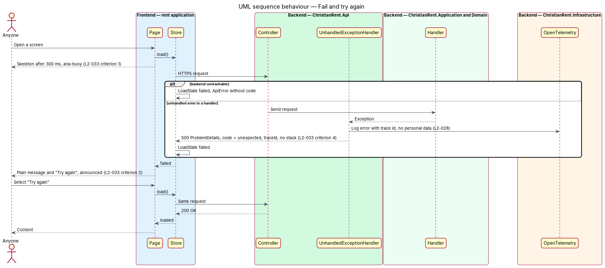
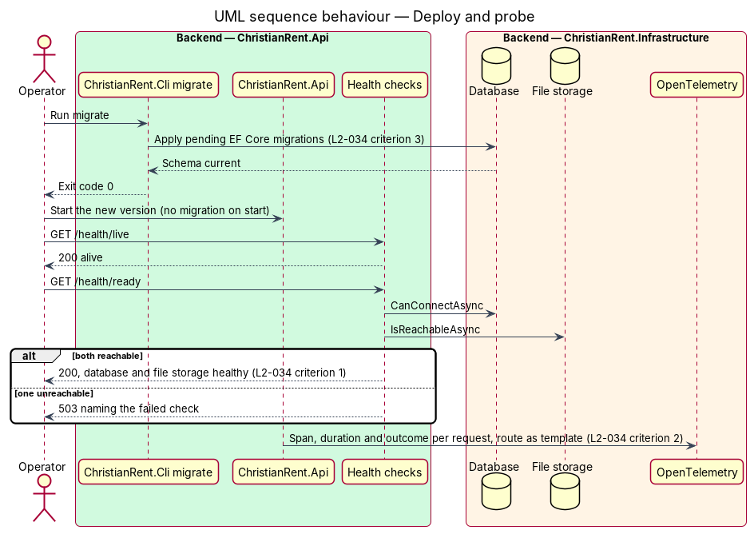

# Fail clearly and operate in production

## Overview

Things fail: a phone loses its connection, a request times out, a bug throws. This feature
designs how christian.rent behaves then, and what an operator needs to run it. Every screen
shows a loading state in the shape of what will arrive, and a plain message with "Try
again" when the backend cannot be reached. The backend answers errors without technical
detail, records them with a trace identifier, reports its health, and emits telemetry that
holds no personal data.

- **loading state** — placeholder drawn in the shape of the content that will replace it
- **operator** — person who deploys and watches the system
- **health endpoint** — address that reports whether the backend is alive and ready
- **trace identifier** — value that links one response to the record of its request
- **migration** — change to the database schema, applied by a command

## Description

**Frontend — one pattern for every request**

- **`LoadState<T>`** (`api` library) — discriminated union `{ status: 'loading' } |
  { status: 'loaded'; value: T } | { status: 'empty' } | { status: 'failed'; error:
  ApiError }`. Each route-scoped store exposes one as a signal, plus its screen-specific
  states (`not-found`, `limited`).
- **Loading** — `cr-skeleton` in the shape of the cards, the listing or the queue. Nothing
  is drawn for the first 300 ms, which avoids a flash on a fast connection. The container
  carries `aria-busy` (L2-033, criteria 1 and 5).
- **Failure** — `cr-empty-state` (error variant) or `cr-alert` shows a plain sentence and
  "Try again", which repeats the same request. No status code, `code` or stack is shown
  (criterion 2). `LiveAnnouncer` announces the failure (L2-032, criterion 4).
- **Nothing lost** — a failed write leaves the store's draft untouched; see
  [publish-listing](../../post/publish-listing/README.md) and
  [send-message](../../messages/send-message/README.md).
- **Cancellation** — every store passes an `AbortSignal` or unsubscribes on destroy, so a
  request a person has navigated away from is dropped.
- **`GlobalErrorHandler`** (`shell` library, bound by both applications) — an Angular `ErrorHandler` that shows a generic toast
  for an unexpected client error: "Something went wrong", with Reload and Dismiss. The toast
  sits in `App`'s `toast-region`, is announced, never dismisses itself and shows one at a
  time. It logs the error to the browser console only and sends nothing to a third party
  (L2-033, criterion 7).
- **Unknown address** — `NotFoundPage`; see
  [present-app-shell](../present-app-shell/README.md).

**Backend — errors**

- **`ProblemExceptionHandler`** — maps known exceptions to their ProblemDetails; see
  [enforce-access](../enforce-access/README.md).
- **`UnhandledExceptionHandler`** — the last `IExceptionHandler`. It logs the exception with
  the current trace identifier at error level and writes a 500 ProblemDetails with the
  title "Something went wrong", the code `unexpected` and a `traceId` extension, and no
  stack trace or exception message, in every environment (criterion 4).

**Backend — health** (L2-034, criterion 1)

- `GET /health/live` — answers 200 while the process runs. It checks nothing else.
- `GET /health/ready` — runs `DatabaseHealthCheck` (`IAppDbContext.CanConnectAsync`) and
  `PhotoStorageHealthCheck` (`IPhotoStorage.IsReachableAsync`). It answers 200 with each
  check's status, or 503 when one fails. Both endpoints are anonymous, excluded from the
  rate limiter, and return status words only.

**Backend — telemetry** (L2-034, criterion 2; L2-028, criterion 3)

- OpenTelemetry tracing and metrics for ASP.NET Core and `HttpClient`, and logs through the
  OpenTelemetry logging provider, exported over OTLP to the endpoint in
  `OTEL_EXPORTER_OTLP_ENDPOINT` when it is set. EF Core's instrumentation is added once it has
  a stable release (it is in beta); the scrubber already removes database statements. The
  health endpoints are not traced, and ASP.NET Core's hosting logs, which quote the full URL,
  are kept out below Warning.
- Each request produces one server span with `http.route` (the template, such as
  `/api/listings/{id}`), the method, the status code and the duration, and feeds the
  request-duration histogram.
- **`TelemetryScrubber`** — an OpenTelemetry processor registered before the exporter. It
  removes `url.query`, `url.full`, `url.path` (which holds the values the route template
  leaves out), the user agent and client address, request and response headers and bodies, the
  database statement text and any status description from every span; exception events are
  never recorded. EF Core is configured without sensitive data
  logging. Log messages use structured templates whose arguments are identifiers, counts
  and codes; no template takes a name, a contact detail, a token or message text. Sign-in
  adds nothing to them: no email, password or cookie is logged or tagged, and a span's route
  is `/api/session` or `/api/admin/session` with no body
  ([ADR 0029](../../../adr/0029-sign-in-and-two-sessions.md)).

**Backend — migrations and seed** (L2-034, criterion 3)

- **`ChristianRent.Cli`** — a console project beside the four layers. It references
  `ChristianRent.Infrastructure` and `ChristianRent.Application`. Commands: `migrate`
  applies pending EF Core migrations; `seed` inserts idempotent seed data; `purge-departed`
  is designed in [handle-member-data](../handle-member-data/README.md); `create-account
  <email> [<member-id>]` reads the password from standard input and creates an account, safe
  to run again; `grant-admin <member-id>` makes an admin
  ([sign-in-and-sessions](../sign-in-and-sessions/README.md)).
- **Deployment** — the backend once, and each application on its own static host
  ([present-app-shell](../present-app-shell/README.md)). The settings a deployment adds for
  sign-in are `Site:AdminOrigin`, `AllowedHosts`, `Sessions:MemberLifetime`,
  `Sessions:AdminLifetime`, and Admin's `config.json`; data protection keys are kept in the
  database and need no setting. The README's Settings table lists them all.
- `ChristianRent.Api` never calls `Database.Migrate()`. Deployment runs `migrate` before
  the new API version takes traffic.

**Backups** (L2-034, criterion 4)

A daily job backs up the database and the file storage to a separate store. A restore drill
restores listings, members, messages and photos into an empty environment and is repeated
after any change to either store.

**Undecided**

- The database engine in production, the file storage product and their backup mechanisms:
  `<TO SUPPLY>`. Development uses PostgreSQL ([ADR 0003](../../../adr/0003-database-engine.md))
  and local disk ([ADR 0004](../../../adr/0004-file-storage.md)). Until production's are
  chosen, the backup job has no implementation.
- The backup retention period: `<TO SUPPLY>`.
- The telemetry backend: `<TO SUPPLY>`; only its OTLP endpoint is a setting.
- The hosting platform and its deployment pipeline: `<TO SUPPLY>`.

### Mocks

The mocks are the source of truth for the UI of this feature. The states this design covers are:

- [`docs/mocks/pages/browse/loading.html`](../../../mocks/pages/browse/loading.html): skeleton cards
- [`docs/mocks/pages/browse/error.html`](../../../mocks/pages/browse/error.html): Browse cannot reach the backend
- [`docs/mocks/pages/browse/more-error.html`](../../../mocks/pages/browse/more-error.html): a later page failed; the list stays
- [`docs/mocks/pages/listing/loading.html`](../../../mocks/pages/listing/loading.html): skeleton in the shape of a listing
- [`docs/mocks/pages/listing/error.html`](../../../mocks/pages/listing/error.html): Listing cannot reach the backend
- [`docs/mocks/pages/post/error.html`](../../../mocks/pages/post/error.html): a failed publish with everything kept
- [`docs/mocks/pages/admin/loading.html`](../../../mocks/pages/admin/loading.html): skeleton queue
- [`docs/mocks/pages/admin/error.html`](../../../mocks/pages/admin/error.html): the queue cannot load
- [`docs/mocks/pages/not-found/default.html`](../../../mocks/pages/not-found/default.html): an unknown address
- [`docs/mocks/notifications/error-toast/default.html`](../../../mocks/notifications/error-toast/default.html): an unexpected error in the browser

## Requirements

The feature realizes the following level-2 (L2) requirements from
[`docs/specs/L2.md`](../../../specs/L2.md). Each L2 requirement refines a level-1 (L1)
requirement, cited by identifier. The table restates each requirement in `shall` form; the
acceptance criteria in the specification remain authoritative.

| L2 ID | Refines (L1) | Requirement |
|-------|--------------|-------------|
| `L2-033` | `L1-015` | A waiting screen shall show a loading state in the shape of what will arrive, and none when the request answers within 300 ms. An unreachable backend shall produce a plain message and "Try again". An unexpected error in the browser shall produce an announced message offering to reload, and nothing shall be sent to a third party. An address that matches no screen shall show "not found" with a way back to Browse. An unhandled backend error shall be a ProblemDetails with no stack trace, recorded with a trace id. |
| `L2-034` | `L1-015` | The backend's health endpoint shall report liveness and whether the database and file storage are reachable. Every request shall emit a trace, its duration and its outcome through OpenTelemetry. Schema changes shall be applied by a command, never by the API as it starts. A daily backup shall exist from which listings, members, messages and photos can be restored. |
| `L2-028` | `L1-011` | Only the member's name, church and what is needed to sign in and reach them shall be collected. When a membership is deleted, the member's listings and photos shall no longer be public and their personal data shall be deleted or made anonymous within 30 days. No log, metric or trace shall hold a contact detail, token, message text, query string or request body. |
| `L2-032` | `L1-014` | Every screen shall meet WCAG 2.2 level AA. Every action shall be completable by keyboard with visible focus. A state shall be carried by text or an announced attribute, never by colour alone. Confirmations and errors shall be announced. Every field shall have a visible label with its error tied to it. Reduced motion shall be honoured, and text at 200% shall lose nothing. "Skip to content" shall be the first control, and a dialog shall hold focus and return it on close. |

## Diagrams

### System context

The people involved are: anyone, operator. Each reaches the feature through christian.rent, which takes no payment and holds no booking calendar.

### Containers

The rent application calls `ChristianRent.Api` over JSON/HTTPS. The API persists state through EF Core and keeps photo files in file storage, outside the database.

### Components

Stores drive the loading and failed states. On the backend, `UnhandledExceptionHandler` is
the last resort for errors, the health checks probe the database and file storage,
telemetry leaves through `TelemetryScrubber`, and the CLI owns schema changes.

### Class structure

`LoadState<T>` is the single shape a screen waits on. The two health checks depend on the
same interfaces the handlers use, so readiness means what a request needs.

### Behaviour — fail and try again

A screen shows its skeleton, then a plain message with "Try again" when the request fails.
An unhandled backend error returns a ProblemDetails with a trace identifier and no stack
trace (`L2-033`).

### Behaviour — deploy and probe

Deployment applies migrations with the CLI before the API takes traffic; the API never
migrates on start. The readiness endpoint reports the database and file storage
(`L2-034`).

