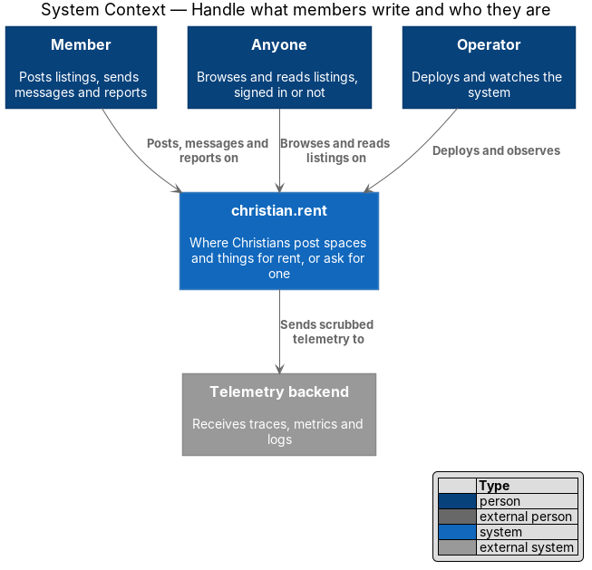
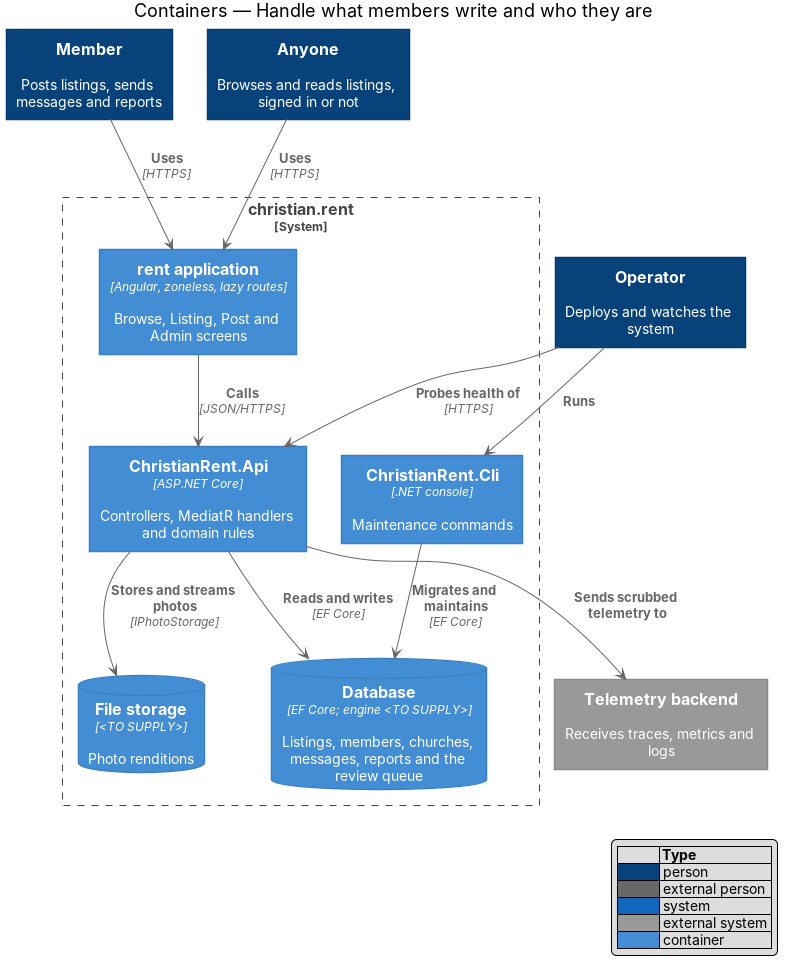
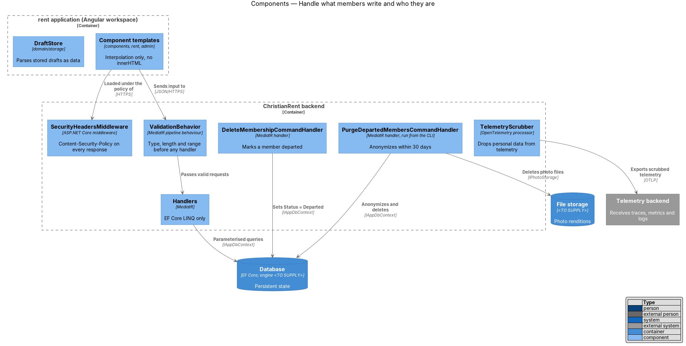
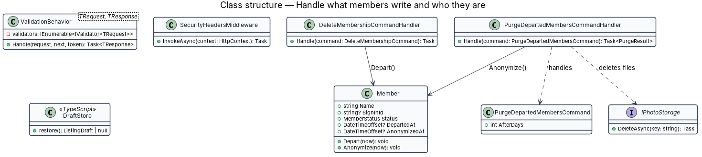
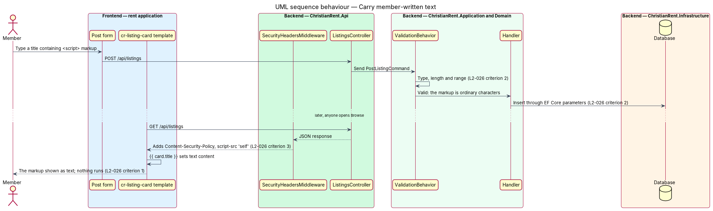
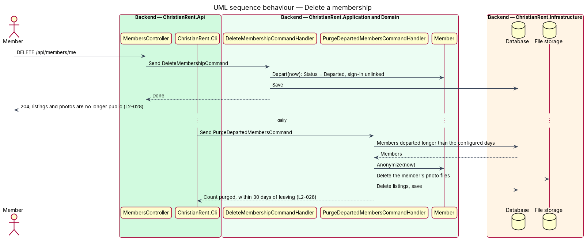

# Handle what members write and who they are

## Overview

Members write titles, notes, messages, their own names and the names of their churches.
christian.rent treats all of it as data: it is validated before use, stored through
parameterised queries, and rendered as text, so nothing a member writes can run as code.
The system also keeps personal data to a minimum, keeps it out of telemetry, and removes it
when a member leaves.

- **member-written text** — title, note, message, report note, member name or church name
- **Content-Security-Policy (CSP)** — response header that tells the browser which scripts
  may run
- **departed member** — member whose membership is deleted at their request
- **anonymize** — replace personal data with values that identify nobody
- **telemetry** — logs, metrics and traces emitted through OpenTelemetry

## Description

**Rendering as text — frontend**

- Every template binds member-written text with interpolation (`{{ listing.title }}`) or a
  property binding to text content. No template binds `[innerHTML]`, and no code calls
  `DomSanitizer.bypassSecurityTrust*` (L2-026, criterion 1). An ESLint rule in the workspace
  configuration forbids both.
- Values from the backend that are not member-written, such as error titles, are not
  rendered at all; screens use their own copy.
- Member-written text placed in an attribute (an `alt`, an `aria-label`, a link's query
  parameter) goes through Angular's attribute binding or `Router` and is never concatenated
  into markup or a URL by hand.
- `DraftStore` parses `sessionStorage` content with `JSON.parse` inside `try`, checks its
  shape, and discards anything that does not match.

**Validation — backend**

- **`ValidationBehavior<TRequest, TResponse>`** — MediatR pipeline behaviour that runs every
  registered `IValidator<TRequest>` before the handler and raises `ValidationException` on
  failure. Each command and query has a validator that states type, length and range
  (criterion 2).
- Model binding uses typed DTOs with enums and `Guid`s; an unknown enum value is a 400.
- Text is trimmed and Unicode-normalized to form C before length checks; control characters
  other than line breaks in a note or message are refused.
- All database access goes through EF Core LINQ on `IAppDbContext`. No handler builds SQL
  from strings; `FromSqlRaw` and `ExecuteSqlRaw` with interpolated input are not used.

**Content-Security-Policy**

- **`SecurityHeadersMiddleware`** (`ChristianRent.Api`) adds to every response:
  `Content-Security-Policy: default-src 'self'; script-src 'self'; object-src 'none';
  base-uri 'self'; frame-ancestors 'none'; form-action 'self'`, with `img-src 'self' blob:`
  for photo thumbnails made from object URLs, plus `X-Content-Type-Options: nosniff` and
  `Referrer-Policy: strict-origin-when-cross-origin`. `script-src 'self'` allows no inline
  script and no third-party script (criterion 3). Fonts are self-hosted, so `font-src` is
  `'self'`.
- The production build emits no inline script. Angular adds component styles as `<style>`
  elements, which need either `style-src 'self' 'unsafe-inline'` or a per-response nonce
  passed through `ngCspNonce`.

**Personal data — backend**

- **Collected fields** — `Member` holds the name, the church, the join time, the two flags,
  the status, when they left, and the sign-in identifier (`SignInId`,
  [ADR 0017](../../../adr/0017-identifying-a-person-until-sign-in.md)), which is the id of
  their account. The account (`Account`, ASP.NET Core Identity) holds the email, a salted hash
  of the password, a security stamp and its failed count and lockout
  ([ADR 0029](../../../adr/0029-sign-in-and-two-sessions.md)). No other personal field exists
  (L2-028, criterion 1). The area of a listing is a city or neighbourhood. No log, span or
  metric carries the email, the password or a cookie (criterion 3).
- **`DeleteMembershipCommand`** — sent by `DELETE /api/members/me`, which answers 204. Its
  handler needs a member (`RequireMember()`, else 403 `not_a_member`) and calls
  `Member.Depart(now)`: `Status = Departed`, `DepartedAt = now`, and `SignInId` cleared, so
  the person is no longer this member at once (ADR 0017). `ListingVisibility` then hides the
  member's listings and photos at once (criterion 2).
- **`PurgeDepartedMembersCommand`** — run daily by the `purge-departed` command of
  `ChristianRent.Cli`. For each member departed at least `Members:PurgeAfterDays` days ago
  (default 30, at most 30) and not yet anonymised, `Member.Anonymize(now)` replaces the name
  with "Former member" and sets `AnonymizedAt`; the handler deletes the member's listings and
  their photo files (every rendition) through `IPhotoStorage.DeleteAsync`. It clears the text
  of every message the member sent (`Message.ClearText()`; the message stays, empty, so the
  other person's conversation keeps its shape) and deletes the messages about the member's
  listings with those listings (L2-016, criterion 7; ADR 0022). It clears the note of every
  report the member sent (`Report.ClearNote()`; the report stays, so the listing is still
  reviewed) and deletes the reports about the member's listings with their review items
  (L2-021, criterion 13; ADR 0023). The command prints
  how many members, listings and photos it handled, and running it again changes nothing.
- **`TelemetryScrubber`** — designed in
  [fail-clearly-and-operate](../fail-clearly-and-operate/README.md). Spans record the route
  template, never the path with values, the query string or a body (criterion 3). Handlers
  log identifiers and codes, never names or text.

**Undecided**

- Whether a nonce is issued for styles: `<TO SUPPLY>`. nginx serves `index.html`
  ([ADR 0031](../../../adr/0031-hosting-on-azure-and-deploying-each-commit.md)) and issues none, so `style-src` is
  `'self' 'unsafe-inline'`; `script-src` is not weakened.
- The origin of file storage, when photos are served from an origin other than the API's;
  `img-src` then names it: `<TO SUPPLY>`.
- The screen from which a member asks to leave: `<TO SUPPLY>`; no mock exists, and no screen
  is built. `DELETE /api/members/me` and `purge-departed` are built (journey 5).
- How a cleared message is shown to the other person: decided with the Messages inbox. The
  messages a departed member received are about their own listings and are deleted with them
  (ADR 0022).
- The contact detail collected "to reach them": the account's email is used only to sign in;
  any other is `<TO SUPPLY>` with the Messages inbox. Leaving ends every session of the
  account (its security stamp is renewed); deleting the account itself is `<TO SUPPLY>`.

### Mocks

The mocks are the source of truth for the UI of this feature. The states this design covers are:

- [`docs/mocks/pages/browse/edge.html`](../../../mocks/pages/browse/edge.html): long and unusual member-written text on cards
- [`docs/mocks/pages/browse/no-results.html`](../../../mocks/pages/browse/no-results.html): a search term rendered as text
- [`docs/mocks/pages/listing/sent.html`](../../../mocks/pages/listing/sent.html): a message quoted back as text

## Requirements

The feature realizes the following level-2 (L2) requirements from
[`docs/specs/L2.md`](../../../specs/L2.md). Each L2 requirement refines a level-1 (L1)
requirement, cited by identifier. The table restates each requirement in `shall` form; the
acceptance criteria in the specification remain authoritative.

| L2 ID | Refines (L1) | Requirement |
|-------|--------------|-------------|
| `L2-026` | `L1-011` | A title, note, message, member name or church name shall be rendered as text wherever it is shown. Every input shall be validated for type, length and range before use, and database access shall be parameterised. Every response shall carry a Content-Security-Policy that allows no inline script and no third-party script. |
| `L2-028` | `L1-011` | Only the member's name, church and what is needed to sign in and reach them shall be collected. When a membership is deleted, the member's listings and photos shall no longer be public and their personal data shall be deleted or made anonymous within 30 days. No log, metric or trace shall hold a contact detail, token, message text, query string or request body. |

## Diagrams

### System context

The people involved are: member, anyone, operator. Each reaches the feature through christian.rent, which takes no payment and holds no booking calendar.

### Containers

The rent application calls `ChristianRent.Api` over JSON/HTTPS. The API persists state through EF Core and keeps photo files in file storage, outside the database.

### Components

Input passes `ValidationBehavior` before any handler, and handlers reach the database only
through EF Core. `SecurityHeadersMiddleware` sets the policy under which templates run. Two
handlers implement leaving, and `TelemetryScrubber` guards what is exported.

### Class structure

`ValidationBehavior` is generic over every request. `Member` owns `Depart()` and
`Anonymize()`; the purge handler is the only caller of `Anonymize()`.

### Behaviour — carry member-written text

Text is validated on arrival, stored through a parameterised query and rendered by
interpolation under a policy that allows no inline script (`L2-026`).

### Behaviour — delete a membership

Leaving hides the member's listings and photos at once; the daily purge anonymizes the
member within 30 days (`L2-028`, criterion 2).

