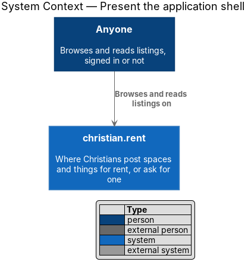
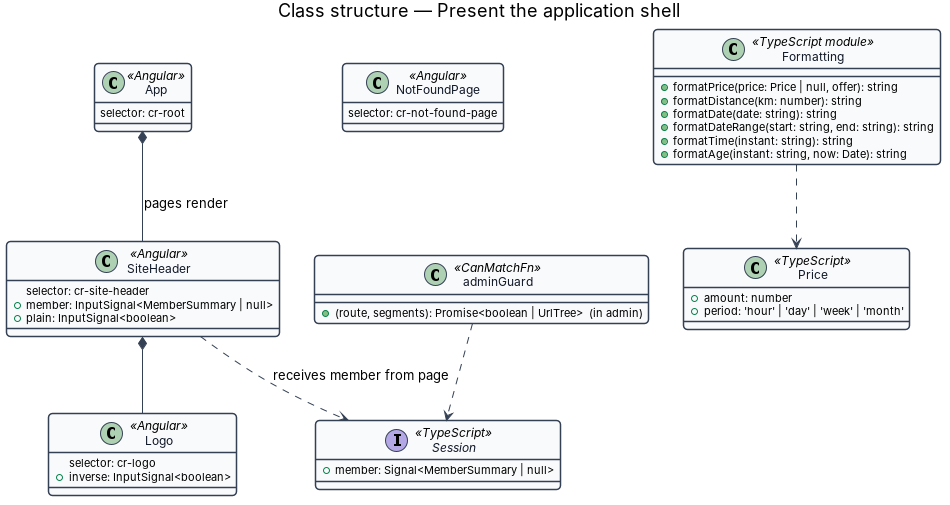
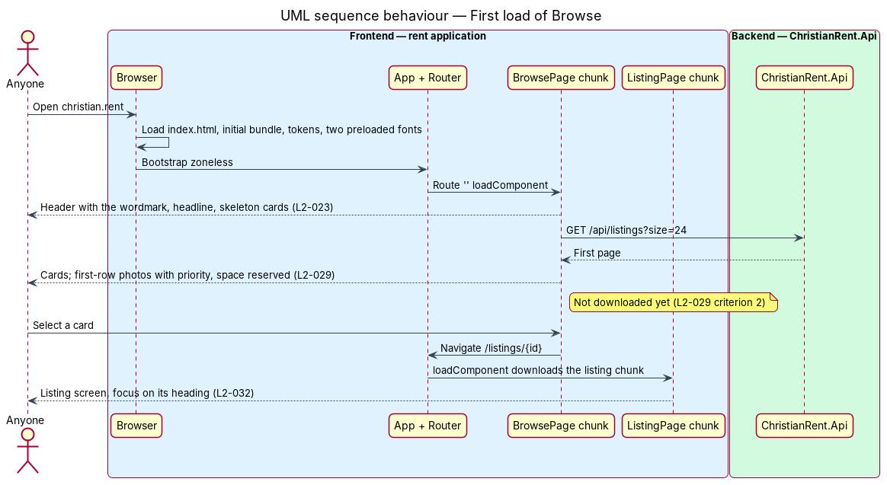
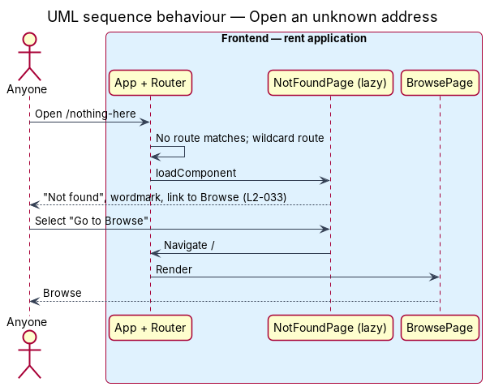

# Present the application shell

## Overview

The application shell is everything the four screens share: the Angular application that
starts in the browser, its routes, the header with the wordmark, the design tokens and
fonts, the helpers that format prices, distances and dates for Canada, and the "not found"
screen. It is what a person downloads first, so its size decides how fast Browse appears on
a phone.

- **shell** — root component, routes, header and global foundations of the `rent`
  application
- **wordmark** — lowercase "christian.rent" with ".rent" in orange
- **initial bundle** — code downloaded before the first screen renders
- **lazy chunk** — code downloaded only when its route or dialog is first needed
- **composition root** — `app.config.ts`, the one place that binds injection tokens
- **foundations** — global styles limited to tokens, `@font-face`, reset and utilities

## Description

**Workspace** (`frontend/`, created with the `angular-new-app` skill)

| Project | Type | Import | Holds |
|---|---|---|---|
| `api` | library | `@rent/api` | contracts, types, injection tokens, HTTP clients |
| `domain` | library | `@rent/domain` | `listings/`, `search/`, `storage/` rules and helpers |
| `components` | library | `@rent/components` | presentation components, `cr-*` selectors; `foundations/` and `public/` (fonts, favicon) for both applications |
| `shell` | library | `@rent/shell` | what both applications' shells share: `GlobalErrorHandler`, `ClientErrors`, `PageFocus`, `ShellTitleStrategy`, `screenPath`, `SignInStore`, `sessionExpiryInterceptor` |
| `rent` | application | — | Browse, Listing, Post, Sign in; dialogs; its routes and composition root |
| `admin` | application | — | Admin, Admin sign-in, its forbidden page; its routes and composition root |

Dependency direction: `rent` → `shell`, `components`, `api`, `domain`; `admin` → `shell`,
`components`, `api`, `domain`; `shell` → `api`, `domain`; `domain` → `api`; `components` →
`api` for types only; `api` → nothing. No application imports the other. ESLint boundaries
enforce it ([ADR 0028](../../../adr/0028-two-applications-deployed-separately.md)).

**Building, serving and deploying each application**

| | `rent` | `admin` |
|---|---|---|
| Serve | `npm start` (port 4200) | `npm run start:admin` (port 4300) |
| Build | `npm run build:rent` → `dist/rent/browser` | `npm run build:admin` → `dist/admin/browser` |
| Proxy (dev and host) | `/api/` → backend | `/api/admin/` → backend |
| Deploy-time file | none | `/config.json`: `{ "siteUrl": "https://christian.rent" }` |
| Indexing | indexed | `noindex, nofollow` (meta, `robots.txt`, `X-Robots-Tag`) |

Each static host serves its folder, falls back to `index.html` for any path that is not a
file, and sends the Content-Security-Policy and the other security headers of
[ADR 0028](../../../adr/0028-two-applications-deployed-separately.md). `npm run build` builds
both.

**`rent` application**

- **`app.config.ts`** — `provideZonelessChangeDetection()`, `provideRouter(routes,
  withComponentInputBinding(), withInMemoryScrolling({ scrollPositionRestoration:
  'enabled' }))`, `provideHttpClient(withFetch(), withInterceptors([apiErrorInterceptor,
  sessionExpiryInterceptor]))`, and the bindings of `SESSION` (`AppSession`), `SESSION_API`
  (`HttpMemberSessionApi`), `LISTINGS_API`, `MEMBERS_API` and `CHURCHES_API`. Tokens used by
  one route (`PHOTOS_API`, `MESSAGES_API`, `REPORTS_API`) are bound by that route.
- **`app.routes.ts`** — every route is lazy (L2-029, criterion 2):

  | Path | Loads | Chunk |
  |---|---|---|
  | `` | `BrowsePage` | browse |
  | `listings/:id` | `ListingPage` | listing |
  | `post` | `PostPage` | post |
  | `sign-in` | `SignInPage` | sign-in |
  | `**` | `NotFoundPage` | not-found |

  `/admin` is "not found" in `rent`: Admin is its own application.

**`admin` application**

- **`app.config.ts`** — the same providers, with `SESSION` bound to `AdminSession` over
  `HttpAdminSessionApi`, `SITE_LINKS` read from `/config.json` before the first screen
  (`parseSiteUrl`), and `REVIEW_QUEUE_API` bound by the review route.
- **`app.routes.ts`**:

  | Path | Loads | Chunk |
  |---|---|---|
  | `` (`canMatch: adminGuard`) | `ReviewPage` | review |
  | `` | `ForbiddenPage` | forbidden |
  | `sign-in` | `AdminSignInPage` | sign-in |
  | `**` | redirects to `` | — |

- **`App`** — the skip link, the outlet and the toast region, as `rent`'s. Titles end in
  "Admin · christian.rent".

- **`App`** (selector `cr-root`) — `cr-skip-link`, `<router-outlet>`, and a
  `toast-region`. Each page renders its own header variant, because Post uses the plain
  header.
- **`NotFoundPage`** — "not found" with a link to Browse (L2-033, criterion 3).
- **`ShellTitleStrategy`** (`shell`) — sets the document title per route, ending in
  "christian.rent", or "Admin · christian.rent" in Admin (the `SITE_TITLE` each application
  binds).
- On navigation to another screen, focus moves to the new page's `<h1 tabindex="-1">`
  (`PageFocus`), and `RentTitleStrategy` announces the title with `LiveAnnouncer` (L2-032,
  criteria 2 and 4). The first load leaves focus alone, so the skip link stays the first
  control. A change of the query alone (Browse's search, switch and kind filter) is the same
  screen: focus stays where the person is and the title is not announced again
  (search-and-filter design).

**`components` library**

- **`cr-logo`** — the mark, a key whose head is a cross, and the wordmark. The wordmark text
  is the constant "christian" + ".rent" in the template; no input can change its case
  (L2-023). The link leads to `/`, home in either application, and is named by its `label`
  input: "christian.rent home", or "Admin home" in Admin.
- **`cr-site-header`** — logo, the session control and a Post button that links to `/post`
  (L2-036, criterion 1). Its inputs are `state` (`unknown`, `signed-out`, `signed-in`),
  `member`, `returnTo` and `plain`; it emits `signOut`. Signed out: "Sign in", a link to
  `/sign-in?return={returnTo}`. Signed in: the member's initials (`member-chip`, not a
  control, `role="img"`, named "Signed in as {name}"; criterion 2) when there is a member, and
  "Sign out", a button. Unknown, and on the sign-in page: Post alone. Below 400 px the session
  control shows its icon alone, below 360 px Post its word alone (criterion 5). With `plain`
  set, on Post, it shows the wordmark and a close button named "Close and go back to Browse",
  and no Post button (criterion 3). Admin uses `cr-admin-nav` (criterion 4). It has no
  Messages button, and no payment, booking, rating or advert element (L2-024).
- **`cr-admin-nav`** — Admin's rail: the logo (to the review queue), "Admin · {name}", Review
  with its count, "Back to site" (a plain link to `siteUrl`, left out when there is none) and
  "Sign out" (a button; output `signOut`).
- **`cr-sign-in`** and **`cr-admin-gate`** — the sign-in form of either application and Admin's
  ink page around a card ([sign-in-and-sessions](../sign-in-and-sessions/README.md)).
- **`cr-skip-link`** — the first focusable element, "Skip to content". It moves focus to
  `<main id="main" tabindex="-1">` itself, because a bare `#main` would resolve against
  `<base href>` and leave the current route.
- **`cr-button`** — the design system's Button as an attribute component on a native `<a>` or
  `<button>` (`a[cr-button]`), whose host carries the mocks' classes. It has every variant
  (for rent, wanted, primary, success, danger, outline, secondary, danger quiet, ghost, link),
  the three sizes, full width, icon only, and busy, which shows a spinner and ignores further
  presses.
- **`cr-icon`** — the icon set of `docs/design-system/foundations/iconography.html`, by name, at
  16, 20 or 24 px. No component or page draws an icon's SVG itself.
- **`cr-toast`** and **`cr-toast-region`** — a toast, whose tone sets its icon (info, check-circle,
  alert, x-circle) and its role, and the polite live region it rises into, which `App` renders
  (see [fail-clearly-and-operate](../fail-clearly-and-operate/README.md)).
- **`cr-plain-page`** — the plain-page block of Empty and error states: an icon, the screen's
  `<h1>`, one sentence and the projected ways forward. `NotFoundPage` uses it; Listing's "not
  found" and "not loaded" and Admin's "forbidden" will too.
- **`cr-hero`** — the Browse headline: the `<h1>` with its accent line, the lead and the projected
  buttons that lead to posting. The scaffold's Browse shows the headline; journey 2 adds the lead
  and the buttons.
- Pages compose these components and never hand-code a design-system block; global styles hold
  only the foundations and the layout primitives (`container`, `stack`, `cluster`).
- `SESSION` answers who is signed in to the application it is bound in
  ([ADR 0029](../../../adr/0029-sign-in-and-two-sessions.md)).

**`domain/listings` formatting** (L2-022)

| Helper | Output |
|---|---|
| `formatPrice(price, offer)` | "$25 / day", "$12.50 / hour", "$1,250.50 / week", "Free", "Up to $120 / day"; cents only when not zero |
| `formatDistance(km)` | "4 km" |
| `formatDate(date)` | "Dec 3, 2026" |
| `formatDateRange(start, end)` | "Jul 14 to 18, 2026"; "Sat, Jun 13, 2026 · one day" |
| `formatTime(instant)` | "3:40 p.m." |
| `formatAge(instant, now)` | "12 min", "3 hr", "2 days ago" |

The helpers use `Intl.NumberFormat` and `Intl.DateTimeFormat` with the locale `en-CA` and
the currency `CAD`, and are pure. Copy uses Canadian spelling and lives in the templates;
the product has one language.

**Foundations and responsiveness**

- `rent/src/styles/` holds `_tokens.scss` (copied from `docs/design-system/tokens/tokens.css`,
  which stays the source), `_fonts.scss` with `@font-face` rules for the self-hosted Bricolage
  Grotesque and Instrument Sans (`rent/public/fonts/`) with `font-display: swap`, `_reset.scss`
  and `_utilities.scss`. Component styles read tokens by role.
- Breakpoints are 576, 768, 992 and 1200 px, mobile first. The listing grid is 1 column
  under 576 px, 2 from 576, 3 from 768 and 4 from 1200; at 992 the gutters widen (L2-031).
- A dialog is a bottom sheet under 640 px and centred from 640 px (L2-031, criterion 8).
- Every control is at least 44 × 44 px. Under `prefers-reduced-motion: reduce`, transitions
  reduce to a fade of the shortest motion token (L2-032, criterion 6). Sizes use `rem`, so
  text at 200% reflows (criterion 7).
- A light and a dark theme come from the same tokens, by `prefers-color-scheme`.

**Performance** (L2-029)

- The initial bundle holds the shell and Browse's first paint only. Dialogs load by dynamic
  `import()`; below-the-fold blocks use `@defer`.
- `angular.json` sets `initial` and `anyComponentStyle` budgets as errors.
- The two font files used above the fold are preloaded. The first row of card photos uses
  `NgOptimizedImage` with `priority`; every image has `width` and `height`.
- State changes are signal-driven with `OnPush`, which keeps a control's response under
  200 ms.

**Undecided**

- The budget values in `angular.json` are set per application in
  [ADR 0030](../../../adr/0030-bundle-budgets-per-application.md), and tightened from there.
- Whether the dark theme has a manual switch in the product: the mocks toggle it from the
  mock bar only.
- Which hosts serve the two applications: `<TO SUPPLY>`. Each is a static host as above.

### Mocks

The mocks are the source of truth for the UI of this feature. The states this design covers are:

- [`docs/mocks/pages/browse/default.html`](../../../mocks/pages/browse/default.html): the site header and the shell around Browse
- [`docs/mocks/pages/post/default.html`](../../../mocks/pages/post/default.html): the plain header on Post
- [`docs/mocks/pages/not-found/default.html`](../../../mocks/pages/not-found/default.html): an address that matches no screen
- [`docs/mocks/pages/brand/default.html`](../../../mocks/pages/brand/default.html): the mark and the wordmark
- [`docs/mocks/pages/browse/signed-out.html`](../../../mocks/pages/browse/signed-out.html): the site header when nobody is signed in
- [`docs/mocks/pages/sign-in/default.html`](../../../mocks/pages/sign-in/default.html): the header on the sign-in page, Post alone
- [`docs/mocks/pages/admin/default.html`](../../../mocks/pages/admin/default.html): Admin's rail, with Back to site and Sign out
- [`docs/mocks/pages/admin/forbidden.html`](../../../mocks/pages/admin/forbidden.html): Admin's own page for a signed-in person who is not an admin

## Requirements

The feature realizes the following level-2 (L2) requirements from
[`docs/specs/L2.md`](../../../specs/L2.md). Each L2 requirement refines a level-1 (L1)
requirement, cited by identifier. The table restates each requirement in `shall` form; the
acceptance criteria in the specification remain authoritative.

| L2 ID | Refines (L1) | Requirement |
|-------|--------------|-------------|
| `L2-022` | `L1-009` | Prices shall be shown in Canadian dollars with their period, with cents only when not zero and a thousands separator. Distances shall be in kilometres. Dates shall write the month as a word, ranges shall use "to", and times shall be in 12-hour form. Copy shall use Canadian spelling. An area shall be a place in Canada. |
| `L2-023` | `L1-009` | The wordmark shall read "christian.rent" in lowercase on every screen. |
| `L2-041` | `L1-017` | `rent` and `admin` shall each build into their own folder, without the other's screens, and be served from their own origin by a static host that falls back to `index.html`, proxies `/api` to the one backend and sends the CSP; Admin shall read the site's address at deploy time and not be indexed. |
| `L2-036` | `L1-001` | The header shall show the wordmark, which leads to Browse, a "Post" button and, once known, "Sign in" or the member's initials as text with "Sign out". On Post it shall show the wordmark and a close button. On Admin the navigation shall show the wordmark, the admin's name, Review with its count, "Back to site" on christian.rent's origin and "Sign out". No header shall have a Messages button; nothing shall scroll sideways at 320 px. |
| `L2-024` | `L1-010` | No screen shall offer a way to pay, take a deposit or enter a card. A listing shall show no booking calendar, review, rating or advert. A message with dates shall not change the listing's availability or reserve anything. |
| `L2-029` | `L1-012` | On a mid-range phone on 4G, Browse shall paint its largest content within 2.5 s with layout shift under 0.1. The code for Listing, Post and Sign in shall not be in `rent`'s initial download, and no code of Admin in `rent` at all; the review queue's code shall not be in Admin's initial download. Each application shall stay within its own budget. A card's photo shall be sized to the card, reserve its space and load lazily below the fold. A control shall respond within 200 ms. |
| `L2-031` | `L1-013` | No screen shall be cut off or scroll sideways from 320 px. Browse shall show one column of cards under 576 px, two from 576 px, three from 768 px and four from 1200 px, with wider gutters from 992 px. From 768 px the message box, the live preview and the Admin detail panel shall sit beside their main column; below it they shall sit under it, and Admin shall show only the queue and a note that deciding needs a wider screen. A dialog shall be a bottom sheet under 640 px. Every touch target shall be at least 44 × 44 px. |
| `L2-032` | `L1-014` | Every screen shall meet WCAG 2.2 level AA. Every action shall be completable by keyboard with visible focus. A state shall be carried by text or an announced attribute, never by colour alone. Confirmations and errors shall be announced. Every field shall have a visible label with its error tied to it. Reduced motion shall be honoured, and text at 200% shall lose nothing. "Skip to content" shall be the first control, and a dialog shall hold focus and return it on close. |
| `L2-033` | `L1-015` | A waiting screen shall show a loading state in the shape of what will arrive, and none when the request answers within 300 ms. An unreachable backend shall produce a plain message and "Try again". An address that matches no screen shall show "not found" with a way back to Browse. An unhandled backend error shall be a ProblemDetails with no stack trace, recorded with a trace id. |

## Diagrams

### System context

The people involved are: anyone. Each reaches the feature through christian.rent, which takes no payment and holds no booking calendar.

### Containers

The rent application calls `ChristianRent.Api` over JSON/HTTPS. The API persists state through EF Core.

### Components

`app.config.ts` bootstraps `App` and provides the routes. Each route loads its page as a
separate chunk. Pages render the header components and format values with the `domain`
helpers.

### Class structure

`SiteHeader` composes `Logo`; the wordmark has no input that could change its text.
`Formatting` is a module of pure functions over `Price` and ISO date strings.

### Behaviour — first load of Browse

The first download holds the shell and Browse only; Listing, Post and Admin arrive when
first opened (`L2-029`).

### Behaviour — open an unknown address

An address that matches no route renders `NotFoundPage` with a way back to Browse
(`L2-033`, criterion 3).

