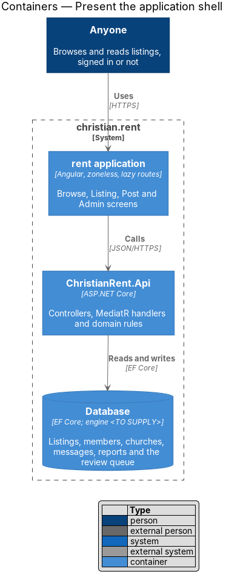
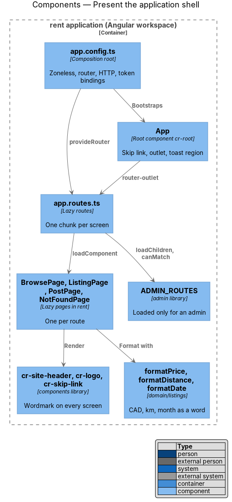

# Present the application shell

## Overview

The application shell is everything the four screens share: the Angular application that
starts in the browser, its routes, the header with the wordmark, the design tokens and
fonts, the helpers that format prices, distances and dates for Canada, and the "not found"
screen. It is what a person downloads first, so its size decides how fast Browse appears on
a phone.

- **shell** — root component, routes, header and global foundations of the `rent`
  application
- **wordmark** — lowercase "christian.rent" with ".rent" in orange
- **initial bundle** — code downloaded before the first screen renders
- **lazy chunk** — code downloaded only when its route or dialog is first needed
- **composition root** — `app.config.ts`, the one place that binds injection tokens
- **foundations** — global styles limited to tokens, `@font-face`, reset and utilities

## Description

**Workspace** (`frontend/`, created with the `angular-new-app` skill)

| Project | Type | Import | Holds |
|---|---|---|---|
| `api` | library | `@rent/api` | contracts, types, injection tokens, HTTP clients |
| `domain` | library | `@rent/domain` | `listings/`, `search/`, `storage/` rules and helpers |
| `components` | library | `@rent/components` | presentation components, `cr-*` selectors |
| `admin` | library | `@rent/admin` | the Admin screen, lazy |
| `rent` | application | — | pages, dialogs, routes, composition root |

Dependency direction: `rent` → `admin`, `components`, `api`, `domain`; `admin` →
`components`, `api`, `domain`; `domain` → `api`; `components` → `api` for types only; `api`
→ nothing. ESLint boundaries enforce it.

**`rent` application**

- **`app.config.ts`** — `provideZonelessChangeDetection()`, `provideRouter(routes,
  withComponentInputBinding(), withInMemoryScrolling({ scrollPositionRestoration:
  'enabled' }))`, `provideHttpClient(withFetch(), withInterceptors([apiErrorInterceptor]))`,
  and the bindings of `SESSION`, `LISTINGS_API`, `MEMBERS_API` and `CHURCHES_API`. Tokens
  used by one route (`PHOTOS_API`, `MESSAGES_API`, `REPORTS_API`, `REVIEW_QUEUE_API`) are
  bound by that route.
- **`app.routes.ts`** — every route is lazy (L2-029, criterion 2):

  | Path | Loads | Chunk |
  |---|---|---|
  | `` | `BrowsePage` | browse |
  | `listings/:id` | `ListingPage` | listing |
  | `post` | `PostPage` | post |
  | `admin` (`canMatch: adminGuard`) | `ADMIN_ROUTES` from `@rent/admin` | admin |
  | `admin` | `ForbiddenPage` | forbidden |
  | `**` | `NotFoundPage` | not-found |

- **`App`** (selector `cr-root`) — `cr-skip-link`, `<router-outlet>`, and a
  `toast-region`. Each page renders its own header variant, because Post uses the plain
  header and Admin uses `cr-admin-nav`.
- **`NotFoundPage`** — "not found" with a link to Browse (L2-033, criterion 3).
- **`TitleStrategy`** — sets the document title per route, ending in "christian.rent".
- On navigation, focus moves to the new page's `<h1>`, and `LiveAnnouncer` announces the
  title (L2-032, criteria 2 and 4).

**`components` library**

- **`cr-logo`** — the mark, a key whose head is a cross, and the wordmark. The wordmark text
  is the constant "christian" + ".rent" in the template; no input can change its case
  (L2-023). The link is named "christian.rent home".
- **`cr-site-header`** — logo, the member's initials (`member-chip`, not a control) and a
  Post button. It has no Messages button and no sign-in control, because neither is designed.
  It has no payment, booking, rating or advert element (L2-024).
- **`cr-skip-link`** — the first focusable element, "Skip to content".

**`domain/listings` formatting** (L2-022)

| Helper | Output |
|---|---|
| `formatPrice(price, offer)` | "$25 / day", "$12.50 / hour", "Free", "Up to $120 / day"; cents only when not zero |
| `formatDistance(km)` | "4 km" |
| `formatDate(date)` | "Dec 3, 2026" |
| `formatDateRange(start, end)` | "Jul 14 to 18, 2026"; "Sat, Jun 13, 2026 · one day" |

The helpers use `Intl.NumberFormat` and `Intl.DateTimeFormat` with the locale `en-CA` and
the currency `CAD`, and are pure. Copy uses Canadian spelling and lives in the templates;
the product has one language.

**Foundations and responsiveness**

- `rent/src/styles/` holds `tokens.css` (from `docs/design-system/tokens/tokens.css`),
  `@font-face` rules for the self-hosted Bricolage Grotesque and Instrument Sans with
  `font-display: swap`, a reset and utilities. Component styles read tokens by role.
- Breakpoints are 576, 768, 992 and 1200 px, mobile first. The listing grid is 1 column
  under 576 px, 2 from 576, 3 from 768 and 4 from 1200; at 992 the gutters widen (L2-031).
- Every control is at least 44 × 44 px. Under `prefers-reduced-motion: reduce`, transitions
  reduce to a fade of the shortest motion token (L2-032, criterion 6). Sizes use `rem`, so
  text at 200% reflows (criterion 7).
- A light and a dark theme come from the same tokens, by `prefers-color-scheme`.

**Performance** (L2-029)

- The initial bundle holds the shell and Browse's first paint only. Dialogs load by dynamic
  `import()`; below-the-fold blocks use `@defer`.
- `angular.json` sets `initial` and `anyComponentStyle` budgets as errors.
- The two font files used above the fold are preloaded. The first row of card photos uses
  `NgOptimizedImage` with `priority`; every image has `width` and `height`.
- State changes are signal-driven with `OnPush`, which keeps a control's response under
  200 ms.

**Undecided**

- The budget values in `angular.json`: `<TO SUPPLY>`, set from the first production build
  and tightened from there.
- Whether the dark theme has a manual switch in the product: the mocks toggle it from the
  mock bar only.
- Which host serves the built application: `<TO SUPPLY>`.

### Mocks

The mocks are the source of truth for the UI of this feature. The states this design covers are:

- [`docs/mocks/pages/browse/default.html`](../../../mocks/pages/browse/default.html): the site header and the shell around Browse
- [`docs/mocks/pages/post/default.html`](../../../mocks/pages/post/default.html): the plain header on Post
- [`docs/mocks/pages/not-found/default.html`](../../../mocks/pages/not-found/default.html): an address that matches no screen
- [`docs/mocks/pages/brand/default.html`](../../../mocks/pages/brand/default.html): the mark and the wordmark
- [`docs/mocks/pages/admin/forbidden.html`](../../../mocks/pages/admin/forbidden.html): the shell for a member who is not an admin

## Requirements

The feature realizes the following level-2 (L2) requirements from
[`docs/specs/L2.md`](../../../specs/L2.md). Each L2 requirement refines a level-1 (L1)
requirement, cited by identifier. The table restates each requirement in `shall` form; the
acceptance criteria in the specification remain authoritative.

| L2 ID | Refines (L1) | Requirement |
|-------|--------------|-------------|
| `L2-022` | `L1-009` | Prices shall be shown in Canadian dollars with their period, with cents only when not zero. Distances shall be in kilometres. Dates shall write the month as a word. Copy shall use Canadian spelling. An area shall be a place in Canada. |
| `L2-023` | `L1-009` | The wordmark shall read "christian.rent" in lowercase on every screen. |
| `L2-024` | `L1-010` | No screen shall offer a way to pay, take a deposit or enter a card. A listing shall show no booking calendar, review, rating or advert. A message with dates shall not change the listing's availability or reserve anything. |
| `L2-029` | `L1-012` | On a mid-range phone on 4G, Browse shall paint its largest content within 2.5 s with layout shift under 0.1. The code for Listing, Post and Admin shall not be in the initial download. A card's photo shall be sized to the card, reserve its space and load lazily below the fold. A control shall respond within 200 ms. |
| `L2-031` | `L1-013` | No screen shall be cut off or scroll sideways from 320 px. Browse's columns shall grow at 576, 768, 992 and 1200 px as the mocks draw. From 768 px the message box, the live preview and the Admin detail panel shall sit beside their main column; below it they shall sit under it, and Admin shall show only the queue. Every touch target shall be at least 44 × 44 px. |
| `L2-032` | `L1-014` | Every screen shall meet WCAG 2.2 level AA. Every action shall be completable by keyboard with visible focus. A state shall be carried by text or an announced attribute, never by colour alone. Confirmations and errors shall be announced. Every field shall have a visible label with its error tied to it. Reduced motion shall be honoured, and text at 200% shall lose nothing. |
| `L2-033` | `L1-015` | A waiting screen shall show a loading state in the shape of what will arrive. An unreachable backend shall produce a plain message and "Try again". An address that matches no screen shall show "not found" with a way back to Browse. An unhandled backend error shall be a ProblemDetails with no stack trace, recorded with a trace id. |

## Diagrams

### System context

The people involved are: anyone. Each reaches the feature through christian.rent, which takes no payment and holds no booking calendar.

### Containers

The rent application calls `ChristianRent.Api` over JSON/HTTPS. The API persists state through EF Core.

### Components

`app.config.ts` bootstraps `App` and provides the routes. Each route loads its page as a
separate chunk. Pages render the header components and format values with the `domain`
helpers.

### Class structure

`SiteHeader` composes `Logo`; the wordmark has no input that could change its text.
`Formatting` is a module of pure functions over `Price` and ISO date strings.

### Behaviour — first load of Browse

The first download holds the shell and Browse only; Listing, Post and Admin arrive when
first opened (`L2-029`).

### Behaviour — open an unknown address

An address that matches no route renders `NotFoundPage` with a way back to Browse
(`L2-033`, criterion 3).

