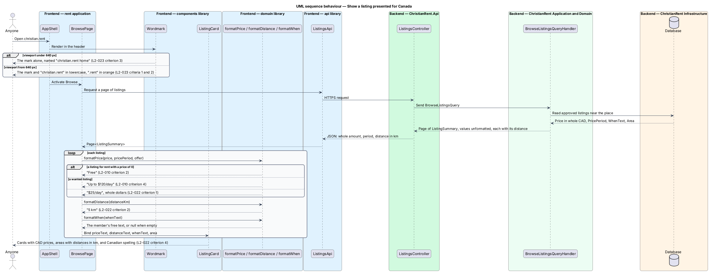
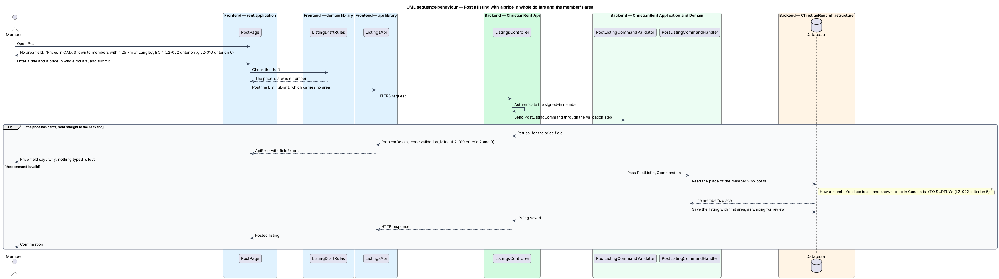

# Present for Canada

## Overview

christian.rent is where Christians post spaces and things for rent, or ask for a space or a
thing to rent. A *listing* is what a member posts; it is *for rent* or *wanted*. christian.rent
launches in Canada, and this feature is the set of shared parts that make every screen read as
Canadian: prices in whole Canadian dollars with their period, distances in kilometres, dates
with the month written as a word, Canadian spelling, an area that is a place in Canada, and the
lowercase wordmark beside its mark.

The feature is cross-cutting. It owns no screen. Browse, Listing, Post and Admin each show
prices, distances, dates, areas and the wordmark, and each obtains them from the parts described
here instead of formatting them itself. One formatter per kind of value means a price reads the
same on a card, in the live preview on Post and in the review queue.

Terms used below:

- **period** — unit of time a price is per: hour, day, night, week or month
- **budget** — price of a wanted listing: the most its member will pay per period
- **area** — city or neighbourhood a listing is in, never a street address
- **place** — point Browse is centred on, or where a member is; a listing takes its area from its member's place
- **wordmark** — product name written as lowercase "christian.rent", with ".rent" in orange
- **mark** — key whose head is a cross, drawn beside the wordmark or alone
- **formatter** — pure function that turns a stored value into the text a person reads

The screens that use these parts are designed in `docs/detailed-designs/listings/`,
`docs/detailed-designs/messages/`, `docs/detailed-designs/members/` and
`docs/detailed-designs/review-queue/`.

## Description

The slice is not built yet; the parts below are the ones the design introduces.

The rule that carries the feature through the layers is that the backend stores and returns
values, and the frontend turns them into text in one place. `ChristianRent.Api` never returns a
formatted price, distance or date, and no component formats one.

**Frontend — `domain` library, `listings/`**

- **`formatPrice(price, period, offer)`** — pure function. A price is a whole number of
  Canadian dollars; no price has cents (`L2-022` criterion 1, `L2-010` criterion 2). For a
  listing for rent it returns the amount and the period with no spaces, as "$25/day". For a
  wanted listing the price is a budget and it returns "Up to $120/day" (`L2-010` criterion 4).
  A price of 0 on a listing for rent returns "Free" (`L2-010` criterion 2). How a budget of 0
  reads, and how a price of 0 reads in the message box, is `<TO SUPPLY>`; the prototype would
  show "$0". Whether an amount of 1,000 or more is written with a separator is `<TO SUPPLY>`.
  Every listing has a price, so the function returns text for every listing.
- **`formatPriceWithCurrency(price, period, offer)`** — pure function for the message box on
  Listing. It returns two pieces: the amount, as "$25" or "Up to $120", and the currency with
  the period, as "CAD / day" (`L2-022` criterion 1, `L2-015` criterion 9). `MessageBox` shows
  the first large and the second after it, under "Rent for" or "They'll pay".
- **`formatDistance(km)`** — pure function. It returns a distance as a whole number of
  kilometres, as "5 km" (`L2-022` criterion 2, `L2-035` criterion 3). A card on Browse and the
  Listing screen show it beside the area, as "Walnut Grove, Langley · 5 km", and the search bar
  shows the radius the same way, as "Langley, BC · 25 km" (`L2-035` criterion 1). The backend
  returns the distance as a number; between which two points it is measured is `<TO SUPPLY>`
  with the choice of the place Browse is centred on (`L2-035`).
- **`formatDate(isoDate)`** — pure function. It returns the date with the month as a short
  word, as "Dec 3, 2026" (`L2-022` criterion 3). The output does not depend on the language or
  region the device is set to, so the same date reads the same for every person.
- **`formatDay(isoDate)`** — pure function for "From" and "To" in the message box. It returns
  the date with its weekday and without its year, as "Sat, Jun 14" (`L2-022` criterion 6).
- **`formatAgo(then, now)`** — pure function. It returns how long ago something happened in
  words, as "2 days ago"; Listing shows it as "Posted 2 days ago" (`L2-022` criterion 6,
  `L2-007` criterion 6). The caller passes the current time, so a unit test fixes it. The
  lengths of time at which the wording moves from one unit to the next are `<TO SUPPLY>`.
- **`formatWhen(whenText)`** — pure function. "When" is one line of free text a member writes,
  for example "Most weekends", and a listing has no start or end date (`L2-010` criterion 5).
  The function returns the text unchanged, or `null` when the member left it empty. What a
  wanted card shows on its line for "when" in that case is `<TO SUPPLY>`.

Each formatter has a table of cases in its unit tests, one row per case, because a formatter is
logic with many cases and lives outside any component.

**Frontend — `rent` application**

- **`app.config.ts`** — the composition root. It binds Angular's `LOCALE_ID` to `en-CA`, so
  that any built-in pipe that reaches a template follows Canadian conventions. Pages call the
  formatters in `domain` for prices, distances and dates; they do not use the `currency` or
  `date` pipes for them.
- **`RentTitleStrategy`** — the application's `TitleStrategy`. It writes each document title
  from the route's title followed by the lowercase name "christian.rent", so the browser tab,
  a bookmark and a shared link carry the same spelling as the wordmark on every screen,
  including Post, where the mark stands alone.
- **Pages** (`BrowsePage`, `ListingPage`, `PostPage`, and `AdminPage` in the `admin` library) —
  each calls the formatters and passes the resulting text to presentation components.
- **`PostPage`** — shows beside its submit button the line "Prices in CAD." followed by where
  the listing will be shown, as "Prices in CAD. Shown to members within 25 km of Langley, BC."
  (`L2-022` criterion 7, `L2-010` criterion 6).

**Frontend — `components` library**

- **`Wordmark`** (`cr-wordmark`) — presentation component. It draws the mark, a key whose head
  is a cross, and beside it the literal text "christian" and ".rent" as two text nodes, the
  second in an element whose colour is the orange accent token (`L2-023` criterion 2). The text
  is real text, not an image, so a screen reader reads "christian.rent". The name is not an
  input: no caller can pass "Christian Rent" or "ChristianRent" (`L2-023` criterion 1). No
  style applies `text-transform` to it.
- `Wordmark` takes two inputs. `text` says from which width the wordmark stands beside the
  mark: always, from 640 px, from 768 px or never. `tone` selects one of the three tones the
  Brand prototype draws for the mark: an orange ground with an ink key, an ink ground with a
  white key, or a white ground with an ink key. The Brand prototype's rule is that below 120 px
  of width the mark is used alone.
- The three places a screen shows it follow `L2-023` criterion 3:

  | Screen | Where | Under the width | From the width |
  |--------|-------|-----------------|----------------|
  | Browse and Listing | The header's control named "christian.rent home" | The mark alone, under 640 px | The mark and the wordmark, from 640 px |
  | Admin | Admin's navigation | The mark alone, under 768 px | The mark and the wordmark, from 768 px |
  | Post | Post's top bar | The mark alone, at every width | The mark alone, at every width |

- Where the mark stands alone it carries the text alternative "christian.rent", so the name is
  still read. Inside the header a screen reader reads the control's own name, "christian.rent
  home". The header is designed in
  `docs/detailed-designs/platform/show-every-screen-to-everyone/`.
- **`ListingCard`** and the other presentation components — each takes `priceText`,
  `distanceText` and `whenText` as inputs that are already formatted. A presentation component
  injects nothing, so it cannot format a value differently from its neighbour.

**Frontend — copy**

Every sentence the product writes is in a component's template or in the map from an error
`code` to its generic message. All of it uses Canadian spelling, as "neighbourhood" and "colour"
(`L2-022` criterion 4). The copy is transcribed from `docs/mocks/`. A spelling check with a
Canadian English dictionary should run over templates and copy as part of
`node tools/verify/verify.mjs`; the tool that performs it is `<TO SUPPLY>`. Text a member writes
is data and is never corrected or respelled.

**Backend — `ChristianRent.Domain`**

- **`Listing`** — holds `Price` as a whole number of Canadian dollars, `PricePeriod`,
  `WhenText`, `Area` and `PostedAt`. It holds no currency field, because one currency exists,
  and no start or end date.
- **`PricePeriod`** — enumeration `Hour`, `Day`, `Night`, `Week`, `Month` (`L2-010`
  criterion 3).

**Backend — `ChristianRent.Application`**

- **`PostListingCommandHandler`** — the handler of `PostListingCommand`. Post has no field for
  the area, and the command carries none: the handler gives the listing the area of the place
  of the member who posts it (`L2-010` criterion 6). No refusal about an area is returned to
  Post.
- **`PostListingCommandValidator`** — the validator of `PostListingCommand`. Among the rules of
  `L2-010`, it refuses a price with cents, so only whole dollars are stored.
- **`ICanadianPlaces`** — port with one method, `IsPlaceInCanadaAsync(place)`. A listing's area
  is a place in Canada (`L2-022` criterion 5) because the place it is taken from is one. How a
  member's place is set, and how it is shown to be in Canada, are `<TO SUPPLY>`; the port is
  called at that step, and its implementation in `ChristianRent.Infrastructure` follows that
  decision. The check runs on the backend because the backend decides what is allowed.

**Backend — `ChristianRent.Api`**

- **`ListingsController`** and every other controller serialize a price as a whole number, a
  period as its name, a distance as a number of kilometres, a calendar date as an ISO 8601 date
  (`2026-12-03`) and a time as an ISO 8601 instant. No endpoint returns text formatted for
  display.

The layout and states of every screen that shows these values follow `docs/mocks/` once drawn,
and this design is brought in line with them then. The forms of a price, a distance and a date
and the places of the wordmark stated here come from the Magic Patterns prototype.

## Requirements

The feature realizes the following level-2 (L2) requirements. Each L2 requirement refines a
level-1 (L1) requirement, cited by identifier.

| L2 ID | Refines (L1) | Requirement |
|-------|--------------|-------------|
| `L2-022` | `L1-009` | CAD, km and Canadian spelling. A price shall be shown in whole Canadian dollars with its period: on a card as "$25/day", and in the message box on Listing as "$25" followed by "CAD / day". A distance shall be shown in kilometres. A date shall be shown with the month written as a word. Any text the product writes shall use Canadian spelling. A listing's area shall be a place in Canada. How long ago something happened shall be shown in words, and a date in the message box shall be shown with its weekday and without its year. Post shall say "Prices in CAD.". |
| `L2-023` | `L1-009` | The wordmark. On any screen the wordmark shall read "christian.rent" in lowercase and shall not be written "Christian Rent" or "ChristianRent". ".rent" shall be in orange, and the wordmark shall stand beside the mark, a key whose head is a cross. On Browse and Listing under 640 px, on Admin under 768 px and on Post at any width, the mark shall stand alone without the wordmark; on Browse and Listing it shall be named "christian.rent home" for a screen reader. |

## Diagrams

### System context

Anyone reads listings on christian.rent and a member posts them; the feature involves no
external system.

### Containers

`ChristianRent.Api` returns amounts, periods, distances and dates unformatted from the database,
and `rent` turns them into text. `ChristianRent.Api` gives a listing the area of its member's
place.

### Components

In the frontend, the header, Post's top bar and Admin's navigation each place the `Wordmark`,
and pages pass text from the formatters in `domain` to presentation components such as
`ListingCard`. In the backend, `PostListingCommandValidator` refuses a price with cents and
`PostListingCommandHandler` takes the listing's area from the member's place. The caller of the
`ICanadianPlaces` port is `<TO SUPPLY>`.

### Class structure

`Listing` holds the unformatted values and `ListingSummary` carries them, with the distance, to
the browser. The formatters in `domain` turn them into the text `ListingCard` receives.
`Wordmark` takes the width from which its text shows and its tone, and `PostListingCommandHandler`
sets the area of a `Listing`.

### Behaviour — show a listing presented for Canada

The header renders the mark, with the wordmark from 640 px, before any data arrives.
`BrowsePage` receives unformatted values, calls `formatPrice`, `formatDistance` and `formatWhen`
once per listing, and binds the text to each `ListingCard`. A listing for rent reads "$25/day",
a wanted listing "Up to $120/day", and a price of 0 on a listing for rent reads "Free".

### Behaviour — post a listing with a price in whole dollars and the member's area

`PostPage` says "Prices in CAD." and where the listing will be shown, and sends a draft with no
area. `PostListingCommandValidator` refuses a price with cents. `PostListingCommandHandler`
gives the listing the area of the member's place; how that place is set and shown to be in
Canada is `<TO SUPPLY>`.

