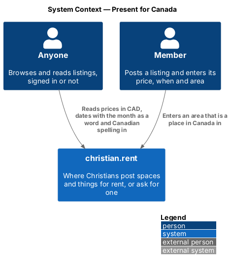
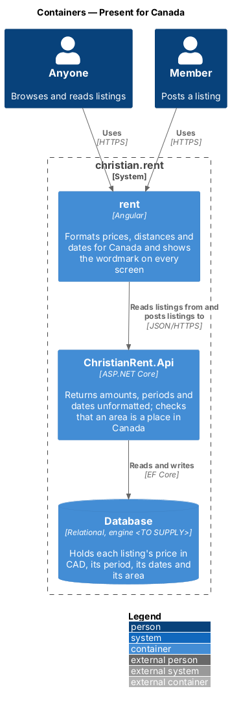
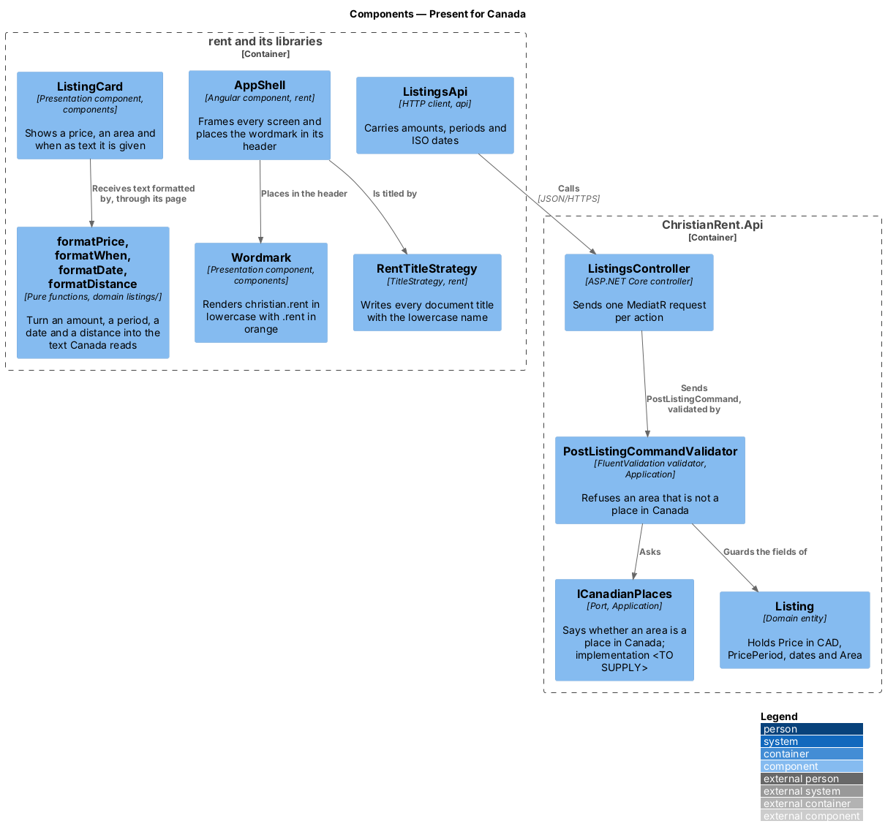
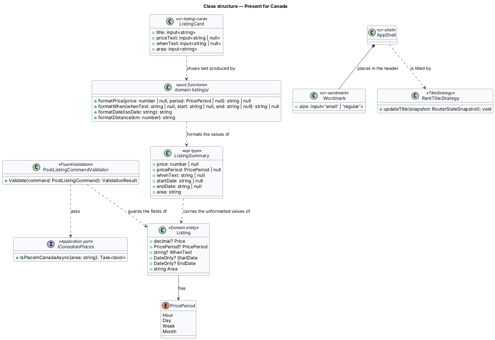
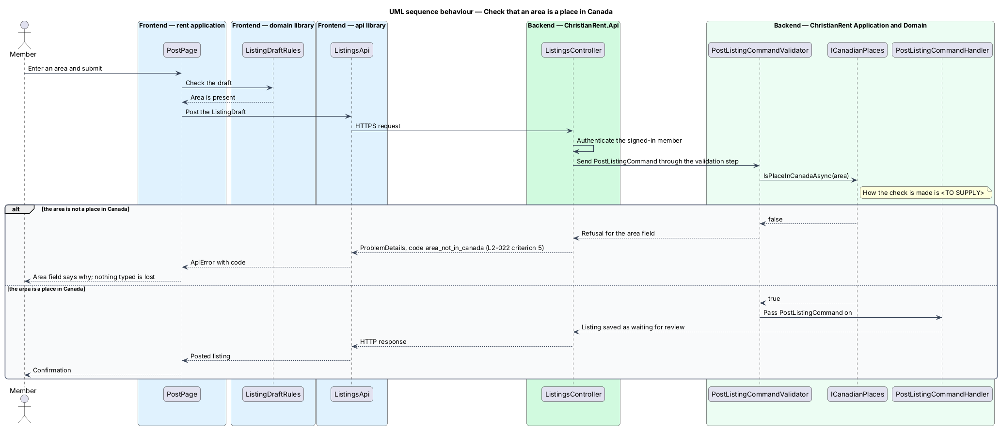

# Present for Canada

## Overview

christian.rent is where Christians post spaces and things for rent, or ask for a space or a
thing to rent. A *listing* is what a member posts; it is *for rent* or *wanted*. christian.rent
launches in Canada, and this feature is the set of shared parts that make every screen read as
Canadian: prices in Canadian dollars with their period, distances in kilometres, dates with the
month written as a word, Canadian spelling, an area that is a place in Canada, and the lowercase
wordmark.

The feature is cross-cutting. It owns no screen. Browse, Listing, Post and Admin each show
prices, dates, areas and the wordmark, and each obtains them from the parts described here
instead of formatting them itself. One formatter per kind of value means a price reads the same
on a card, on the Listing screen, in the live preview on Post and in the review queue.

Terms used below:

- **period** — unit of time a price is per: hour, day, week or month
- **area** — city or neighbourhood a listing is in, never a street address
- **wordmark** — product name written as lowercase "christian.rent", with ".rent" in orange
- **formatter** — pure function that turns a stored value into the text a person reads

The screens that use these parts are designed in `docs/detailed-designs/listings/`,
`docs/detailed-designs/messages/`, `docs/detailed-designs/members/` and
`docs/detailed-designs/review-queue/`.

## Description

The slice is not built yet; the parts below are the ones the design introduces.

The rule that carries the feature through the layers is that the backend stores and returns
values, and the frontend turns them into text in one place. `ChristianRent.Api` never returns a
formatted price or a formatted date, and no component formats one.

**Frontend — `domain` library, `listings/`**

- **`formatPrice(price, period)`** — pure function. It returns the price in Canadian dollars
  followed by its period, as "$25 / day". Cents appear only when they are not zero, so 25 reads
  "$25 / day" and 25.5 reads "$25.50 / day" (`L2-022` criterion 1). A price of 0 returns "Free",
  as `L2-010` criterion 2 requires. An absent price on a wanted listing returns `null`, and the
  card shows no price. The currency symbol is "$" alone; the function does not append "CAD",
  because every price on christian.rent is in Canadian dollars.
- **`formatDate(isoDate)`** — pure function. It returns the date with the month as a short
  word, as "Dec 3, 2026" (`L2-022` criterion 3). The output does not depend on the language or
  region the device is set to, so the same date reads the same for every person.
- **`formatWhen(whenText, startDate, endDate)`** — pure function. It returns the member's free
  text unchanged when the listing has free text, and a range built from two `formatDate` results
  when the listing has a start and an end date.
- **`formatDistance(km)`** — pure function. It returns a distance in kilometres, as "4 km"
  (`L2-022` criterion 2). No L2 requirement names a place where a distance is shown; which
  screen shows a distance, and between which two places, is `<TO SUPPLY>`. Until that is
  decided the function has no caller.

Each formatter has a table of cases in its unit tests, one row per case, because a formatter is
logic with many cases and lives outside any component.

**Frontend — `rent` application**

- **`app.config.ts`** — the composition root. It binds Angular's `LOCALE_ID` to `en-CA`, so
  that any built-in pipe that reaches a template follows Canadian conventions. Pages call the
  formatters in `domain` for prices, dates and distances; they do not use the `currency` or
  `date` pipes for them.
- **`AppShell`** (`cr-shell`) — the frame around every screen. Its header holds the `Wordmark`
  as a link to Browse. Because every route renders inside `AppShell`, the wordmark is on every
  screen without any page placing it (`L2-023` criterion 1).
- **`RentTitleStrategy`** — the application's `TitleStrategy`. It writes each document title
  from the route's title followed by the lowercase name "christian.rent", so the browser tab,
  a bookmark and a shared link carry the same spelling as the wordmark.
- **Pages** (`BrowsePage`, `ListingPage`, `PostPage`, and `AdminPage` in the `admin` library) —
  each calls the formatters and passes the resulting text to presentation components.

**Frontend — `components` library**

- **`Wordmark`** (`cr-wordmark`) — presentation component. Its template holds the literal text
  "christian" and ".rent" as two text nodes, the second in an element whose colour is the
  orange accent token. The text is real text, not an image, so a screen reader reads
  "christian.rent". The name is not an input: no caller can pass "Christian Rent" or
  "ChristianRent". No style applies `text-transform` to it. The mark, a key whose head is a
  cross, sits beside the text as a decorative image hidden from assistive technology.
- **`ListingCard`** and the other presentation components — each takes `priceText` and
  `whenText` as inputs that are already formatted. A presentation component injects nothing, so
  it cannot format a value differently from its neighbour.

**Frontend — copy**

Every sentence the product writes is in a component's template or in the map from an error
`code` to its generic message. All of it uses Canadian spelling, as "neighbourhood" and "colour"
(`L2-022` criterion 4). The copy is transcribed from `docs/mocks/`. A spelling check with a
Canadian English dictionary should run over templates and copy as part of
`node tools/verify/verify.mjs`; the tool that performs it is `<TO SUPPLY>`. Text a member writes
is data and is never corrected or respelled.

**Backend — `ChristianRent.Domain`**

- **`Listing`** — holds `Price` as a decimal amount in Canadian dollars, `PricePeriod`, either
  `WhenText` or `StartDate` and `EndDate`, and `Area`. It holds no currency field: one currency
  exists.
- **`PricePeriod`** — enumeration `Hour`, `Day`, `Week`, `Month`.

**Backend — `ChristianRent.Application`**

- **`ICanadianPlaces`** — port with one method, `IsPlaceInCanadaAsync(area)`. How an area is
  checked to be a place in Canada is not decided: `<TO SUPPLY>`. The open points are the source
  of place names, whether the area field on Post is free text or a choice from that source, and
  whether a neighbourhood is checked or only its city. The implementation of the port, in
  `ChristianRent.Infrastructure`, follows that decision.
- **`PostListingCommandValidator`** — the validator of `PostListingCommand`. Beside the rules of
  `L2-010`, it asks `ICanadianPlaces` about the area and refuses the command when the answer is
  no (`L2-022` criterion 5). The refusal is a ProblemDetails with the `code`
  `area_not_in_canada`. The check runs on the backend because the backend decides what is
  allowed; the frontend may also offer places as the member types, for convenience only.

**Backend — `ChristianRent.Api`**

- **`ListingsController`** and every other controller serialize a price as a number, a period as
  its name and a date as an ISO 8601 calendar date (`2026-12-03`). No endpoint returns text
  formatted for display.

The layout and states of every screen that shows these values follow `docs/mocks/` once drawn,
and this design is brought in line with them then.

## Requirements

The feature realizes the following level-2 (L2) requirements. Each L2 requirement refines a
level-1 (L1) requirement, cited by identifier.

| L2 ID | Refines (L1) | Requirement |
|-------|--------------|-------------|
| `L2-022` | `L1-009` | CAD, km and Canadian spelling. A price shall be shown in Canadian dollars with its period, with cents shown only when they are not zero. A distance shall be shown in kilometres. A date shall be shown with the month written as a word. Any text the product writes shall use Canadian spelling. An area a member enters shall be a place in Canada. |
| `L2-023` | `L1-009` | The wordmark. On any screen the wordmark shall read "christian.rent" in lowercase and shall not be written "Christian Rent" or "ChristianRent". |

## Diagrams

### System context

Anyone reads listings on christian.rent and a member posts them; the feature involves no
external system.

### Containers

`ChristianRent.Api` returns amounts, periods and dates unformatted from the database, and `rent`
turns them into text. The check that an area is a place in Canada runs in `ChristianRent.Api`.

### Components

In the frontend, `AppShell` places the `Wordmark`, and pages pass text from the formatters in
`domain` to presentation components such as `ListingCard`. In the backend,
`PostListingCommandValidator` asks the `ICanadianPlaces` port about the area.

### Class structure

`Listing` holds the unformatted values and `ListingSummary` carries them to the browser. The
formatters in `domain` turn them into the text `ListingCard` receives. `AppShell` composes
`Wordmark`, and `PostListingCommandValidator` depends on `ICanadianPlaces`.

### Behaviour — show a listing presented for Canada

`AppShell` renders the wordmark before any data arrives. `BrowsePage` receives unformatted
values, calls `formatPrice` and `formatWhen` once per listing, and binds the text to each
`ListingCard`. A price of 0 reads "Free" and an absent price on a wanted listing shows nothing.

### Behaviour — check that an area is a place in Canada

`ListingDraftRules` confirms in the browser that an area is present. `PostListingCommandValidator`
then asks `ICanadianPlaces` and refuses with the `code` `area_not_in_canada` when the area is
not a place in Canada; otherwise the command reaches its handler. How `ICanadianPlaces` reaches
its answer is `<TO SUPPLY>`.

