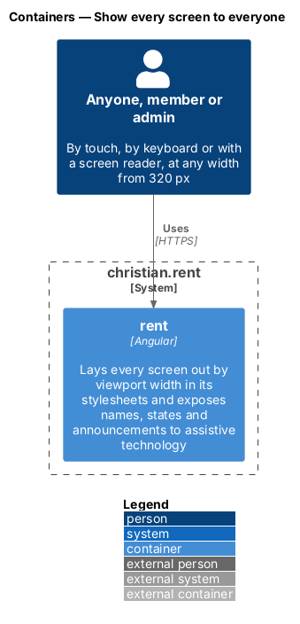
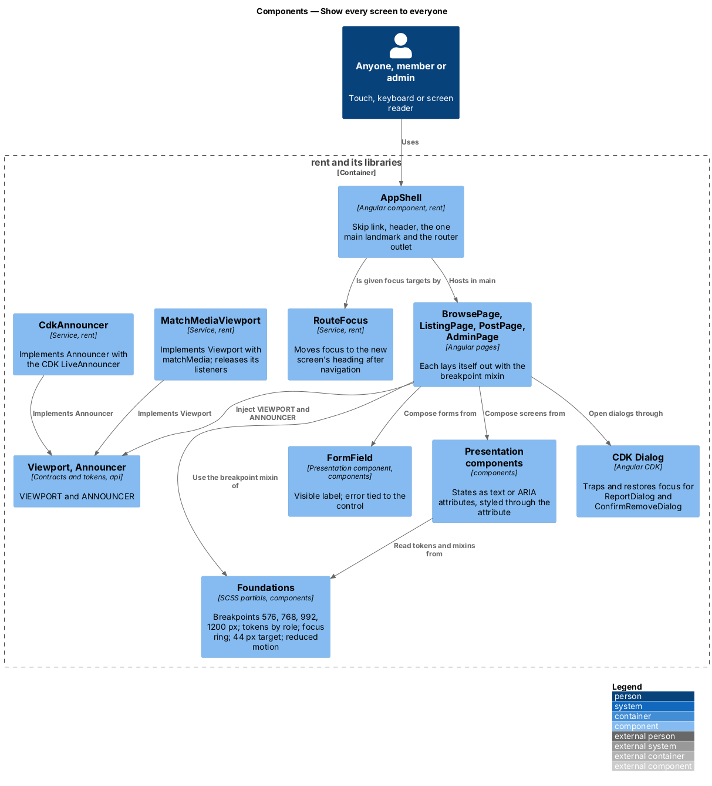
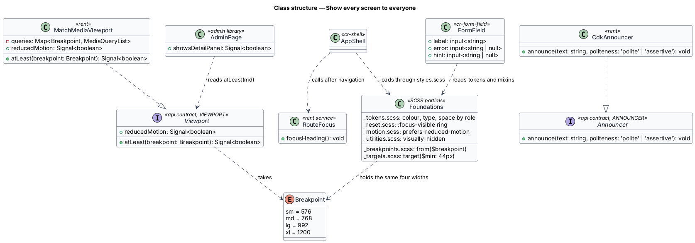
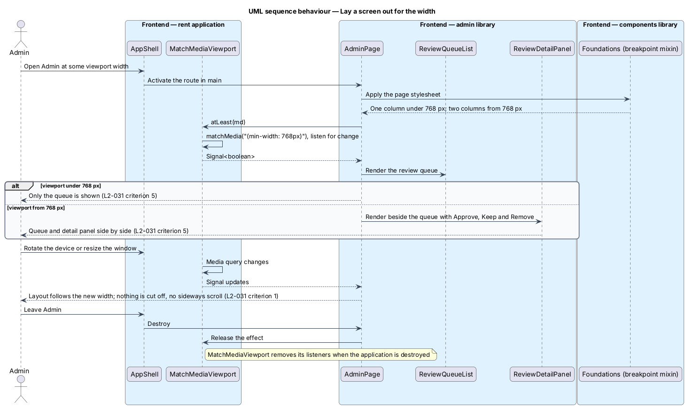
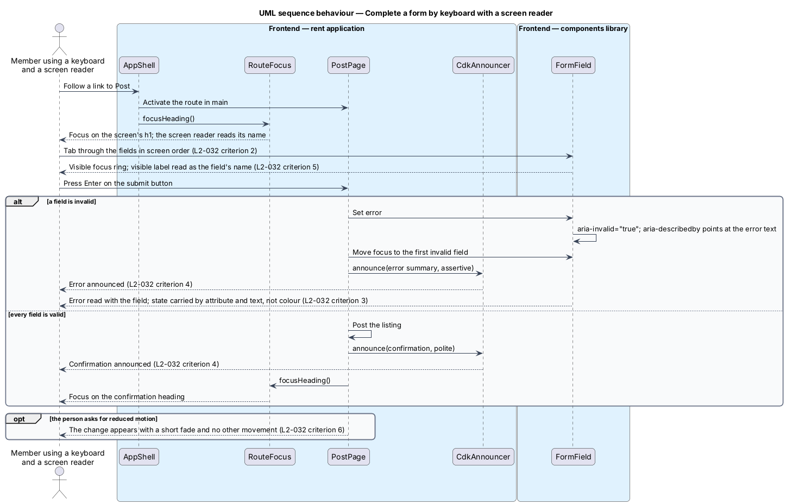

# Show every screen to everyone

## Overview

christian.rent is where Christians post spaces and things for rent, or ask for a space or a
thing to rent. It has four screens: Browse, Listing, Post and Admin. Most people open it on a
phone; others use a tablet, a laptop or a wide desktop, by touch, by keyboard or with a screen
reader. This feature is the set of shared parts that make each screen work at every viewport
width and meet WCAG 2.2 level AA.

The feature is cross-cutting. It owns no screen. It supplies what every screen and every
presentation component builds on: one set of breakpoints, one minimum touch target, one focus
ring, one way to tie a label and an error to a field, one way to announce a confirmation or an
error, and one rule for motion. A screen that uses these parts is responsive and accessible by
construction, and is not patched for one form factor after it is built.

The slice lies wholly in the frontend. It has no backend part: no endpoint, handler or table
belongs to it, and its C4 diagrams show no backend container.

Terms used below:

- **breakpoint** — viewport width at which a screen's layout changes: 576, 768, 992 or 1200 px
- **touch target** — area of a control that responds to a tap
- **landmark** — region of a page (header, main) that assistive technology lists and jumps to
- **live announcement** — text a screen reader speaks without focus moving to it
- **foundations** — global styles every component reads: tokens, `@font-face`, reset and utilities
- **token** — named design value (a colour, a size, a duration) read by its role, never by its literal value
- **sweep** — Playwright run that checks every screen for layout, appearance or accessibility

## Description

The slice is not built yet; the parts below are the ones the design introduces.

### Foundations

The foundations are SCSS partials in the `components` library, loaded once by `rent`'s
`styles.scss` and available to every component stylesheet through the workspace's include path.
They hold no component styles.

- **`_breakpoints.scss`** — the four widths, `sm` 576 px, `md` 768 px, `lg` 992 px and `xl`
  1200 px, and one mixin, `from($breakpoint)`, that wraps a block in a `min-width` media query.
  Every stylesheet is written for the narrowest phone first and adds to it with `from(...)`. No
  stylesheet writes a width in a media query itself, so the four numbers exist in one place.
- **`_tokens.scss`** — colour, type, spacing and motion tokens as custom properties, named by
  role. The names follow `docs/design-system/` once it is extracted from the mocks. Each pair of
  text and surface tokens has a contrast of at least 4.5:1 (`L2-032` criterion 1). The orange
  ".rent" of the wordmark is part of a logotype, which WCAG 2.2 exempts from the contrast
  criterion; orange is not used for other text unless its pair meets 4.5:1.
- **`_reset.scss`** — the reset and the focus ring: one `:focus-visible` rule drawing an outline
  from a token on every focusable element (`L2-032` criterion 2). No stylesheet removes an
  outline without drawing the same ring another way.
- **`_targets.scss`** — the mixin `target()`, which gives a control a minimum width and height
  of 44 px (`L2-031` criterion 6). A control whose drawn shape is smaller, such as an icon
  button, keeps its shape and gains the area through padding.
- **`_motion.scss`** — transition durations as tokens, and one `prefers-reduced-motion: reduce`
  block that replaces every transition and animation with a short fade (`L2-032` criterion 6).
  The length of that fade is `<TO SUPPLY>`: the requirement says "a short fade" and gives no
  number. No component animates with a duration that is not a token.
- **`_utilities.scss`** — the `visually-hidden` utility for text that only a screen reader
  reads.

Type and spacing are in `rem`, and no container of text has a fixed height. Text enlarged to
200% therefore reflows, and nothing is lost or overlaps (`L2-032` criterion 7).

### What each screen does at each breakpoint

Each page and each presentation component lays itself out in its own encapsulated stylesheet
with CSS grid and the `from(...)` mixin. Layout that CSS can express is expressed in CSS, so it
costs no script and no listener.

| Screen | Under 576 px | From 576 px | From 768 px | From 992 px | From 1200 px |
|--------|--------------|-------------|-------------|-------------|--------------|
| Browse | Cards in one column | Column count `<TO SUPPLY>` | Column count `<TO SUPPLY>` | Column count `<TO SUPPLY>` | Column count `<TO SUPPLY>` |
| Listing | Message box below the listing | As under 576 px | Message box to the right of the listing | As from 768 px | As from 768 px |
| Post | Live preview below the form | As under 576 px | Live preview beside the form | As from 768 px | As from 768 px |
| Admin | Only the review queue | As under 576 px | Detail panel, with Approve, Keep and Remove, beside the queue | As from 768 px | As from 768 px |

The rows realize `L2-031` criteria 2 to 5. `L2-031` criterion 2 fixes one column under 576 px
and says the number of columns grows at each breakpoint as the mocks draw it; the four counts
are `<TO SUPPLY>` until `docs/mocks/` exists.

Every screen holds from 320 px wide with nothing cut off and no sideways scroll (`L2-031`
criterion 1). Three rules carry this: widths are fluid and grid tracks use `minmax(0, 1fr)`;
photos never exceed their container; and text a member writes wraps anywhere, so one long word
in a title or a note does not widen the page.

Where a layout places the same content in a different position, the order of elements in the
document stays the reading order. The message box follows the listing in the document at every
width, so the focus order follows the screen (`L2-032` criterion 2).

### Where structure differs, not only layout

- **`Viewport`** — contract in `api`, with the token `VIEWPORT`. `atLeast(breakpoint)` returns a
  signal that is true from that width up, and `reducedMotion` is a signal of the person's
  preference.
- **`MatchMediaViewport`** — implementation in `rent`, bound in `app.config.ts`. It wraps
  `matchMedia`, creates one query per breakpoint on first use, and removes every listener when
  the application is destroyed.
- **`AdminPage`** is the one caller. Under 768 px it does not render `ReviewDetailPanel` at
  all, so its buttons are not present for a keyboard or a screen reader to reach. From 768 px it
  renders the panel beside `ReviewQueueList`. What an admin on a phone sees on selecting an item
  of the queue is `<TO SUPPLY>`: `L2-031` criterion 5 says only the queue is shown.

Listing, Post and Browse do not use `Viewport`; their breakpoints change position only, which
CSS handles.

### The shell

- **`AppShell`** (`cr-shell`) — the frame around every screen. In document order it holds a
  skip link to the main content, a `header` with the wordmark, and one `main` holding the
  router outlet. Each page supplies exactly one `h1`.
- **`RouteFocus`** — service in `rent`. After each navigation it moves focus to the new
  screen's `h1`, so a keyboard continues from the top of the new screen and a screen reader
  reads its name. The same call moves focus to a confirmation's heading when a confirmation
  replaces a form.
- **Document title** — each route has a title, written by the application's `TitleStrategy`
  (designed in `docs/detailed-designs/platform/present-for-canada/`).

### Names, states and forms

- **States by attribute or text** — a state assistive technology shall know is an attribute on
  the element: `aria-pressed` or `aria-checked` for a selected choice, `aria-current` for the
  open item of the review queue, `aria-invalid` for an invalid field, `disabled` for a control
  that cannot be used. The component's stylesheet styles the state through that attribute, so
  the visible state and the announced state cannot differ. A state a person reads is text:
  `VerifiedMark` shows the word "Verified" with its icon, and a wanted listing's card carries
  the word "Wanted" (`L2-032` criterion 3). No state is carried by colour alone.
- **Native elements first** — a control is a `button`, an `a` or a form control. A `div` with a
  click handler is not used. Every action is therefore reachable and operable by keyboard
  without added script (`L2-032` criterion 2).
- **`FormField`** (`cr-form-field`) — presentation component in `components` that wraps one
  projected control. It renders a visible `label` bound to the control, an optional hint, and
  an error paragraph. When `error` is set it marks the control `aria-invalid="true"` and adds
  the error's id to the control's `aria-describedby`, so the error is read with the field
  (`L2-032` criterion 5). Every field on Post, in `MessageBox`, in `ReportDialog` and in the
  form for becoming a member is inside a `FormField`.
- **Dialogs** — `ReportDialog` and `ConfirmRemoveDialog` are CDK Dialogs. The CDK traps focus
  inside the dialog, closes it on Escape and returns focus to the control that opened it. No
  dialog is hand-rolled.
- **Photos and icons** — each photo has a text alternative; an icon beside its own text is
  hidden from assistive technology.

### Live announcements

- **`Announcer`** — contract in `api`, with the token `ANNOUNCER` and one method,
  `announce(text, politeness)`.
- **`CdkAnnouncer`** — implementation in `rent`, bound in `app.config.ts`, that calls the CDK
  `LiveAnnouncer`. The CDK keeps one live region in the document for the whole application.
- A page calls `announce` with `polite` when a confirmation appears and with `assertive` when
  an error appears (`L2-032` criterion 4). `ErrorState` also carries `role="alert"`, so an error
  that replaces a screen's content is announced where no page code runs. The text announced is
  the text shown.

### Proof

Three Playwright sweeps cover this feature: a responsive sweep at widths on each side of every
breakpoint and at 320 px, a visual sweep against baselines, and an accessibility sweep of every
screen in every state. They are written and kept current, and they run only when a person asks.
The tool the accessibility sweep uses is `<TO SUPPLY>`. Behaviour specs, which run by default,
drive forms and dialogs by keyboard through page objects.

The layout and states of each screen follow `docs/mocks/` once drawn, and this design is
brought in line with them then.

## Requirements

The feature realizes the following level-2 (L2) requirements. Each L2 requirement refines a
level-1 (L1) requirement, cited by identifier.

| L2 ID | Refines (L1) | Requirement |
|-------|--------------|-------------|
| `L2-031` | `L1-013` | Every screen at every width. From a viewport 320 px wide, no screen shall cut anything off or scroll sideways. Browse shall show cards in one column under 576 px, and the number of columns shall grow from 576 px, 768 px, 992 px and 1200 px as the mocks draw it. Under 768 px, Listing shall put the message box below the listing, Post shall put the live preview below the form, and Admin shall show only the queue; from 768 px the message box shall be to the right, the preview beside the form, and the detail panel with its Approve, Keep and Remove buttons beside the queue. The touch target of every control shall be at least 44 × 44 px. |
| `L2-032` | `L1-014` | Accessible to everyone. Every screen shall meet WCAG 2.2 level AA, including a contrast of at least 4.5:1 for text. Every action shall be completable with a keyboard alone, with focus always visible and in the order of the screen. A state shall be carried by text or an attribute a screen reader announces, never by colour alone. A confirmation or an error shall be announced by a screen reader. A form field shall have a visible label and its error tied to it. For a person who asks for reduced motion, nothing shall animate beyond a short fade. With text enlarged to 200%, nothing shall be lost or overlap. |

## Diagrams

### System context

People reach christian.rent by touch, by keyboard and with a screen reader; the feature
involves no external system.

### Containers

The slice lies in `rent` alone. The diagram shows no backend container because layout and
accessibility are decided in the browser.

### Components

`AppShell` hosts each page inside the one `main` landmark and `RouteFocus` moves focus after
navigation. Pages and presentation components read the foundations. `MatchMediaViewport` and
`CdkAnnouncer` implement the `Viewport` and `Announcer` contracts of `api`, and `FormField`
ties a label and an error to each control.

### Class structure

`MatchMediaViewport` realizes `Viewport`, which takes a `Breakpoint`; `CdkAnnouncer` realizes
`Announcer`. `AdminPage` reads `Viewport`, `AppShell` calls `RouteFocus`, and the foundations
hold the same four widths as `Breakpoint`.

### Behaviour — lay a screen out for the width

Admin is the one screen whose structure changes with the width. Its stylesheet sets one or two
columns, and `AdminPage` reads `Viewport.atLeast(md)` to render `ReviewDetailPanel` only from
768 px. A change of width updates the signal and the layout follows.

### Behaviour — complete a form by keyboard with a screen reader

`RouteFocus` places focus on the screen's heading. Each `FormField` gives its control a visible
label; on an invalid submit it ties the error to the control, focus moves to the first invalid
field, and `CdkAnnouncer` announces the error. On success the confirmation is announced and
receives focus.

