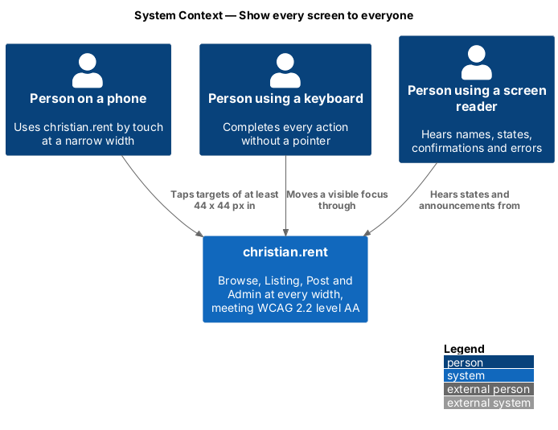
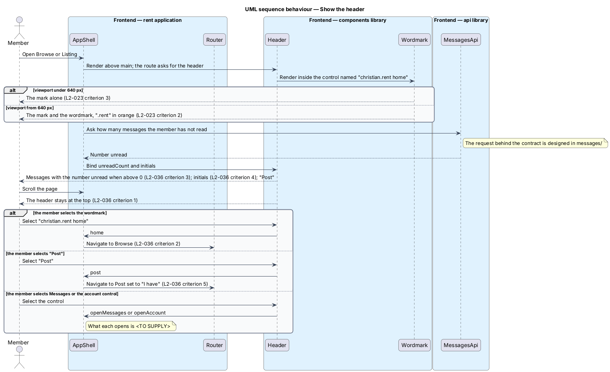

# Show every screen to everyone

## Overview

christian.rent is where Christians post spaces and things for rent, or ask for a space or a
thing to rent. It has four screens: Browse, Listing, Post and Admin. Most people open it on a
phone; others use a tablet, a laptop or a wide desktop, by touch, by keyboard or with a screen
reader. This feature is the set of shared parts that make each screen work at every viewport
width and meet WCAG 2.2 level AA.

The feature is cross-cutting. It owns no screen. It supplies what every screen and every
presentation component builds on: one set of breakpoints, one minimum touch target, one focus
ring, one way to tie a label and an error to a field, one way to announce a confirmation or an
error, and one rule for motion. A screen that uses these parts is responsive and accessible by
construction, and is not patched for one form factor after it is built.

The slice lies wholly in the frontend. It has no backend part: no endpoint, handler or table
belongs to it, and its C4 diagrams show no backend container. The header shows one value from
the backend, the number of unread messages, which it receives through a contract designed in
`docs/detailed-designs/messages/`.

Terms used below:

- **breakpoint** — viewport width at which a screen's layout changes: 640, 768, 1024 or 1280 px
- **touch target** — area of a control that responds to a tap
- **landmark** — region of a page (header, main) that assistive technology lists and jumps to
- **live announcement** — text a screen reader speaks without focus moving to it
- **foundations** — global styles every component reads: tokens, `@font-face`, reset and utilities
- **token** — named design value (a colour, a size, a duration) read by its role, never by its literal value
- **header** — bar that Browse and Listing share, holding the wordmark, Messages, the account control and "Post"
- **mark** — key whose head is a cross, drawn beside the wordmark or alone
- **sweep** — Playwright run that checks every screen for layout, appearance or accessibility

## Description

The slice is not built yet; the parts below are the ones the design introduces.

### Foundations

The foundations are SCSS partials in the `components` library, loaded once by `rent`'s
`styles.scss` and available to every component stylesheet through the workspace's include path.
They hold no component styles.

- **`_breakpoints.scss`** — the four widths, `sm` 640 px, `md` 768 px, `lg` 1024 px and `xl`
  1280 px, and one mixin, `from($breakpoint)`, that wraps a block in a `min-width` media query.
  Every stylesheet is written for the narrowest phone first and adds to it with `from(...)`. No
  stylesheet writes a width in a media query itself, so the four numbers exist in one place.
- **`_tokens.scss`** — colour, type, spacing and motion tokens as custom properties, named by
  role. The names follow `docs/design-system/` once it is extracted from the mocks. The values
  are the prototype's: a white page and white panels, the surface "Mist" `#F1F3F8`, the hairline
  `#E3E6EE`, "Ink" `#16213A` for text, muted text `#5B6478`, "Sunrise" orange `#FF6B3D` with a
  deep tone `#C8431A`, "Sky" blue `#3D5AFE` with a deep tone `#2B3FC4`, green `#1F8A5B` and
  alert red `#C62E2E`. Orange marks what is offered and blue what is asked for; neither colour
  is the only carrier of that difference. Each pair of text and surface tokens shall have a
  contrast of at least 4.5:1 (`L2-032` criterion 1). The orange ".rent" of the wordmark is part
  of a logotype, which WCAG 2.2 exempts from the contrast criterion; orange is not used for
  other text unless its pair meets 4.5:1.
- **`_reset.scss`** — the reset and the focus ring: one `:focus-visible` rule drawing an outline
  from a token on every focusable element (`L2-032` criterion 2). No stylesheet removes an
  outline without drawing the same ring another way. The reset also sets `scroll-padding-top`
  to the header's height, so an element that receives focus is not hidden under the header.
- **`_targets.scss`** — the mixin `target()`, which gives a control a minimum width and height
  of 44 px (`L2-031` criterion 6). A control whose drawn shape is smaller, such as an icon
  button, keeps its shape and gains the area through padding. The prototype draws the header's
  controls and Listing's Share and Report controls at 36 or 40 px; each receives the 44 px
  target.
- **`_page.scss`** — the mixin `page()`, which Browse, Listing and Post apply to their content.
  It centres the content, limits it to 1152 px, and sets the margin at each side to 16 px under
  640 px and 24 px from 640 px (`L2-031` criterion 7).
- **`_motion.scss`** — transition durations as tokens, from 120 to 300 ms, and one easing token,
  `cubic-bezier(0.23, 1, 0.32, 1)`. One `prefers-reduced-motion: reduce` block removes the
  duration of every transition and animation, so each change appears at once and nothing moves:
  the pill of a switch does not slide, and a decided item does not slide out of the review
  queue. `L2-032` criterion 6 permits a short fade at most, and the design uses none. No
  component animates with a duration that is not a token.
- **`_utilities.scss`** — the `visually-hidden` utility for text that only a screen reader
  reads.

Type and spacing are in `rem`, and no container of text has a fixed height. Text enlarged to
200% therefore reflows, and nothing is lost or overlaps (`L2-032` criterion 7).

### What each screen does at each breakpoint

Each page and each presentation component lays itself out in its own encapsulated stylesheet
with CSS grid and the `from(...)` mixin. Layout that CSS can express is expressed in CSS, so it
costs no script and no listener.

| Screen | Under 640 px | From 640 px | From 768 px | From 1024 px | From 1280 px |
|--------|--------------|-------------|-------------|--------------|--------------|
| Header (Browse and Listing) | The mark alone | The mark and the wordmark | As from 640 px | As from 640 px | As from 640 px |
| Browse | Cards in one column; the search field, the place and "Search" stacked; the two buttons below the headline | Cards in two columns; the search bar in one row | As from 640 px | Cards in three columns; the two buttons to the right of the headline | Cards in four columns |
| Listing | Message box below the listing | As under 640 px | As under 640 px | Message box, 380 px wide, to the right of the listing and in view as the listing scrolls | As from 1024 px |
| Post | Live preview below the form; the fields in one column | As under 640 px, with the price beside "When" | As from 640 px | Live preview, 320 px wide, beside the form and in view as the form scrolls | As from 1024 px |
| Admin | Only the review queue, under a navigation bar with the mark and four icons | As under 640 px | Navigation as a column 240 px wide, then the queue, then the detail panel with Approve, Keep and Remove | As from 768 px | As from 768 px |

The rows realize `L2-031` criteria 2 to 5, `L2-003` criterion 6, `L2-005` criterion 4, `L2-019`
criterion 9 and `L2-023` criterion 3. 768 px changes nothing on Browse, Listing or Post; it is
the breakpoint of Admin alone. The message box on Listing and the live preview on Post stay in
view through `position: sticky`, which costs no script. Under 640 px the content of Browse,
Listing and Post has a margin of 16 px at each side, and from 640 px a margin of 24 px. The
content is at most 1152 px wide and is centred on a wider viewport (`L2-031` criterion 7).

Every screen holds from 320 px wide with nothing cut off and no sideways scroll (`L2-031`
criterion 1). Three rules carry this: widths are fluid and grid tracks use `minmax(0, 1fr)`;
photos never exceed their container; and text a member writes wraps anywhere, so one long word
in a title or a note does not widen the page.

Where a layout places the same content in a different position, the order of elements in the
document stays the reading order. The message box follows the listing in the document at every
width, so the focus order follows the screen (`L2-032` criterion 2).

### Where structure differs, not only layout

- **`Viewport`** — contract in `api`, with the token `VIEWPORT`. `atLeast(breakpoint)` returns a
  signal that is true from that width up, and `reducedMotion` is a signal of the person's
  preference.
- **`MatchMediaViewport`** — implementation in `rent`, bound in `app.config.ts`. It wraps
  `matchMedia`, creates one query per breakpoint on first use, and removes every listener when
  the application is destroyed.
- **`AdminPage`** is the one caller. Under 768 px it does not render `ReviewDetailPanel` at
  all, so its buttons are not present for a keyboard or a screen reader to reach. An admin who
  selects an item under 768 px opens no detail and can decide nothing (`L2-019` criterion 10,
  `L2-031` criterion 5); the prototype draws Admin this way on purpose, and an admin decides
  from 768 px. From 768 px `AdminPage` renders the panel beside `ReviewQueueList`.
- **Admin's navigation** changes by CSS alone. From 768 px it is a column to the left of the
  queue holding the mark and the wordmark, "Admin", the four entries Review, Reports, Members
  and Churches, and "Back to site". Under 768 px it is a bar across the top holding the mark and
  the four entries as icons; each icon keeps its name for a screen reader through
  `visually-hidden` text, and the number waiting and "Back to site" are not shown (`L2-019`
  criterion 9). The navigation is designed in
  `docs/detailed-designs/review-queue/work-review-queue/`.

Listing, Post and Browse do not use `Viewport`; their breakpoints change position only, which
CSS handles.

### The shell

- **`AppShell`** (`cr-shell`) — the frame around every screen. In document order it holds a
  skip link to the main content, the header on the routes that ask for it, and one `main`
  holding the router outlet. Each page supplies exactly one `h1`.
- The routes of Browse and Listing ask for the header through their route data. Post and Admin
  do not: Post has its own top bar, holding the mark and a Close control that returns to Browse
  (`L2-009` criterion 6), and Admin has its own navigation (`L2-019` criterion 9). Whether the
  "not found" screen carries the header is `<TO SUPPLY>` until `docs/mocks/` draws that screen.
- **`RouteFocus`** — service in `rent`. After each navigation it moves focus to the new
  screen's `h1`, so a keyboard continues from the top of the new screen and a screen reader
  reads its name. The same call moves focus to a confirmation's heading when a confirmation
  replaces a form.
- **Document title** — each route has a title, written by the application's `TitleStrategy`
  (designed in `docs/detailed-designs/platform/present-for-canada/`).

### The header

- **`Header`** (`cr-header`) — presentation component in `components`. It takes `unreadCount`
  and `initials` as inputs and emits `home`, `openMessages`, `openAccount` and `post`. It
  injects nothing; `AppShell` supplies the inputs and acts on the outputs.
- The header is a `header` landmark 64 px high with a hairline below it and a translucent white
  ground. It stays at the top as the page scrolls (`L2-036` criterion 1) through
  `position: sticky`, with no scroll listener.
- **Left** — one control named "christian.rent home" for a screen reader. It holds the
  `Wordmark` component, which shows the mark and the wordmark from 640 px and the mark alone
  under 640 px (`L2-023` criterion 3). Selecting it emits `home`, and `AppShell` opens Browse
  (`L2-036` criterion 2).
- **Right, in order** — the Messages control, the account control and "Post".
  - The Messages control is an icon button named "Messages". When `unreadCount` is above 0 it
    shows the count on an orange badge (`L2-036` criterion 3). The count is text inside the
    control, so a screen reader reads it with the name and the badge's colour carries nothing
    alone.
  - The account control is a circle holding the member's initials, with the title "Your
    account" (`L2-036` criterion 4).
  - "Post" is a button with a plus icon and its label at every width. Selecting it emits `post`,
    and `AppShell` opens Post set to "I have" (`L2-036` criterion 5).
- Each of the three controls and the home control has a touch target of at least 44 × 44 px
  through `target()`. At 320 px the mark alone leaves room for all three.
- **The number unread** — `AppShell` reads it for the signed-in member through the
  `MessagesApi` contract (`MESSAGES_API`) of `api`, and binds it to `unreadCount`. The request
  behind the contract belongs to `docs/detailed-designs/messages/`. What marks a message as
  read, and when the count is read again during a visit, are `<TO SUPPLY>`: the Messages inbox
  is not designed.
- **The initials** — `AppShell` derives them from the signed-in member's name. Where `rent`
  holds the signed-in member is `<TO SUPPLY>` with sign-in.
- **What the controls open** — what the Messages control opens and what the account control
  opens are `<TO SUPPLY>` (`L2-036`); neither the inbox nor sign-in is designed. In the
  prototype the account control opens Admin so that Admin can be reached in the demonstration;
  that is not a rule.
- **A person who is not signed in** — the prototype draws no such form of the header. What the
  Messages control and the account control show to that person is `<TO SUPPLY>`.

### Names, states and forms

- **States by attribute or text** — a state assistive technology shall know is an attribute on
  the element: `aria-pressed` or `aria-checked` for a selected choice, `aria-current` for the
  open item of the review queue, `aria-invalid` for an invalid field, `disabled` for a control
  that cannot be used. The component's stylesheet styles the state through that attribute, so
  the visible state and the announced state cannot differ. A state a person reads is text:
  `VerifiedMark` shows the word "Verified" with its icon, and a wanted listing's card carries
  the word "Wanted" (`L2-032` criterion 3). No state is carried by colour alone. The prototype
  draws one check icon beside the church and no word; `L2-008` criteria 2 to 4 stand, and the
  mocks draw a mark with text for the member and for the church.
- **Native elements first** — a control is a `button`, an `a` or a form control. A `div` with a
  click handler is not used. Every action is therefore reachable and operable by keyboard
  without added script (`L2-032` criterion 2).
- **Controls drawn as an icon** — the Messages control, Share and Report on Listing, Close on
  Post, "Remove photo" on a thumbnail and the entries of Admin's navigation under 768 px each
  have a name a screen reader reads (`L2-021` criterion 6, `L2-019` criterion 9).
- **`FormField`** (`cr-form-field`) — presentation component in `components` that wraps one
  projected control. It renders a visible `label` bound to the control, an optional hint, and
  an error paragraph. When `error` is set it marks the control `aria-invalid="true"` and adds
  the error's id to the control's `aria-describedby`, so the error is read with the field
  (`L2-032` criterion 5). Every field on Post, in `ReportDialog` and in the form for becoming a
  member is inside a `FormField`. The text area of `MessageBox` is the one field the prototype
  draws with no visible label; `L2-032` criterion 5 stands, and the mock of the message box
  shall draw the label "Message".
- **Dialogs** — `ReportDialog` and `ConfirmRemoveDialog` are CDK Dialogs. The CDK traps focus
  inside the dialog, closes it on Escape and returns focus to the control that opened it. No
  dialog is hand-rolled.
- **Photos and icons** — each photo has a text alternative, which no member writes (`L2-007`
  criterion 3); an icon beside its own text is hidden from assistive technology.

### Live announcements

- **`Announcer`** — contract in `api`, with the token `ANNOUNCER` and one method,
  `announce(text, politeness)`.
- **`CdkAnnouncer`** — implementation in `rent`, bound in `app.config.ts`, that calls the CDK
  `LiveAnnouncer`. The CDK keeps one live region in the document for the whole application.
- A page calls `announce` with `polite` when a confirmation appears and with `assertive` when
  an error appears (`L2-032` criterion 4). `ErrorState` also carries `role="alert"`, so an error
  that replaces a screen's content is announced where no page code runs. The text announced is
  the text shown.

### Proof

Three Playwright sweeps cover this feature: a responsive sweep at widths on each side of every
breakpoint and at 320 px, a visual sweep against baselines, and an accessibility sweep of every
screen in every state. They are written and kept current, and they run only when a person asks.
The tool the accessibility sweep uses is `<TO SUPPLY>`. Behaviour specs, which run by default,
drive forms and dialogs by keyboard through page objects.

The layout and states of each screen follow `docs/mocks/` once drawn, and this design is
brought in line with them then. The widths, sizes, colours and copy stated here come from the
Magic Patterns prototype.

## Requirements

The feature realizes the following level-2 (L2) requirements. Each L2 requirement refines a
level-1 (L1) requirement, cited by identifier.

| L2 ID | Refines (L1) | Requirement |
|-------|--------------|-------------|
| `L2-031` | `L1-013` | Every screen at every width. From a viewport 320 px wide, no screen shall cut anything off or scroll sideways. Browse shall show cards in one column under 640 px, in two from 640 px, in three from 1024 px and in four from 1280 px. Listing shall put the message box below the listing under 1024 px, and from 1024 px to the right of it, where it shall stay in view as the listing scrolls. Post shall put the live preview below the form under 1024 px, and from 1024 px beside it, where it shall stay in view as the form scrolls. Admin shall show only the queue under 768 px; from 768 px the detail panel and its Approve, Keep and Remove buttons shall be beside the queue, and the navigation shall be a column to the left of it. The touch target of every control shall be at least 44 × 44 px. On a viewport wider than 1152 px the content of Browse, Listing and Post shall be 1152 px wide and centred; the margin at each side shall be 16 px under 640 px and 24 px from 640 px. |
| `L2-032` | `L1-014` | Accessible to everyone. Every screen shall meet WCAG 2.2 level AA, including a contrast of at least 4.5:1 for text. Every action shall be completable with a keyboard alone, with focus always visible and in the order of the screen. A state shall be carried by text or an attribute a screen reader announces, never by colour alone. A confirmation or an error shall be announced by a screen reader. A form field shall have a visible label and its error tied to it. For a person who asks for reduced motion, nothing shall animate beyond a short fade. With text enlarged to 200%, nothing shall be lost or overlap. |
| `L2-036` | `L1-001`, `L1-005` | The header. Browse and Listing shall share one header that stays at the top as the page scrolls and holds the wordmark, a Messages control, an account control and a "Post" button. Selecting the wordmark shall open Browse. The Messages control shall show how many messages a member has not read. The account control shall show the member's initials. Selecting "Post" shall open Post set to "I have". |

## Diagrams

### System context

People reach christian.rent by touch, by keyboard and with a screen reader; the feature
involves no external system.

### Containers

The slice lies in `rent` alone. The diagram shows no backend container because layout and
accessibility are decided in the browser. The one value the slice shows from the backend, the
number of unread messages, arrives through the `MessagesApi` contract designed in
`docs/detailed-designs/messages/`.

### Components

`AppShell` shows `Header` above the one `main` landmark on Browse and Listing, hosts each page,
and reads the number of unread messages through `MessagesApi`. `RouteFocus` moves focus after
navigation. Pages and presentation components read the foundations. `MatchMediaViewport` and
`CdkAnnouncer` implement the `Viewport` and `Announcer` contracts of `api`, and `FormField`
ties a label and an error to each control.

### Class structure

`MatchMediaViewport` realizes `Viewport`, which takes a `Breakpoint`; `CdkAnnouncer` realizes
`Announcer`. `AdminPage` reads `Viewport`, `AppShell` calls `RouteFocus` and composes `Header`,
which composes `Wordmark`. The foundations hold the same four widths as `Breakpoint`: 640, 768,
1024 and 1280 px.

### Behaviour — lay a screen out for the width

Admin is the one screen whose structure changes with the width. Its stylesheet sets the
navigation as a bar or a column, and `AdminPage` reads `Viewport.atLeast(md)` to render
`ReviewDetailPanel` only from 768 px. Under 768 px selecting an item opens no detail. A change
of width updates the signal and the layout follows.

### Behaviour — show the header

`AppShell` renders `Header` above Browse and Listing. The header shows the mark alone under
640 px and the mark with the wordmark from 640 px, the number of unread messages, the member's
initials and "Post", and it stays at the top as the page scrolls. The wordmark opens Browse and
"Post" opens Post set to "I have"; what the Messages control and the account control open is
`<TO SUPPLY>`. The diagram shows frontend boxes only.

### Behaviour — complete a form by keyboard with a screen reader

`RouteFocus` places focus on the screen's heading. Each `FormField` gives its control a visible
label; on an invalid submit it ties the error to the control, focus moves to the first invalid
field, and `CdkAnnouncer` announces the error. On success the confirmation is announced and
receives focus. For a person who asks for reduced motion each change appears at once.

