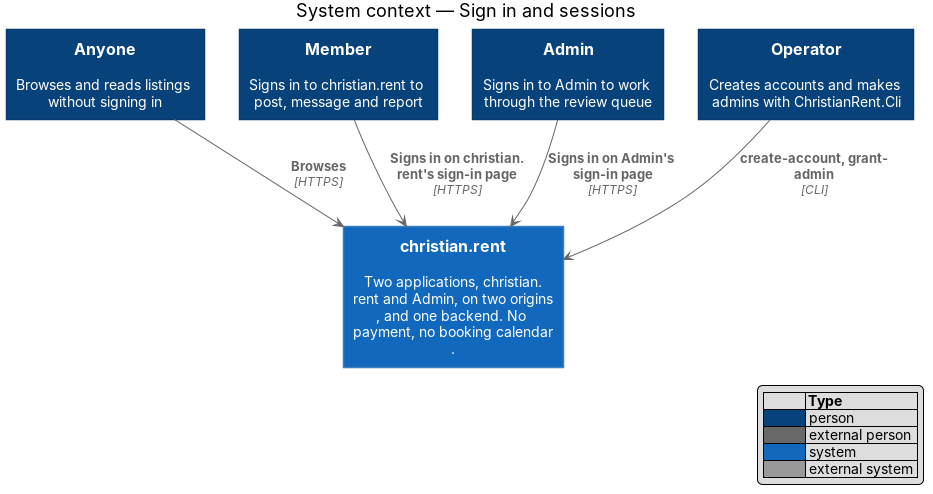
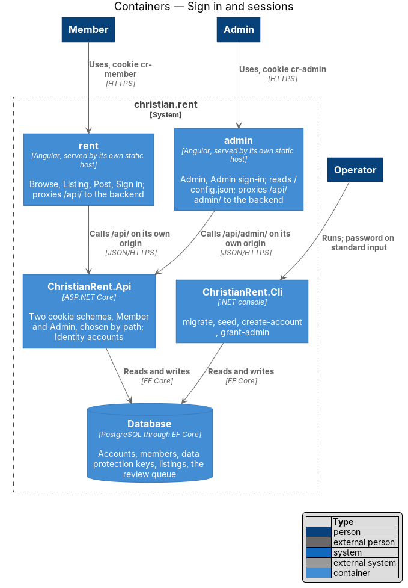
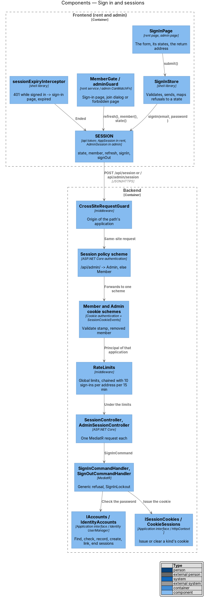
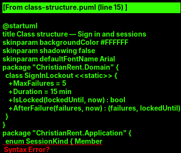
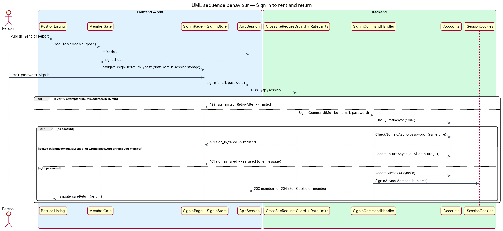
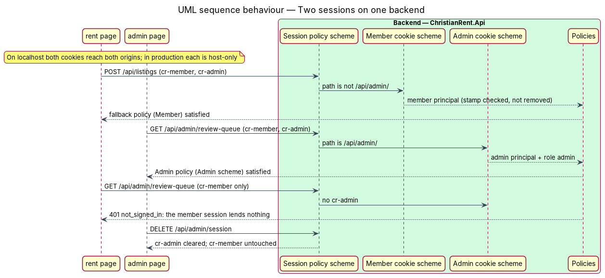
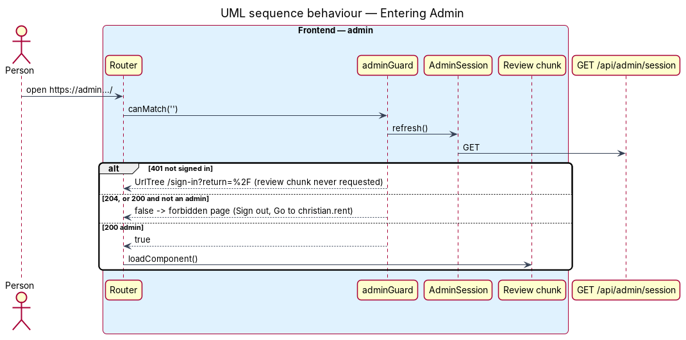

# Sign in and keep a session in each application

## Overview

christian.rent is two applications on two origins, `rent` and `admin`, and one backend
([ADR 0028](../../../adr/0028-two-applications-deployed-separately.md)). Each application has its
own sign-in page and its own session; signing in or out of one does nothing to the other, and the
backend refuses either session on the other's endpoints. Browsing, searching and reading a
listing need no sign-in.

- **account** — the email address and password hash an operator created, an ASP.NET Core
  Identity user; its opaque id is the `sub` claim
- **session** — the cookie of one application: `cr-member` for `rent`, `cr-admin` for Admin
- **session kind** — `Member` or `Admin`, chosen by the request's path
- **return address** — the path within the same application to go back to after sign-in
- **lockout** — 15 minutes without sign-in for an account after 5 refusals in a row
- **generic refusal** — the one answer, `sign_in_failed`, to every failed sign-in

The decisions are [ADR 0029](../../../adr/0029-sign-in-and-two-sessions.md). Sign-up, password
reset and change, email confirmation, other providers and multi-factor sign-in are not designed:
nobody can create their own account.

## Description

**Backend — accounts**

- `Account : IdentityUser` (`ChristianRent.Infrastructure/Identity`). `AppDbContext` becomes
  `IdentityUserContext<Account>` and `IDataProtectionKeyContext`; the migration
  `AddAccountsAndKeys` adds the Identity user tables and `DataProtectionKeys`.
- `AddIdentityCore<Account>()` with the EF stores: unique email as the user name; passwords of
  at least 12 characters with no composition rules; Identity's lockout off (`SignInLockout`
  replaces it, below).
- `IAccounts` (`ChristianRent.Application/Abstractions`) is what handlers use;
  `IdentityAccounts` implements it with `UserManager<Account>`. `CheckNothingAsync` verifies the
  password against a fixed hash so an unknown email takes as long as a known one.
- `ChristianRent.Cli create-account <email> [<member-id>]` reads one line, the password, from
  standard input and sends `CreateAccountCommand`: it creates the account or reports that it
  exists and changes nothing, then links the active member when given. Exit 1 for a password
  that breaks the rules, an unknown or inactive member, or a member linked to another account.

**Backend — signing in and out**

| Endpoint | Access | Answer |
|---|---|---|
| `POST /api/session` | anonymous | 200 member, 204 account that is not a member; sets `cr-member` |
| `DELETE /api/session` | anonymous | 204; clears `cr-member` |
| `GET /api/members/me` | member session | 200 member, 204 not a member, 401 |
| `POST /api/admin/session` | anonymous | 200 member (with `isAdmin`), 204; sets `cr-admin` |
| `DELETE /api/admin/session` | anonymous | 204; clears `cr-admin` |
| `GET /api/admin/session` | Admin session | 200 member, 204 not a member, 401 |
| `GET /api/admin/review-queue…` | Admin session, admin | as before (was `/api/review-queue`) |
| `GET /api/admin/photos/{id}/{rendition}` | Admin session, admin | the photo, as `GetPhotoQuery` decides |

- `SignInCommand(Kind, Email, Password)`: validated (email 1 to 256 characters, password 1 to
  1,024). The handler finds the account; with none it checks nothing and refuses. If
  `SignInLockout.IsLocked(account.LockedUntil, now)`, the password is wrong, or the account
  belongs to a removed member, it records the refusal (`SignInLockout.AfterFailure`) and
  refuses with `SignInRefusedException` (401 `sign_in_failed`). Otherwise it records a success,
  issues the cookie of `Kind` through `ISessionCookies`, and answers who is signed in with
  `GetCurrentMemberQuery`'s rule.
- `SignOutCommand(Kind)` clears that kind's cookie and nothing else.
- `SignInLockout` (`ChristianRent.Domain/Members`): 5 failures, 15 minutes, read from
  `TimeProvider` (L2-037, criterion 3).

| Failures before | Locked until before | Outcome | Failures after | Locked until after |
|---|---|---|---|---|
| 0 to 3 | none | wrong password | +1 | none |
| 4 | none | wrong password | 0 | now + 15 min |
| any | in the future | any password | unchanged | unchanged |
| any | in the past or none | right password | 0 | none |

**Backend — which session a request has**

- The default scheme `Session` is a policy scheme: a path under `/api/admin/` forwards to the
  cookie scheme `Admin`, any other to `Member`. `UseAuthentication` therefore resolves the
  application's own principal before `UseRateLimiter`, whose partition key stays `member_id`,
  or the remote address. An admin's requests are partitioned by their member id, apart from
  nobody else's.
- Policies name their scheme: the fallback `Member` and authenticated; `AdminSession` `Admin`
  and authenticated; `Admin` that and the role `admin`. So when both cookies arrive, as on
  `localhost`, only the one for the endpoint counts (L2-040, criterion 3).
- Cookies: `HttpOnly`, `SameSite=Strict`, `Path=/`, `Secure` and named `__Host-cr-member` and
  `__Host-cr-admin` outside development. `Sessions:MemberLifetime` (default 14 days, sliding,
  persistent) and `Sessions:AdminLifetime` (default 8 hours, absolute, browser session).
- `SessionCookieEvents.ValidatePrincipal` checks on each request that the account still has the
  stamp in the cookie and is not a removed member's; else it rejects and clears the cookie.
  `DeleteMembershipCommand` renews the stamp, so leaving ends every session of the account.
- `MemberClaimsTransformation` is unchanged: `member_id` and the role from the active member
  whose `SignInId` is the account id.

**Backend — abuse, origins and keys**

- `RateLimits` chains the global limiter with a sign-in limiter: `POST /api/session` and
  `POST /api/admin/session` are counted per remote address, 10 per 15 minutes; anything else
  passes it. A refusal is 429 `rate_limited` with `Retry-After`.
- `SiteOptions` gains `AdminOrigin`. `CrossSiteRequestGuard` refuses a data-changing request
  from another site by `Sec-Fetch-Site`, and one whose `Origin`, when sent, is not the origin of
  the path's application. Sign-in and sign-out are covered, which prevents login CSRF.
- Forwarded headers: `X-Forwarded-For` and `X-Forwarded-Proto` from `ForwardedHeaders:KnownProxies`
  only; `Host` is the public host each static host forwards, checked against `AllowedHosts`.
- `AddDataProtection().SetApplicationName("christian-rent").PersistKeysToDbContext<AppDbContext>()`.
- No log, span or metric carries the email, the password or a cookie: request bodies, headers
  and query strings are never recorded, and the handlers log no account detail.

**Frontend — `api`, `domain` and `shell`**

- `Session` (token `SESSION`): `state` (`unknown`, `signed-out`, `signed-in`), `member`,
  `refresh()`, `signIn(credentials)`, which rejects with an `ApiError`, `signOut()` and
  `expire()`. `SessionApi` (token `SESSION_API`): `me()`, `signIn()`, `signOut()`;
  `HttpMemberSessionApi` (`/api/members/me`, `/api/session`) and `HttpAdminSessionApi`
  (`/api/admin/session`).
- `domain/members`: `safeReturn(value)` keeps a path that starts with one `/` and is not `//` or
  `/\`, else `/`; `validateSignIn(form)` names the empty fields; `toSignInProblem(error)` maps a
  refusal to `refused`, `limited` (with `retryAt`) or `error`.
- `shell`: `SignInStore` (the form's state: `idle`, `submitting`, `refused`, `limited`, `error`,
  the errors and focus target), and `sessionExpiryInterceptor`, which, on a 401 `not_signed_in`
  answered to a request other than the session's own while `state()` is `signed-in`, calls
  `expire()`; each application's session then navigates to `/sign-in?return=<here>&expired=1`.

**Frontend — `rent`**

- `/sign-in` (lazy `SignInPage`), titled "Sign in". The header shows Post alone there. An already
  signed-in member is sent to the return address. Signing in navigates to `safeReturn(return)`.
- `AppSession` binds `SESSION`: 200 is a member, 204 signed in with no member, 401 signed out,
  a failure `unknown`. `signOut()` clears the drafts kept in the tab (`DraftStore`,
  `MessageDraftStore`), then the session; on Post it returns to Browse.
- `MemberGate.requireMember(purpose)`: a member goes on; signed out goes to
  `/sign-in?return=<current address>` and answers false; signed in without a member gets the
  join dialog, as before.
- `cr-site-header` takes `state` and `member`, and emits `signOut`; the sign-in link carries the
  current address as `return`.

**Frontend — `admin`**

- Routes: `''` with `canMatch: [adminGuard]` loading the review page; `''` again loading
  `ForbiddenPage`; `sign-in` loading the Admin sign-in page; `**` redirecting to `''`.
- `adminGuard` awaits `SESSION.refresh()`: `signed-out` → `/sign-in?return=<address>`;
  `signed-in` without `member()?.isAdmin` → `false`, so the forbidden page loads; an admin →
  `true`. A failure to ask shows the forbidden page's "We couldn't reach Admin." with "Try
  again" (L2-019, criterion 22). The review page's code and its requests start only after
  `true`.
- `AdminSession` binds `SESSION` over `HttpAdminSessionApi`; signing out navigates to
  `/sign-in`.

**Undecided**

- Sign-up, password reset and change, email confirmation, external providers, multi-factor
  sign-in: not designed.

### Mocks

- [`pages/sign-in/`](../../../mocks/pages/sign-in/default.html): default, invalid, submitting,
  refused, limited, error, expired
- [`pages/admin-sign-in/`](../../../mocks/pages/admin-sign-in/default.html): the same states
- [`pages/browse/signed-out.html`](../../../mocks/pages/browse/signed-out.html) and
  [`pages/browse/default.html`](../../../mocks/pages/browse/default.html): the header signed out
  and signed in
- [`pages/admin/forbidden.html`](../../../mocks/pages/admin/forbidden.html) and
  [`pages/admin/default.html`](../../../mocks/pages/admin/default.html): Admin's forbidden page
  and its navigation with Sign out

## Requirements

| L2 ID | Refines (L1) | Requirement |
|-------|--------------|-------------|
| `L2-037` | `L1-016`, `L1-011` | A member shall sign in on `rent`'s sign-in page with an email and password, be refused with one message that reveals nothing, be locked out after 5 refusals for 15 minutes, be throttled per address, and return to where they were with what they wrote kept, by a same-application relative path only. |
| `L2-038` | `L1-016`, `L1-007` | An admin shall sign in on Admin's own sign-in page; anyone not signed in to Admin shall get that page and no review queue data or code; a signed-in non-admin shall be told the page is for admins. |
| `L2-039` | `L1-016`, `L1-011` | Each application shall offer Sign out, which ends its own session only and clears what was kept in the tab. |
| `L2-040` | `L1-016`, `L1-011` | A member session shall last 14 days, sliding, and an Admin session 8 hours; an ended session shall lead to the sign-in page; neither session shall work on the other's endpoints; a removed member's session shall stop; cookies shall be `HttpOnly`, `Secure`, `SameSite=Strict`, and survive a restart. |
| `L2-025` | `L1-011` | Only the endpoints it names, sign-in and sign-out among them, shall answer anyone not signed in. |
| `L2-027` | `L1-011` | Sign-in and sign-out shall be refused from another site, and attempts throttled. |
| `L2-028` | `L1-011` | An account shall hold an email, a password hash, a stamp and its lockout; no log, metric or span shall hold an email, password or cookie. |

## Diagrams

### System context

### Containers

Two static hosts, each proxying its own `/api` paths to the one API.

### Components

### Class structure

### Behaviour — sign in to rent and return

### Behaviour — two sessions on one backend

### Behaviour — entering Admin

