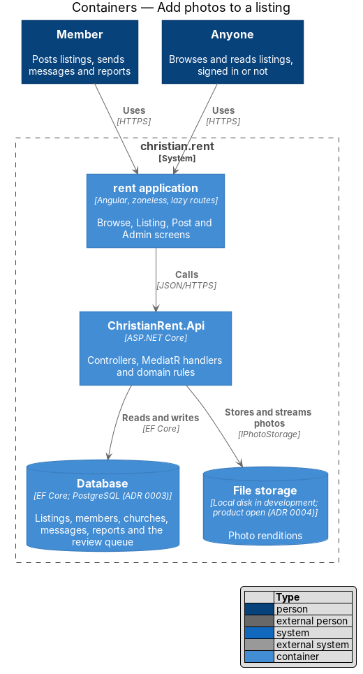
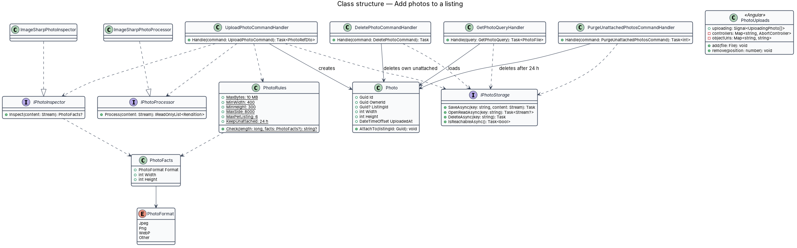
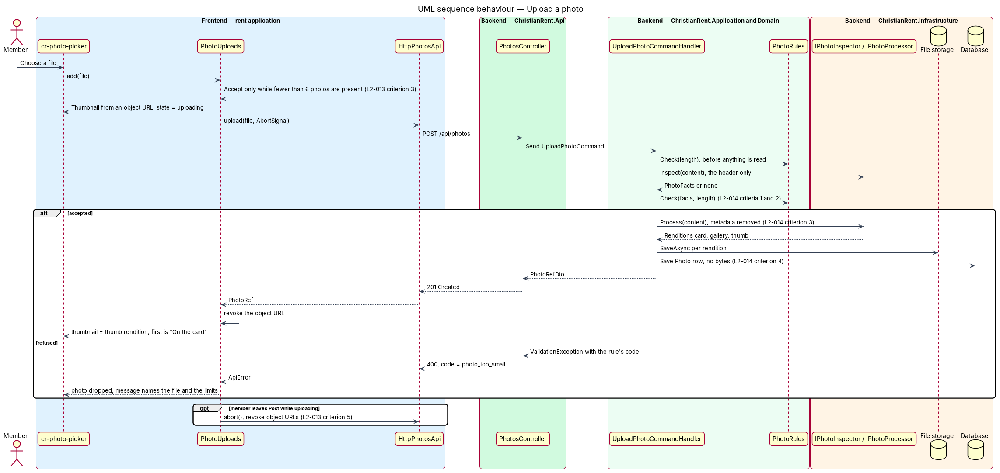

# Add photos to a listing

## Overview

A member can add up to 6 photos to a listing for rent. The first photo is the one the card
shows on Browse. A wanted listing has no photo. Each photo is checked by the backend before
it is stored: its real content type, its size and its dimensions. Its embedded metadata,
including location data, is removed. Photos are kept in file storage and served from there
at sizes fitted to where they appear.

- **photo** — image a member adds to a listing for rent
- **rendition** — copy of a photo re-encoded at one fitted size
- **file storage** — store for photo files, separate from the database
- **unattached photo** — uploaded photo not yet named by a published listing

The picker sits inside Post, designed in [compose-listing](../compose-listing/README.md).
Photos become part of a listing when it is published; see
[publish-listing](../publish-listing/README.md).

## Description

**Frontend**

- **`cr-photo-picker`** (`components`) — a list of thumbnails, each with a 44 px Remove
  button named "Remove photo {n}", the tag "On the card" on the first, an Add tile that
  opens the file chooser (`accept="image/jpeg,image/png,image/webp"`, one file at a time), and
  the count "1 of 6" of the photos that are in. A hint states the limits: "Up to 6. JPEG, PNG
  or WebP, 10 MB or less each. The first one is shown on the card." (L2-013, criterion 6). With
  6 photos added or uploading the Add tile is disabled and the hint becomes "That's all 6
  photos. Remove one to add another." (criterion 3). A thumbnail whose state is `uploading`
  shows a status named "Uploading photo {n}" and a button named "Cancel upload of photo {n}"
  (criterion 7). A refused file shows an alert under the list that names the file and the
  limits (L2-014, criterion 6); a file that could not be sent because christian.rent could not
  be reached shows one that names the file and says to try adding it again (L2-013,
  criterion 8). The photos already added stay. The file name is rendered as text. It takes
  `photos` (`PickerPhoto { key, url, uploading }`), `problem` (`PhotoProblem { file, reason }`)
  and `max` as inputs, and emits `chosen` (a `File`) and `remove` (a position). A thumbnail's
  text alternative is "Photo {n}", or "Photo {n}, uploading" (ADR 0021).
- **`PhotoUploads`** (`rent/src/app/pages/post/`) — service provided by the Post route. For
  the chosen file it creates an object URL for the immediate thumbnail and an
  `AbortController`, then calls `PHOTOS_API.upload(file, signal)`. It accepts no file while 6
  photos are added or uploading, and `PostListingCommandValidator` refuses a seventh (L2-013,
  criterion 3). Once a photo is in, its object URL is revoked and the thumbnail is the `thumb`
  rendition. Removing a photo that is in calls `PHOTOS_API.remove(id)`; cancelling one that is
  uploading aborts it. On `DestroyRef.onDestroy` it aborts every upload in flight and revokes
  every object URL, so leaving Post cancels uploads (criterion 5).
- **`PostStore`** — keeps `draft.photos` as `DraftPhoto { id, thumbUrl, cardUrl }`, the photos
  that are in, in order, written to `sessionStorage` with the rest of the draft (ADR 0019).
  `previewCard` uses the first one's `cardUrl`, so removing a photo updates the preview
  (criterion 2). A wanted draft keeps its photos but previews and posts none (criterion 9).
  Publishing sends the `id` values in order. `PhotoUploads` holds the photos still uploading.
- **`PhotosApi`** with the token **`PHOTOS_API`** — `upload(file, signal)` returns
  `PhotoRef { id, urls: { card, gallery, thumb } }`; `remove(id, signal)` deletes a photo no
  listing names. `HttpPhotosApi` is bound by the Post route.

**Backend**

- **`PhotosController`** — `POST /api/photos` (member required; one multipart field, `file`;
  request body limit 10 MB plus 64 KiB for the form; 201 with the `PhotoRefDto`),
  `DELETE /api/photos/{id}` (the uploader only, unattached only; 204) and
  `GET /api/photos/{id}/{rendition}` (`[AllowAnonymous]`). Each sends one MediatR request.
- **`UploadPhotoCommand`** — `{ Content: Stream, Length }`. The file name and the declared
  content type are not part of the command.
- **`UploadPhotoCommandHandler`** — requires a member, asks `IPhotoInspector.Inspect(stream)`
  only when the length is within the limit, applies `PhotoRules`, asks
  `IPhotoProcessor.Process(stream)` for the renditions, writes each through
  `IPhotoStorage.SaveAsync(key, stream)`, then saves a `Photo` row that holds the uploader, the
  dimensions and the time, and no image bytes (L2-014, criterion 4). A refusal is a
  `ValidationException` whose error code is the rule's, answered 400 with that `code`.
- **`Photo`** (`ChristianRent.Domain`) — `Id`, `OwnerId`, `ListingId` (null until a posted
  listing names it), `Width`, `Height`, `UploadedAt`. The renditions' keys follow from `Id`
  (ADR 0011).
- **`IPhotoInspector`** — reads the image header. It returns `PhotoFacts { Format, Width,
  Height }` or null for "not an image" (criterion 1). `ImageSharpPhotoInspector` implements it.
- **`PhotoRules`** (`ChristianRent.Domain`) — the table below, checked in its order, first match
  wins; each row has a direct test.

  | Rule | Refusal code |
  |---|---|
  | length at most 10 MB | `photo_too_large` |
  | format is JPEG, PNG or WebP by content | `photo_type_refused` |
  | at most 8,000 px on either side | `photo_dimensions_too_large` |
  | at least 400 × 300 px | `photo_too_small` |

- **`IPhotoProcessor`** — decodes and re-encodes the image into the renditions `card`
  800 × 600, `gallery` 1600 × 1200 and `thumb` 240 × 180, each a JPEG at quality 82, turned
  upright and cropped from the centre to fill 4:3. Every embedded profile (EXIF with its GPS,
  ICC, IPTC, XMP) is removed before encoding (criterion 3). The original file is not stored.
  `ImageSharpPhotoProcessor` implements it and processes at most 2 photos at a time.
- **`IPhotoStorage`** — `SaveAsync`, `OpenReadAsync`, `DeleteAsync`, `IsReachableAsync`.
  The implementation lives in `ChristianRent.Infrastructure`.
- **`DeletePhotoCommandHandler`** — deletes the caller's own photo that no listing names: its
  renditions, then its row. Anything else is `not_found` (L2-014, criterion 8).
- **`PostListingCommandHandler`** — attaches each `photoId` in order as a `ListingPhoto`, after
  checking that each is the member's own unattached `Photo`; otherwise `validation_failed` on
  `photoIds`, and nothing is saved.
- **`GetPhotoQueryHandler`** — serves the rendition with a long `Cache-Control` lifetime when
  an approved listing names the photo. Otherwise it serves it with `private, no-store` to the
  poster of the listing that names it, to an admin when a listing names it, and to the uploader
  of a photo no listing names; anyone else is answered `not_found` (criterion 5).
- **`PurgeUnattachedPhotosCommand`** — run hourly by `ChristianRent.Cli purge-photos`: deletes
  every photo no listing names that was uploaded more than 24 hours ago, files first (L2-014,
  criterion 7).

**Undecided**

- The control that reorders photos: L2-013, criterion 2 names reordering, and the mocks draw no
  control for it. Until one is drawn the photos stay in the order they were added (ADR 0021).
- Who writes the description that is a photo's text alternative; see
  [read-listing](../../listing/read-listing/README.md).
- The file storage product and its setting names (ADR 0004); the change that adds it
  documents its settings.

Decided in [ADR 0021](../../../adr/0021-uploading-photos-open-decisions.md): the image library
(ImageSharp), the renditions' format, the rules' order, who may read and delete a photo no
listing names, and that it is kept 24 hours.

### Mocks

The mocks are the source of truth for the UI of this feature. The states this design covers are:

- [`docs/mocks/pages/post/default.html`](../../../mocks/pages/post/default.html): one photo, marked "On the card"
- [`docs/mocks/pages/post/photo-uploading.html`](../../../mocks/pages/post/photo-uploading.html): an upload in progress
- [`docs/mocks/pages/post/photo-refused.html`](../../../mocks/pages/post/photo-refused.html): a refused file, with the limit named
- [`docs/mocks/pages/post/photo-failed.html`](../../../mocks/pages/post/photo-failed.html): a file that could not be sent, with the advice to try again
- [`docs/mocks/pages/post/photos-full.html`](../../../mocks/pages/post/photos-full.html): 6 photos; no more can be added
- [`docs/mocks/pages/listing/default.html`](../../../mocks/pages/listing/default.html): the gallery that shows the stored photos

## Requirements

The feature realizes the following level-2 (L2) requirements from
[`docs/specs/L2.md`](../../../specs/L2.md). Each L2 requirement refines a level-1 (L1)
requirement, cited by identifier. The table restates each requirement in `shall` form; the
acceptance criteria in the specification remain authoritative.

| L2 ID | Refines (L1) | Requirement |
|-------|--------------|-------------|
| `L2-013` | `L1-004` | A member shall be able to add up to 6 photos to a listing for rent, each with a thumbnail, the first shown on the card and marked "On the card". The photos field shall show the count and the limits. With 6 photos the Add button shall be off with a message. Removing photos shall update the preview; reordering waits for its mock. A listing for rent with no photo shall be accepted and show a placeholder image. An uploading photo shall show its state and a cancel button. Leaving Post shall cancel an upload in progress. A photo that cannot be sent shall be named with advice to try again, and photos shall survive a switch to wanted and back. |
| `L2-014` | `L1-004` | A photo shall be accepted only when its content is a JPEG, PNG or WebP image of at most 10 MB, at least 400 × 300 px and at most 8,000 px on either side. A refusal shall name the file and the limits. Embedded metadata shall be removed before storage. Photos shall be served from file storage at a fitted size, never from the database, and a photo of a listing that is not approved shall be served only to its poster or an admin. A photo no posted listing names shall be its uploader's alone and shall be deleted after 24 hours. |
| `L2-025` | `L1-011` | Every endpoint other than browsing, searching, reading an approved listing and serving its photos shall respond 401 to anyone not signed in. Listing the churches, joining and asking who is signed in shall not be refused for want of membership. The backend shall refuse a request for, or a change to, anything that is not the member's own, and shall reveal nothing about it. A refusal a screen branches on shall be a ProblemDetails with a `code`. |
| `L2-029` | `L1-012` | On a mid-range phone on 4G, Browse shall paint its largest content within 2.5 s with layout shift under 0.1. The code for Listing, Post and Admin shall not be in the initial download. A card's photo shall be sized to the card, reserve its space and load lazily below the fold. A control shall respond within 200 ms. |

## Diagrams

### System context

The people involved are: member, anyone. Each reaches the feature through christian.rent, which takes no payment and holds no booking calendar.

### Containers

The rent application calls `ChristianRent.Api` over JSON/HTTPS. The API persists state through EF Core and keeps photo files in file storage, outside the database.

### Components

`PhotoUploads` owns every upload and releases it with the route. On the backend, the upload
handler inspects the content, applies `PhotoRules`, and writes renditions through
`IPhotoStorage`; the database holds only the `Photo` row.

### Class structure

`PhotoRules` holds every limit as a constant. The two handlers depend on the three
infrastructure interfaces, so tests replace them with in-memory fakes. `Photo` records where
the files are and never the files themselves.

### Behaviour — upload a photo

The backend decides the type from the content (`L2-014`), refuses with a code that names
the limit, and stores only re-encoded renditions. Leaving Post aborts the request
(`L2-013`).

### Behaviour — serve a photo

A rendition streams from file storage. A photo of a listing that is not approved is served
only to its poster or an admin (`L2-014`).

