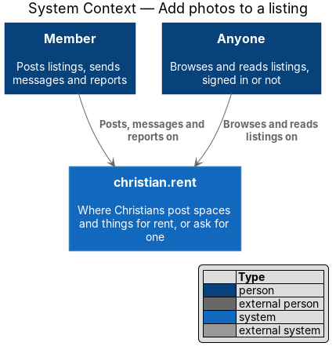
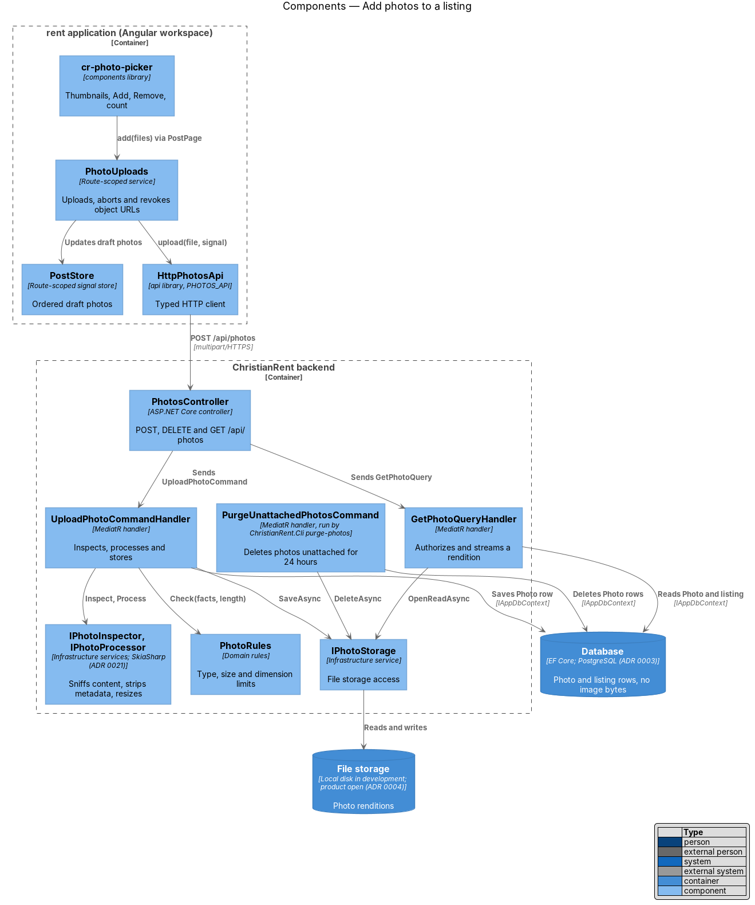
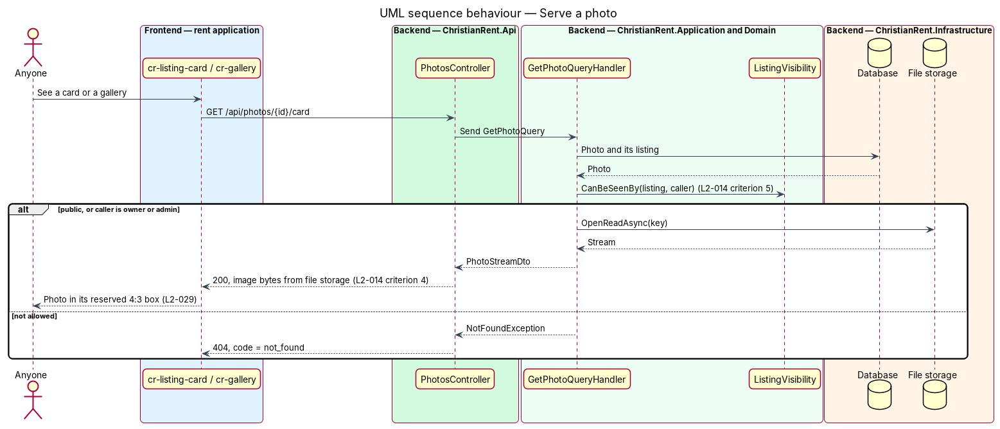

# Add photos to a listing

## Overview

A member can add up to 6 photos to a listing for rent. The first photo is the one the card
shows on Browse. A wanted listing has no photo. Each photo is checked by the backend before
it is stored: its real content type, its size and its dimensions. Its embedded metadata,
including location data, is removed. Photos are kept in file storage and served from there
at sizes fitted to where they appear.

- **photo** — image a member adds to a listing for rent
- **rendition** — copy of a photo re-encoded at one fitted size
- **file storage** — store for photo files, separate from the database
- **unattached photo** — uploaded photo not yet named by a published listing

The picker sits inside Post, designed in [compose-listing](../compose-listing/README.md).
Photos become part of a listing when it is published; see
[publish-listing](../publish-listing/README.md).

## Description

**Frontend**

- **`cr-photo-picker`** (`components`) — a list of thumbnails, each with a 44 px Remove
  button named "Remove photo {n}", the tag "On the card" on the first, an Add tile that
  opens the file chooser (`accept="image/jpeg,image/png,image/webp"`), and the count
  "1 of 6". A hint states the limits: "Up to 6. JPEG, PNG or WebP, 10 MB or less each. The
  first one is shown on the card." (L2-013, criterion 6). With 6 photos the Add tile is
  disabled and the hint becomes "That's all 6 photos. Remove one to add another."
  (criterion 3). A thumbnail in the state `uploading` shows a status named "Uploading photo
  {n}" and a button named "Cancel upload of photo {n}" (criterion 7). A refused file shows
  an alert under the list that names the file and the limits; the photos already added stay
  (L2-014, criterion 6). The file name is rendered as text. It takes `photos` as input and
  emits `add`, `remove`, `cancel` and `reorder`.
- **`PhotoUploads`** (`rent/src/app/post/`) — service provided by the Post route. For each
  chosen file it creates an object URL for the immediate thumbnail and an `AbortController`,
  then calls `PHOTOS_API.upload(file, signal)`. It accepts no file while 6 photos are
  present, and `PostListingCommandValidator` refuses a seventh (L2-013, criterion 3). On `DestroyRef.onDestroy` it aborts every upload in flight
  and revokes every object URL, so leaving Post cancels uploads (criterion 5).
- **`PostStore`** — keeps `draft.photos` as `DraftPhoto { localId, photoId, thumbUrl, state }`
  with `state`: `uploading`, `ready`, `refused`. `previewCard` uses the first `ready` photo,
  so removing or reordering updates the preview (criterion 2). Publishing sends the
  `photoId` values in order.
- **`PhotosApi`** with the token **`PHOTOS_API`** — `upload(file, signal)` returns
  `PhotoRef { id, urls }`; `remove(id)` deletes an unattached photo.

**Backend**

- **`PhotosController`** — `POST /api/photos` (member required; multipart; request body
  limit 10 MB plus form overhead), `DELETE /api/photos/{id}` (owner only, unattached only),
  and `GET /api/photos/{id}/{rendition}` (`[AllowAnonymous]`).
- **`UploadPhotoCommand`** — `{ Content: Stream, Length }`. The file name and the declared
  content type are not part of the command.
- **`UploadPhotoCommandHandler`** — asks `IPhotoInspector.Inspect(stream)`, applies
  `PhotoRules`, asks `IPhotoProcessor.Process(stream)` for the renditions, writes each
  through `IPhotoStorage.SaveAsync(key, stream)`, then saves a `Photo` row that holds keys
  and dimensions and no image bytes (L2-014, criterion 4).
- **`IPhotoInspector`** — reads the leading bytes and the image header. It returns
  `PhotoFacts { Format, Width, Height }` or "not an image" (criterion 1).
- **`PhotoRules`** (`ChristianRent.Domain`) — the table below; each row has a direct test.

  | Rule | Refusal code |
  |---|---|
  | format is JPEG, PNG or WebP by content | `photo_type_refused` |
  | length at most 10 MB | `photo_too_large` |
  | at least 400 × 300 px | `photo_too_small` |
  | at most 8,000 px on either side | `photo_dimensions_too_large` |

- **`IPhotoProcessor`** — decodes and re-encodes the image into the renditions `card`,
  `gallery` and `thumb`. Re-encoding from pixels drops EXIF, GPS and every other embedded
  block (criterion 3). The original file is not stored.
- **`IPhotoStorage`** — `SaveAsync`, `OpenReadAsync`, `DeleteAsync`, `IsReachableAsync`.
  The implementation lives in `ChristianRent.Infrastructure`.
- **`GetPhotoQueryHandler`** — loads the `Photo` and its listing. It serves the rendition
  when the listing is public, or when the caller is the photo's owner or an admin; otherwise
  it answers `not_found` (criterion 5). An unattached photo is served to its owner only.
  A photo of a public listing is served with a long `Cache-Control` lifetime; any other
  photo with `private, no-store`.

**Undecided**

- The control that reorders photos: L2-013 requires reordering, and the mocks draw no
  control for it. Its mock is `<TO SUPPLY>` before the frontend is built.
- Who writes the description that is a photo's text alternative; see
  [read-listing](../../listing/read-listing/README.md).
- The image library behind `IPhotoInspector` and `IPhotoProcessor`: `<TO SUPPLY>`.
- The pixel size and format of each rendition: `<TO SUPPLY>`; the card rendition matches
  the 4:3 card box (L2-029, criterion 3).
- The file storage product and its setting names: `<TO SUPPLY>`; the change that adds it
  documents its settings.
- How long an unattached photo is kept before a clean-up command deletes it: `<TO SUPPLY>`.

### Mocks

The mocks are the source of truth for the UI of this feature. The states this design covers are:

- [`docs/mocks/pages/post/default.html`](../../../mocks/pages/post/default.html): one photo, marked "On the card"
- [`docs/mocks/pages/post/photo-uploading.html`](../../../mocks/pages/post/photo-uploading.html): an upload in progress
- [`docs/mocks/pages/post/photo-refused.html`](../../../mocks/pages/post/photo-refused.html): a refused file, with the limit named
- [`docs/mocks/pages/post/photos-full.html`](../../../mocks/pages/post/photos-full.html): 6 photos; no more can be added
- [`docs/mocks/pages/listing/default.html`](../../../mocks/pages/listing/default.html): the gallery that shows the stored photos

## Requirements

The feature realizes the following level-2 (L2) requirements from
[`docs/specs/L2.md`](../../../specs/L2.md). Each L2 requirement refines a level-1 (L1)
requirement, cited by identifier. The table restates each requirement in `shall` form; the
acceptance criteria in the specification remain authoritative.

| L2 ID | Refines (L1) | Requirement |
|-------|--------------|-------------|
| `L2-013` | `L1-004` | A member shall be able to add up to 6 photos to a listing for rent, each with a thumbnail, the first shown on the card and marked "On the card". The photos field shall show the count and the limits. With 6 photos the Add button shall be off with a message. Removing or reordering photos shall update the preview. A listing for rent with no photo shall be accepted and show a placeholder image. An uploading photo shall show its state and a cancel button. Leaving Post shall cancel an upload in progress. |
| `L2-014` | `L1-004` | A photo shall be accepted only when its content is a JPEG, PNG or WebP image of at most 10 MB, at least 400 × 300 px and at most 8,000 px on either side. A refusal shall name the file and the limits. Embedded metadata shall be removed before storage. Photos shall be served from file storage at a fitted size, never from the database, and a photo of a listing that is not approved shall be served only to its poster or an admin. |
| `L2-025` | `L1-011` | Every endpoint other than browsing, searching, reading an approved listing and serving its photos shall respond 401 to anyone not signed in. Listing the churches, joining and asking who is signed in shall not be refused for want of membership. The backend shall refuse a request for, or a change to, anything that is not the member's own, and shall reveal nothing about it. A refusal a screen branches on shall be a ProblemDetails with a `code`. |
| `L2-029` | `L1-012` | On a mid-range phone on 4G, Browse shall paint its largest content within 2.5 s with layout shift under 0.1. The code for Listing, Post and Admin shall not be in the initial download. A card's photo shall be sized to the card, reserve its space and load lazily below the fold. A control shall respond within 200 ms. |

## Diagrams

### System context

The people involved are: member, anyone. Each reaches the feature through christian.rent, which takes no payment and holds no booking calendar.

### Containers

The rent application calls `ChristianRent.Api` over JSON/HTTPS. The API persists state through EF Core and keeps photo files in file storage, outside the database.

### Components

`PhotoUploads` owns every upload and releases it with the route. On the backend, the upload
handler inspects the content, applies `PhotoRules`, and writes renditions through
`IPhotoStorage`; the database holds only the `Photo` row.

### Class structure

`PhotoRules` holds every limit as a constant. The two handlers depend on the three
infrastructure interfaces, so tests replace them with in-memory fakes. `Photo` records where
the files are and never the files themselves.

### Behaviour — upload a photo

The backend decides the type from the content (`L2-014`), refuses with a code that names
the limit, and stores only re-encoded renditions. Leaving Post aborts the request
(`L2-013`).

### Behaviour — serve a photo

A rendition streams from file storage. A photo of a listing that is not approved is served
only to its poster or an admin (`L2-014`).

