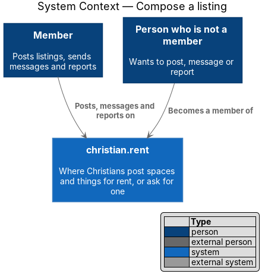
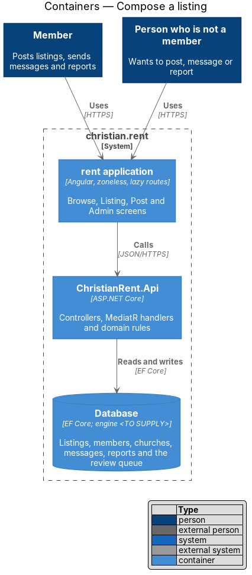
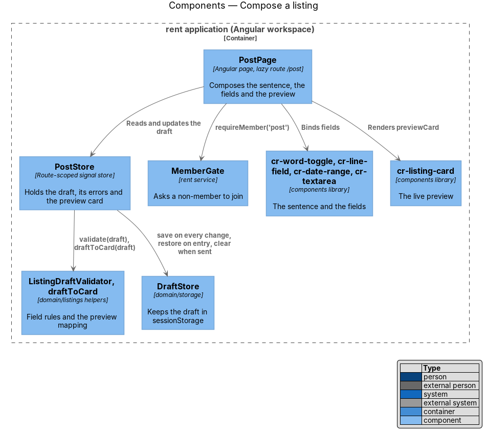
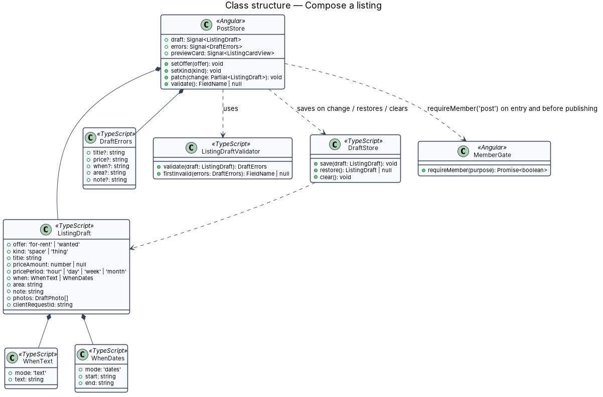
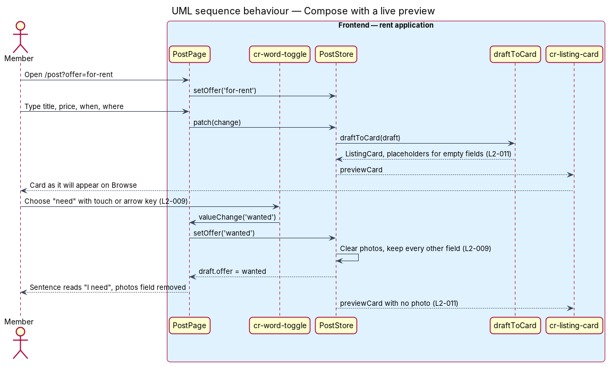
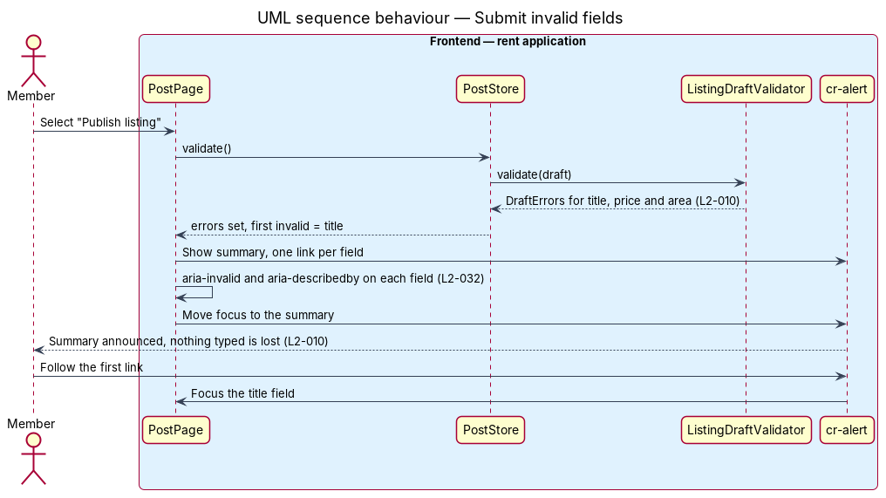

# Compose a listing

## Overview

Post, at `/post`, is where a member writes a listing. It opens with one sentence, "I have /
need a space / a thing to rent out". Both words of each pair show, and the chosen one is
highlighted. "I have" makes a listing for rent; "I need" makes a wanted listing. A few fields follow, and a live preview
shows the card as it will appear on Browse.

- **draft** — listing being written, held in the browser until it is published
- **offer** — whether the draft is for rent or wanted
- **kind** — whether the draft is for a space or a thing
- **when** — description of availability, as free text or as a start and end date; it is
  not a reservation
- **live preview** — listing card rendered from the draft on every change

This feature covers the draft, its rules and its preview, and involves no request that
changes data. Sending the draft is designed in
[publish-listing](../publish-listing/README.md), photos in
[add-photos](../add-photos/README.md), and the membership prompt in
[become-member](../../members/become-member/README.md).

## Description

**Frontend — `rent` application**

- **`PostPage`** (`rent/src/app/post/post-page.ts`, selector `cr-post-page`) — lazy page for
  `/post`. It provides `PostStore`. It reads the query parameters `offer` (`for-rent` or
  `wanted`) and `title`, which Browse sets (L2-004, L2-005). The `post-layout` block puts the
  preview under the form below 768 px and beside it from 768 px (L2-031, criterion 4).
- **`PostStore`** — route-scoped signal store. `draft` is a `ListingDraft` signal;
  `errors` is a `DraftErrors` signal; `previewCard` is a `computed` that maps the draft
  through `draftToCard`. `setOffer('wanted')` clears the photo list and keeps every other
  field; `setKind()` changes only the kind (L2-009, criteria 1 and 2). `validate()` runs
  `ListingDraftValidator` and sets every error at once. `PostPage` then moves focus to the
  error summary (L2-010, criterion 8). The draft is never reset by a failed validation.
- **`MemberGate`** — on entry, `PostPage` asks `MemberGate.requireMember()`. For a person
  who is not a member it saves the draft through `DraftStore`, opens the Join dialog, and
  restores the draft afterwards (L2-009, criterion 4).

**Frontend — `domain` library**

- **`ListingDraft`** — `{ offer, kind, title, priceAmount, pricePeriod, when, area, note,
  photos, clientRequestId }`. `when` is `{ mode: 'text'; text }` or
  `{ mode: 'dates'; start; end }`. A new draft has the kind `thing` and "when" in the mode
  `text` (L2-009, criterion 6; L2-010, criterion 10).
- **`ListingDraftValidator`** (`domain/listings/`) — pure function from a draft to
  `DraftErrors`. Its rules are the table below, with one unit test per row.
- **`draftToCard`** — maps a draft to a `ListingCard`. An empty title, price or area becomes
  the placeholder "Your listing title", "Price" or "Your area", never "undefined" and never
  an empty price (L2-011, criterion 3). A price of 0 becomes "Free". A wanted draft maps to a
  card with no photo. The card takes the church name, and for a wanted draft the poster's
  name, from `SESSION.member()`, and has no distance (criterion 4). A draft for rent with no
  photo maps to the placeholder image named "No photo yet" (criterion 5).
- **`DraftStore`** (`domain/storage/`) — reads and writes the draft in `sessionStorage`
  under the key `cr.post.draft`. Photos are kept by identifier only. Storage content is
  parsed as data and validated before use.

| Field | Rule | Error code |
|---|---|---|
| title | 3 to 80 characters after trimming | `title_length` |
| price, for rent | required; 0 to 100,000; at most 2 decimals | `price_required`, `price_range` |
| price, wanted | optional; 0 to 100,000 when given | `price_range` |
| price period | hour, day, week or month; required with a price | `period_required` |
| when, text | required; at most 80 characters | `when_required`, `when_length` |
| when, dates | start and end required; end on or after start | `when_required`, `when_order` |
| area | required; at most 80 characters | `area_required` |
| note | optional; at most 1,000 characters | `note_length` |

The 80-character limit on the area is a design choice; the requirement names no limit, and
L1 lists it as not yet decided. "When" is required because Post labels only the note and the
budget "Optional" (L2-010, criteria 11 and 12).

**Frontend — `components` library**

- **`cr-word-toggle`** — a radio group of two words ("have / need", "a space / a thing").
  Both words show and the checked one is highlighted. Each word is a radio input with a
  visible label; the group has the accessible name "Do you have it or need it?" or "A space
  or a thing?"; the arrow keys move between the words (L2-009, criterion 3).
- **`cr-line-field`** — the large single-line fields: title (`maxlength` 80), price with its
  prefix and period select, when (`maxlength` 80), and "Where" with the hint "A city or
  neighbourhood in Canada. Never a street address." (L2-010, criterion 13). An optional
  field carries the label "Optional" (criterion 11).
- **`cr-date-range`** — start and end date inputs with a line that reads the range in words.
  "Give dates instead" under the text field switches to it; "Describe it in words instead"
  switches back (criterion 10).
- **`cr-textarea`** — the note, labelled "Anything else?" and "Optional", with a counter
  "55 / 1,000" (criterion 15).

The offer decides the copy (L2-009, criterion 5):

| | For rent ("have") | Wanted ("need") |
|---|---|---|
| sentence ends | "to rent out." | "to rent." |
| title label | "What is it?" | "What do you need?" |
| price label and prefix | "Price", "$" | "Your budget", "Optional", "Up to $" |
| photos field | shown | removed |
| submit button | "Publish listing" | "Post request" |

- **`cr-alert`** — the error summary. Each entry is a link that moves focus to its field;
  each field's error is tied to it with `aria-describedby` and `aria-invalid`
  (L2-032, criterion 5).
- **`cr-listing-card`** — the preview under the heading "How it'll look", the same component
  Browse uses (L2-011).

Post has no field for a payment, a deposit or a card (L2-024).

**Backend**

The backend applies the same rules when the draft is published; see
`PostListingCommandValidator` in [publish-listing](../publish-listing/README.md).

**Undecided**

- How an area is confirmed to be a place in Canada (L2-022, criterion 5): the source of
  place names is `<TO SUPPLY>`.
- Whether a start date in the past is refused for "when": the requirement names only the
  order of the two dates.

### Mocks

The mocks are the source of truth for the UI of this feature. The states this design covers are:

- [`docs/mocks/pages/post/default.html`](../../../mocks/pages/post/default.html): a filled draft for rent with its preview
- [`docs/mocks/pages/post/blank.html`](../../../mocks/pages/post/blank.html): an empty draft; placeholders in the preview
- [`docs/mocks/pages/post/need.html`](../../../mocks/pages/post/need.html): "I need": no photos field, optional budget
- [`docs/mocks/pages/post/dates.html`](../../../mocks/pages/post/dates.html): "when" as a start and end date
- [`docs/mocks/pages/post/invalid.html`](../../../mocks/pages/post/invalid.html): every invalid field marked, with a summary
- [`docs/mocks/dialogs/join/default.html`](../../../mocks/dialogs/join/default.html): the membership prompt over Post

## Requirements

The feature realizes the following level-2 (L2) requirements from
[`docs/specs/L2.md`](../../../specs/L2.md). Each L2 requirement refines a level-1 (L1)
requirement, cited by identifier. The table restates each requirement in `shall` form; the
acceptance criteria in the specification remain authoritative.

| L2 ID | Refines (L1) | Requirement |
|-------|--------------|-------------|
| `L2-009` | `L1-003` | Post shall open with the sentence "I have / need a space / a thing to rent out", with both words of each pair shown and the chosen one highlighted. Switching "have" to "need" shall make a wanted listing, remove the photos field and change the sentence, the field labels and the button. Each word shall be a named control with a selected state. "A thing" shall be chosen when no kind is given. A person who is not a member shall be asked to become a member or sign in and shall return to Post with their choices kept. |
| `L2-010` | `L1-003` | A listing shall have a title (3 to 80 characters), a price (0 to 100,000, per hour, day, week or month; optional when wanted and then shown as "Up to"), when (required; free text of up to 80 characters or a start and end date), an area (labelled "Where"), photos (for rent only) and an optional note of up to 1,000 characters. Optional fields shall be labelled "Optional". Every invalid field shall be marked at once, and focus shall move to a summary that lists them. The backend shall refuse invalid fields with the same rules. |
| `L2-011` | `L1-003` | The preview card on Post shall update on every field change to show the listing as it will appear on Browse. A wanted listing shall preview with no photo. An empty field shall show a placeholder. The preview shall carry the member's church, the member's name when wanted, and no distance. |
| `L2-022` | `L1-009` | Prices shall be shown in Canadian dollars with their period, with cents only when not zero and a thousands separator. Distances shall be in kilometres. Dates shall write the month as a word, ranges shall use "to", and times shall be in 12-hour form. Copy shall use Canadian spelling. An area shall be a place in Canada. |
| `L2-024` | `L1-010` | No screen shall offer a way to pay, take a deposit or enter a card. A listing shall show no booking calendar, review, rating or advert. A message with dates shall not change the listing's availability or reserve anything. |
| `L2-031` | `L1-013` | No screen shall be cut off or scroll sideways from 320 px. Browse shall show one column of cards under 576 px, two from 576 px, three from 768 px and four from 1200 px, with wider gutters from 992 px. From 768 px the message box, the live preview and the Admin detail panel shall sit beside their main column; below it they shall sit under it, and Admin shall show only the queue and a note that deciding needs a wider screen. A dialog shall be a bottom sheet under 640 px. Every touch target shall be at least 44 × 44 px. |
| `L2-032` | `L1-014` | Every screen shall meet WCAG 2.2 level AA. Every action shall be completable by keyboard with visible focus. A state shall be carried by text or an announced attribute, never by colour alone. Confirmations and errors shall be announced. Every field shall have a visible label with its error tied to it. Reduced motion shall be honoured, and text at 200% shall lose nothing. "Skip to content" shall be the first control, and a dialog shall hold focus and return it on close. |

## Diagrams

### System context

The people involved are: member, person who is not a member. Each reaches the feature through christian.rent, which takes no payment and holds no booking calendar.

### Containers

The rent application calls `ChristianRent.Api` over JSON/HTTPS. The API persists state through EF Core.

### Components

The slice lives in the browser. `PostPage` binds the fields to `PostStore`, which validates
and maps the draft with pure helpers from the `domain` library. `MemberGate` uses
`DraftStore` to keep the draft across the Join dialog.

### Class structure

`PostStore` owns one `ListingDraft` and its `DraftErrors`. `ListingDraftValidator` is a pure
type with no Angular dependency, so each rule has a direct unit test.

### Behaviour — compose with a live preview

Switching "have" to "need" removes the photos field and keeps the other fields (`L2-009`).
Each change recomputes the preview card (`L2-011`).

### Behaviour — submit invalid fields

A submission with invalid fields sends no request. Every invalid field is marked at once,
focus moves to the summary, each link of the summary moves focus to its field, and the draft
is kept (`L2-010`).

