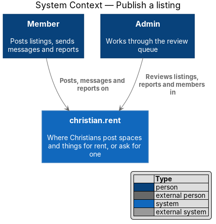
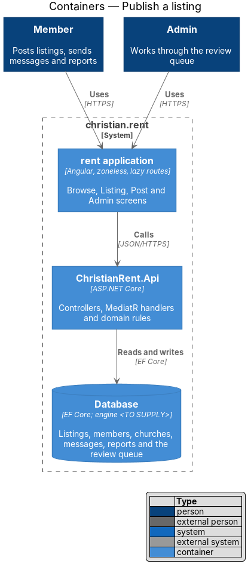
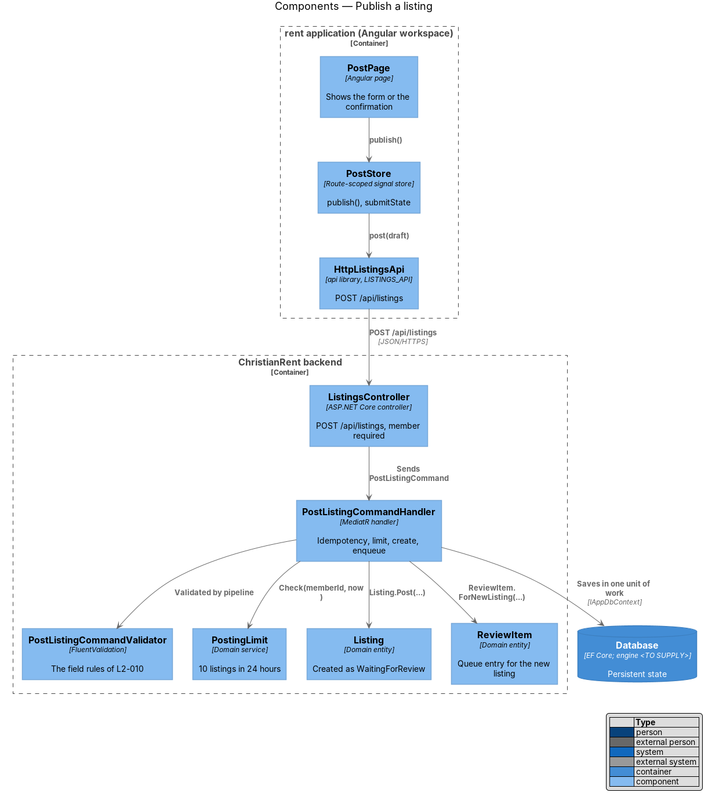
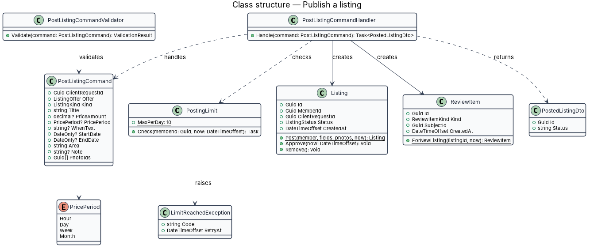
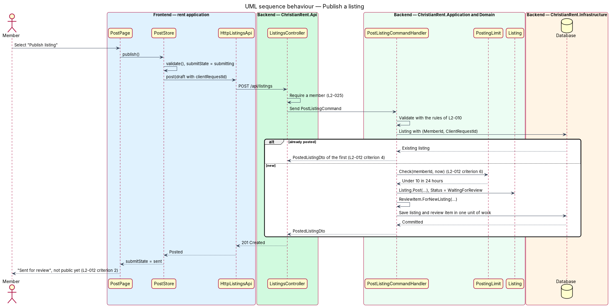
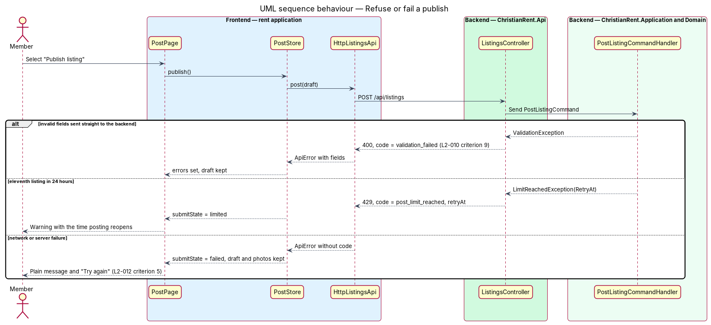

# Publish a listing

## Overview

Publishing sends a finished draft to the backend. The backend checks it with the same rules
as the form, saves it as a listing that is **waiting for review**, and adds an item to the
review queue. The member sees a confirmation that says the listing will appear once an admin
has looked at it. The listing becomes public only when an admin approves it.

- **waiting for review** — first status of a listing; it is visible to its poster and to
  admins only
- **review item** — entry in the review queue that asks an admin for a decision
- **client request identifier** — identifier the browser creates once per draft, which lets
  the backend recognize a repeated submission
- **posting limit** — at most 10 listings per member in any 24 hours

The form and its client-side rules are designed in
[compose-listing](../compose-listing/README.md); the admin's decision in
[decide-review-item](../../review/decide-review-item/README.md).

## Description

**Frontend**

- **`PostStore.publish()`** — runs `validate()`, then calls `LISTINGS_API.post(draft)`. The
  store holds `submitState`: `idle`, `submitting`, `sent`, `failed`, `limited`. While
  `submitting`, the button is `aria-disabled` and shows `cr-spinner`, and a second
  activation is ignored. The draft's `clientRequestId` is created once with
  `crypto.randomUUID()` and is sent on every attempt, so "Try again" repeats the same
  request (L2-012, criteria 4 and 5).
- **`cr-confirmation`** — replaces the form when `submitState` is `sent`. It shows "Sent
  for review", the preview card, "Back to browsing" and "Post another". It does not say the
  listing is public (L2-012, criterion 2). `LiveAnnouncer` announces it. `DraftStore.clear()`
  then runs.
- **`cr-alert`** — on `failed`, a plain message with "Try again" above the kept form; on
  `limited`, a warning that names when posting reopens, from `retryAt`.
- **`HttpListingsApi.post()`** — `POST /api/listings`. It maps a ProblemDetails to
  `ApiError { status, code, retryAt, fields }`.

**Backend**

- **`ListingsController.Post`** — `POST /api/listings`. It requires a member (fallback
  policy), sends one `PostListingCommand`, and returns `201 Created` with
  `PostedListingDto { Id, Status }`.
- **`PostListingCommand`** — `{ ClientRequestId, Offer, Kind, Title, PriceAmount?,
  PricePeriod?, WhenText?, StartDate?, EndDate?, Area, Note?, PhotoIds[] }`.
- **`PostListingCommandValidator`** — FluentValidation rules equal to the table in
  [compose-listing](../compose-listing/README.md), plus: `PhotoIds` empty for a wanted
  listing and at most 6 for rent. `ValidationBehavior` runs it before the handler, and a
  failure is a 400 ProblemDetails with the code `validation_failed` and an `errors` map
  (L2-010, criterion 9).
- **`PostListingCommandHandler`** — in order:
  1. reads the caller from `ICurrentMember`; a removed member is refused with `not_a_member`;
  2. looks up a listing with the same `(MemberId, ClientRequestId)` and returns it when
     found, so a double submission creates one listing (L2-012, criterion 4);
  3. asks `PostingLimit.Check(memberId, now)`; when 10 listings exist in the last 24 hours
     it raises `LimitReachedException` with `RetryAt`, returned as 429 with the code
     `post_limit_reached` (criterion 6);
  4. loads the photos named by `PhotoIds` and refuses any that the member does not own;
  5. calls `Listing.Post(...)`, which creates the listing with `Status = WaitingForReview`;
  6. adds `ReviewItem.ForNewListing(listing.Id, now)`;
  7. saves both in one `SaveChangesAsync` (criterion 1).
- **`PostingLimit`** — domain service. `RetryAt` is the creation time of the member's tenth
  most recent listing plus 24 hours. It reads the clock from `TimeProvider`.
- **`Listing.Post`** — factory on the domain entity. It sets `SearchText`, `CreatedAt` and
  the ordered `ListingPhoto` rows.
- A unique index on `(MemberId, ClientRequestId)` backs step 2 in a relational database.

**Tests**

The acceptance test posts through the API on EF Core InMemory and asserts the listing is
absent from `GET /api/listings` until approved. `PostListingCommandValidator` and
`PostingLimit` each have a direct test, one case per row, with `FakeTimeProvider`.

### Mocks

The mocks are the source of truth for the UI of this feature. The states this design covers are:

- [`docs/mocks/pages/post/submitting.html`](../../../mocks/pages/post/submitting.html): the request is in flight
- [`docs/mocks/pages/post/success.html`](../../../mocks/pages/post/success.html): "Sent for review" for a listing for rent
- [`docs/mocks/pages/post/success-wanted.html`](../../../mocks/pages/post/success-wanted.html): "Sent for review" for a wanted listing
- [`docs/mocks/pages/post/error.html`](../../../mocks/pages/post/error.html): the request failed; everything is kept
- [`docs/mocks/pages/post/limited.html`](../../../mocks/pages/post/limited.html): the posting limit, with the time posting reopens

## Requirements

The feature realizes the following level-2 (L2) requirements from
[`docs/specs/L2.md`](../../../specs/L2.md). Each L2 requirement refines a level-1 (L1)
requirement, cited by identifier. The table restates each requirement in `shall` form; the
acceptance criteria in the specification remain authoritative.

| L2 ID | Refines (L1) | Requirement |
|-------|--------------|-------------|
| `L2-010` | `L1-003` | A listing shall have a title (3 to 80 characters), a price (0 to 100,000, per hour, day, week or month; optional when wanted), when (free text of up to 80 characters or a start and end date), an area, photos (for rent only) and an optional note of up to 1,000 characters. Every invalid field shall be marked at once. The backend shall refuse invalid fields with the same rules. |
| `L2-012` | `L1-003` | A valid submission shall save the listing as waiting for review, add it to the review queue and show a confirmation that does not say the listing is public. A double submission shall create one listing. A failed request shall keep everything entered and offer "Try again". An eleventh listing in 24 hours shall be refused with the time posting reopens. |
| `L2-025` | `L1-011` | Every endpoint other than browsing, searching and reading an approved listing shall respond 401 without a signed-in member. The backend shall refuse a request for, or a change to, anything that is not the member's own, and shall reveal nothing about it. A refusal a screen branches on shall be a ProblemDetails with a `code`. |
| `L2-026` | `L1-011` | A title, note, message, member name or church name shall be rendered as text wherever it is shown. Every input shall be validated for type, length and range before use, and database access shall be parameterised. Every response shall carry a Content-Security-Policy that allows no inline script and no third-party script. |

## Diagrams

### System context

The people involved are: member, admin. Each reaches the feature through christian.rent, which takes no payment and holds no booking calendar.

### Containers

The rent application calls `ChristianRent.Api` over JSON/HTTPS. The API persists state through EF Core.

### Components

`PostStore` sends the draft once per `clientRequestId`. The handler validates, checks the
posting limit, creates the `Listing` and its `ReviewItem`, and commits both together.

### Class structure

`PostListingCommand` mirrors the draft. The handler depends on `PostingLimit` and creates
one `Listing` and one `ReviewItem`. `LimitReachedException` carries the time posting
reopens.

### Behaviour — publish a listing

The handler recognizes a repeated `clientRequestId`, checks the posting limit, and commits
the listing and its review item together (`L2-012`). The confirmation states that the
listing is not public yet.

### Behaviour — refuse or fail a publish

The three refusals a screen branches on each carry a `code` (`L2-025`). In every branch the
draft, including photos already added, stays in `PostStore` (`L2-012`).

