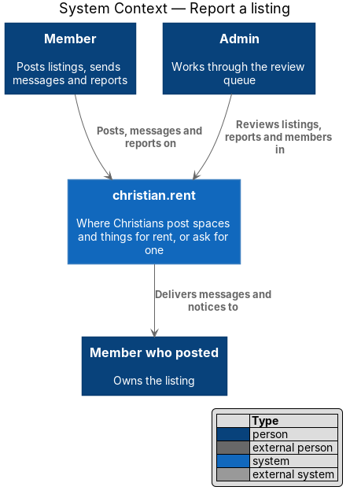
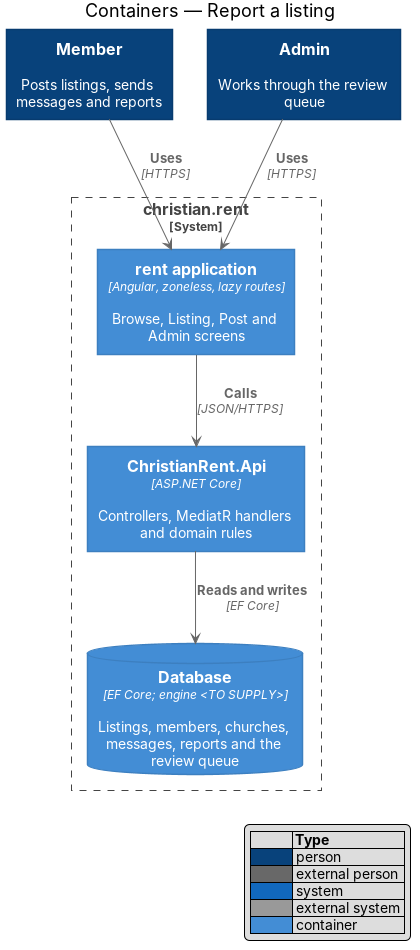
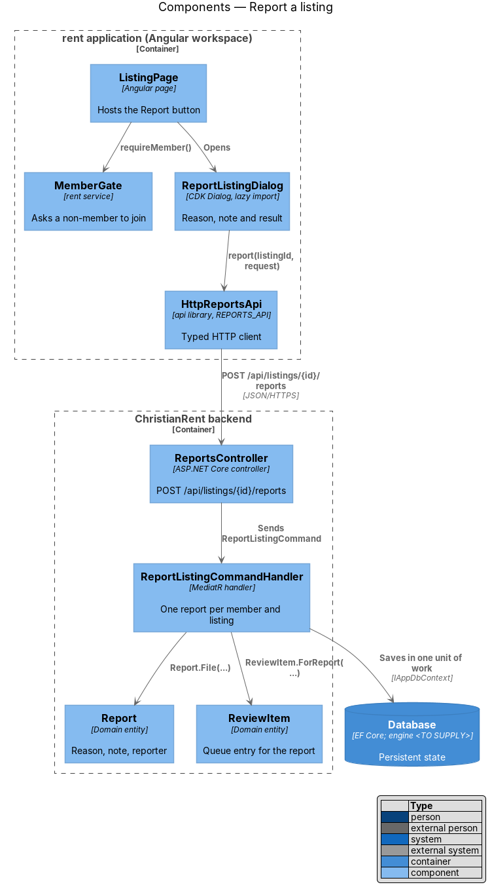
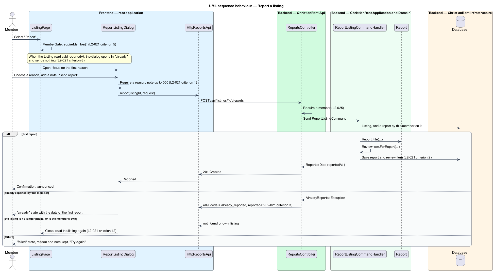

# Report a listing

## Overview

A member who sees a listing that does not belong on christian.rent can report it. The
Report button on the Listing screen opens a dialog with a fixed list of reasons and an
optional note. The report enters the review queue, where an admin keeps or removes the
listing. The member who posted the listing is never told who reported it.

- **report** — member's complaint about one listing
- **reason** — one of: not a real listing, inappropriate, a scam, something else
- **reporter** — member who sends the report
- **open report** — report that has no admin decision yet

The admin's side is designed in
[decide-review-item](../../review/decide-review-item/README.md).

## Description

**Frontend — `rent` application**

- **Report button** — in the `listing-toolbar` of `ListingPage`, shown once the listing has
  loaded. It is not shown on the member's own listing (L2-021, criterion 10); the handler
  refuses a report on it with `own_listing`. Selecting it calls
  `MemberGate.requireMember('report')` (L2-021, criterion 5), then imports and opens
  `ReportListingDialog`. While that is under way a second press does nothing, and leaving the
  screen first opens nothing. The dialog is opened with the page's injector, so it reads the
  Listing route's `REPORTS_API`. It closes with a `ReportOutcome`: when the member's report
  was filed (`reportedAt`), or that the listing changed. The page then keeps the time in
  `ListingStore.markReported`, or reads the listing again with `ListingStore.load`
  (criterion 12).
- **`ReportListingDialog`** (`rent/src/app/report/`, selector `cr-report-listing-dialog`) —
  CDK dialog with the states `default`, `busy`, `invalid`, `failed`, `success`, `already`.
  Its text says "An admin will look at it. {name} is never told who reported." (criterion
  6). Focus starts on the first reason and stays inside the dialog; Escape and Close return
  it to the Report button (L2-032, criterion 9). Under 640 px it is a bottom sheet.
  Submitting without a reason sends nothing, marks the group invalid with "Choose a
  reason." and moves focus to the first reason (criterion 7). In `busy` the button carries
  `aria-busy`, the reasons are disabled, the note is read-only, Cancel and Close are off and
  Escape does nothing; in `failed` the reason and note stay and the button reads "Try again"
  (criterion 9). `success` shows "Thanks. Your report was sent." with "Done"; `already` says
  the earlier report, with its date, is with an admin (criterion 8), with "OK, close". In
  `success` and `already` focus moves to that button, and a status line in the dialog
  announces the title and the text (L2-032, criterion 4). When the listing was reported
  before it is selected, the dialog opens in `already` and sends nothing. Its code loads only
  when it is opened.
- **`ReportStore`** — provided by the dialog: the reason, the note, the errors once the member
  has tried to send, and the state. It sends through `REPORTS_API`, answers `already` for
  `already_reported`, and asks the dialog to close for `not_found` and `own_listing`. Closing
  the dialog aborts a request in flight.
- **`ReportsApi`** with the token **`REPORTS_API`** —
  `report(listingId, { reason, note }, signal)`, answering `{ reportedAt }`. The Listing
  route binds the token to `HttpReportsApi`.

**Frontend — `domain` and `api` libraries**

- **`report-form`** (`domain/listings/`) — `REPORT_REASONS` (the four, with their words),
  `validateReport`, `toReportRequest` (the cleaned note, or null) and `formatReportDate`
  ("Jun 6, 2026", the browser's local date).
- **`ApiError`** gains `reportedAt`, read from the refusal's extension.

**Frontend — `components` library**

- **`cr-radio-group`** — the four reasons, one choice, its legend the question with
  "Required" for a screen reader; its error is tied to the group and announced.
- **`cr-textarea`** — the note, with the counter "63 / 500".
- **`cr-dialog`** — gains an optional icon in its head (`dialog__icon--info`) for `success`
  and `already`; **`cr-alert`** draws the failure.

**Backend**

- **`ReportsController.Report`** — `POST /api/listings/{listingId}/reports`, member
  required. It sends one `ReportListingCommand` and answers `201 Created` with
  `ReportedDto { reportedAt }`.
- **`ReportListingCommand`** — `{ ListingId, Reason, Note? }`. `ListingId` and `Reason` are
  the request's text, so an unknown one is answered by the rules and not by model binding.
- **`ReportListingCommandValidator`** — `Reason` is one of `fake`, `inappropriate`, `scam`
  and `other` (`ReportWords`); `Note`, as `ReportText` cleans it, is at most 500 characters
  and holds no control character but a line break or a tab (L2-021, criterion 1; ADR 0023).
- **`ReportListingCommandHandler`** — needs a member; loads the listing through
  `PublicListings`, so one that is not public answers `not_found` to anyone; refuses the
  member's own with `own_listing` (criterion 11). When a report by the same member on the
  same listing exists, it creates nothing and raises `AlreadyReportedException`, returned as
  409 with the code `already_reported` and `reportedAt`, the time of the first report
  (criterion 3). Otherwise it creates `Report.File(listing, reporter, reason, note, now)` and
  `ReviewItem.ForReport(report.Id, now)` and saves both together (criterion 2). When the save
  fails because another report by the member arrived first, it answers `already_reported`.
- **`Report`** — `{ Id, ListingId, ReporterId, Reason, Note, CreatedAt, Status }` with
  `Status`: `Open` or `Closed`. A unique index on `(ListingId, ReporterId)` backs the
  one-report rule in a relational database. Journey 11 closes reports.
- **`GetListingQueryHandler`** — adds `ReportedAt`, the caller's own report of the listing,
  to `ListingDetailDto`; null for everyone else (criterion 8; ADR 0023).
- **Reporter privacy** — `ReporterId` appears in no DTO. `ReportDetailDto`, shown to an
  admin (journey 10), holds the reason, the note and the time; the panel reads "by a member"
  (L2-019, criterion 8). `IMemberNotifier.ListingRemovedAsync` takes no report (criterion 4).
- **`PurgeDepartedMembersCommand`** — clears the note of every report a departed member
  sent (`Report.ClearNote`), and deletes the reports about their deleted listings with their
  review items (criterion 13;
  [handle-member-data](../../platform/handle-member-data/README.md)).

The note is stored and rendered as text (L2-026). No log, metric or span carries it.

**Undecided**

None. [ADR 0023](../../../adr/0023-reporting-a-listing-open-decisions.md) records one report
for each member and listing, whatever its status.

### Mocks

The mocks are the source of truth for the UI of this feature. The states this design covers are:

- [`docs/mocks/dialogs/report-listing/default.html`](../../../mocks/dialogs/report-listing/default.html): the four reasons and the note
- [`docs/mocks/dialogs/report-listing/invalid.html`](../../../mocks/dialogs/report-listing/invalid.html): no reason chosen
- [`docs/mocks/dialogs/report-listing/busy.html`](../../../mocks/dialogs/report-listing/busy.html): the request is in flight
- [`docs/mocks/dialogs/report-listing/failed.html`](../../../mocks/dialogs/report-listing/failed.html): the request failed; "Try again"
- [`docs/mocks/dialogs/report-listing/success.html`](../../../mocks/dialogs/report-listing/success.html): the confirmation
- [`docs/mocks/dialogs/report-listing/already.html`](../../../mocks/dialogs/report-listing/already.html): the member already reported this listing
- [`docs/mocks/pages/admin/report.html`](../../../mocks/pages/admin/report.html): the report as the admin sees it

## Requirements

The feature realizes the following level-2 (L2) requirements from
[`docs/specs/L2.md`](../../../specs/L2.md). Each L2 requirement refines a level-1 (L1)
requirement, cited by identifier. The table restates each requirement in `shall` form; the
acceptance criteria in the specification remain authoritative.

| L2 ID | Refines (L1) | Requirement |
|-------|--------------|-------------|
| `L2-021` | `L1-008` | A member shall be able to report a listing with a reason from a fixed list and an optional note of up to 500 characters. A report with no reason shall not be sent. The report shall enter the review queue and the member shall see a confirmation. A second report by the same member on the same listing shall not be created. The member who posted shall never be told who reported. Report shall not be offered on a member's own listing, and a report on it, or on a listing that is not public, shall store nothing. A listing taken down while a report is written shall be said to be not there. A departed member's report notes shall be cleared, and the reports about their listings deleted with them. |
| `L2-025` | `L1-011` | Every endpoint other than browsing, searching, reading an approved listing and serving its photos shall respond 401 to anyone not signed in. Listing the churches, joining and asking who is signed in shall not be refused for want of membership. The backend shall refuse a request for, or a change to, anything that is not the member's own, and shall reveal nothing about it. A refusal a screen branches on shall be a ProblemDetails with a `code`. |
| `L2-026` | `L1-011` | A title, note, message, member name or church name shall be rendered as text wherever it is shown. Every input shall be validated for type, length and range before use, and database access shall be parameterised. Every response shall carry a Content-Security-Policy that allows no inline script and no third-party script. |
| `L2-032` | `L1-014` | Every screen shall meet WCAG 2.2 level AA. Every action shall be completable by keyboard with visible focus. A state shall be carried by text or an announced attribute, never by colour alone. Confirmations and errors shall be announced. Every field shall have a visible label with its error tied to it. Reduced motion shall be honoured, and text at 200% shall lose nothing. "Skip to content" shall be the first control, and a dialog shall hold focus and return it on close. |

## Diagrams

### System context

The people involved are: member, admin, member who posted. Each reaches the feature through christian.rent, which takes no payment and holds no booking calendar.

### Containers

The rent application calls `ChristianRent.Api` over JSON/HTTPS. The API persists state through EF Core.

### Components

`ListingPage` gates the action and opens the lazily imported dialog. The handler creates a
`Report` and its `ReviewItem` together, or refuses a repeat.

### Class structure

`Report` links one listing and one reporter. `ReportDetailDto` projects a report without the
reporter, which is how the reporter stays private.

### Behaviour — report a listing

The report and its review item are saved together (`L2-021`, criterion 2). A repeat by the
same member creates nothing and the dialog shows the "already" state (criterion 3).

