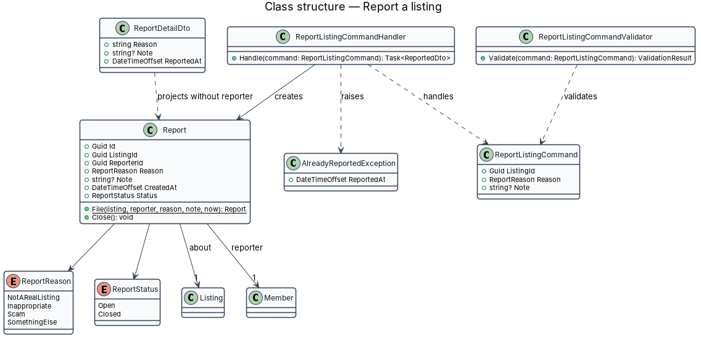

# Report a listing

## Overview

A member who sees a listing that does not belong on christian.rent can report it. The
Report button on the Listing screen opens a dialog with a fixed list of reasons and an
optional note. The report enters the review queue, where an admin keeps or removes the
listing. The member who posted the listing is never told who reported it.

- **report** — member's complaint about one listing
- **reason** — one of: not a real listing, inappropriate, a scam, something else
- **reporter** — member who sends the report
- **open report** — report that has no admin decision yet

The admin's side is designed in
[decide-review-item](../../review/decide-review-item/README.md).

## Description

**Frontend — `rent` application**

- **Report button** — in the `listing-toolbar` of `ListingPage`. It is not shown on the
  member's own listing. Selecting it calls `MemberGate.requireMember()` (L2-021, criterion
  5), then imports and opens `ReportListingDialog`.
- **`ReportListingDialog`** (`rent/src/app/report/`, selector `cr-report-listing-dialog`) —
  CDK dialog with the states `default`, `busy`, `invalid`, `failed`, `success`, `already`.
  Focus starts on the first reason and stays inside the dialog; Escape and Close return it
  to the Report button. Under 640 px it is a bottom sheet. Submitting without a reason
  marks the group invalid. `success` shows a confirmation; `already` says the earlier report
  is with an admin. Both are announced (L2-032, criterion 4).
- **`ReportsApi`** with the token **`REPORTS_API`** — `report(listingId, { reason, note })`.
  The token is bound by the Listing route.

**Frontend — `components` library**

- **`cr-radio-group`** — the four reasons, one required choice.
- **`cr-textarea`** — the note, with the counter "63 / 500".
- **`cr-dialog`**, **`cr-confirmation`**, **`cr-alert`**.

**Backend**

- **`ReportsController.Report`** — `POST /api/listings/{listingId}/reports`, member
  required. It sends one `ReportListingCommand`.
- **`ReportListingCommand`** — `{ ListingId, Reason, Note? }`.
- **`ReportListingCommandValidator`** — `Reason` is a defined `ReportReason`; `Note` is at
  most 500 characters (L2-021, criterion 1).
- **`ReportListingCommandHandler`** — loads the listing; a listing that is not public
  answers `not_found`. When a report by the same member on the same listing exists, it
  creates nothing and raises `AlreadyReportedException`, returned as 409 with the code
  `already_reported` and the date of the first report (criterion 3). Otherwise it creates
  `Report.File(listing, reporter, reason, note, now)` and `ReviewItem.ForReport(report.Id,
  now)` and saves both together (criterion 2). It returns `201 Created`.
- **`Report`** — `{ Id, ListingId, ReporterId, Reason, Note, CreatedAt, Status }` with
  `Status`: `Open` or `Closed`. A unique index on `(ListingId, ReporterId)` backs the
  one-report rule in a relational database.
- **Reporter privacy** — `ReporterId` appears in no DTO. `ReportDetailDto`, shown to an
  admin, holds the reason, the note and the time. `IMemberNotifier.ListingRemovedAsync`
  takes no report (criterion 4).

The note is stored and rendered as text (L2-026).

**Undecided**

- Whether a member may report their own listing: the mocks hide the button; the handler
  refuses with `own_listing`.
- Whether a second report is allowed after the first is closed with Keep: `<TO SUPPLY>`.
  The design allows one report per member and listing, whatever its status.

### Mocks

The mocks are the source of truth for the UI of this feature. The states this design covers are:

- [`docs/mocks/dialogs/report-listing/default.html`](../../../mocks/dialogs/report-listing/default.html): the four reasons and the note
- [`docs/mocks/dialogs/report-listing/invalid.html`](../../../mocks/dialogs/report-listing/invalid.html): no reason chosen
- [`docs/mocks/dialogs/report-listing/busy.html`](../../../mocks/dialogs/report-listing/busy.html): the request is in flight
- [`docs/mocks/dialogs/report-listing/failed.html`](../../../mocks/dialogs/report-listing/failed.html): the request failed; "Try again"
- [`docs/mocks/dialogs/report-listing/success.html`](../../../mocks/dialogs/report-listing/success.html): the confirmation
- [`docs/mocks/dialogs/report-listing/already.html`](../../../mocks/dialogs/report-listing/already.html): the member already reported this listing
- [`docs/mocks/pages/admin/report.html`](../../../mocks/pages/admin/report.html): the report as the admin sees it

## Requirements

The feature realizes the following level-2 (L2) requirements from
[`docs/specs/L2.md`](../../../specs/L2.md). Each L2 requirement refines a level-1 (L1)
requirement, cited by identifier. The table restates each requirement in `shall` form; the
acceptance criteria in the specification remain authoritative.

| L2 ID | Refines (L1) | Requirement |
|-------|--------------|-------------|
| `L2-021` | `L1-008` | A member shall be able to report a listing with a reason from a fixed list and an optional note of up to 500 characters. The report shall enter the review queue and the member shall see a confirmation. A second report by the same member on the same listing shall not be created. The member who posted shall never be told who reported. |
| `L2-025` | `L1-011` | Every endpoint other than browsing, searching and reading an approved listing shall respond 401 without a signed-in member. The backend shall refuse a request for, or a change to, anything that is not the member's own, and shall reveal nothing about it. A refusal a screen branches on shall be a ProblemDetails with a `code`. |
| `L2-026` | `L1-011` | A title, note, message, member name or church name shall be rendered as text wherever it is shown. Every input shall be validated for type, length and range before use, and database access shall be parameterised. Every response shall carry a Content-Security-Policy that allows no inline script and no third-party script. |
| `L2-032` | `L1-014` | Every screen shall meet WCAG 2.2 level AA. Every action shall be completable by keyboard with visible focus. A state shall be carried by text or an announced attribute, never by colour alone. Confirmations and errors shall be announced. Every field shall have a visible label with its error tied to it. Reduced motion shall be honoured, and text at 200% shall lose nothing. |

## Diagrams

### System context

The people involved are: member, admin, member who posted. Each reaches the feature through christian.rent, which takes no payment and holds no booking calendar.

### Containers

The rent application calls `ChristianRent.Api` over JSON/HTTPS. The API persists state through EF Core.

### Components

`ListingPage` gates the action and opens the lazily imported dialog. The handler creates a
`Report` and its `ReviewItem` together, or refuses a repeat.

### Class structure

`Report` links one listing and one reporter. `ReportDetailDto` projects a report without the
reporter, which is how the reporter stays private.

### Behaviour — report a listing

The report and its review item are saved together (`L2-021`, criterion 2). A repeat by the
same member creates nothing and the dialog shows the "already" state (criterion 3).

