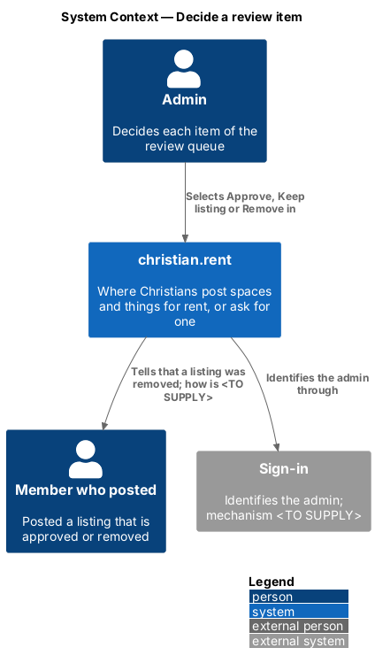
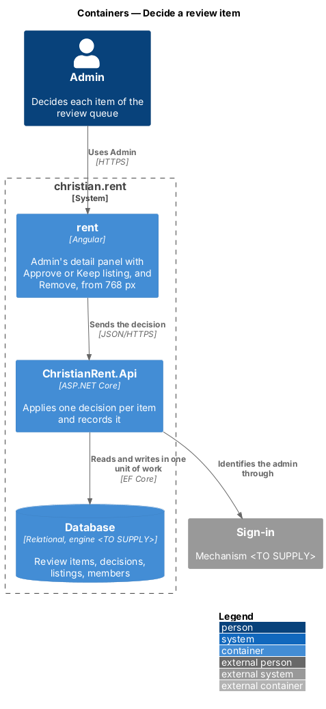
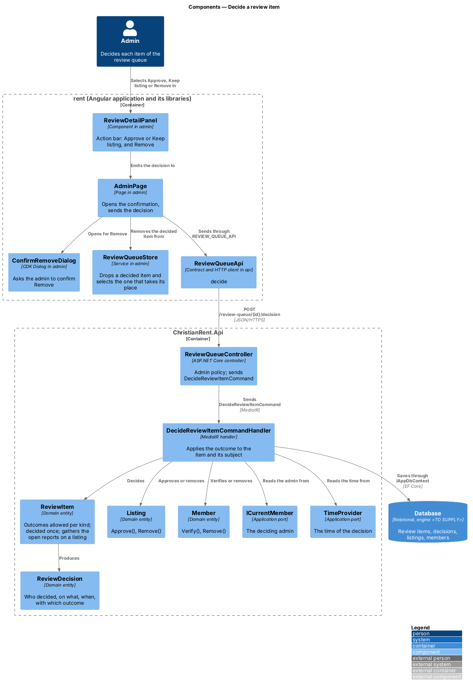
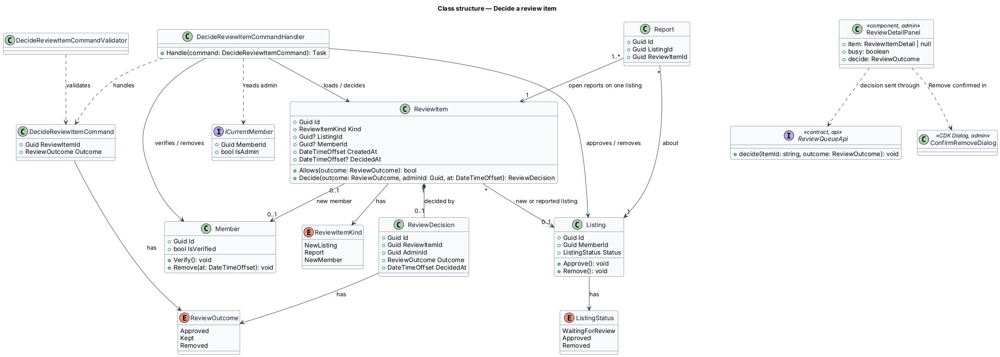
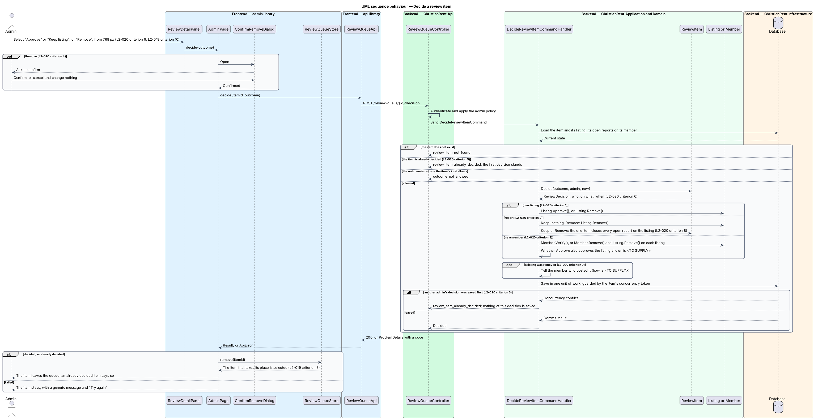

# Decide a review item

## Overview

christian.rent keeps a *review queue* that an admin works through. It holds new listings,
*reports* (a member's complaint about a listing) and new members. This feature covers the
decision an admin makes on one item of the queue.

Three decisions exist, and each kind of item allows two of them. A new listing is approved, and
becomes public, or removed, and never becomes public. A report is answered with Keep, whose
button reads "Keep listing", and the listing stays public, or with Remove, and the listing stops
being public; either way every open report on the listing leaves the queue. A new member is
approved, and becomes *verified*, or removed. Every decision takes the item out of the queue,
and the item that takes its place is selected. Remove asks the admin to confirm before it takes
effect. An admin decides from 768 px: under it Admin shows the queue only.

Two admins may open the same item. The first decision stands; the second is refused with a
message that the item was already decided. Every decision is recorded with who made it, on what
and when. When a listing is removed, the member who posted it is told.

Two local terms are used below.

- **review item** — one entry of the review queue: a new listing, a reported listing or a new member
- **outcome** — decision recorded on a review item: `Approved`, `Kept` or `Removed`

Reading the queue and the detail panel is designed in `review-queue/work-review-queue`. What
verifying and removing a member mean is designed in `members/verify-member-and-church`.

## Description

The slice is not built yet; the components below are the ones the design introduces. The slice
runs from Admin's detail panel in the `rent` application to the database behind
`ChristianRent.Api`.

The outcomes each kind of review item allows, and what each does:

| Kind | Outcome | Effect |
|------|---------|--------|
| `NewListing` | `Approved` | The listing becomes public (`L2-020` criterion 1). |
| `NewListing` | `Removed` | The listing never becomes public (`L2-020` criterion 1). |
| `Report` | `Kept` | The listing stays public, and every open report on it leaves the queue (`L2-020` criterion 2). |
| `Report` | `Removed` | The listing is no longer public, and every open report on it leaves the queue (`L2-020` criterion 2). |
| `NewMember` | `Approved` | The member is verified (`L2-020` criterion 3). |
| `NewMember` | `Removed` | The member is removed as in `L2-018` (`L2-020` criterion 3). |

**Frontend**

- **`ReviewDetailPanel`** — component in `admin`. An action bar stays at the foot of the panel
  and holds the two decisions its item's kind allows, taken from the table (`L2-020`
  criterion 9). The first button reads "Approve" for a new listing or a new member and "Keep
  listing" for a report (`L2-020` criterion 2); the second reads "Remove". Beside them is "View on
  site" (`review-queue/work-review-queue`). The first button is green and "Remove" is written in
  red; the wording carries the difference. The panel's output `decide` carries the outcome. The
  panel is shown from 768 px; under 768 px no detail opens and nothing can be decided (`L2-031`
  criterion 5, `L2-019` criterion 10).
- **`AdminPage`** — page in `admin`. On `decide` with `Removed` it opens `ConfirmRemoveDialog`
  and proceeds only when the admin confirms (`L2-020` criterion 4). It then calls
  `ReviewQueueApi.decide` and, on success, tells `ReviewQueueStore` to drop the item. On the code
  `review_item_already_decided` it says the item was already decided and drops the item as well
  (`L2-020` criterion 5). On any other failure the item stays, with a generic message and "Try
  again". Buttons are disabled while a decision is in flight.
- **`ConfirmRemoveDialog`** — CDK Dialog in the `admin` library, so its code loads only for an
  admin. It names what is removed and offers confirm and cancel; cancel changes nothing. The
  prototype removes at once and draws no confirmation; `L2-020` criterion 4 stands, and the
  dialog's wording and layout are `<TO SUPPLY>` until a mock draws it.
- **`ReviewQueueStore`** — service in `admin` (`review-queue/work-review-queue`). `remove(itemId)`
  drops the decided item, selects the item that takes its place and reloads the summary line
  (`L2-019` criterion 8).
- **`ReviewQueueApi`** — contract and injection token (`REVIEW_QUEUE_API`) in `api`.
  `decide(itemId, outcome)` posts the decision and refuses with an `ApiError` whose `code`
  `AdminPage` branches on.

**Backend**

- **`ReviewQueueController`** — `POST /review-queue/{id}/decision` carries the admin policy and
  sends one `DecideReviewItemCommand`. A caller who is not an admin is refused before any state
  is read (`L2-025` criterion 3).
- **`DecideReviewItemCommand`** — request carrying `ReviewItemId` and `Outcome`. The admin is
  not part of the request; the handler reads it from `ICurrentMember`.
- **`DecideReviewItemCommandValidator`** — FluentValidation validator; it refuses an outcome
  that is not a `ReviewOutcome`.
- **`ReviewItem`** — domain entity. `Allows(outcome)` holds the table above.
  `Decide(outcome, adminId, at)` refuses an outcome the kind does not allow and refuses an item
  whose `DecidedAt` is already set; otherwise it sets `DecidedAt` and returns a `ReviewDecision`.
  `DecidedAt` is a concurrency token.
- **`ReviewDecision`** — domain entity: `Id`, `ReviewItemId`, `AdminId`, `Outcome` and
  `DecidedAt`. It is the record of who decided, on what and when (`L2-020` criterion 6). It is
  written once and never changed.
- **`DecideReviewItemCommandHandler`** — MediatR handler. It loads the review item with its
  listing, its open reports or its member. It refuses with `review_item_not_found`,
  `review_item_already_decided` or `outcome_not_allowed`. Otherwise it calls
  `ReviewItem.Decide`, applies the effect from the table, and saves everything in one unit of
  work.
- **`Listing`** — domain entity. `Approve()` moves `Status` from `WaitingForReview` to
  `Approved`; `Remove()` sets `Removed`. Only an approved listing is public.
- **`Member`** — domain entity. `Verify()` and `Remove(at)` are described in
  `members/verify-member-and-church`.
- **`ICurrentMember`**, **`TimeProvider`**, **`IAppDbContext`** — ports in
  `ChristianRent.Application`: the deciding admin, the clock and the database.

A listing reported more than once is one review item of kind `Report`, which gathers every open
report on the listing (`L2-020` criterion 8, `review-queue/report-listing`). Deciding that item,
with `Kept` or with `Removed`, therefore clears every open report on the listing with one
`ReviewDecision` (`L2-020` criterion 2). `Kept` changes nothing on the listing; `Removed` calls
`Listing.Remove()`. A report made after the decision opens a new review item.

For a new member, `Approved` verifies the member (`L2-020` criterion 3). The review queue shows a
new member through the listing that member posted (`L2-019` criterion 2); whether `Approved` on
that item also approves the listing shown, and what is decided for a new member who has posted
nothing, are `<TO SUPPLY>`.

Two admins deciding the same item are separated in two ways (`L2-020` criterion 5). An item
already decided when the second request loads it is refused by `ReviewItem.Decide`. Two requests
that load the item at the same moment are separated by the concurrency token: the second save
fails, the handler saves nothing of the second decision, and it returns
`review_item_already_decided`. The refusal is a ProblemDetails with status 409.

When a listing is removed, by any row of the table, the member who posted it is told
(`L2-020` criterion 7). How the member is told is `<TO SUPPLY>`: christian.rent writes to a
member at their email address (`L2-028` criterion 4), and the prototype emails a member about
messages only and draws no removal notice. The notice names the listing and never names a member
who reported it (`L2-021` criterion 4). Whether the notice gives a reason is `<TO SUPPLY>`.
Whether the member who reported is told the outcome is `<TO SUPPLY>`.

The layout and the states of the detail panel and of the confirmation follow `docs/mocks/` once
the mocks are drawn, and this design is brought in line with them then. The facts stated here
come from the Magic Patterns prototype.

## Requirements

The feature realizes the following level-2 (L2) requirement. It refines a level-1 (L1)
requirement, cited by identifier.

| L2 ID | Refines (L1) | Requirement |
|-------|--------------|-------------|
| `L2-020` | `L1-007` | Approve, Keep or Remove: an admin shall be able to approve or remove a new listing, keep or remove a reported listing, and approve or remove a new member; Keep, whose button reads "Keep listing", and Remove shall each take every open report on the listing out of the queue; Remove shall ask for confirmation, a second admin's decision on the same item shall be refused, each decision shall be recorded, and the member who posted a removed listing shall be told. |

## Diagrams

### System context

An admin decides items through christian.rent. When the decision removes a listing,
christian.rent tells the member who posted it; how is `<TO SUPPLY>`.

### Containers

The decision travels from Admin in the `rent` application to `ChristianRent.Api`, which changes
the review item and its subject and records the decision in the database, in one unit of work.
File storage takes no part in this slice.

### Components

`ReviewDetailPanel` emits the outcome to `AdminPage`, which opens `ConfirmRemoveDialog` for
Remove and sends the decision through `ReviewQueueApi`. `DecideReviewItemCommandHandler` reads
the admin and the time from its ports, decides the `ReviewItem`, which produces the
`ReviewDecision`, and approves, removes or verifies the `Listing` or the `Member`.

### Class structure

A `ReviewItem` has one kind, points at one listing or one member, gathers the open reports on a
reported listing, and owns at most one `ReviewDecision`. `DecideReviewItemCommandHandler` decides the item and changes the `Listing` or
the `Member` through that entity's own method.

### Behaviour — decide a review item

Remove is confirmed in a dialog before any request. The handler refuses an unknown item, an item
already decided and an outcome the kind does not allow. Otherwise it records the decision,
applies the effect for the item's kind and saves once; a concurrent decision by another admin
fails that save and is reported as already decided. The decided item leaves the queue and the
item that takes its place is selected.

