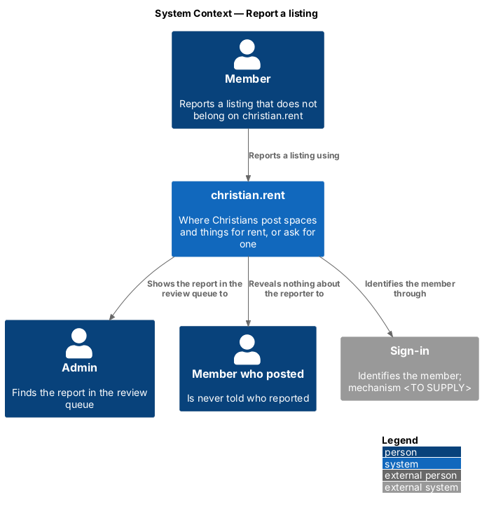
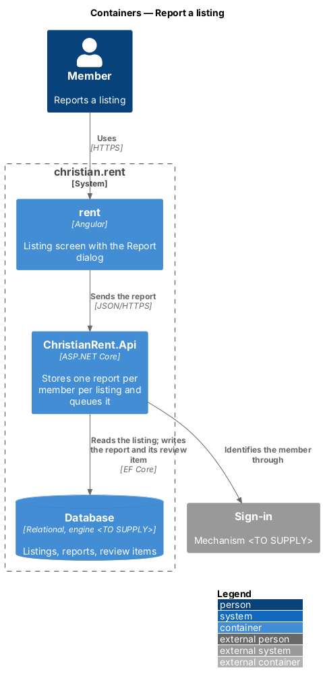
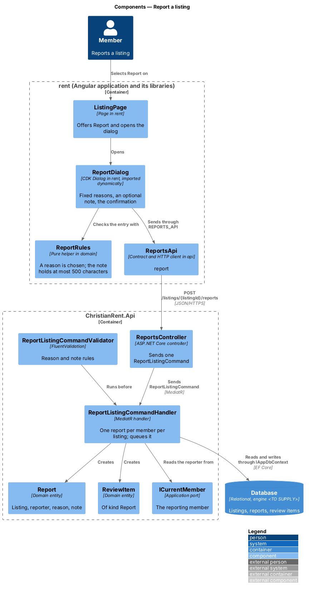
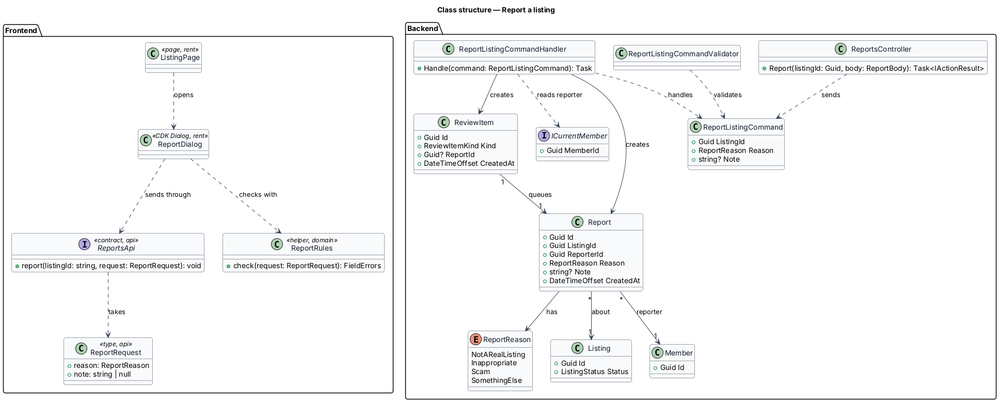
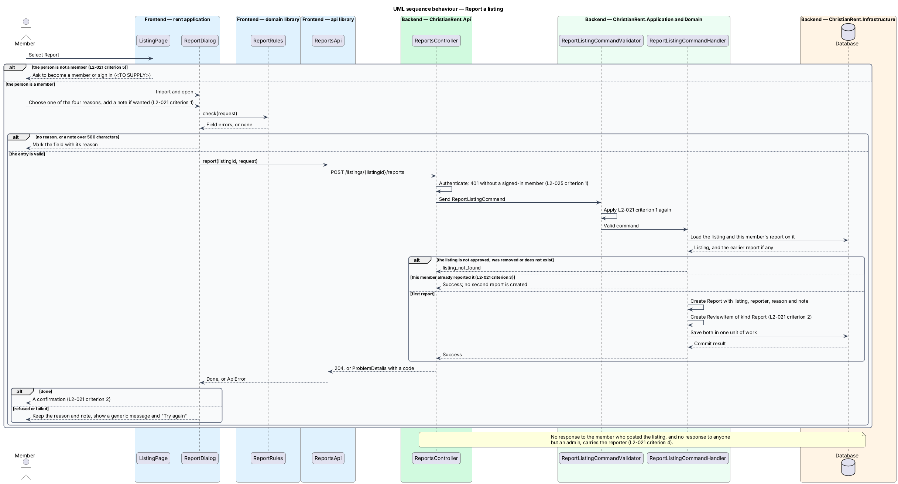

# Report a listing

## Overview

christian.rent is narrow on purpose, and an admin learns of a listing that does not belong on
it through a report. A *report* is a member's complaint about a listing. A *member* is someone
who uses christian.rent, and the *review queue* is the list of items an admin works through.

This feature covers making a report. A member on the Listing screen selects Report, chooses one
reason from a fixed list of four (not a real listing, inappropriate, a scam, something else) and
may add a note of up to 500 characters. The report enters the review queue and the member sees a
confirmation. A member reports a given listing once: a second attempt creates no second report.
The member who posted the listing is never told who reported it. A person who is not a member is
asked to become a member or sign in.

One local term is used below.

- **reporter** — member who made a report

What an admin does with the report, Keep or Remove, is designed in
`review-queue/decide-review-item`.

## Description

The slice is not built yet; the components below are the ones the design introduces. The slice
runs from the Listing screen in the `rent` application to the database behind
`ChristianRent.Api`.

**Frontend**

- **`ListingPage`** — page in `rent` (designed in `listings/read-listing`). In this slice it
  offers the Report control and opens `ReportDialog`. For a person who is not a member it asks
  them to become a member or sign in instead (`L2-021` criterion 5); joining is designed in
  `members/become-member` and sign-in is `<TO SUPPLY>`.
- **`ReportDialog`** — CDK Dialog in `rent`, imported dynamically when Report is selected, so
  its code is not part of Listing's first load. It holds a group of four reasons, of which one
  is chosen, and an optional note. It calls `ReportsApi` through the `REPORTS_API` token, shows
  the confirmation once the report is received (`L2-021` criterion 2), and announces it to a
  screen reader (`L2-032` criterion 4). On a refusal or a failed request it keeps the reason and
  the note, shows a generic message and offers "Try again". It aborts a request in flight when it
  closes.
- **`ReportRules`** — pure helper in `domain`, in a `reports/` folder this slice adds. It
  refuses an entry with no reason and a note longer than 500 characters (`L2-021` criterion 1).
- **`ReportsApi`** — contract and injection token (`REPORTS_API`) in `api`, with its HTTP
  client. `report(listingId, request)` posts the report and refuses with an `ApiError` whose
  `code` the dialog branches on.
- **`ReportRequest`** — type in `api`: a `ReportReason` and an optional note.

**Backend**

- **`ReportsController`** — `POST /listings/{listingId}/reports` requires a signed-in member
  under the fallback policy and responds 401 without one (`L2-025` criterion 1, `L2-017`
  criterion 5). It checks nothing itself and sends one `ReportListingCommand`.
- **`ReportListingCommand`** — request carrying `ListingId`, `Reason` and `Note`. The reporter
  is not part of the request; the handler reads it from `ICurrentMember`.
- **`ReportListingCommandValidator`** — FluentValidation validator. It refuses a reason outside
  `ReportReason` and a note longer than 500 characters, so a request sent straight to the backend
  meets the same rules (`L2-026` criterion 2).
- **`ReportListingCommandHandler`** — MediatR handler. It refuses with `listing_not_found` when
  the listing does not exist, is not approved or has been removed, revealing nothing about it
  (`L2-025` criterion 2). When the reporter already has a report on the listing, it creates
  nothing and returns success (`L2-021` criterion 3). Otherwise it creates a `Report` and a
  `ReviewItem` of kind `Report` and saves both in one unit of work (`L2-021` criterion 2).
- **`Report`** — domain entity: `Id`, `ListingId`, `ReporterId`, `Reason`, `Note` and
  `CreatedAt`. A unique index on `ListingId` with `ReporterId` holds the rule of one report per
  member per listing when two requests arrive together; the handler treats the resulting
  conflict as the earlier report.
- **`ReportReason`** — enumeration of the fixed list: `NotARealListing`, `Inappropriate`,
  `Scam`, `SomethingElse`.
- **`ReviewItem`** — domain entity the review queue lists; here of kind `Report`, pointing at
  the report. Each report has its own review item, so reports by different members on one
  listing wait in the queue separately.

The reporter is kept from the member who posted in three ways (`L2-021` criterion 4).
`ReporterId` is returned only by the review queue's endpoints, which only an admin may call. No
response about a listing, on Browse or Listing, to its poster or to anyone else, says that it was
reported or by whom. The notice a member receives when their listing is removed
(`review-queue/decide-review-item`) names no reporter. Whether the name of the reporter is shown
to the admin in the detail panel is `<TO SUPPLY>` (`review-queue/work-review-queue`).

The specs leave two points open, each `<TO SUPPLY>`: what the dialog shows a member who reports
a listing they have already reported, where this design returns the same confirmation; and
whether a member may report their own listing.

The note is what a member wrote: it is stored and later rendered as text, never as HTML
(`L2-026` criterion 1), and no log, metric or span of this slice carries it (`L2-028`
criterion 3).

The layout and the states of the Report control and its dialog follow `docs/mocks/` once the
mocks are drawn, and this design is brought in line with them then.

## Requirements

The feature realizes the following level-2 (L2) requirement. It refines a level-1 (L1)
requirement, cited by identifier.

| L2 ID | Refines (L1) | Requirement |
|-------|--------------|-------------|
| `L2-021` | `L1-008` | Report a listing: a member on a listing shall be able to report it with a reason chosen from a fixed list and an optional note of up to 500 characters; the report shall enter the review queue, and the member who posted the listing shall never be told who reported it. |

## Diagrams

### System context

A member reports a listing through christian.rent, which shows the report to an admin in the
review queue and reveals nothing about the reporter to the member who posted. The mechanism that
identifies the member is `<TO SUPPLY>`.

### Containers

The report travels from the `rent` application to `ChristianRent.Api`, which reads the listing
and writes the report and its review item to the database. File storage takes no part in this
slice.

### Components

`ListingPage` opens `ReportDialog`, which checks the entry with `ReportRules` and sends it
through `ReportsApi`. In `ChristianRent.Api`, `ReportsController` sends one
`ReportListingCommand`; the validator runs before `ReportListingCommandHandler`, which reads the
reporter from `ICurrentMember` and creates the `Report` and its `ReviewItem`.

### Class structure

A `Report` is about one `Listing`, has one reporter and one `ReportReason`, and is queued by one
`ReviewItem`. On the frontend, `ReportsApi` takes a `ReportRequest`.

### Behaviour — report a listing

A person who is not a member is asked to become one or sign in. For a member, the dialog and
then the backend apply the reason and note rules. The handler refuses a listing that is not
public, creates nothing when the member has already reported the listing, and otherwise saves
the report and its review item together; the member then sees the confirmation.

