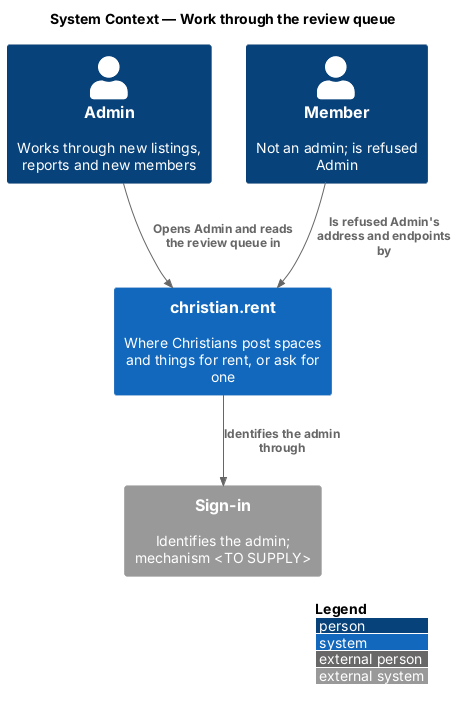
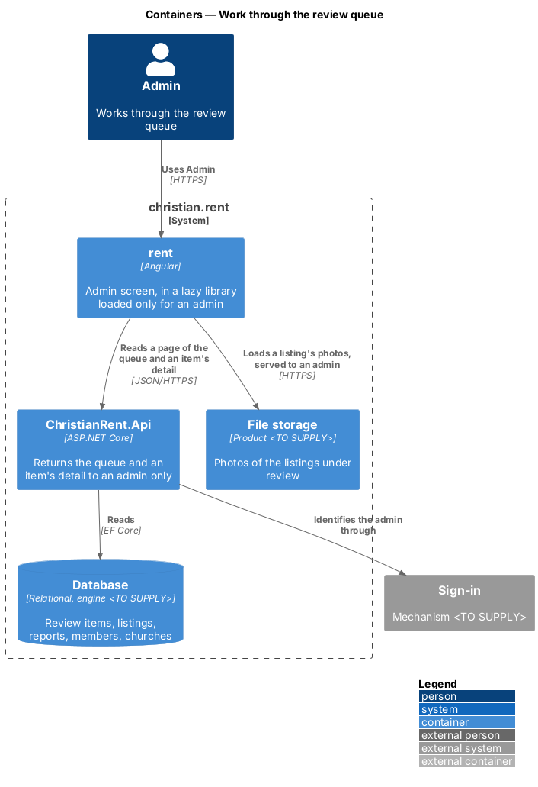
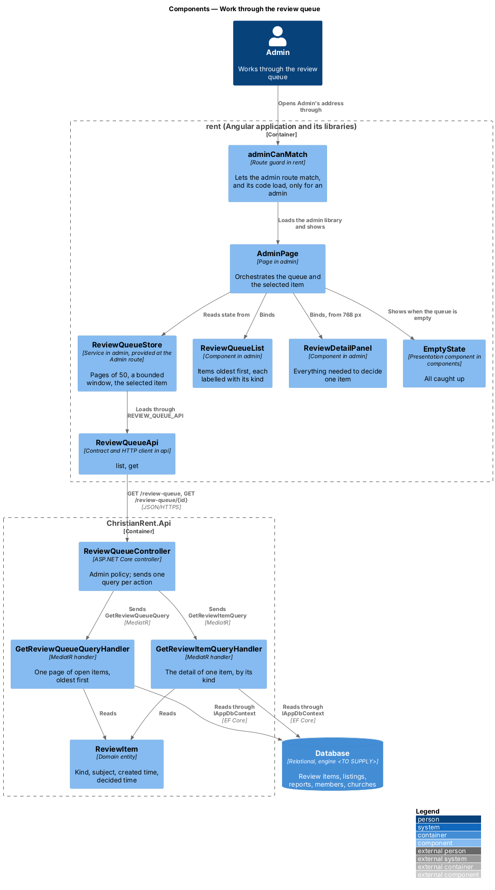
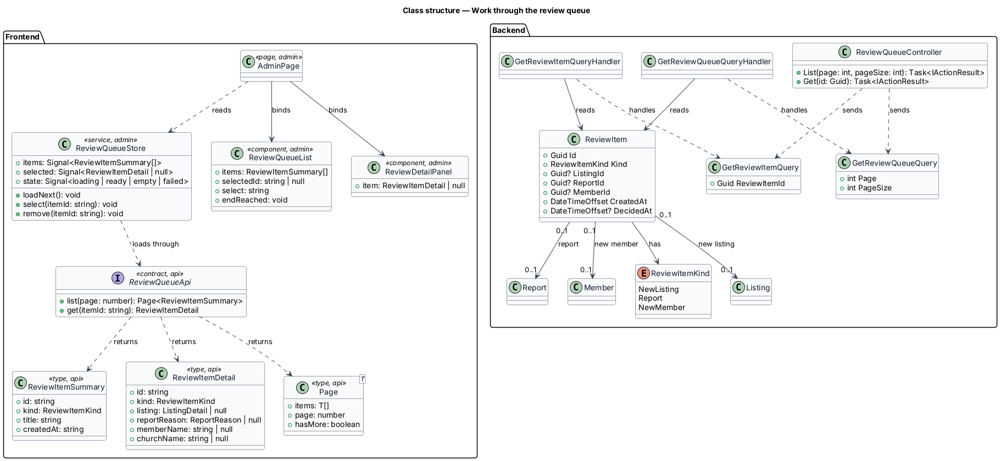

# Work through the review queue

## Overview

christian.rent shows a listing to the public only once an admin has approved it. An *admin* is
the person who confirms what belongs on christian.rent. The *review queue* is what an admin
works through. It holds three kinds of item: a new listing waiting to become public, a *report*,
which is a member's complaint about a listing, and a new member waiting to be confirmed.

This feature covers the Admin screen as a place to read. An admin opens Admin and sees the
review queue, oldest first, each item labelled with its kind. Selecting an item opens a detail
panel that shows everything needed to decide it. When nothing waits, Admin says "All caught up".
When more than 50 items wait, they load in pages. Nobody but an admin receives the queue, and
Admin's code is loaded only for an admin.

Two local terms are used below.

- **review item** — one entry of the review queue: a new listing, a report or a new member
- **open review item** — review item no admin has decided yet

Deciding an item, with Approve, Keep or Remove, is designed in
`review-queue/decide-review-item`. How an item enters the queue is designed with the feature
that creates it: `listings/post-listing`, `review-queue/report-listing` and
`members/become-member`.

## Description

The slice is not built yet; the components below are the ones the design introduces. The slice
runs from the Admin screen in the `rent` application to the database behind
`ChristianRent.Api`, and reads only.

**Frontend**

- **`admin` route** — route in `rent` that loads the `admin` library with `loadChildren`. The
  route binds `REVIEW_QUEUE_API` and provides `ReviewQueueStore`, so neither is in the initial
  bundle and both go when the admin leaves Admin.
- **`adminCanMatch`** — route guard in `rent` on that route. For a person who is not an admin
  the route does not match, the `admin` library is not requested, and `NotFoundPage` is shown
  (`L2-019` criterion 5). How the browser learns that the signed-in member is an admin is
  `<TO SUPPLY>` with sign-in. The guard is a convenience; the backend refuses whatever the guard
  does.
- **`AdminPage`** — page in `admin`. It reads `ReviewQueueStore`, binds `ReviewQueueList` and
  `ReviewDetailPanel`, and shows `EmptyState` with "All caught up" when the store reports an
  empty queue (`L2-019` criterion 3). Under 768 px it shows the queue only; from 768 px the
  detail panel sits beside the queue (`L2-031` criterion 5). Whether an admin on a phone can
  open an item at all is `<TO SUPPLY>`; the specs draw no detail panel under 768 px.
- **`ReviewQueueList`** — component in `admin` (selector `cr-review-queue-list`). Its inputs are
  the review items and the selected identifier; its outputs are `select` and `endReached`. Each
  row names its kind in text (`L2-019` criterion 1, `L2-032` criterion 3), and the selected row
  carries `aria-current`.
- **`ReviewDetailPanel`** — component in `admin` (selector `cr-review-detail-panel`). For a new
  listing it shows all the listing's fields, its photos through `PhotoGallery`, and who posted
  it. For a report it shows the listing and the reason. For a new member it shows the member's
  name and church (`L2-019` criterion 2). Whether a report's note and the name of the member who
  reported are shown to the admin is `<TO SUPPLY>`; `L2-019` criterion 2 names the listing and
  the reason only.
- **`ReviewQueueStore`** — service in `admin`, provided at the Admin route. It holds the loaded
  review items, the selected item's detail and a state of loading, ready, empty or failed.
  `loadNext()` requests the next page of 50 (`L2-019` criterion 4) and makes no request once the
  last page has arrived. The store keeps a bounded window of pages and releases pages far off
  screen, so the queue does not grow in memory for the length of a visit. It aborts requests in
  flight when it is destroyed.
- **`ReviewQueueApi`** — contract and injection token (`REVIEW_QUEUE_API`) in `api`, with its
  HTTP client: `list(page)` and `get(itemId)` in this slice. A refusal is an `ApiError` whose
  `code` `AdminPage` branches on.
- **`ReviewItemSummary`**, **`ReviewItemDetail`** — types in `api`. A summary carries the
  identifier, the kind, a title (the listing's title or the member's name) and the time the item
  was created. A detail carries what its kind calls for and leaves the rest absent.

A listing's title and note and a member's or a church's name are rendered as text, never as
HTML (`L2-026` criterion 1). While a page or a detail is in flight, the list or the panel shows
a loading state in the shape of what will arrive; a failed page keeps the items already shown
and offers "Try again" (`L2-033` criteria 1 and 2).

**Backend**

- **`ReviewQueueController`** — ASP.NET Core controller carrying the admin policy on every
  action. A caller who is not signed in receives 401; a signed-in member who is not an admin
  receives 403 with the code `not_admin`; neither response holds queue data (`L2-019`
  criterion 5). `GET /review-queue` sends one `GetReviewQueueQuery`; `GET /review-queue/{id}`
  sends one `GetReviewItemQuery`. How a person is known to be an admin is `<TO SUPPLY>` with
  sign-in.
- **`GetReviewQueueQuery`** and its handler — return one page of open review items ordered by
  `CreatedAt`, oldest first (`L2-019` criterion 1). The page size is 50, and a larger size is
  refused (`L2-030` criterion 3).
- **`GetReviewItemQuery`** and its handler — return the detail of one review item by its kind:
  the listing with its fields, photos and the member who posted it; the report with its listing
  and reason; or the member with their church (`L2-019` criterion 2). An unknown identifier is
  refused with `review_item_not_found`.
- **`ReviewItem`** — domain entity: `Id`, `Kind`, `CreatedAt`, `DecidedAt`, and one of
  `ListingId`, `ReportId` or `MemberId` according to its kind. An item is open while `DecidedAt`
  is empty.

The photos in the detail panel belong to a listing that is not yet approved. File storage serves
them to an admin and to the member who posted, and to nobody else (`L2-014` criterion 5); that
rule is designed in `listings/add-photos`.

The layout and the states of Admin follow `docs/mocks/` once the mocks are drawn, and this
design is brought in line with them then.

## Requirements

The feature realizes the following level-2 (L2) requirement. It refines a level-1 (L1)
requirement, cited by identifier.

| L2 ID | Refines (L1) | Requirement |
|-------|--------------|-------------|
| `L2-019` | `L1-007` | The review queue: Admin shall list new listings, reports and new members to an admin, oldest first and each labelled with its kind, shall show a detail panel with everything needed to decide an item, and shall show "All caught up" when the queue is empty. |

## Diagrams

### System context

An admin reads the review queue in christian.rent. A member who is not an admin is refused both
Admin's address and its endpoints. The mechanism that identifies the admin is `<TO SUPPLY>`.

### Containers

Admin, in the `rent` application, reads a page of the queue and an item's detail from
`ChristianRent.Api`, which reads the database. The photos of a listing under review come from
file storage.

### Components

`adminCanMatch` lets the route match only for an admin, and only then is the `admin` library
loaded. `AdminPage` reads `ReviewQueueStore`, which loads through `ReviewQueueApi`. In
`ChristianRent.Api`, `ReviewQueueController` applies the admin policy and sends one query per
action to a handler that reads `ReviewItem` records.

### Class structure

`ReviewQueueStore` holds a list of `ReviewItemSummary` and one selected `ReviewItemDetail`, both
loaded through `ReviewQueueApi`. On the backend a `ReviewItem` has one `ReviewItemKind` and
points at one listing, one report or one member.

### Behaviour — work through the review queue

A person who is not an admin never loads Admin's code. For an admin, the store requests the
first page of 50 open review items, oldest first; an empty result shows "All caught up".
Reaching the end of the list loads the next page, and selecting an item loads its detail into
the panel.

