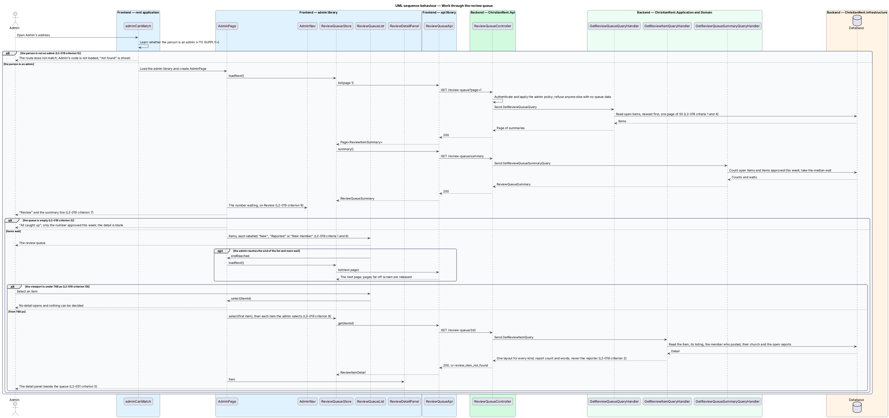

# Work through the review queue

## Overview

christian.rent shows a listing to the public only once an admin has approved it. An *admin* is
the person who confirms what belongs on christian.rent. The *review queue* is what an admin
works through. It holds three kinds of item: a new listing waiting to become public, a *report*,
which is a member's complaint about a listing, and a new member waiting to be confirmed.

This feature covers the Admin screen as a place to read. An admin opens Admin and sees the
review queue, newest first, each item labelled with its kind: "New", "Reported" or "New member".
The first item is selected, and a detail panel shows everything needed to decide it, laid out
the same for every kind. When nothing waits, Admin says "All caught up". When more than 50 items
wait, they load in pages. Under 768 px Admin shows the queue only: no detail opens and nothing
can be decided. Nobody but an admin receives the queue, and Admin's code is loaded only for an
admin.

Three local terms are used below.

- **review item** — one entry of the review queue: a new listing, a reported listing or a new member
- **open review item** — review item no admin has decided yet
- **summary line** — line under the queue's heading giving the number waiting, the median wait and the number approved this week

Deciding an item, with Approve, Keep or Remove, is designed in
`review-queue/decide-review-item`. How an item enters the queue is designed with the feature
that creates it: `listings/post-listing`, `review-queue/report-listing` and
`members/become-member`.

## Description

The slice is not built yet; the components below are the ones the design introduces. The slice
runs from the Admin screen in the `rent` application to the database behind
`ChristianRent.Api`, and reads only.

**Layout**

From 768 px Admin fills the height of the viewport in three parts: the navigation, a column
240 px wide at the left; the queue, up to 448 px wide; and the detail panel, which takes the
rest and holds its content to at most 672 px (`L2-031` criterion 5). Under 768 px the navigation
is a bar across the top and the queue is below it; the detail panel is not shown (`L2-019`
criterion 10). This is the design and not a gap: an admin decides from 768 px.

**Frontend**

- **`admin` route** — route in `rent` that loads the `admin` library with `loadChildren`. The
  route binds `REVIEW_QUEUE_API` and provides `ReviewQueueStore`, so neither is in the initial
  bundle and both go when the admin leaves Admin.
- **`adminCanMatch`** — route guard in `rent` on that route. For a person who is not an admin
  the route does not match, the `admin` library is not requested, and `NotFoundPage` is shown
  (`L2-019` criterion 5). How the browser learns that the signed-in member is an admin is
  `<TO SUPPLY>` with sign-in. The guard is a convenience; the backend refuses whatever the guard
  does.
- **`AdminPage`** — page in `admin`. It reads `ReviewQueueStore` and binds `AdminNav`,
  `ReviewQueueList` and `ReviewDetailPanel`. It shows the heading "Review" and the summary line
  above the queue (`L2-019` criterion 7). It shows `EmptyState` with "All caught up" and the
  sentence "New posts and reports will show up here." when the store reports an empty queue, and
  the detail panel is then blank (`L2-019` criterion 3). `AdminPage` watches the 768 px
  breakpoint through the CDK `BreakpointObserver` and releases it when destroyed. Under 768 px it
  binds no `ReviewDetailPanel`, requests no detail, and selecting a row opens nothing (`L2-019`
  criterion 10). From 768 px it asks the store to select the first item once the first page has
  arrived (`L2-019` criterion 8).
- **`AdminNav`** — component in `admin` (selector `cr-admin-nav`). Its inputs are the number
  waiting and the current entry. From 768 px it is the column at the left: the mark and the
  wordmark, the word "Admin", the four entries Review, Reports, Members and Churches, each with
  an icon, and at the foot "Back to site", which opens Browse. Review carries the number
  waiting. Under 768 px it is the bar across the top: the mark alone and the four entries as
  icons, each still named for a screen reader, with no number and no "Back to site" (`L2-019`
  criterion 9, `L2-023` criterion 3). The current entry carries `aria-current`. What the Reports,
  Members and Churches entries open is `<TO SUPPLY>`: the prototype names the three sections and
  draws nothing in them.
- **`ReviewQueueList`** — component in `admin` (selector `cr-review-queue-list`). Its inputs are
  the review items and the selected identifier; its outputs are `select` and `endReached`. Each
  row is one button showing the listing's first photo, or a blue tile reading "Want" for a wanted
  listing; the title; who posted it; how long the item has waited, as "12 min"; and its kind
  (`L2-019` criterion 6). The kind is the text "New", "Reported" or "New member" (`L2-019`
  criterion 1, `L2-032` criterion 3); the colour behind it differs by kind and is not the only
  carrier. The selected row carries `aria-current`.
- **`ReviewDetailPanel`** — component in `admin` (selector `cr-review-detail-panel`). It has one
  layout for every kind (`L2-019` criterion 2):
  - for a reported listing only, a banner above the rest reading "Reported 2×:" followed by what
    the report says, with the number of open reports on the listing in place of 2; it never
    shows who reported;
  - the listing's photos through `PhotoGallery`, or for a wanted listing its title on a blue
    panel; the prototype draws one photo, at 16:9, and how more than one photo is moved
    through is `<TO SUPPLY>`;
  - the title, with the price beside it written as on a card (`L2-022` criterion 1), and the
    note;
  - a list of four rows: "Posted by", the member; "Church", their church with `VerifiedMark`
    when it is verified; "Account", how long they have been a member; and "Location", the
    listing's area;
  - "View on site", which opens the listing as Listing shows it (`L2-019` criterion 11).

  For a new member the listing is the one that member posted, and "Account" also says that
  their church is pending when no admin has confirmed it (`L2-019` criterion 2, `L2-018`
  criterion 6). The buttons that decide the item are designed in
  `review-queue/decide-review-item`.
- **`ReviewQueueStore`** — service in `admin`, provided at the Admin route. It holds the loaded
  review items, the selected item's detail, the summary and a state of loading, ready, empty or
  failed. `loadNext()` requests the next page of 50 (`L2-019` criterion 4) and makes no request
  once the last page has arrived. `select(itemId)` loads that item's detail. `remove(itemId)`
  drops a decided item, selects the item that takes its place and reloads the summary (`L2-019`
  criterion 8). The store keeps a bounded window of pages and releases pages far off screen, so
  the queue does not grow in memory for the length of a visit. It aborts requests in flight when
  it is destroyed.
- **`ReviewQueueApi`** — contract and injection token (`REVIEW_QUEUE_API`) in `api`, with its
  HTTP client: `list(page)`, `get(itemId)` and `summary()` in this slice. A refusal is an
  `ApiError` whose `code` `AdminPage` branches on.
- **`ReviewItemSummary`** — type in `api`: the identifier, the kind, the listing's title, its
  `ListingOffer`, the address of its first photo, the name of the member who posted it and the
  time the item was created.
- **`ReviewItemDetail`** — type in `api`: the identifier, the kind, the listing as a
  `ListingDetail`, the time the member who posted joined, and for a reported listing the number
  of open reports and the words shown. It carries no reporter.
- **`ReviewQueueSummary`** — type in `api`: the number waiting, the median wait and the number
  approved this week. `AdminPage` writes it as "4 waiting · median wait 38 min · 61 approved
  this week", and as "61 approved this week" alone when the queue is empty (`L2-019`
  criterion 7).

"Account" shows the age of the membership and the pending church, and nothing else. The
prototype's sample rows also count rentals, which christian.rent does not hold (`L2-024`), and
one names no church, which cannot occur because a church is required to join (`L2-017`
criterion 1).

Three points of the detail panel are `<TO SUPPLY>`:

- Which report's words the banner shows when a listing has more than one report, and whether
  the fixed reason is shown beside the note.
- What the panel shows for a new member who has posted nothing, or who has posted more than one
  listing.
- Whether one listing can wait under both a "New" item and a "New member" item.

A listing's title and note and a member's or a church's name are rendered as text, never as
HTML, and so is what a report says (`L2-026` criterion 1). While a page or a detail is in
flight, the list or the panel shows a loading state in the shape of what will arrive; a failed
page keeps the items already shown and offers "Try again" (`L2-033` criteria 1 and 2). The
prototype draws two states of Admin, default and empty; the loading and failed states are
`<TO SUPPLY>` until `docs/mocks/` draws them.

**Backend**

- **`ReviewQueueController`** — ASP.NET Core controller carrying the admin policy on every
  action. A caller who is not signed in receives 401; a signed-in member who is not an admin
  receives 403 with the code `not_admin`; neither response holds queue data (`L2-019`
  criterion 5). `GET /review-queue` sends one `GetReviewQueueQuery`; `GET /review-queue/{id}`
  sends one `GetReviewItemQuery`; `GET /review-queue/summary` sends one
  `GetReviewQueueSummaryQuery`. How a person is known to be an admin is `<TO SUPPLY>` with
  sign-in.
- **`GetReviewQueueQuery`** and its handler — return one page of open review items ordered by
  `CreatedAt`, newest first (`L2-019` criterion 1), each with what its row shows (`L2-019`
  criterion 6). The page size is 50, and a larger size is refused (`L2-030` criterion 3).
- **`GetReviewItemQuery`** and its handler — return the detail of one review item: the listing
  with its fields, photos, the member who posted it and their church; and for a reported listing
  the number of open reports on it and the words shown (`L2-019` criterion 2). The response
  holds no `ReporterId` and no other trace of who reported. An unknown identifier is refused with
  `review_item_not_found`.
- **`GetReviewQueueSummaryQuery`** and its handler — return the number of open review items,
  the median wait and the number approved this week (`L2-019` criterion 7), reading the time from
  `TimeProvider`. Whether the median is taken over the items now waiting or over the items
  decided, and the days "this week" spans, are `<TO SUPPLY>`.
- **`ReviewItem`** — domain entity: `Id`, `Kind`, `CreatedAt`, `DecidedAt`, and `ListingId` or
  `MemberId` according to its kind. An item of kind `Report` points at the reported listing and
  gathers every open report on it, so a listing reported more than once is one item (`L2-020`
  criterion 8); `review-queue/report-listing` describes how reports join it. An item is open
  while `DecidedAt` is empty.

The review queue holds no item for a church (`L2-018` criterion 6). A church is confirmed, and a
member approved earlier is removed, under the Churches and Members entries
(`members/verify-member-and-church`).

The photos in the detail panel may belong to a listing that is not yet approved. File storage
serves them to an admin and to the member who posted, and to nobody else (`L2-014` criterion 5);
that rule is designed in `listings/add-photos`. "View on site" opens such a listing for an admin
under the same rule (`L2-007` criterion 4).

The layout and the states of Admin follow `docs/mocks/` once the mocks are drawn, and this
design is brought in line with them then. The facts stated here come from the Magic Patterns
prototype.

## Requirements

The feature realizes the following level-2 (L2) requirement. It refines a level-1 (L1)
requirement, cited by identifier.

| L2 ID | Refines (L1) | Requirement |
|-------|--------------|-------------|
| `L2-019` | `L1-007` | The review queue: Admin shall list new listings, reports and new members to an admin, newest first, each labelled with its kind as "New", "Reported" or "New member"; shall select the first item and show a detail panel with everything needed to decide it, laid out the same for every kind; shall show "All caught up" when the queue is empty; and shall show only the queue, with nothing to decide, under 768 px. |

## Diagrams

### System context

An admin reads the review queue in christian.rent. A member who is not an admin is refused both
Admin's address and its endpoints. The mechanism that identifies the admin is `<TO SUPPLY>`.

### Containers

Admin, in the `rent` application, reads a page of the queue, its summary and an item's detail
from `ChristianRent.Api`, which reads the database. The photos of a listing under review come
from file storage.

### Components

`adminCanMatch` lets the route match only for an admin, and only then is the `admin` library
loaded. `AdminPage` binds `AdminNav`, `ReviewQueueList` and, from 768 px, `ReviewDetailPanel`,
and reads `ReviewQueueStore`, which loads through `ReviewQueueApi`. In `ChristianRent.Api`,
`ReviewQueueController` applies the admin policy and sends one query per action to a handler
that reads `ReviewItem` records.

### Class structure

`ReviewQueueStore` holds a list of `ReviewItemSummary`, one selected `ReviewItemDetail` and one
`ReviewQueueSummary`, all loaded through `ReviewQueueApi`. On the backend a `ReviewItem` has one
`ReviewItemKind` and points at one listing or one member; every open `Report` on a reported
listing belongs to that listing's one item.

### Behaviour — work through the review queue

A person who is not an admin never loads Admin's code. For an admin, the store requests the
summary and the first page of 50 open review items, newest first; an empty result shows "All
caught up". From 768 px the first item is selected and its detail loads into the panel; under
768 px no detail is requested. Reaching the end of the list loads the next page, and selecting
another item loads its detail.

