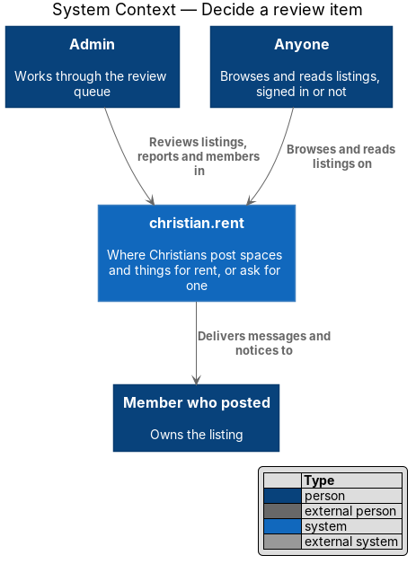

# Decide a review item

## Overview

An admin ends the wait of each review item with one decision. A new listing is approved or
removed. A reported listing is kept or removed. A new member is approved or removed.
Approving a listing makes it public; removing it means it is never, or no longer, public.
Remove asks for confirmation first. A decision is recorded with who made it, on what and
when, and it stands: there is no undo.

- **decision** — one of Approve, Keep or Remove, applied to a review item
- **Approve** — makes a new listing public, or a new member verified
- **Keep** — leaves a reported listing public and closes the report
- **Remove** — makes a listing not public, or removes a member
- **already decided** — refusal given to a second decision on the same item

The queue and the detail panel are designed in
[view-review-queue](../view-review-queue/README.md).

## Description

**Frontend — `admin` library**

- **`cr-review-detail`** (`components`) — its `decision-bar` shows the buttons named in
  `ReviewItemDetail.decisions`: "Approve" and "Remove", or "Keep listing" and "Remove"
  (L2-020, criterion 8). It emits `decide`; the button of the decision in flight is busy and the
  others do nothing; `decided` turns them all off. A warning is projected above the item with
  `slot="notice"`. The panel, and so the bar, is not shown under 768 px.
- **`ConfirmRemoveDialog`** (`admin`, selector `cr-confirm-remove-dialog`) — CDK dialog
  opened for Remove (L2-020, criterion 4). It names what is removed and what follows: the
  listing stops being public, every open report on it is closed, the poster is told, and
  the admin's name and the time are recorded (criterion 9). The same dialog confirms the
  removal of a new listing and of a new member. Focus starts on "Keep it". States:
  `default`, `busy`, `failed`. In `busy` the confirm button carries `aria-busy` and "Keep
  it" is off; in `failed` an alert says nothing has changed and the button reads "Try
  again" (criterion 10). It has no input, so Remove takes no reason.
- **`ReviewDecider.decide(decision, select)`** (`admin`, provided by `ReviewPage`) — calls
  `REVIEW_QUEUE_API.decide(id, decision)` for the open item, one decision at a time. On success
  it selects the next item (`ReviewQueueStore.nextAfter`), then `ReviewQueueStore.drop` removes
  the decided one and lowers the number waiting, and a success toast names the decision and the
  item; no undo is offered (criterion 11). Focus moves to the next item's title. On
  `already_decided` it keeps the item selected by its id while the item leaves the queue, and
  `elsewhere` holds the other admin's decision and time: the panel shows a warning with "Go to
  the next item", the decision buttons are off, and a warning toast says the decision was not
  applied (criterion 13). On any other failure nothing changes and a danger toast offers "Try
  again", which repeats the same decision (criterion 12). The words come from `@rent/domain`'s
  `decision-words`. Removing a reported listing also decides the other items about it on the server;
  the queue drops only the one decided, and opening another shows "This item is no longer
  waiting." until the queue is read again.
- **`ToastQueue`** (`admin`) — route-scoped list of toasts, newest last. A toast dismisses
  itself after 8 s; the timer pauses on hover and focus; a danger toast stays until
  dismissed (L2-020, criterion 14). Timers are cleared on dismissal and on destroy. `cr-toast` renders inside a
  live region so that a screen reader announces each (L2-032, criterion 4).

**Backend**

- **`ReviewQueueController.Decide`** — `POST /api/review-queue/{id}/decision` with
  `{ decision }`, under the `Admin` policy. It sends one
  `DecideReviewItemCommand`.
- **`DecideReviewItemCommandHandler`** — loads the item and its subject, calls
  `ReviewItem.Decide(decision, adminId, now)`, applies the effect from the table, and saves
  everything in one unit of work.

  | Item kind | Decision | Effect |
  |---|---|---|
  | new listing | Approve | `Listing.Approve(now)`: status `Approved`, `ApprovedAt` set |
  | new listing | Remove | `Listing.Remove()`; the poster is told |
  | report | Keep | `Report.Close()`; the listing stays public |
  | report | Remove | `Listing.Remove()`; every waiting review item about the listing is decided as Remove and its report closed; the poster is told |
  | new member | Approve | `Member.Verify()` |
  | new member | Remove | `Member.Remove()` |

  Any other pair is refused with `decision_not_allowed`.
- **`ReviewItem.Decide`** — sets `Decision`, `DecidedBy` and `DecidedAt` and raises
  `AlreadyDecidedException` when a decision exists. These three fields are the record of
  who decided what and when (L2-020, criterion 6); a review item is never deleted.
- **Concurrency** — `ReviewItem.Version` is an EF Core concurrency token. Of two admins who
  decide the same item, the second either finds a decision already set or fails the token
  check on save. Both cases return 409 with the code `already_decided`, the first decision
  and its time, and change nothing (L2-020, criterion 5).
- **`IMemberNotifier`** (`ChristianRent.Application`) — `ListingRemovedAsync(memberId,
  listingId)`. The handler calls it after a listing is removed (L2-020, criterion 7). The
  notice names the listing and never a reporter (L2-021, criterion 4).

**Tests**

The acceptance tests decide through the API. The decision table has a direct handler test,
one case per row, and one test for the refused pairs.

**Decided in ADR 0025**

- The poster is told by a `MemberNotice` that `IMemberNotifier` records with the decision; the
  inbox, when designed, shows it.
- A decision already recorded, or a save whose `ReviewItem.Version` token check fails because
  another admin decided first, answers 409 `already_decided`; the request carries no version.
- At most three toasts show; a fourth drops the oldest that is not a failure.
- The words after each decision, the confirmation for a new listing and a new member, and new
  items noticed every 60 s while the page is visible (L2-019, criterion 12).

### Mocks

The mocks are the source of truth for the UI of this feature. The states this design covers are:

- [`docs/mocks/pages/admin/default.html`](../../../mocks/pages/admin/default.html): Approve and Remove on a new listing
- [`docs/mocks/pages/admin/report.html`](../../../mocks/pages/admin/report.html): Keep listing and Remove on a report
- [`docs/mocks/pages/admin/new-member.html`](../../../mocks/pages/admin/new-member.html): Approve and Remove on a new member
- [`docs/mocks/pages/admin/decided.html`](../../../mocks/pages/admin/decided.html): the item was already decided by another admin
- [`docs/mocks/dialogs/confirm-remove/default.html`](../../../mocks/dialogs/confirm-remove/default.html): the confirmation, focus on "Keep it"
- [`docs/mocks/dialogs/confirm-remove/busy.html`](../../../mocks/dialogs/confirm-remove/busy.html): the removal is in flight
- [`docs/mocks/dialogs/confirm-remove/failed.html`](../../../mocks/dialogs/confirm-remove/failed.html): the removal failed
- [`docs/mocks/notifications/review-toast/success.html`](../../../mocks/notifications/review-toast/success.html): after Approve, Keep or Remove
- [`docs/mocks/notifications/review-toast/warning.html`](../../../mocks/notifications/review-toast/warning.html): another admin decided the item first
- [`docs/mocks/notifications/review-toast/danger.html`](../../../mocks/notifications/review-toast/danger.html): a decision failed; never dismisses itself
- [`docs/mocks/notifications/review-toast/info.html`](../../../mocks/notifications/review-toast/info.html): new items arrived in the queue
- [`docs/mocks/notifications/review-toast/stacked.html`](../../../mocks/notifications/review-toast/stacked.html): a stack of toasts, newest at the bottom

## Requirements

The feature realizes the following level-2 (L2) requirements from
[`docs/specs/L2.md`](../../../specs/L2.md). Each L2 requirement refines a level-1 (L1)
requirement, cited by identifier. The table restates each requirement in `shall` form; the
acceptance criteria in the specification remain authoritative.

| L2 ID | Refines (L1) | Requirement |
|-------|--------------|-------------|
| `L2-018` | `L1-006` | An admin's approval shall make a member verified. An admin's confirmation shall make a church verified for the listings of all its members. The two marks shall be independent, and approving a new member shall not verify their church. A removed member shall no longer sign in, post or message, and their listings shall no longer be public. The backend shall refuse anyone but an admin who sets a verified mark. |
| `L2-019` | `L1-007` | Admin shall list new listings, reports and new members, oldest first, each labelled "New", "Reported" or "New member" with how long it has waited. Selecting an item shall show a detail panel with everything needed to decide. A report's detail shall show the reason and the note and shall not name the reporter. An empty queue shall show "All caught up". More than 50 items shall load in pages. For a person who is not an admin the backend shall refuse and Admin's code shall not be loaded. A notification shall say when new items arrive. |
| `L2-020` | `L1-007` | An admin shall decide each item: Approve or Remove a new listing, Keep or Remove a reported listing, Approve or Remove a new member. Remove shall ask for confirmation, naming what is removed, with focus on "Keep it". A decided item shall leave the queue with a notification and no undo. A decision that cannot be saved shall stay in the queue with "Try again". A second decision on an item shall be refused as already decided. Each decision shall record who made it, on what and when. The member who posted a removed listing shall be told. |
| `L2-025` | `L1-011` | Every endpoint other than browsing, searching, reading an approved listing and serving its photos shall respond 401 to anyone not signed in. Listing the churches, joining and asking who is signed in shall not be refused for want of membership. The backend shall refuse a request for, or a change to, anything that is not the member's own, and shall reveal nothing about it. A refusal a screen branches on shall be a ProblemDetails with a `code`. |
| `L2-032` | `L1-014` | Every screen shall meet WCAG 2.2 level AA. Every action shall be completable by keyboard with visible focus. A state shall be carried by text or an announced attribute, never by colour alone. Confirmations and errors shall be announced. Every field shall have a visible label with its error tied to it. Reduced motion shall be honoured, and text at 200% shall lose nothing. "Skip to content" shall be the first control, and a dialog shall hold focus and return it on close. |

## Diagrams

### System context

The people involved are: admin, member who posted, anyone. Each reaches the feature through christian.rent, which takes no payment and holds no booking calendar.

### Containers

The rent application calls `ChristianRent.Api` over JSON/HTTPS. The API persists state through EF Core.

### Components

The decision bar emits to `ReviewPage`, which opens `ConfirmRemoveDialog` for Remove and
then calls `ReviewQueueStore`. The handler records the decision on `ReviewItem`, applies the
effect to the subject, and calls `IMemberNotifier` when a listing is removed.

### Class structure

`ReviewItem` owns the decision, the rule for which decisions its kind allows, and the
refusal of a second decision. The handler applies the effect to `Listing`, `Report` or
`Member`.

### Behaviour — approve a new listing

Approve records the decision and makes the listing public in one unit of work (`L2-020`).
A second admin's decision on the same item is refused as already decided.

### Behaviour — remove a reported listing

Remove asks for confirmation (`L2-020`, criterion 4). The handler removes the listing,
decides every waiting item about it, and tells the poster without naming a reporter.

