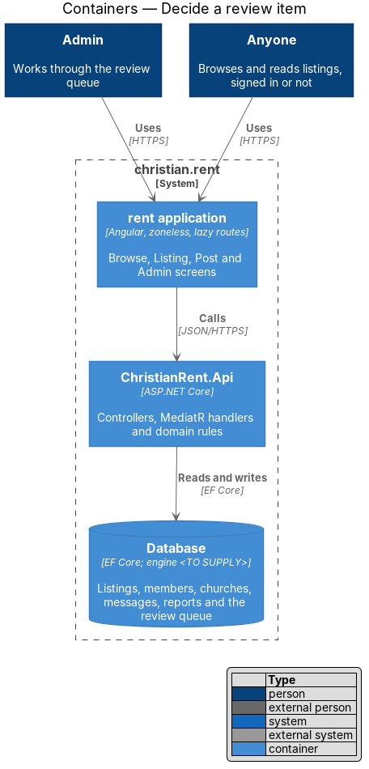
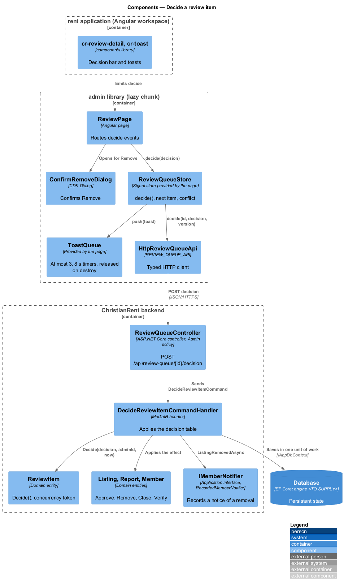
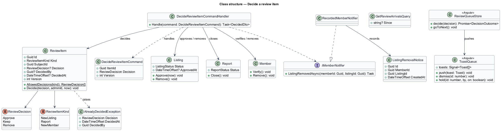
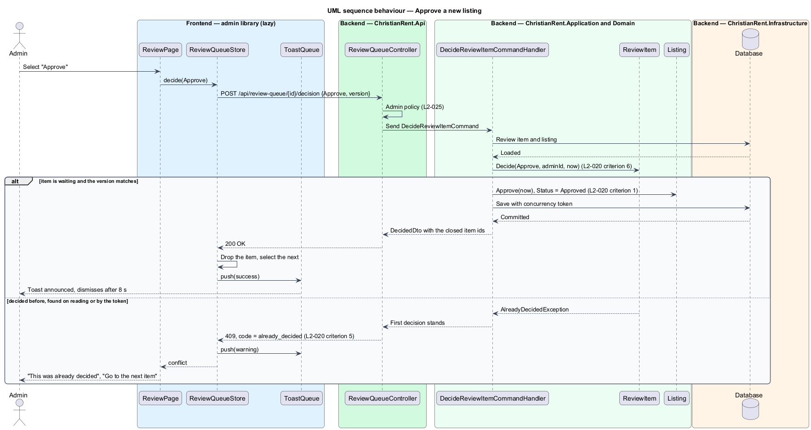
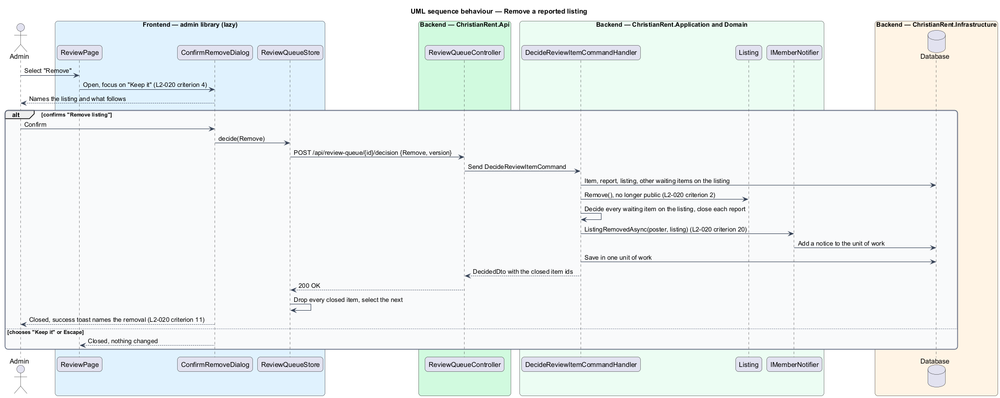

# Decide a review item

## Overview

An admin ends the wait of each review item with one decision. A new listing is approved or
removed. A reported listing is kept or removed. A new member is approved or removed.
Approving a listing makes it public; removing it means it is never, or no longer, public.
Remove asks for confirmation first. A decision is recorded with who made it, on what and
when, and it stands: there is no undo.

- **decision** — one of Approve, Keep or Remove, applied to a review item
- **Approve** — makes a new listing public, or a new member verified
- **Keep** — leaves a reported listing public and closes the report
- **Remove** — makes a listing not public, or removes a member
- **already decided** — refusal given to a second decision on the same item

The queue and the detail panel are designed in
[view-review-queue](../view-review-queue/README.md).

## Description

**Frontend — `admin` library**

- **`cr-review-detail`** (`components`) — its `decision-bar` shows the buttons of
  `ReviewDetailView.decisions`, written from `ReviewItemDetail.allowedDecisions`: "Approve"
  and "Remove", or "Keep listing" and "Remove" (L2-020, criterion 8), beside "View on site"
  for a report. It emits `decide`. While `deciding` names a decision, that button carries
  `aria-busy` and every decision button is off (criterion 16). Given a `conflict`, it draws a
  warning above the item, turns the buttons off, and emits `next` from "Go to the next item"
  (criterion 13). The panel is not shown under 768 px.
- **`ReviewPage`** — for Remove it opens `ConfirmRemoveDialog`; it calls the store for
  anything else. It draws the store's toasts in a `cr-toast-region` that is on the page before
  any toast arrives (L2-032, criterion 4), and after a decision, or "Go to the next item",
  moves focus to the row then selected, or to the heading "Review" when none is left
  (criterion 15). It provides `ReviewQueueStore` and `ToastQueue`, which go with it.
- **`ConfirmRemoveDialog`** (selector `cr-confirm-remove-dialog`) — a CDK dialog in
  `cr-dialog` with the danger icon. `toRemoveCopy` (`domain`) writes its title, description,
  button and failure for a reported listing, a new listing and a new member (criterion 9).
  Focus starts on "Keep it" and returns to Remove when it is kept. States: `default`, `busy`,
  `failed`. In `busy` the confirm button carries `aria-busy`, "Keep it" and Close are off and
  Escape does nothing; in `failed` an alert says nothing has changed and the button reads "Try
  again" (criterion 10). It closes once the removal is made, or the item turns out decided or
  gone. It has no input, so Remove takes no reason.
- **`ReviewQueueStore.decide(decision)`** — decides the selected item: it calls
  `REVIEW_QUEUE_API.decide(id, decision, version)` and answers what came of it (`done`,
  `conflict`, `gone`, `failed` or `ignored`). One decision is in flight at a time, in
  `deciding`; destroying the store aborts it.
  - On success it drops every item in `closedItemIds` from the window, lowers `waitingCount`
    by as many, selects the row that followed the decided one, or the one before, and pushes a success toast that `toDecisionToast` writes;
    no undo is offered (criteria 11 and 15). A selection the admin made meanwhile stays. When
    the rows held run out while more wait, it reads the queue again; with none waiting it
    shows "All caught up".
  - On `already_decided` it sets `conflict` for that item with the first decision, its time
    and whether it was the admin's own, and pushes a warning toast (criteria 13 and 17).
    `goToNext()` then drops the item.
  - On `not_found` the detail is `gone` (criterion 18).
  - On any other failure it keeps the selection. For Approve and Keep it pushes a danger toast
    with "Try again", which repeats the same decision on the same item (criterion 12); a
    removal's failure is answered to the dialog.
- **New items** (L2-019, criterion 12) — the store keeps the `asOf` of the first page. While
  the queue is shown or empty and the page is visible, every 60 s it asks
  `REVIEW_QUEUE_API.arrivals(asOf)`. When more have arrived than it has said, it pushes an
  info toast that `toArrivalsToast` writes, with "Show them", which loads the queue again.
  Loading again and destroying the store stop the timer and abort the request.
- **`ToastQueue`** — the toasts, newest last, at most 3. A toast with the `key` of one shown
  replaces it; a fourth drops the oldest that would dismiss itself, or the oldest. A toast
  dismisses itself after 8 s; the time is paused while the pointer or the focus is on it; a
  danger toast stays until dismissed (L2-020, criterion 14). Timers are cleared on dismissal
  and on destroy.
- **`cr-toast`** — gains `timed` and `paused`: a toast that dismisses itself draws
  `toast__progress`, which stops while paused.

**Frontend — `api` and `domain`**

`ReviewQueuePage` gains `asOf`, and `ReviewItemDetail` gains `version` and `allowedDecisions`.
`ReviewQueueApi` gains `decide` and `arrivals`. An `ApiError` of `already_decided` carries
`decided`. `domain/review/decision-words` writes every word of the buttons, the
confirmation, the conflict and the toasts, with a test per case.

**Backend**

- **`ReviewQueueController.Decide`** — `POST /api/review-queue/{id}/decision` with
  `{ decision, version }` (`approve`, `keep` or `remove`), under the `Admin` policy. It sends
  one `DecideReviewItemCommand` and answers `DecidedDto { ClosedItemIds }`: the item, and every
  other item the decision closed.
- **`DecideReviewItemCommandHandler`** — loads the item; refuses a decided one; refuses one
  that no longer waits (`WaitingReviewItems`) with `not_found`; calls
  `ReviewItem.Decide(decision, adminId, now)`, applies the effect from the table, and saves
  everything in one unit of work.

  | Item kind | Decision | Effect |
  |---|---|---|
  | new listing | Approve | `Listing.Approve(now)`: status `Approved`, `ApprovedAt` set |
  | new listing | Remove | `Listing.Remove()`; a notice is recorded for the poster |
  | report | Keep | `Report.Close()`; the listing stays public |
  | report | Remove | `Listing.Remove()`; every waiting review item about the listing is decided as Remove and its report closed; one notice is recorded for the poster |
  | new member | Approve | `Member.Verify()`; the church is not touched (L2-018, criterion 6) |
  | new member | Remove | `Member.Remove()`: no longer a member, and their listings are not public (L2-018, criterion 4) |

  Any other pair is refused with 409 `decision_not_allowed`.
- **`ReviewItem`** — gains `Decision`, `DecidedBy`, `DecidedAt` and `Version`.
  `AllowedDecisions(kind)` is the table's pairs. `Decide` sets the three fields, raises
  `Version`, and raises `AlreadyDecidedException` when a decision exists. The three fields are
  the record of who decided what and when (L2-020, criterion 6); a decision never deletes an
  item. `WaitingReviewItems` leaves decided items out, so the queue, its count and the detail
  do.
- **Concurrency** ([ADR 0026](../../../adr/0026-two-admins-deciding-one-item.md)) —
  `Version` is an EF Core concurrency token. A second decision, found on reading or by the
  token on saving, is a 409 `already_decided` with `decision`, `decidedAt` and
  `decidedByYou`, and changes nothing. The same admin repeating the same decision is answered
  as made. An undecided item sent another version is refused with `version_unknown`.
- **`IMemberNotifier`** (`ChristianRent.Application`) — `ListingRemovedAsync(memberId,
  listingId)`. The handler calls it before it saves. `RecordedMemberNotifier`
  (`ChristianRent.Infrastructure`) adds a `ListingRemovalNotice` and sends nothing
  ([ADR 0025](../../../adr/0025-telling-a-poster-their-listing-was-removed.md); criteria 7 and
  20). The notice names the listing and never a reporter (L2-021, criterion 4).
  `purge-departed` deletes a departed member's notices.
- **`GetReviewItemQueryHandler`** — its answer gains `version` and `allowedDecisions`.
- **Arrivals** — `GET /api/review-queue` answers `asOf`, and
  `GET /api/review-queue/arrivals?since=` sends `GetReviewArrivalsQuery`, which answers
  `{ newListings, reports, newMembers }`: the waiting items made after `since`
  (`since_invalid` when it is not an instant).

**Tests**

The acceptance tests decide through the API. The decision table has a direct handler test,
one case per row, and one test for the refused pairs. The toast times and the 60 s look are
unit-tested on a fake clock.

**Decided where this design left it open** — telling a poster
([ADR 0025](../../../adr/0025-telling-a-poster-their-listing-was-removed.md)); two admins
([ADR 0026](../../../adr/0026-two-admins-deciding-one-item.md)); at most 3 toasts, the look for
new items, the three confirmations, focus and a removed member
([ADR 0027](../../../adr/0027-deciding-a-review-item-open-decisions.md)).

### Mocks

The mocks are the source of truth for the UI of this feature. The states this design covers are:

- [`docs/mocks/pages/admin/default.html`](../../../mocks/pages/admin/default.html): Approve and Remove on a new listing
- [`docs/mocks/pages/admin/report.html`](../../../mocks/pages/admin/report.html): Keep listing and Remove on a report
- [`docs/mocks/pages/admin/new-member.html`](../../../mocks/pages/admin/new-member.html): Approve and Remove on a new member
- [`docs/mocks/pages/admin/deciding.html`](../../../mocks/pages/admin/deciding.html): a decision is in flight
- [`docs/mocks/pages/admin/decided.html`](../../../mocks/pages/admin/decided.html): the item was already decided by another admin
- [`docs/mocks/dialogs/confirm-remove/default.html`](../../../mocks/dialogs/confirm-remove/default.html): the confirmation for a reported listing, focus on "Keep it"
- [`docs/mocks/dialogs/confirm-remove/new-listing.html`](../../../mocks/dialogs/confirm-remove/new-listing.html): the confirmation for a new listing
- [`docs/mocks/dialogs/confirm-remove/new-member.html`](../../../mocks/dialogs/confirm-remove/new-member.html): the confirmation for a new member
- [`docs/mocks/dialogs/confirm-remove/busy.html`](../../../mocks/dialogs/confirm-remove/busy.html): the removal is in flight
- [`docs/mocks/dialogs/confirm-remove/failed.html`](../../../mocks/dialogs/confirm-remove/failed.html): the removal failed
- [`docs/mocks/notifications/review-toast/success.html`](../../../mocks/notifications/review-toast/success.html): after Approve, Keep or Remove
- [`docs/mocks/notifications/review-toast/warning.html`](../../../mocks/notifications/review-toast/warning.html): another admin decided the item first
- [`docs/mocks/notifications/review-toast/danger.html`](../../../mocks/notifications/review-toast/danger.html): a decision failed; never dismisses itself
- [`docs/mocks/notifications/review-toast/info.html`](../../../mocks/notifications/review-toast/info.html): new items arrived in the queue
- [`docs/mocks/notifications/review-toast/stacked.html`](../../../mocks/notifications/review-toast/stacked.html): a stack of toasts, newest at the bottom

## Requirements

The feature realizes the following level-2 (L2) requirements from
[`docs/specs/L2.md`](../../../specs/L2.md). Each L2 requirement refines a level-1 (L1)
requirement, cited by identifier. The table restates each requirement in `shall` form; the
acceptance criteria in the specification remain authoritative.

| L2 ID | Refines (L1) | Requirement |
|-------|--------------|-------------|
| `L2-018` | `L1-006` | An admin's approval shall make a member verified. An admin's confirmation shall make a church verified for the listings of all its members. The two marks shall be independent, and approving a new member shall not verify their church. A removed member shall no longer sign in, post or message, and their listings shall no longer be public. The backend shall refuse anyone but an admin who sets a verified mark. |
| `L2-019` | `L1-007` | Admin shall list new listings, reports and new members, oldest first, each labelled "New", "Reported" or "New member" with how long it has waited. Selecting an item shall show a detail panel with everything needed to decide. A report's detail shall show the reason and the note and shall not name the reporter. An empty queue shall show "All caught up". More than 50 items shall load in pages. For a person who is not an admin the backend shall refuse and Admin's code shall not be loaded. A notification shall say when new items arrive. |
| `L2-020` | `L1-007` | An admin shall decide each item: Approve or Remove a new listing, Keep or Remove a reported listing, Approve or Remove a new member. Remove shall ask for confirmation, naming what is removed, with focus on "Keep it". A decided item shall leave the queue with a notification and no undo. A decision that cannot be saved shall stay in the queue with "Try again". A second decision on an item shall be refused as already decided. Each decision shall record who made it, on what and when. The member who posted a removed listing shall be told. |
| `L2-025` | `L1-011` | Every endpoint other than browsing, searching, reading an approved listing and serving its photos shall respond 401 to anyone not signed in. Listing the churches, joining and asking who is signed in shall not be refused for want of membership. The backend shall refuse a request for, or a change to, anything that is not the member's own, and shall reveal nothing about it. A refusal a screen branches on shall be a ProblemDetails with a `code`. |
| `L2-032` | `L1-014` | Every screen shall meet WCAG 2.2 level AA. Every action shall be completable by keyboard with visible focus. A state shall be carried by text or an announced attribute, never by colour alone. Confirmations and errors shall be announced. Every field shall have a visible label with its error tied to it. Reduced motion shall be honoured, and text at 200% shall lose nothing. "Skip to content" shall be the first control, and a dialog shall hold focus and return it on close. |

## Diagrams

### System context

The people involved are: admin, member who posted, anyone. Each reaches the feature through christian.rent, which takes no payment and holds no booking calendar.

### Containers

The rent application calls `ChristianRent.Api` over JSON/HTTPS. The API persists state through EF Core.

### Components

The decision bar emits to `ReviewPage`, which opens `ConfirmRemoveDialog` for Remove; the
decision goes to `ReviewQueueStore`, which pushes to `ToastQueue`. The handler records the
decision on `ReviewItem`, applies the effect to the subject, and calls `IMemberNotifier`
when a listing is removed.

### Class structure

`ReviewItem` owns the decision, the rule for which decisions its kind allows, and the
refusal of a second decision. The handler applies the effect to `Listing`, `Report` or
`Member`.

### Behaviour — approve a new listing

Approve records the decision and makes the listing public in one unit of work (`L2-020`).
A second admin's decision on the same item is refused as already decided.

### Behaviour — remove a reported listing

Remove asks for confirmation (`L2-020`, criterion 4). The handler removes the listing,
decides every waiting item about it, and tells the poster without naming a reporter.

