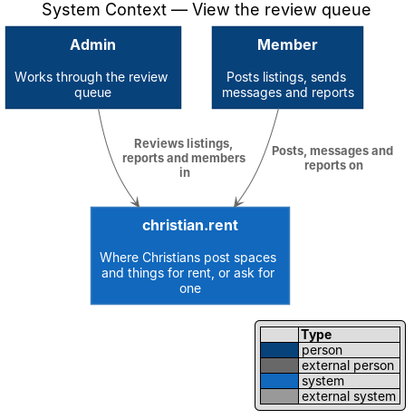
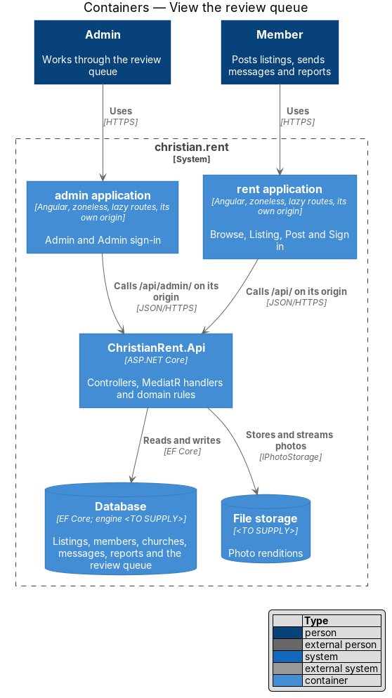
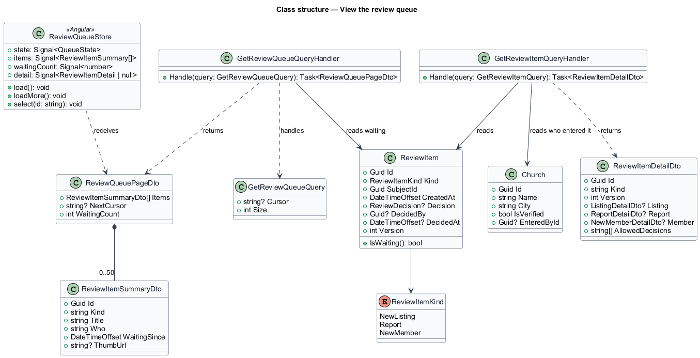

# View the review queue

## Overview

Admin, at `/admin`, is the screen an admin works through. It holds the **review queue**:
every new listing, every report and every new member that waits for a decision, oldest
first. Selecting an item shows a detail panel with everything needed to decide. When
nothing waits, the screen says "All caught up".

- **admin** — member allowed to review; the backend decides who is one
- **review item** — one entry in the queue, of the kind new listing, report or new member
- **detail panel** — panel beside the queue that shows the selected item in full
- **waiting** — state of a review item that has no decision yet

Only an admin sees the queue. For anyone else the backend refuses, returns no queue data,
and the browser never downloads Admin's code. Deciding an item is designed in
[decide-review-item](../decide-review-item/README.md).

## Description

**Frontend — `rent` application**

- **Route `/admin`** — `{ path: 'admin', canMatch: [adminGuard], loadChildren: () =>
  import('@rent/admin').then(m => m.ADMIN_ROUTES) }`, followed by
  `{ path: 'admin', loadComponent: ForbiddenPage }`.
- **`adminGuard`** — a `CanMatchFn` that awaits `SESSION.refresh()` and returns
  `member()?.isAdmin === true`. When it returns false the route does not match, the
  `@rent/admin` chunk is never requested (L2-019, criterion 5), and the next route renders
  "This page is for admins". The guard is a convenience; the backend's refusal is the rule.
- **`ForbiddenPage`** — small lazy page in `rent`: the header and a `cr-plain-page`. It names
  the signed-in member, or says that the person is not signed in as an admin, and links back
  to Browse (L2-019, criteria 11 and 22).

**Frontend — `admin` library (`frontend/projects/admin`, imported as `@rent/admin`)**

A new library, loaded only for an admin. Its place in the dependency direction is
`rent` → `admin` → `components`, `api`, `domain`; `AGENTS.md` and the ESLint boundaries say
so. `rent` imports it only with `import('@rent/admin')`.

- **`ADMIN_ROUTES`** — one route whose `providers` bind `REVIEW_QUEUE_API` to
  `HttpReviewQueueApi`, so its code stays out of the initial bundle. The client holds no
  state.
- **`ReviewPage`** (selector `cr-review-page`) — lays out `cr-admin-nav`, the queue and the
  detail panel with `cr-admin-layout`. It watches `(min-width: 48rem)` with `matchMedia`:
  under it, it shows the queue and a note that deciding needs a wider screen, and asks for no
  detail; from it, the detail panel sits beside the queue and the first item is selected
  (L2-019, criterion 13; L2-031, criteria 5 and 7). The heading "Review" carries
  "4 waiting · oldest first", and "· showing 50" when more wait than are held (criteria 6 and
  10). An `IntersectionObserver` watches the ends of the list, and the spacers that stand for
  released rows, and loads the page beyond them; so a jump into a spacer, as the Home key
  makes, loads what belongs there. It removes the media listener and disconnects the observer
  when it is destroyed. It provides `ReviewQueueStore` itself: Angular keeps a route's
  providers after the route is left, so only the page's own end can end the store.
- **`ReviewQueueStore`** — `state` (`loading`, `loaded`, `empty`, `failed`), `pages`,
  `waitingCount`, `moreState`, `selectedId`, `detailState` (`none`, `loading`, `loaded`,
  `failed`, `gone`) and `detail`. It loads pages of 50 by cursor and holds at most 3 in a `ListingWindow`
  (criteria 4 and 19). `select(id)` loads the detail and aborts the previous detail request.
  A loading state is shown only after 300 ms (L2-033, criterion 5). Destroying it aborts both
  requests and clears its timers.

**Frontend — `domain`**

`domain/review` turns the API's data into the words the screen shows: `formatWaiting`
(criterion 14), `toQueueItemView`, `toReviewDetailView` (criteria 7 to 9, 16 and 17) and
`queueSummary`, each with a test per case. `ListingWindow` is shared with Browse.

**Frontend — `components` library**

- **`cr-admin-layout`** — the `admin` block: slots for the rail, the queue and the detail.
- **`cr-admin-nav`** — the ink rail: logo, "Admin · {name}", Review with its count, "Back
  to site".
- **`cr-queue-header`**, **`cr-queue-list`**, **`cr-queue-more`** — the heading, the
  summary and the phone's note; the list of rows; and "Showing 50 of 63" with "Load 13
  more", busy and failed. `ReviewPage` draws the spacers around the list.
- **`cr-queue-item`** — the listing's title or the member's name, who posted or which
  church, how long it has waited, and a `cr-tag` that names the kind in text: "New",
  "Reported", "New member" (criterion 6). From 768 px it is a button, and the selected one
  carries `aria-current`. A long title is cut with an ellipsis and keeps its full text for
  assistive technology. With no item it draws a skeleton row.
- **`cr-review-detail`** — the detail panel; its content differs by kind. It takes a
  `ReviewDetailView`, whose every word `domain` has written.
- **`cr-empty-state`** — "All caught up" (variant `done`, criterion 3), the failed queue, and
  the failed or gone detail (criterion 21).

**Backend**

- **`ReviewQueueController`** — `[Authorize(Policy = "Admin")]`. `GET /api/review-queue`
  sends `GetReviewQueueQuery`; `GET /api/review-queue/{id}` sends `GetReviewItemQuery`.
  Nobody signed in receives 401 `not_signed_in`; anyone else who is not an admin receives
  403 `not_an_admin`. Neither carries queue data.
- **`WaitingReviewItems`** — the items whose subject still waits (ADR 0024; criterion 18):
  a new listing waiting for review, an open report on an approved listing, or a member; the
  poster or member active. Both handlers read through it.
- **`GetReviewQueueQueryHandler`** — orders waiting items by `CreatedAt` then `Id`, both
  ascending, pages by keyset cursor (`KeysetCursor`, shared with Browse), and returns
  `ReviewQueuePageDto { Items, NextCursor, WaitingCount }`. `size` is 1 to 50, by default 50
  (`page_size_out_of_range`, `cursor_invalid`).
- **`ReviewItemSummaryDto`** — `{ Id, Kind, Title, Who, WaitingSince, Offer?, ThumbUrl? }`.
  `Kind` is `new-listing`, `report` or `new-member`. `Who` is the poster, or a new member's
  church. `ThumbUrl` is the `thumb` rendition of a listing for rent that has a photo; an admin
  may read it before the listing is public (ADR 0021).
- **`GetReviewItemQueryHandler`** — returns `ReviewItemDetailDto { Id, Kind, WaitingSince,
  Listing?, Report?, Member? }`, exactly one part set, or `not_found` for an item that does
  not wait or an address that is not an identifier:
  - new listing: every field, the photos in the member's order, the poster with both
    verified flags, the church, when the poster joined and when it was posted (criteria 2,
    7 and 15);
  - report: the same listing, the reason (`fake`, `inappropriate`, `scam`, `other`), the
    note, when it was reported and since when the listing has been public. It holds no
    reporter. "View on site" opens the listing (criterion 8);
  - new member: name, when they joined, church, city, whether the church is verified and who
    entered it, the counts of the member's listings that are not removed (all, for rent,
    public), and the count of messages sent. The panel's one control for the church confirms
    it ([verify-members-and-churches](../../members/verify-members-and-churches/README.md);
    criteria 9, 16 and 17).
- **`ReviewItem`** — `{ Id, Kind, SubjectId, CreatedAt }`. `SubjectId` names a listing, a
  report or a member according to `Kind`. Journey 11 adds the decision.
- **`Church.EnteredById`** — the member who entered the church when they joined, or null.
- **`GrantAdminCommand`** — `ChristianRent.Cli grant-admin <member-id>` makes an active
  member an admin (criterion 23). Nothing else does.

**Deciding**

- Approve, Keep and Remove, their toasts and the notification that new items arrived
  (L2-019, criterion 12), with how the store learns of them, are
  [decide-review-item](../decide-review-item/README.md). It adds `Decision`, `DecidedBy`,
  `DecidedAt` and `Version` to `ReviewItem`, which `WaitingReviewItems` uses to leave decided
  items out, `version` and `allowedDecisions` to the detail, and `asOf` to a page.

### Mocks

The mocks are the source of truth for the UI of this feature. The states this design covers are:

- [`docs/mocks/pages/admin/default.html`](../../../mocks/pages/admin/default.html): the queue with a new listing selected
- [`docs/mocks/pages/admin/report.html`](../../../mocks/pages/admin/report.html): a report's detail
- [`docs/mocks/pages/admin/new-member.html`](../../../mocks/pages/admin/new-member.html): a new member's detail
- [`docs/mocks/pages/admin/wanted.html`](../../../mocks/pages/admin/wanted.html): a new wanted listing's detail
- [`docs/mocks/pages/admin/loading.html`](../../../mocks/pages/admin/loading.html): skeleton rows and panel
- [`docs/mocks/pages/admin/empty.html`](../../../mocks/pages/admin/empty.html): "All caught up"
- [`docs/mocks/pages/admin/error.html`](../../../mocks/pages/admin/error.html): the queue failed to load
- [`docs/mocks/pages/admin/forbidden.html`](../../../mocks/pages/admin/forbidden.html): a member who is not an admin
- [`docs/mocks/pages/admin/long.html`](../../../mocks/pages/admin/long.html): 50 rows and long titles
- [`docs/mocks/pages/admin/photos.html`](../../../mocks/pages/admin/photos.html): a listing with several photos
- [`docs/mocks/pages/admin/more-loading.html`](../../../mocks/pages/admin/more-loading.html): the next page is on its way
- [`docs/mocks/pages/admin/more-error.html`](../../../mocks/pages/admin/more-error.html): the next page failed
- [`docs/mocks/pages/admin/detail-error.html`](../../../mocks/pages/admin/detail-error.html): the detail failed to load
- [`docs/mocks/pages/admin/detail-gone.html`](../../../mocks/pages/admin/detail-gone.html): the item is no longer waiting
- [`docs/mocks/pages/admin/forbidden-signed-out.html`](../../../mocks/pages/admin/forbidden-signed-out.html): a person nobody knows as a member
- [`docs/mocks/notifications/review-toast/info.html`](../../../mocks/notifications/review-toast/info.html): new items arrived in the queue (journey 11)

## Requirements

The feature realizes the following level-2 (L2) requirements from
[`docs/specs/L2.md`](../../../specs/L2.md). Each L2 requirement refines a level-1 (L1)
requirement, cited by identifier. The table restates each requirement in `shall` form; the
acceptance criteria in the specification remain authoritative.

| L2 ID | Refines (L1) | Requirement |
|-------|--------------|-------------|
| `L2-019` | `L1-007` | Admin shall list new listings, reports and new members, oldest first, each labelled "New", "Reported" or "New member" with how long it has waited. Selecting an item shall show a detail panel with everything needed to decide. A report's detail shall show the reason and the note and shall not name the reporter. An empty queue shall show "All caught up". More than 50 items shall load in pages. For a person who is not an admin the backend shall refuse and Admin's code shall not be loaded. A notification shall say when new items arrive. |
| `L2-025` | `L1-011` | Every endpoint other than browsing, searching, reading an approved listing and serving its photos shall respond 401 to anyone not signed in. Listing the churches, joining and asking who is signed in shall not be refused for want of membership. The backend shall refuse a request for, or a change to, anything that is not the member's own, and shall reveal nothing about it. A refusal a screen branches on shall be a ProblemDetails with a `code`. |
| `L2-030` | `L1-012` | With 10,000 approved listings, a page of Browse or a search shall respond within 300 ms and a single listing within 200 ms, at the 95th percentile. A list endpoint shall return at most one page and shall refuse a page size above 50. Browser memory shall stay bounded while a person scrolls 500 listings. |
| `L2-031` | `L1-013` | No screen shall be cut off or scroll sideways from 320 px. Browse shall show one column of cards under 576 px, two from 576 px, three from 768 px and four from 1200 px, with wider gutters from 992 px. From 768 px the message box, the live preview and the Admin detail panel shall sit beside their main column; below it they shall sit under it, and Admin shall show only the queue and a note that deciding needs a wider screen. A dialog shall be a bottom sheet under 640 px. Every touch target shall be at least 44 × 44 px. |
| `L2-033` | `L1-015` | A waiting screen shall show a loading state in the shape of what will arrive, and none when the request answers within 300 ms. An unreachable backend shall produce a plain message and "Try again". An address that matches no screen shall show "not found" with a way back to Browse. An unhandled backend error shall be a ProblemDetails with no stack trace, recorded with a trace id. |

## Diagrams

### System context

The people involved are: admin, member. Each reaches the feature through christian.rent, which takes no payment and holds no booking calendar.

### Containers

The rent application calls `ChristianRent.Api` over JSON/HTTPS. The API persists state through EF Core and keeps photo files in file storage, outside the database.

### Components

`adminGuard` decides whether the lazy `admin` library loads. Inside it, `ReviewPage` renders
from `ReviewQueueStore`. `ReviewQueueController` carries the `Admin` policy, and two
handlers read `ReviewItem` rows and their subjects.

### Class structure

`ReviewItem` points at its subject through `Kind` and `SubjectId`. The summary DTO feeds the
queue rows; the detail DTO holds exactly one of its three optional parts.

### Behaviour — open Admin

For an admin the guard matches, the `admin` chunk loads and the queue arrives oldest first
(`L2-019`). For anyone else no chunk loads, and a direct call to the endpoint is refused
with no data.

### Behaviour — select an item

Selecting a row loads its detail by kind (`L2-019`, criterion 2). A newer selection aborts
the earlier request.

