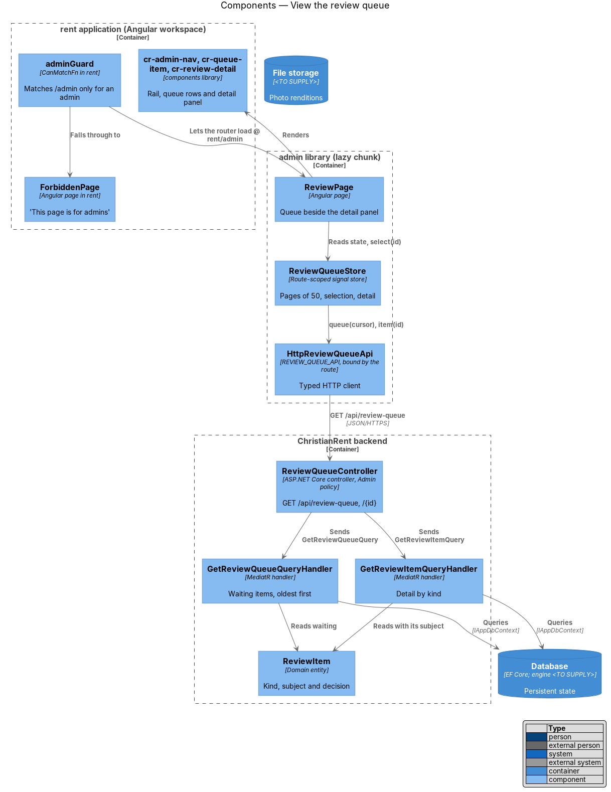
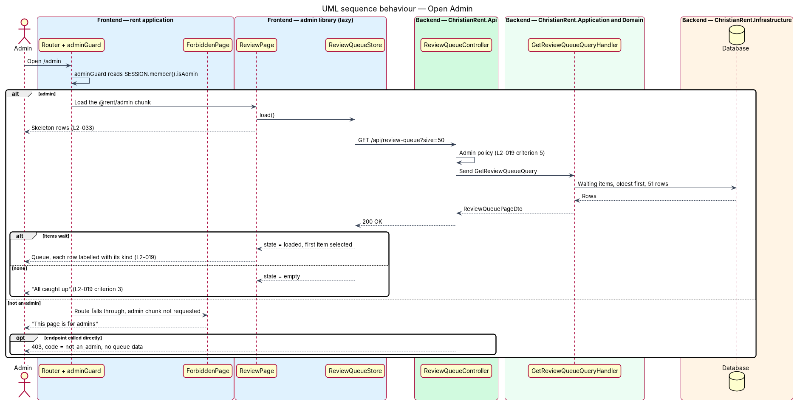
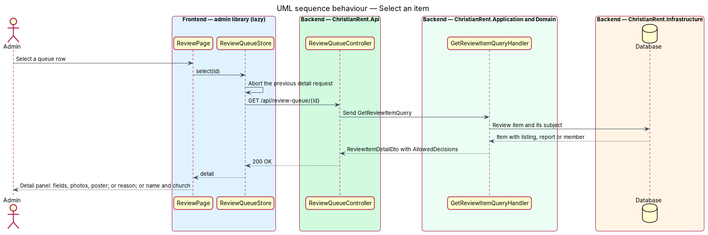

# View the review queue

## Overview

Admin, at `/admin`, is the screen an admin works through. It holds the **review queue**:
every new listing, every report and every new member that waits for a decision, oldest
first. Selecting an item shows a detail panel with everything needed to decide. When
nothing waits, the screen says "All caught up".

- **admin** — member allowed to review; the backend decides who is one
- **review item** — one entry in the queue, of the kind new listing, report or new member
- **detail panel** — panel beside the queue that shows the selected item in full
- **waiting** — state of a review item that has no decision yet

Only an admin sees the queue. For anyone else the backend refuses, returns no queue data,
and the browser never downloads Admin's code. Deciding an item is designed in
[decide-review-item](../decide-review-item/README.md).

## Description

**Frontend — `rent` application**

- **Route `/admin`** — `{ path: 'admin', canMatch: [adminGuard], loadChildren: () =>
  import('@rent/admin').then(m => m.ADMIN_ROUTES) }`.
- **`adminGuard`** — a `CanMatchFn` that awaits `SESSION` and returns
  `member()?.isAdmin === true`. When it returns false the route does not match, the
  `@rent/admin` chunk is never requested (L2-019, criterion 5), and the next route,
  `{ path: 'admin', loadComponent: ForbiddenPage }`, renders "This page is for admins".
  The guard is a convenience; the backend's refusal is the rule.
- **`ForbiddenPage`** — small lazy page in `rent` with a way back to Browse.

**Frontend — `admin` library (`frontend/projects/admin`, imported as `@rent/admin`)**

A new library, loaded only for an admin. Its place in the dependency direction is
`rent` → `admin` → `components`, `api`, `domain`; the change that adds it updates
`AGENTS.md` and the ESLint boundaries.

- **`ADMIN_ROUTES`** — one route whose `providers` bind `REVIEW_QUEUE_API` to
  `HttpReviewQueueApi` and provide `ReviewQueueStore` and `ToastQueue`, so their code and
  state stay out of the initial bundle and go when the admin leaves.
- **`ReviewPage`** (selector `cr-review-page`) — lays out `cr-admin-nav`, the queue and the
  detail panel with the `admin` block. Under 768 px it shows the queue and a note that
  deciding needs a wider screen; from 768 px the detail panel sits beside the queue
  (L2-031, criterion 5).
- **`ReviewQueueStore`** — `state` (`loading`, `loaded`, `empty`, `failed`), `items`,
  `waitingCount`, `selectedId`, `detail`. It loads pages of 50 by cursor as the list end is
  reached, and keeps at most 3 pages in memory, like `ListingWindow`. `select(id)` loads the
  detail and aborts the previous detail request.

**Frontend — `components` library**

- **`cr-admin-nav`** — the ink rail: logo, "Admin · {name}", Review with its count, "Back
  to site".
- **`cr-queue-item`** — title, who, how long it has waited, and a `cr-tag` that names the
  kind in text: "New", "Reported", "New member". The selected item carries `aria-current`.
- **`cr-review-detail`** — the detail panel; its content differs by kind.
- **`cr-empty-state`** — "All caught up" (L2-019, criterion 3), and the failed state.

**Backend**

- **`ReviewQueueController`** — `[Authorize(Policy = "Admin")]`. `GET /api/review-queue`
  sends `GetReviewQueueQuery`; `GET /api/review-queue/{id}` sends `GetReviewItemQuery`.
  A member who is not an admin receives 403 with the code `not_an_admin` and no data.
- **`GetReviewQueueQueryHandler`** — selects review items with no decision, ordered by
  `CreatedAt` ascending then `Id`, pages by keyset cursor with `Size = 50`, and returns
  `ReviewQueuePageDto { Items, NextCursor, WaitingCount }`.
- **`ReviewItemSummaryDto`** — `{ Id, Kind, Title, Who, WaitingSince, Offer?, ThumbUrl? }`.
- **`GetReviewItemQueryHandler`** — returns `ReviewItemDetailDto` by kind (L2-019,
  criterion 2):
  - new listing: every field, the photos, the poster with both verified flags, the church,
    "Member since" and the posting time;
  - report: the same listing detail, the reason, the note, when it was reported, and
    "Public since";
  - new member: name, church and city, the declaration, the church's status, the count of
    the member's listings and of messages sent.
- **`ReviewItem`** — `{ Id, Kind, SubjectId, CreatedAt, Decision?, DecidedBy?, DecidedAt?,
  Version }`. `SubjectId` names a listing, a report or a member according to `Kind`.

**Undecided**

- How a member becomes an admin (who sets `Member.IsAdmin`): `<TO SUPPLY>`. Seed data may
  create the first admin.
- Whether the detail of a report names the reporter to the admin. The mock shows "by a
  member"; the design returns no reporter identity.
- Whether the queue refreshes while open when new items arrive: `<TO SUPPLY>`. The design
  loads on entry and after each decision.

### Mocks

The mocks are the source of truth for the UI of this feature. The states this design covers are:

- [`docs/mocks/pages/admin/default.html`](../../../mocks/pages/admin/default.html): the queue with a new listing selected
- [`docs/mocks/pages/admin/report.html`](../../../mocks/pages/admin/report.html): a report's detail
- [`docs/mocks/pages/admin/new-member.html`](../../../mocks/pages/admin/new-member.html): a new member's detail
- [`docs/mocks/pages/admin/wanted.html`](../../../mocks/pages/admin/wanted.html): a new wanted listing's detail
- [`docs/mocks/pages/admin/loading.html`](../../../mocks/pages/admin/loading.html): skeleton rows and panel
- [`docs/mocks/pages/admin/empty.html`](../../../mocks/pages/admin/empty.html): "All caught up"
- [`docs/mocks/pages/admin/error.html`](../../../mocks/pages/admin/error.html): the queue failed to load
- [`docs/mocks/pages/admin/forbidden.html`](../../../mocks/pages/admin/forbidden.html): a member who is not an admin
- [`docs/mocks/pages/admin/long.html`](../../../mocks/pages/admin/long.html): 50 rows and long titles

## Requirements

The feature realizes the following level-2 (L2) requirements from
[`docs/specs/L2.md`](../../../specs/L2.md). Each L2 requirement refines a level-1 (L1)
requirement, cited by identifier. The table restates each requirement in `shall` form; the
acceptance criteria in the specification remain authoritative.

| L2 ID | Refines (L1) | Requirement |
|-------|--------------|-------------|
| `L2-019` | `L1-007` | Admin shall list new listings, reports and new members, oldest first, each labelled with its kind. Selecting an item shall show a detail panel with everything needed to decide. An empty queue shall show "All caught up". More than 50 items shall load in pages. For a person who is not an admin the backend shall refuse and Admin's code shall not be loaded. |
| `L2-025` | `L1-011` | Every endpoint other than browsing, searching and reading an approved listing shall respond 401 without a signed-in member. The backend shall refuse a request for, or a change to, anything that is not the member's own, and shall reveal nothing about it. A refusal a screen branches on shall be a ProblemDetails with a `code`. |
| `L2-030` | `L1-012` | With 10,000 approved listings, a page of Browse or a search shall respond within 300 ms and a single listing within 200 ms, at the 95th percentile. A list endpoint shall return at most one page and shall refuse a page size above 50. Browser memory shall stay bounded while a person scrolls 500 listings. |
| `L2-031` | `L1-013` | No screen shall be cut off or scroll sideways from 320 px. Browse's columns shall grow at 576, 768, 992 and 1200 px as the mocks draw. From 768 px the message box, the live preview and the Admin detail panel shall sit beside their main column; below it they shall sit under it, and Admin shall show only the queue. Every touch target shall be at least 44 × 44 px. |
| `L2-033` | `L1-015` | A waiting screen shall show a loading state in the shape of what will arrive. An unreachable backend shall produce a plain message and "Try again". An address that matches no screen shall show "not found" with a way back to Browse. An unhandled backend error shall be a ProblemDetails with no stack trace, recorded with a trace id. |

## Diagrams

### System context

The people involved are: admin, member. Each reaches the feature through christian.rent, which takes no payment and holds no booking calendar.

### Containers

The rent application calls `ChristianRent.Api` over JSON/HTTPS. The API persists state through EF Core and keeps photo files in file storage, outside the database.

### Components

`adminGuard` decides whether the lazy `admin` library loads. Inside it, `ReviewPage` renders
from `ReviewQueueStore`. `ReviewQueueController` carries the `Admin` policy, and two
handlers read `ReviewItem` rows and their subjects.

### Class structure

`ReviewItem` points at its subject through `Kind` and `SubjectId`. The summary DTO feeds the
queue rows; the detail DTO holds exactly one of its three optional parts and lists the
decisions its kind allows.

### Behaviour — open Admin

For an admin the guard matches, the `admin` chunk loads and the queue arrives oldest first
(`L2-019`). For anyone else no chunk loads, and a direct call to the endpoint is refused
with no data.

### Behaviour — select an item

Selecting a row loads its detail by kind (`L2-019`, criterion 2). A newer selection aborts
the earlier request.

